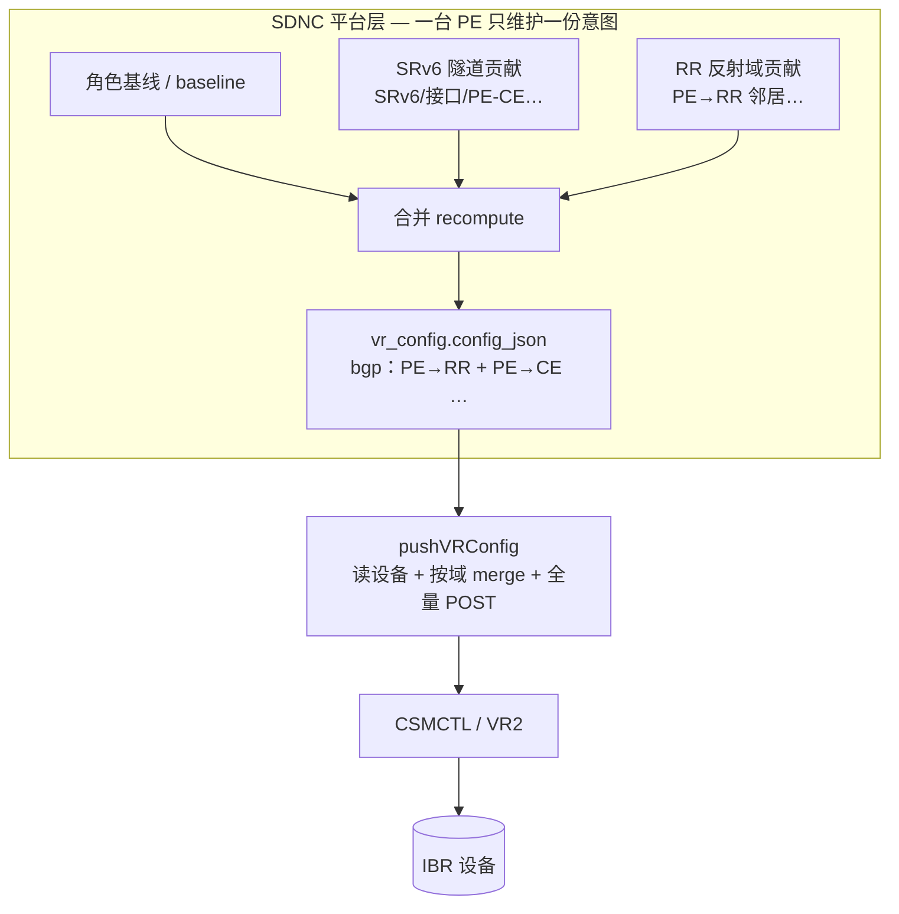
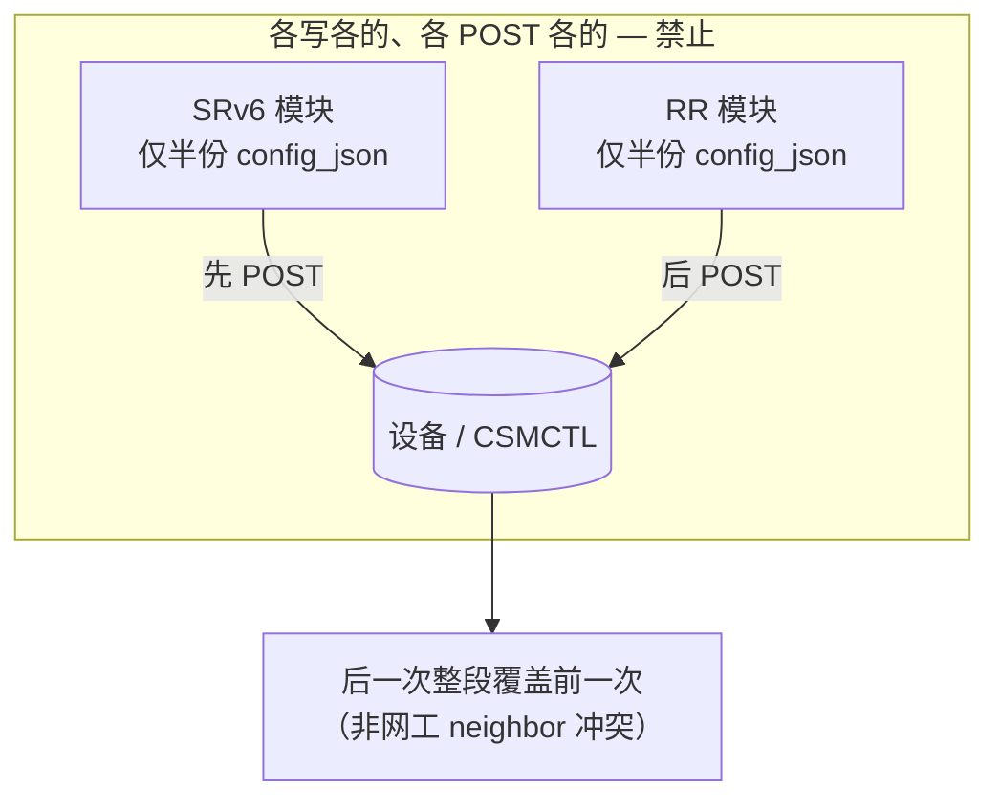
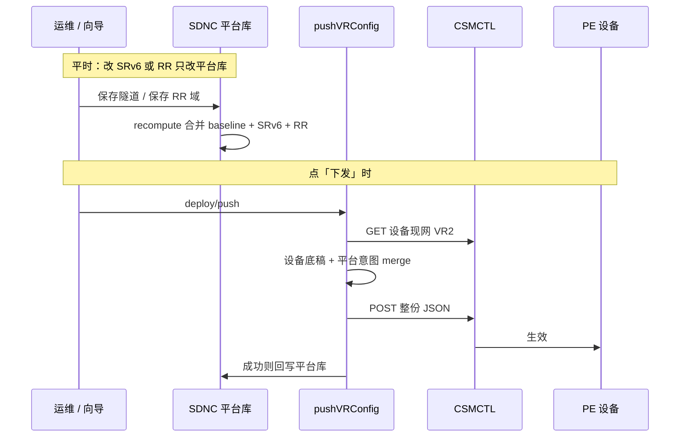
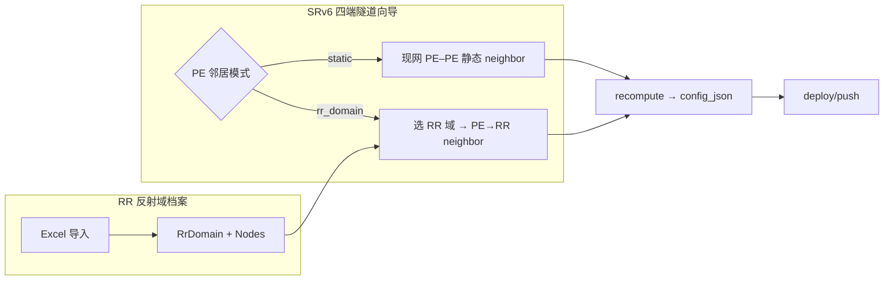

# BGP Route Reflector（RR）与 SRv6 共存 · 设计说明

> **状态**：设计定稿（研发/网工对齐用）；**RR 反射域一期已落地**（档案 CRUD/导入、SRv6 `rr_domain`/`static` 引用、双 RR 全量建邻）。  

> **读者**：产品、网工、研发。  
> **关联**：[`ibr-vr-config-deploy.md`](./ibr-vr-config-deploy.md)（全量 POST / 分域 merge）、[`srv6-baseline-recompute.md`](./srv6-baseline-recompute.md)（baseline + Σcontrib）、[`srv6-hub-pe-spec.md`](./srv6-hub-pe-spec.md)（Hub–Spoke 与 RR 区别）、HA 方案二见 `docs/网际路由SRV6 高可用方案.docx`。

---

## 1. 文档目的

记录 SDNC 控制器侧关于 **BGP Route Reflector（路由反射器，下称 RR）** 的产品定义，以及 RR 与现有 **SRv6 隧道 / 隧道内 BGP** 如何 **共存、合并、下发**，避免：

- 误以为「上了 RR 就不用 SRv6 隧道」；
- 误以为 Hub–Spoke 等于 RR；
- 两个模块各写各的 `bgp` 后 **全量 POST 互相覆盖**。

---

## 2. 术语

| 术语 | 含义 |
|------|------|
| **RR** | BGP Route Reflector；帮多台 PE **反射 iBGP 路由**，省全互联 |
| **RR Client** | 向 RR 建 iBGP、接收反射路由的 PE |
| **SRv6 隧道** | 平台「一条业务隧道」对象；含四端/Hub–Spoke 选型、SID、**按链路的 BGP 邻居** 等 |
| **平台意图** | SQLite `vr_config.config_json`（及 SRv6 隧道档案）；下发前与设备 merge 的权威副本 |
| **全量 POST** | CSMCTL / VR2 更新接口：每次提交 **整份 JSON**，非 PATCH |
| **recompute** | SRv6：`baseline + Σ(各隧道 injectedDelta)` 合成一台 PE 的有效配置 |

---

## 3. 控制器需求清单 · 实现对照（摘要）

| # | 需求 | 状态 | 说明 |
|---|------|------|------|
| 1 | 健康巡检 + 拓扑架构展示 | 一期部分 | 单 VR Console 巡检已有；SRv6：隧道级 **live** 巡检（BGP 公网/私网邻居、SRv6 数据面、CE A → CE B 可达性）+ **Hub 多隧道架构拓扑** |
| 2 | SSO 登录 VR + Ping | 一期已做 | 嵌入 IBR Console + 健康巡检内 Ping（`VrConsolePingPanel`）；不另做列表级独立 Ping |
| 3 | HA 配置交互下发 | 一期已做 | HA 向导 + `vrrpIntent` 落库 + `POST /api/ibr-ha-groups/:id/deploy`（定点 merge → CSMCTL） |
| 4 | RD/RT 手工指定 | 一期已做 | 确认步「自动 / 手工」；格式 `数字:数字`；REUSE 后续锁定 Hub RD+RT，仅 Spoke RD 可改；后端档案解析校验 |
| 5 | **RR 组网整体下发** | **一期已做** | 反射域档案 + SRv6 引用注入 RR neighbor；随隧道 deploy/push 下发 |
| 6 | 管理 IP 上报 → router-id | 一期已做 | 上报写 `managementIp`；若已有公网 `bgp` 则填空/跟随旧管理 IP 写 `router_id`（只改平台库，不因心跳 push） |
| 7 | BGP/隧道/VRRP 上报蓝鲸/工单 | 未做（规格草案） | 对接形态=**告警**；工单=**蓝鲸流程**；节奏=**状态变更事件**；优先 **VRRP / BGP 邻居**；接口待 CSM·云堤·蓝鲸侧对齐 |
| 8 | 隧道状态 + 流量计数 | 一期部分 | IPsec 列表有状态/流量；SRv6 列表增**配置健康**（`?includeHealth=1` 去重 reconcile）；SRv6 **无**隧道级流量（设备未上报）；Console IPsec SA 已露 child 流量列 |

---

## 4. RR 是什么 · 面向谁

### 4.1 能力边界

- **RR**：控制面能力，让域内多台 PE **通过 RR 交换 BGP 路由**，而不必 PE 之间 full-mesh iBGP。
- **SRv6 隧道**：数据面 + **按隧道** 的链路/邻居配置（segment、SID、PE–PE / PE–CE BGP 等）。

**RR 不替代 SRv6 隧道**；二者层次不同，通常 **一起用**。

### 4.2 角色归属

| IBR 角色 | 与 RR 的关系 |
|----------|----------------|
| **PE / HUB_PE / SPOKE_PE** | RR 节点或 RR Client 的候选实例 |
| **CE / 标准** | **不编入 RR 拓扑**；边缘 VRRP 见 HA 组（[`haGroupWizardLib`](../frontend/src/pages/sdncc/ibr/ha-groups/haGroupWizardLib.ts)） |

### 4.3 与 Hub–Spoke SRv6 的区别

| | Hub–Spoke SRv6（已有） | BGP RR（一期已落地） |
|--|------------------------|----------------|
| 建模单位 | **一条 SRv6 隧道** | **一个 RR 反射域** |
| 拓扑 | Hub PE 上 **每 Spoke 一条隧道、一个公网 neighbor** | 域内 PE 连 **RR**，由 RR **反射** 路由 |
| 文档 | [`srv6-hub-pe-spec.md`](./srv6-hub-pe-spec.md) | 本文档 |

Hub 在业务上像「星型汇聚」，**不等于** BGP RR 协议；勿混用名词。

### 4.4 网工定稿 · RR 模式下的四端 SRv6 隧道（2026-07-13）

**结论（网工确认）**：域内采用 **BGP RR** 时，四端隧道里的 **PE 不与对端 PE 直连 BGP 邻居**，而是 **PE 只与 RR 反射器建邻居**；VPN/单播路由经 RR 反射，**不存在「隧道 PE–PE neighbor」与「RR neighbor」抢同一地址、语义冲突** 的问题。

| 对象 | RR 模式下谁和谁建 BGP 邻居 |
|------|---------------------------|
| **PE** | → **RR**（iBGP）；**不** → 对端 PE（四端公网 PE–PE 邻居） |
| **CE** | → 本侧 **PE**（与现网一致，隧道内网段） |
| **RR** | ← 各 **PE Client** |

对 SDNC 的含义：

1. **SRv6 隧道 contrib**（RR 域已启用时）：侧重 **SRv6 数据面**（接口、SID、`ipv6_route` 等）+ **PE–CE**；**不应再**按现网逻辑注入 **PE–PE 公网 `neighbor`**。
2. **RR 反射域 contrib**：各 PE 上 **PE → RR** 的 neighbor + reflect 相关参数。
3. **neighbor 清单分工明确**，网工视角 **无覆盖冲突**；平台仍须 **一份 `config_json`、一次 recompute、一次 POST**（见 §6），那是 **工程合并**，不是因为有 duplicate neighbor 打架。

> **现网代码注意**：当前 SRv6 向导仍会注入 PE–PE 公网 neighbor（`injectNeighborsForPEPeer`）。RR 模式落地时须 **按本约定改隧道 contrib 生成逻辑**，否则与网工设计不一致。

---

## 5. SRv6 隧道 BGP 与 RR · 是否冲突

### 5.1 现网实现（非 RR 模式 · 点对点 / Hub–Spoke）

每条 SRv6 隧道会在 PE 上注入（见 `frontend/src/pages/sdncc/ibr/srv6/Create.tsx`、`backend/src/routes/sdn/srv6.merge.ts`）：

| 位置 | 内容 |
|------|------|
| **PE ↔ PE（公网 `bgp[0]`）** | 对端 **公网 IPv6** 为 `neighbor`；IPv4 VPN AF + `activate_address_family` |
| **PE ↔ CE（内网 VRF）** | 内网 neighbor |
| **Hub 多 Spoke** | 同一 Hub 的 `bgp[0]` 上 **叠加多个 Spoke neighbor**（C-H1：对端 Spoke 公网唯一） |

这是 **「这条隧道 / 这条链路」** 上的 **PE 直连对端 PE**，不是 RR 反射域。

### 5.2 RR 模式（网工定稿 · 见 §4.4）

采用 RR 时：**PE 只连 RR，不连对端 PE**。隧道仍负责 SRv6 转发与 **PE–CE**；**控制面 VPN 路由走 RR**。

因此 **不存在**「同一 PE 上既要写隧道 PE–PE neighbor、又要写 RR neighbor 且互相抢同一对端」的网工层冲突。

### 5.3 平台层 · 仍须合并下发（与 neighbor 冲突无关）

CSMCTL 仍是 **全量 JSON POST**（[`ibr-vr-config-deploy.md`](./ibr-vr-config-deploy.md)）。平台侧约定不变：

- **一台 PE、一份** `vr_config.config_json`：`baseline + ΣSRv6 + ΣRR` **recompute 后一次下发**。
- **禁止** SRv6 模块与 RR 模块 **各持半份 `bgp`、各 POST 一次**——那会整段 **覆盖** 对方写入的其它 key（不限于 neighbor），属于 **错误集成**，不是 RR 与隧道在网工上的 neighbor 冲突。

SRv6 建隧道时的 **409**（C-N1 / C-H1）仍只拦 **隧道 vs 隧道** 的重复 neighbor。

---

## 6. 配置合并 · 正确架构（核心）

本节 **Mermaid 图**（需支持 Mermaid 的 Markdown 预览）：

| 小节 | 图 |
|------|-----|
| [§6.2](#62-正确架构总览流程图) | 平台 recompute 合并总览（flowchart） |
| [§6.3](#63-错误架构互相覆盖禁止) | 错误双 POST 覆盖（flowchart） |
| [§6.6](#66-下发序列图) | 保存 vs 下发时序（sequenceDiagram） |

### 6.1 一台 PE、一份平台 `config_json`

```text
现在：  baseline + Σ(各 SRv6 隧道 contrib)  →  vr_config.config_json  →  deploy/push
将来：  baseline + Σ(各 SRv6 隧道 contrib) + Σ(RR 反射域 contrib)  →  同一份 config_json  →  deploy/push
```

RR 是 **多一块 Σ(RR)**，不是另开一条直写 CSMCTL 的并行通道（须遵守 [`ibr-vr-config-deploy.md`](./ibr-vr-config-deploy.md) §4 / §5 边界）。

### 6.2 正确架构总览（流程图）



### 6.3 错误架构（平台各 POST 半份配置，禁止）

网工已确认 RR 模式下 **neighbor 职责不重叠**；下图说的是 **研发/integration 错误**：两个模块 **未 recompute 合并** 就 **先后全量 POST**，导致整段 `bgp` 或其它 key 被后一次盖掉。



### 6.4 概念结构（一台 PE · RR 模式）

```text
PE-1  config_json（平台 recompute 后 · RR 模式）
├── interfaces / ipv6_route / SRv6 相关 …     ← SRv6 隧道（数据面；无 PE–PE BGP 邻居）
├── bgp
│   ├── [0] 或 RR 约定 index                  ← RR contrib：neighbor → RR1, RR2…
│   └── [内网 VRF]                              ← SRv6：neighbor → CE
└── acl / nat / ipsec …
```

合并规则（RR 模式落地时）：

1. **SRv6 隧道**：绑定 RR 域时 **跳过** PE–PE 公网 neighbor 注入；保留 PE–CE、SRv6 路由/SID。
2. **RR 域**：仅写入 **PE → RR** neighbor 与 reflect 相关字段。
3. **neighbor 去重**：同一 `bgpIndex` + 同一 `remote_ip` 仍须平台校验（防配置误重复）。
4. **eject / recompute 分域**：删隧道只摘 SRv6 contrib；删 RR 域只摘 RR contrib。

### 6.5 文字版对照

**错误（平台未 merge、两次 POST）：**

```text
SRv6 模块 ──POST──► CSMCTL   （半份 JSON）
RR   模块 ──POST──► CSMCTL   （另半份 JSON）  → 后一次整段覆盖前一次
```

**正确（RR 模式 · 网工 neighbor 分工 + 平台一次 merge）：**

```text
SRv6 contrib（无 PE–PE neighbor，有 PE–CE + SRv6）
RR   contrib（PE → RR neighbor）
        ──┼──► recompute ──► 一份 config_json
            └──► pushVRConfig ──► CSMCTL 一次 POST
```

### 6.6 下发序列图

保存与下发分两阶段：**平时只写平台库并 recompute**；**点下发**才走 `pushVRConfig` → CSMCTL。



文字版（与上图等价）：

```text
运维保存 SRv6 / RR  →  仅写平台库 + recompute
运维点击「下发」    →  pushVRConfig
                       ├ GET 设备现网（VR2）
                       ├ merge（srv6 域或未来 rr 域 / 统一 recompute 结果）
                       ├ [可选] 漂移检测
                       └ POST 整份 JSON → CSMCTL → 回写平台库
```

---

## 7. 产品规格 · RR 反射域与 SRv6 集成（2026-07-13 需求对齐）

> **状态**：产品/网工对齐稿；**未实现**。对端 RR 信息 **无北向 API**，仅 **线下 Excel + 平台档案**。

### 7.1 业务背景

| 事实 | 说明 |
|------|------|
| **对端 RR 控制器** | 客户侧 RR 的邻居相关参数由客户网工 **线下提供**（如 Excel）；信息 **基本固定**，**无查询接口** |
| **平台职责** | 维护 **RR 反射域** 档案（可导入/编辑），供建隧道时 **引用** |
| **SRv6 四端隧道** | PE 侧邻居 **二选一**：关联 RR 反射域 **或** 沿用现网 **静态 PE–PE 邻居**（人工设定） |

### 7.2 平台对象 · RR 反射域（`RrDomain`）

**菜单**：IBR 管理 → **RR 反射域**（独立列表，非 SRv6 子页）。

| 字段（域级） | 说明 |
|--------------|------|
| `id` / `name` | 域标识（slug，唯一） | `域标识` |
| `displayName` | 域显示名 | `域名称` |
| `description` | 备注、客户/线路说明 | `域备注` |
| `remote_as` | **域级对端 ASN**（该域 RR 侧 AS；Excel 提供，建邻时 **跟 RR 域走**） |
| `local_as` | **域级本端 ASN**（可选；缺省时可从本端 PE 角色基线读，**以网工 Excel 为准**） |
| `source` | `manual` \| `excel_import` |
| `status` | `active` \| `archived` |
| `updated_at` | 最近维护时间 |

**子表 · RR 节点（对端反射器清单）** `RrDomainNode` — 一条即客户 RR 控制器上的一个可连邻居：

| 字段 | 说明 | Excel 列名 |
|------|------|------------|
| `rr_name` | 节点名称/别名 | `RR名称` |
| `neighbor_address` | PE 建邻用的 **对端地址**（IPv4/IPv6） | `邻居地址` |
| `remote_as` | 节点级对端 ASN（可选；**缺省继承域级 `remote_as`**） | `对端ASN` |
| `local_as` | 节点级本端 ASN（可选；**缺省继承域级 `local_as`**） | `本端ASN` |
| `cluster_id` | BGP cluster-id（若需要） | `ClusterID` |
| `router_id_hint` | 对端 router-id 提示（可选，文档用） | `RouterID` |
| `priority` | 主/备 RR **排序/展示**（1=主）；**建邻时不省略**，见 §7.3.1 | `优先级` |
| `remark` | 备注 | `备注` |

**不做**：对接客户 RR 控制器的自动同步 API（明确 **Out of Scope**）。

**导入**：支持 Excel/CSV 上传 → 校验列 → 预览 → 写入/更新域；平台提供 **下载模板**（见 §7.6）。

### 7.6 通用 Excel/CSV 导入模板（草案 v1）

> **模板文件**：[`docs/templates/rr-domain-import-template.csv`](./templates/rr-domain-import-template.csv)（UTF-8，Excel 可直接打开；平台实现时可另导出 `.xlsx` 并附「填写说明」Sheet，**列名与下表一致**）。

#### 7.6.1 版式 · 单 Sheet、扁平行

- **一行 = 一个 RR 节点**；同一 **域标识** 的多行合并为一个 `RrDomain` + 多条 `RrDomainNode`。
- **域级列**（`域标识`～`域级本端ASN`）在同一域的多行上 **应一致**；导入时以 **该域首行** 为准，后续行若域级字段不同则 **预览阶段告警**（默认拒绝导入，可配置「以首行为准忽略差异」）。
- **不要** 合并单元格；不要改列名（大小写、全半角按模板）。

#### 7.6.2 列定义

| 列名 | 必填 | 映射字段 | 格式 / 说明 |
|------|:----:|----------|-------------|
| `域标识` | 是 | `RrDomain.name`（slug） | 英文/数字/连字符，**全局唯一**；如 `customer-a-bj`；用作平台内部键与 SRv6 下拉引用 |
| `域名称` | 是 | `RrDomain.displayName` | 中文或英文显示名 |
| `域备注` | 否 | `RrDomain.description` | 客户、线路、维护窗口等 |
| `域级对端ASN` | 是 | `RrDomain.remote_as` | 正整数；该域 RR 侧 AS；**建邻默认跟此值** |
| `域级本端ASN` | 否 | `RrDomain.local_as` | 正整数；缺省时实现可从本端 PE 角色基线补，**以 Excel 为准优先** |
| `RR名称` | 是 | `RrDomainNode.rr_name` | 节点别名，域内 **不可重复** |
| `邻居地址` | 是 | `RrDomainNode.neighbor_address` | IPv4 或 IPv6；**客户提供的 PE 可达地址**（公网、Loopback、VRF 内地址均可，由网工填实际建邻地址） |
| `对端ASN` | 否 | `RrDomainNode.remote_as` | 正整数；**留空则继承 `域级对端ASN`** |
| `本端ASN` | 否 | `RrDomainNode.local_as` | 正整数；**留空则继承 `域级本端ASN`**（再缺省才走 PE 基线） |
| `ClusterID` | 否 | `RrDomainNode.cluster_id` | 如 `1.1.1.1` 或整数；设备/CSM 若不需要则留空 |
| `RouterID` | 否 | `RrDomainNode.router_id_hint` | **仅档案/运维参考**，不参与自动下发 |
| `优先级` | 否 | `RrDomainNode.priority` | 正整数，默认 `1`；主 RR 填 `1`、备 RR 填 `2`；**建邻时主备均建**，见 §7.3.1 |
| `备注` | 否 | `RrDomainNode.remark` | 节点级说明 |

#### 7.6.3 填写示例（与模板文件一致）

| 域标识 | 域名称 | 域级对端ASN | 域级本端ASN | RR名称 | 邻居地址 | 优先级 |
|--------|--------|-------------|-------------|--------|----------|--------|
| `customer-a-bj` | 客户A-北京RR域 | 65001 | 65000 | RR-BJ-Primary | 203.0.113.10 | 1 |
| `customer-a-bj` | 客户A-北京RR域 | 65001 | 65000 | RR-BJ-Backup | 203.0.113.11 | 2 |
| `customer-b-sh` | 客户B-上海RR域 | 65100 | 65000 | RR-SH-01 | 2001:db8::1 | 1 |

#### 7.6.4 导入校验（平台实现）

| 规则 | 失败提示（示例） |
|------|------------------|
| 表头必须包含 §7.6.2 全部列名 | 「缺少列：域级对端ASN」 |
| `域标识` + `RR名称` 在文件内唯一 | 「域 customer-a-bj 下 RR 名称重复」 |
| `邻居地址` 合法 IP，域内不重复 | 「邻居地址 203.0.113.10 重复」 |
| ASN 字段若填写须为正整数 | 「域级对端ASN 无效：abc」 |
| 同一 `域标识` 至少一行 | 「域 customer-x 无 RR 节点」 |
| 更新策略（待 UI 选项） | **按 `域标识` upsert**：存在则替换该域及全部节点；不存在则新建 |

#### 7.6.5 给网工的一页说明（可随模板导出）

1. 一个反射域有多台 RR（主备）时，**每个 RR 占一行**，`域标识` 相同。
2. **ASN 以域为准**：多数场景只填 `域级对端ASN` / `域级本端ASN`，节点 ASN 列留空即可。
3. **双 RR 都要填**：主、备各一行；平台会对 **每一行** 生成 PE→RR neighbor。
4. `邻居地址` 填 **PE 实际用来建 BGP 会话的地址**，类型由现场决定（O-2 待网工统一口径前，模板 **不限制** 公网/Loopback）。
5. 不要删除表头行；数据从第 2 行起填写。

### 7.3 SRv6 四端隧道 · PE 邻居模式（与现网并存）

在 **PE-A / PE-B** 配置区（或隧道级统一策略）增加 **邻居构建方式**：

| 模式 | 值 | 行为 |
|------|-----|------|
| **关联 RR 反射域** | `rr_domain` | 从下拉选择 §7.2 档案；按域内 RR 节点生成 **PE → RR** neighbor；**不**注入 PE–PE 公网 neighbor（§4.4） |
| **静态配置** | `static` | **现网逻辑**：人工/表单指定 PE–PE 公网 neighbor、`activate_address_family` 等 |

约束（**网工定稿**）：

- **PE-A 与 PE-B 不要求同一 RR 域**：两侧可各选不同 `rrDomainId`（客户对端 RR 不同时）。
- **ASN 跟所选 RR 域走**：建邻时 `remote_as` / `local_as` 取自 **该 PE 所选域**（域级为主，节点级可覆盖）；**不**混用另一域或未选域的 ASN。
- 选 `rr_domain` 时 **必填** 本端 `rrDomainId`；选 `static` 时 **不得** 注入 RR 域 neighbor。
- 隧道档案持久化：`peANeighborMode` / `peBNeighborMode`、`peARrDomainId` / `peBRrDomainId`（分端独立）。

#### 7.3.1 双 RR · 全量建邻（网工定稿）

一个 RR 反射域内若有 **多台 RR 节点**（如主备双 RR），本端 PE 在 `rr_domain` 模式下应对 **域内每一条 `RrDomainNode` 均建立 neighbor**（主、备都建），**不是** 仅连 `priority=1` 的一台。

生成 contrib 时：

```text
foreach node in selectedRrDomain.nodes:
  neighbor.push({ remote_ip: node.neighbor_address, remote_as: node.remote_as ?? domain.remote_as })
```

`priority` 仅用于 UI 排序、运维说明或后续策略扩展，**不** 用于「只建主 RR」。



### 7.4 页面与 API（一期已落地）

| 能力 | 前端 | 后端 |
|------|------|------|
| RR 域 CRUD | `pages/sdncc/ibr/rr-domains/` | `GET/POST/PATCH/DELETE /api/networks/rr-domains` |
| Excel 导入 | 上传 + 预览 Modal | `POST /api/networks/rr-domains/import` |
| 隧道引用 | `srv6/Create.tsx` PE-A/PE-B 各自：模式 + RR 域下拉 | 隧道实体 `peA/BNeighborMode`、`peA/BRrDomainId`；contrib 按域生成 **全量 RR neighbor** + ASN |
| 下发 | 仍走 SRv6 `deploy/push` | recompute 合并 RR 引用 + 隧道 delta |

**不再要求** 独立「RR 五步向导 + 单独选本端 PE 当 RR 节点」作为 **一期** 能力；一期重点是 **档案 + SRv6 引用**。本端若作 RR Client，邻居 **对端地址来自档案**，本端 PE 实例仍来自隧道四端选型。

### 7.5 与 RD/RT、router-id、蓝鲸

- **RD/RT（需求 4）**：RR 域档案 **不含** RD/RT；仍由 SRv6 隧道向导/继承逻辑负责。
- **router-id（需求 6）**：本端 PE 仍可用 `management_ip`；对端 RR 的 `router_id_hint` 仅档案/运维参考。
- **蓝鲸（需求 7）**：见下一节（规格草案；RR 域本身不上报）。

---

## 7.6 需求 7 · 蓝鲸告警 / 工单闭环（规格草案 · 2026-07-14）

> **状态**：产品意图已对齐；**接口未定**，本仓 **不实现**。需与 **CSM / 云堤 / 蓝鲸** 三方定契约后再开工。  
> 本仓库 `csm-controller` **未检索到** 现成蓝鲸/云堤告警对接代码；若云堤侧已有对接，须拿到**对方接口文档或样例**再设计 SDNC 适配层。

### 已定稿

| 议题 | 决议 |
|------|------|
| 对接形态 | **告警**（不做 CMDB 主路径，亦不先做自定义插件/ESB） |
| 工单 | **蓝鲸自身流程服务**（异常告警触发/关联工单；状态回写跟蓝鲸流程） |
| 推送节奏 | **状态变更事件**（非周期全量对账推送） |
| 优先上报对象 | **① VRRP 状态**、**② BGP 邻居状态**；隧道等其它对象待现网再确认 |

### 采集 vs 告警（分工，避免混为一谈）

| 层 | 职责 | 是否等于「VR 发蓝鲸告警」 |
|----|------|---------------------------|
| **设备 / `vrctl.agent`** | 上报**事实状态**（BGP neighbor、VRRP 等）；长期主路径走南向 `/V2/vrcontrol`，需 **扩展上报字段/契约** | **否** |
| **平台（SDNC / CSM / 云堤）** | 相对上次快照做**变更检测**，调用**蓝鲸告警 API**，再进蓝鲸流程开单 | **是（告警发出点）** |

- Console 现有拉取（`forwarding/bgp/summary`、`forwarding/vrrp`）只适合运维点检，**不作为**无人值守告警主数据源。  
- **不要求** VR 单独开发「往蓝鲸打告警日志」特性；设备侧增量集中在 **agent 状态上报扩字段**。  
- 本仓 `csm-controller` 未见现成蓝鲸对接；若云堤已有通道，优先复用其告警出口，SDNC 只保证状态可见/可归并。

### 逻辑链路（目标）

```text
VR / vrctl.agent 周期或变更上报（扩字段：VRRP、BGP neighbor …）
  → CSM（/ 云堤）落状态
  → 平台检测「相对上次」变更（去抖）
    → 蓝鲸告警 API
      → 蓝鲸流程开单 / 关单 / 流转
        →（可选）工单号回写 SDNC 展示
```

### 仍待三方对齐（阻塞实现）

1. **告警接入点**：蓝鲸监控/告警中心的事件 API（路径、鉴权、字段表、幂等键）。  
2. **与云堤 / CSM 的分工**：状态归并与谁调蓝鲸——是否复用云堤已有告警通道。  
3. **agent 上报契约**：VRRP / BGP neighbor 字段形状、上报频率、与现有 VR3/心跳如何合并。  
4. **关联键**：告警挂蓝鲸主机/业务（候选：`vr_uuid`、管理 IP；VRRP 附 HA 组 / VRID；BGP 附 neighbor + AS）。  
5. **变更判定**：如 Master↔Backup、Established↔Idle 与去抖窗口。  
6. **工单回写**：蓝鲸流程回调 / 查询；SDNC 是否落库展示。

### 实现前置条件（Checklist）

- [ ] 拿到蓝鲸告警事件 API（或云堤已有包装接口）  
- [ ] 明确 CSM/云堤是否已对接蓝鲸及可复用范围  
- [ ] 定 agent/CSM **状态上报扩字段**（VRRP、BGP neighbor）规格  
- [ ] 定「变更」判定与去抖  
- [ ] 定关联键映射表（设备字段 → 蓝鲸主机）  
- [ ] 再开平台侧开发；**设备侧不另做蓝鲸告警客户端**；此前仅 Console 只读

---

## 8. 给网工 / 产品的三条硬约定

1. **一台 PE、一份平台 `config_json`**：SRv6 与 RR 都只 **追加 contrib**，禁止各 POST 一整份 `bgp`。
2. **对 CSMCTL 永远一次全量 POST**：未 merge 的后下发 = **覆盖**。
3. **Hub–Spoke ≠ RR**：Hub 隧道继续走 SRv6 规格；RR 走独立反射域。

---

## 9. 实现检查清单（RR 一期）

- [x] Excel 模板列定义（§7.6；样表 [`docs/templates/rr-domain-import-template.csv`](./templates/rr-domain-import-template.csv)）
- [x] 数据模型：`RrDomain` + `RrDomainNode`（对端 RR 档案，非本端 IBR 实例）
- [x] RR 域 CRUD + 导入 API + 列表页（导出可后续增强；删除前检查隧道引用）
- [x] SRv6 隧道：`peNeighborMode`（`rr_domain` \| `static`）+ `rrDomainId` 持久化
- [x] `rr_domain` 分支：域内 **所有 RR 节点** 均建 neighbor；ASN **跟所选域**（§7.3.1）
- [x] PE-A / PE-B **可分选不同 RR 域**（`peARrDomainId` / `peBRrDomainId`）
- [x] `static` 分支：保持现网 PE–PE 注入逻辑
- [x] recompute：baseline + ΣSRv6（含模式分支）→ 单 PE `config_json`
- [x] deploy：仍 `srv6/deploy/push` + `pushVRConfig`
- [x] RBAC：`networks.rr-domains:read/write`

---

## 10. 待决问题

| ID | 问题 | 状态 |
|----|------|------|
| O-1 | RR 模式下四端隧道 **PE 是否与对端 PE 建 BGP 邻居** | **已决**：**否**；PE 只连 RR（§4.4） |
| O-2 | RR **neighbor_address** 用 loopback / 公网 / 其它 | **模板 v1 不限制**；列 `邻居地址` 填现场可达 IP（§7.6.2）；网工可后续统一口径 |
| O-3 | PE-A 与 PE-B **是否必须** 选同一 RR 域 | **已决**：**否**；可分端选域；**ASN 跟各自所选 RR 域**（§7.2–§7.3） |
| O-4 | 双 RR **是否都建 neighbor** | **已决**：**是**；域内 **全部 RR 节点** 均建邻（§7.3.1） |
| O-5 | 是否与 CSMCTL / 设备 **route-reflector** JSON 字段对齐 | 研发 + 网工 |

---

## 11. 变更记录

| 日期 | 说明 |
|------|------|
| 2026-07-13 | 初版：RR 定义、与 SRv6/Hub 区别、config_json 合并与全量 POST 覆盖风险、交互与 API 草案、需求清单摘要 |
| 2026-07-13 | 补充 §6.2 / §6.3 Mermaid 流程图（正确 merge 与错误覆盖）、§6.6 下发序列图 |
| 2026-07-13 | **网工定稿 §4.4**：RR 模式下 PE 只连 RR、四端隧道不注入 PE–PE neighbor；修订 §5–§6 冲突/覆盖表述 |
| 2026-07-13 | **§7 产品规格**：对端 RR 线下 Excel 档案、RR 反射域 CRUD、SRv6 四端 `rr_domain` / `static` 双模式 |
| 2026-07-13 | **§7.3.1**：PE-A/B 可分域、ASN 跟 RR 域；双 RR **全量建邻** |
| 2026-07-13 | **§7.6**：通用 RR 域 Excel/CSV 导入模板 v1 + 样例文件 |
| 2026-07-14 | 一期落地勾选：档案/导入/SRv6 引用/确认页摘要；文档状态改为已实现 |
| 2026-07-14 | 需求 6：管理 IP 上报绑定公网 `bgp.router_id`（填空/跟随）；PE/CE 向导空值预填 |
| 2026-07-14 | 需求 1：SRv6 列表健康巡检接四端 reconcile；拓扑改为 Hub 多隧道架构图（去掉单条四端复读） |
| 2026-07-14 | 需求 8：SRv6 列表 `includeHealth` 配置健康列；流量列标明无源；Console IPsec SA 露出字节/报文 |
| 2026-07-14 | 需求 4：SRv6 向导确认步支持 RD/RT 手工指定（REUSE 锁定 Hub）；前后端 `A:B` 校验 |
| 2026-07-14 | 需求 2：确认以 IBR Console 内 Ping 为准，不另做独立入口 |
| 2026-07-14 | 需求 7：蓝鲸对接草案——告警 + 蓝鲸流程 + 状态变更事件；优先 VRRP/BGP；接口待 CSM/云堤/蓝鲸对齐 |
