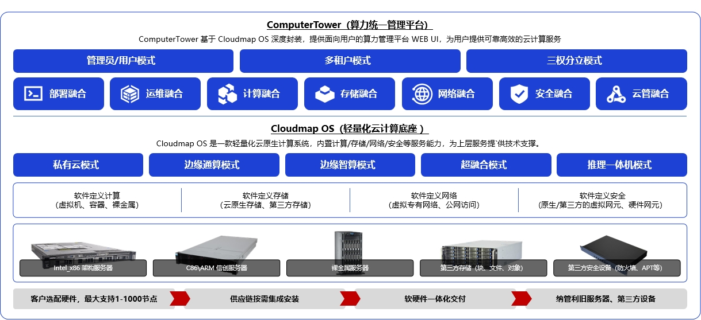
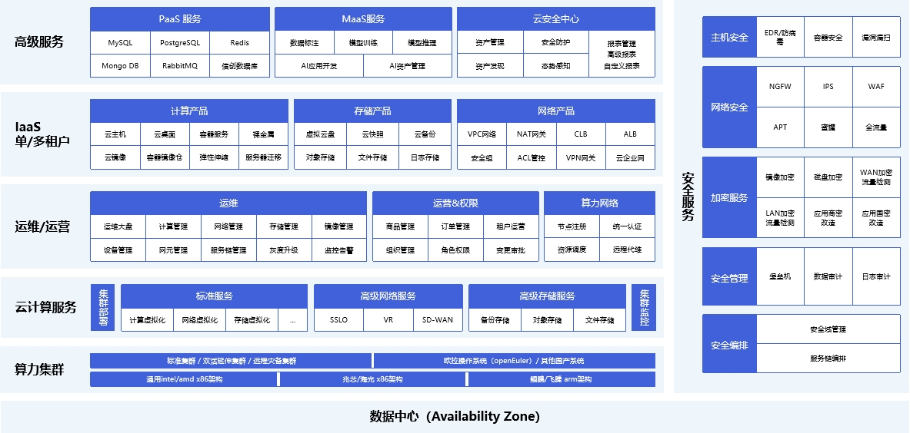

# 2. 产品架构

Cloudmap 采用**轻量化云原生、软硬协同、统一管控**的分层架构设计，整体分为**底层基础设施、Cloudmap OS 资源底座、ComputerTower 管控平台、业务应用层**四大层级，构建从硬件到应用、从边缘到数据中心的一体化超融合体系，实现**资源池化、能力模块化、运维一体化、安全内生化**。

## 2.1 总体架构设计

Cloudmap 总体架构遵循**「一核两翼、分层解耦、全域协同」**的设计原则，以 Cloudmap OS 为核心，向上通过 ComputerTower 提供统一管控，向下兼容多元硬件，横向覆盖全场景部署形态。

**图 2-1 Cloudmap 总体架构**

### 底层基础设施层

全面兼容 **x86、鲲鹏、海光、飞腾、龙芯** 等异构 CPU 服务器，适配通用、高性能、全闪、GPU 智算等多类型硬件；支持本地盘、分布式存储、第三方 SAN/NAS 混合接入，满足不同性能、容量、成本诉求。硬件层支持**单节点、多节点集群、异构混合集群**等多种组网模式，覆盖边缘、分支、区域、数据中心全场景。

### Cloudmap OS 资源底座层

作为平台**核心引擎**，Cloudmap OS 是轻量化云原生超融合操作系统，内置**软件定义计算、软件定义存储、软件定义网络、内生安全**四大核心能力：

- **计算虚拟化**：统一调度虚拟机、容器、裸金属、云桌面、AI 推理等多元算力，支持一云多芯、硬件直通、资源动态调度；
- **统一存储**：构建分布式统一存储池，提供块、对象、文件三类存储服务，支持全闪加速、多副本冗余、快照克隆、跨集群复制；
- **软件定义网络**：支持公共子网、扁平子网、VPC、直通网络，集成边界服务、安全组、流量编排、跨站点互联；
- **内生安全**：构建管理/业务/安全三网隔离架构，池化异构安全能力，实现智能流量编排、全栈防护、态势感知。

Cloudmap OS 采用**控制面与数据面分离、分布式集群架构**，控制面高可用、数据面分布式，具备**高性能、高可靠、高弹性、易扩展**特性。

### ComputerTower 管控平台层

基于 Cloudmap OS 封装的**统一可视化管控中枢**，提供 Web 图形化界面，实现**资源管理、运维运营、安全管理、租户服务、监控告警、审计追溯**一体化管理：

- **统一资源管理**：集中纳管计算、存储、网络、安全、裸金属、GPU、云桌面等全栈资源；
- **多租户运营**：支持多租户、多组织、配额管理、权限隔离，适配集团化、多部门分权使用；
- **智能运维**：提供可视化资源大盘、自动化巡检、风险预警、全域日志审计、任务跟踪；
- **安全运营**：内置云安全中心，提供安全资源池、流量编排、态势感知、事件处置；
- **多级管控**：支持中心—区域—边缘三级联动，算网大脑全局调度，边缘自治运行。

### 业务应用层

面向用户提供 **IaaS、PaaS、MaaS、SaaS** 全栈服务，覆盖政企信创、核心数据库、私有云、云原生、云桌面、AI 推理、算力网络、安全办公等全场景业务负载，实现**稳态+敏态**双模 IT 统一承载。

### 部署形态与运营模式

- **五大部署形态**：私有云、边缘通算、边缘智算、全栈超融合、推理一体机，适配不同规模与场景；
- **三种运营模式**：管理员模式、多租户模式、三权分立模式，分别适配单团队运维、多部门自助、等保分权场景；
- **交付路径**：硬件选型 → 集成部署 → 一体化交付 → 利旧纳管 → 平滑扩容，实现快速上线、平滑演进。

## 2.2 功能全景图

Cloudmap 功能全景覆盖**硬件集群、资源虚拟化、统一运维、租户服务、高级增值、安全防护**六大模块，自下而上构建全栈超融合能力矩阵，各模块能力模块化、松耦合、可按需选配、分期建设。

**图 2-2 Cloudmap 功能全景图**

### 硬件集群底座

兼容异构服务器、国产操作系统、第三方存储与安全设备，构建**单节点至千级节点**的标准集群、低时延集群、跨地域容灾集群，为上层提供稳定、可靠、多元的硬件支撑。

### 资源虚拟化层

基于 Cloudmap OS 实现**计算、存储、网络、安全**全虚拟化：

- **计算资源**：虚拟机、容器、裸金属、云桌面、GPU/vGPU 直通；
- **存储资源**：块存储、对象存储、文件存储、全闪加速、快照备份；
- **网络资源**：VPC、扁平网络、直通网络、负载均衡、NAT、EIP；
- **安全资源**：防火墙、WAF、IPS、堡垒机、EDR、漏洞扫描。

### 统一运维运营层

提供**集群管理、租户管理、监控告警、日志审计、权限控制、自动化运维**一体化能力，将分散运维收拢至同一界面，降低运维复杂度、提升管理效率。

### 租户 IaaS 服务层

向租户提供**云主机、裸金属、容器、云桌面、云盘、VPC、负载均衡、弹性公网 IP** 等基础资源，支持配额管理、权限隔离、自助服务，适配多部门分权使用。

### 高级增值服务层

按需叠加 **PaaS 中间件、云数据库、MaaS 大模型、云备份、云安全、云桌面** 等增值服务，与 IaaS 同平台交付，避免多系统拼凑。

### 全栈安全防护层

覆盖**主机防护、边界防护、数据加密、堡垒审计、安全编排、态势感知**，支持国密改造、等保合规、异构安全设备纳管，构建**内生、全域、智能、可控**的安全防护体系。

所有模块均部署于私有化环境，数据本地留存，支持同城双活、异地灾备，满足**数据不出域、安全可控、合规审计**要求；各层能力可按业务阶段分期部署，平滑演进，保护投资。
