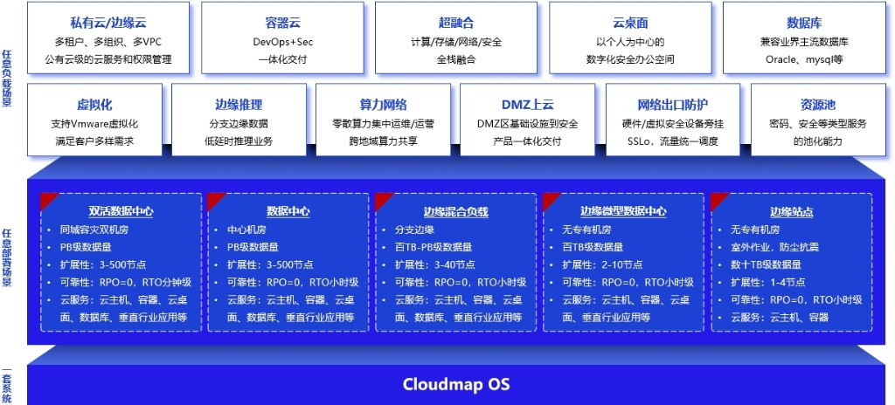

# 8. 典型应用场景

Cloudmap 融合边缘云适用于两类建设需求：一类是业务负载场景，包括私有云、边缘云、容器云、云桌面、数据库、虚拟化迁移、边缘推理、算力网络、DMZ 上云和安全资源池；另一类是部署形态场景，包括中心数据中心、同城双活、区域资源池、园区边缘节点、工业现场节点和微型机房。

**图 8-1 Cloudmap 典型应用场景**

## 8.1 政企信创与合规建设

**场景痛点**：政企客户通常需要在国产化、等保、数据驻留和统一运维之间取得平衡。传统分散建设模式容易形成多个资源孤岛，安全策略和审计口径难以统一。

**解决方案**：Cloudmap 支持一云多芯混合部署，兼容 x86、ARM、LoongArch 等服务器架构，并提供租户权限、网络隔离、国密适配、堡垒审计和安全服务编排能力。中心侧统一管理策略和审计，区域或边缘侧承载本地业务。

**业务价值**：支撑政企国产化替代、私有云整合和边缘节点统一管理，减少多套平台并行建设带来的运维复杂度。

## 8.2 工业与园区边缘云

**场景痛点**：工业现场和智慧园区存在视频流、设备数据、门禁、安防、质检和生产系统等多类数据。业务对低时延、数据不出园区和弱网连续性有要求，单纯依赖中心数据中心处理会增加链路和合规压力。

**解决方案**：在园区或工厂部署轻量边缘节点，承载容器、虚拟机、数据库、视频分析和边缘推理。中心云负责统一策略、镜像、模型、监控和审计，边缘节点在本地完成数据处理和业务响应。

**业务价值**：降低现场业务对远端链路的依赖，提升本地处理效率，并通过统一管理减少多个园区重复运维。

## 8.3 集团/行业专属私有云

**场景痛点**：集团型企业和行业单位通常拥有多个部门、分支机构和业务系统，资源申请、配额、权限、安全策略和账务统计需要统一治理。

**解决方案**：Cloudmap 提供多租户、多组织、多 VPC 隔离、配额和 RBAC 权限管理。中心资源池承担统一门户和治理能力，区域资源池按业务部门或地域承载资源。

**业务价值**：提升资源交付效率，减少部门级重复采购，并为后续边缘节点纳管提供统一入口。

## 8.4 核心数据库与高性能业务承载

**场景痛点**：金融、政务、制造等行业核心业务对 I/O 性能、数据一致性、备份恢复和运维可观测要求较高。

**解决方案**：平台结合高性能分布式存储、NVMe 缓存、RDMA、NUMA 亲和、大页内存和备份策略，为 Oracle、MySQL、达梦等数据库或高 I/O 业务提供资源底座。具体性能指标需以硬件配置和项目压测结果为准。

**业务价值**：在私有化环境中承载关键业务，同时通过统一备份、监控和审计降低运维风险。

## 8.5 传统虚拟化整合与迁移

**场景痛点**：存量 VMware/KVM 环境长期运行后，可能面临许可成本、硬件更新、统一纳管和国产化替代压力。

**解决方案**：Cloudmap 支持对接 vCenter/ESXi 等环境进行资源发现和迁移评估，并结合镜像转换、写时复制、备份校验和割接计划完成迁移。跨架构或复杂业务系统迁移需提前验证驱动、网络、存储和应用兼容性。

**业务价值**：降低存量虚拟化平台整合难度，为统一云管、边缘节点复制和国产化替代奠定基础。

## 8.6 算力网络与边缘计算协同

**场景痛点**：智慧城市、交通、能源、连锁门店等场景的算力分布广、站点数量多、业务类型差异大。资源分散会导致利用率低、运维成本高和故障定位困难。

**解决方案**：通过中心、区域、边缘三级资源体系，将边缘算力纳入统一资源目录。平台根据资源类型、站点位置、数据归属和网络条件提供部署与调度参考，并统一汇聚监控和告警。

**业务价值**：提高分布式算力可见性和复用率，支撑边缘 AI、视频分析、门店业务和现场数据处理等应用规模化复制。

## 8.7 云原生容器应用支撑

**场景痛点**：企业微服务、DevOps 和行业应用希望同时使用容器、虚拟机、存储、网络和安全能力，但多平台割裂会增加交付和排障复杂度。

**解决方案**：Cloudmap 提供容器工作负载、Pod、Job、服务发现、Ingress/Gateway、配置、密钥、镜像仓库和网络策略管理，并与云主机、云盘、负载均衡和安全能力协同。

**业务价值**：让传统应用、云原生应用和边缘应用共用同一资源底座，减少运维工具链割裂。

## 8.8 DMZ 上云与网络边界防护

**场景痛点**：企业 DMZ 区承载公网入口、门户、API、办公接入和第三方互联，既需要弹性资源，也需要审计、隔离和边界防护。

**解决方案**：平台通过 VPC、公共子网、NAT、负载均衡、安全组、WAF、IPS、堡垒机和安全流量编排构建 DMZ 云化方案。安全设备可按项目旁挂或串联部署。

**业务价值**：统一管理网络边界资源和安全策略，降低传统 DMZ 设备分散部署带来的维护难度。

## 8.9 安全办公云桌面

**场景痛点**：远程办公、分支机构和外包协作需要统一桌面环境，同时避免数据分散落地到终端。

**解决方案**：Cloudmap 提供云桌面、远程接入、统一用户、分配管理和审计能力，可按项目对接 Guacamole 等远程访问网关。图形工作站、GPU 桌面和高并发办公桌面需结合硬件规格测算。

**业务价值**：集中管理桌面资源和访问权限，降低终端丢失、越权访问和分散运维风险。

## 8.10 AI 推理与数据智能应用

**场景痛点**：行业客户希望在私有环境或边缘现场使用大模型、视频分析和知识问答能力，同时满足数据安全和低时延要求。

**解决方案**：平台通过 GPU/vGPU、显存切分、模型服务、应用编排和边缘推理节点承载 AI 推理负载。中心侧管理模型目录和策略，边缘侧就近运行推理服务。

**业务价值**：支撑园区视频分析、政务问答、工业质检、设备预测性维护、研发助手和医疗辅助研判等场景，减少敏感数据跨域流转。

## 8.11 部署规模说明

Cloudmap 可按场景选择不同规模：

- **单节点或 1–4 节点边缘站点**：适合轻量业务、现场数据处理、边缘推理和小型云桌面。
- **3 节点及以上资源池**：适合具备高可用要求的园区、分支机构和中小型私有云。
- **区域或中心资源池**：适合多业务混合承载、数据库、高性能存储、云桌面和多租户运营。
- **多可用区部署**：适合对业务连续性和灾备有要求的客户，需同步规划网络、存储复制、备份策略和演练机制。
