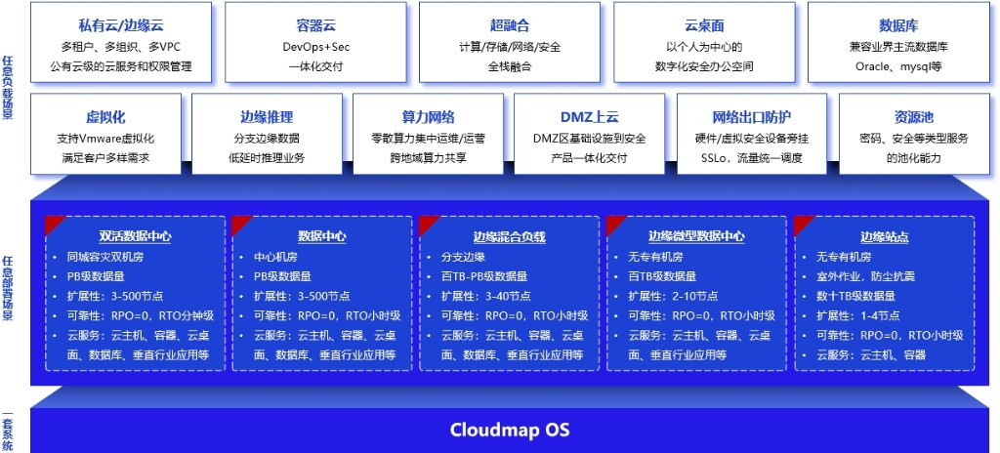

# 9. 典型应用场景

一套 **Cloudmap OS** 支撑两类维度：**任务负载**（见 **9.1**）与 **部署形态**（见 **第 5 章**、**9.2**）。术语释义见 **第 8 章**。

**图 9-1 Cloudmap 典型应用场景**

- **任务负载**：多租户私有云、DevOps 容器、全栈超融合、云桌面、主流数据库、VMware 环境迁移、边缘低时延推理、算力网络统管、DMZ 与安全旁挂、密码/安全资源池化。
- **部署形态**：同城双活（3–500 节点、RPO=0、分钟级 RTO）至无专用机房的边缘站点（1–4 节点）；数据规模从数十 TB 到 PB 级。规模对照见 **9.2**。

## 9.1 全场景业务负载

以下各节采用统一结构：**场景痛点 → 方案要点（引用章节）→ 部署形态 → 业务价值**。能力细节不在此重复，以第 3 章及对应专章为准。

### 9.1.1 政企信创与合规建设

**场景痛点**：国产化替代与等保测评并行，需多架构硬件共存、国密与分权审计可落地。  
**方案要点**：一云多芯混合集群（**3.2.4**、**5.5**）；国密与商密改造、等保自查（**4.2.3**、**4.4.3**）；三权分立与 RBAC（**2.1**、**4.1.2**）。  
**部署形态**：3 节点起步的区域或数据中心集群；可按等保要求分区部署。  
**业务价值**：架构自主可控，合规要求可检查、可审计，利旧设备可渐进纳管。

### 9.1.2 核心数据库高性能承载

**场景痛点**：交易与核心库对 I/O 时延、一致性要求高，传统三层架构运维复杂。  
**方案要点**：分布式存储与全闪加速（**3.3.2**、**3.3.5**）；RDMA 存储网络（**3.3.7**）；虚拟机/裸金属承载 Oracle、MySQL、达梦等。  
**部署形态**：存算分离或全闪超融合集群，建议 3 节点以上。  
**业务价值**：关键库集中运维，性能可随节点扩展，备份与容灾策略见 **3.9**、**3.16**。

### 9.1.3 集团/行业专属私有云

**场景痛点**：多子公司或多部门需资源隔离，又希望统一运营与自助申请。  
**方案要点**：多租户、多组织、多 VPC（**3.4.3**、**4.1.2**）；安全资源池按需开通（**4.2.1**）。  
**部署形态**：区域或中心集群 3–500+ 节点，可按可用区划分。  
**业务价值**：统一管控面降低重复建设，租户自助缩短资源等待时间。

### 9.1.4 全栈超融合 IT 基础设施

**场景痛点**：计算、存储、网络、安全分建，机房占用与运维界面分散。  
**方案要点**：超融合部署（**3.1.1**）；网络与安全内生于平台（**3.4**、**第 4 章**）。  
**部署形态**：3 节点典型起步，边缘可 1 节点（功能 subset，见 **9.2**）。  
**业务价值**：减少机柜与交换机层级，日常变更在 Web 界面完成。

### 9.1.5 传统虚拟化整合与平滑迁移

**场景痛点**：VMware/KVM 存量大，双栈运维与许可成本高。  
**方案要点**：P2V/V2V 迁移（**3.8**）；写时复制与批量迁移任务。  
**部署形态**：目标侧新建 Cloudmap 集群，源环境并行运行至割接完成。  
**业务价值**：迁移过程可分批、可回退，降低一次性切换风险。

### 9.1.6 算力网络与边缘协同

**场景痛点**：分支与边缘算力分散，中心难以统一策略与监控；推理业务要求低时延与数据不出园区。  
**方案要点**：算网大脑与中心—区域—边缘三级管控（**3.15**）；边缘推理与模型目录同步（**3.11.1**–**3.11.5**）；跨站点互联（**3.4.9**）。  
**部署形态**：中心算网大脑 + 区域节点 + 1–4 节点边缘站点或推理一体机。  
**业务价值**：边缘就近响应，中心统一运维；断网时区域可自治（**3.15**）。

### 9.1.7 云原生容器应用支撑

**场景痛点**：应用容器化后，需与现有 VM、网络、存储同一套运维体系。  
**方案要点**：容器全栈管理（**3.5**）；与 VM 共用 VPC 与边界服务（**3.4**）。  
**部署形态**：中心或区域 Kubernetes 工作负载集群，可与超融合节点共池。  
**业务价值**：开发运维在同一平台完成网络与配额配置，减少跨平台协作。

### 9.1.8 DMZ 区安全上云与边界防护

**场景痛点**：对外发布系统需隔离，安全设备策略与云网络脱节。  
**方案要点**：DMZ 网段与 VPC/公共子网规划（**3.4.1**、**3.4.3**）；安全流量编排（**3.4.8**、**4.2.2**）。  
**部署形态**：独立 VPC 或扁平网段 + 池化安全网元（**4.2.1**）。  
**业务价值**：南北向流量可审计、可编排，策略变更不依赖手工改物理链路。

### 9.1.9 安全办公云桌面（含 VDI）

**场景痛点**：远程办公需数据不落地，多终端接入需统一鉴权。  
**方案要点**：云桌面服务（**3.6**）；Guacamole 网关远程接入（需按项目部署网关组件）。  
**部署形态**：中心集群承载桌面池；边缘可选轻量接入节点。  
**业务价值**：桌面与数据集中存放于机房，终端仅显示图像，降低终端泄密面。

### 9.1.10 AI 推理与高性能算力

**场景痛点**：大模型推理与高性能库需要 GPU 与低时延存储，且数据不宜出域。  
**方案要点**：GPU/vGPU 直通与切分（**3.2.5**）；边缘推理架构（**3.11**）；MaaS 训练模块联动为选配。  
**部署形态**：推理一体机或 GPU 节点集群；可与 **9.1.6** 边缘站点合并建设。  
**业务价值**：推理本地部署，满足合规；与训练模块联动时可形成标注—训练—部署闭环。

## 9.2 集群部署规模说明

下表与 **图 2-1**、**图 9-1** 及 **附录 A** 硬件建议对照，供选型与章节跳转。具体性能以项目压测与硬件配置为准。

| 规模类型 | 建议节点数 | 典型部署形态 | 主要能力引用 | 容灾参考 |
|----------|------------|--------------|--------------|----------|
| 单点边缘站点 | 1 | 边缘单机（**5.1**） | **3.1.1**、**3.11** | 本地备份 **3.9** |
| 边缘微型机房 | 1–4 | 边缘单机 / 中小集群（**5.1**、**5.2**） | **3.15** | RPO/RTO 按策略配置 |
| 分支/园区 | 3–16 | 中小集群超融合（**5.2**） | **3.15**、**3.4.9** | 可对接中心备份 |
| 区域数据中心 | 3–128 | 存算分离（**5.3**） | **3.1.1**、**3.3** | **3.16**、**3.9** |
| 中心双活/大规模 | 3–500+ | 存算分离（**5.3**） | **3.16** 同城双活 | RPO=0，RTO 分钟级 |
| 智算推理 | 1–N | 推理一体机（**5.4**） | **3.11** | 按项目配置 |

**硬件参考**：通用负载见 **附录 A.1**；数据库与高性能场景见 **附录 A.2**。边缘推理需 GPU 机型，按 **3.11** 与厂商清单单独选型。
