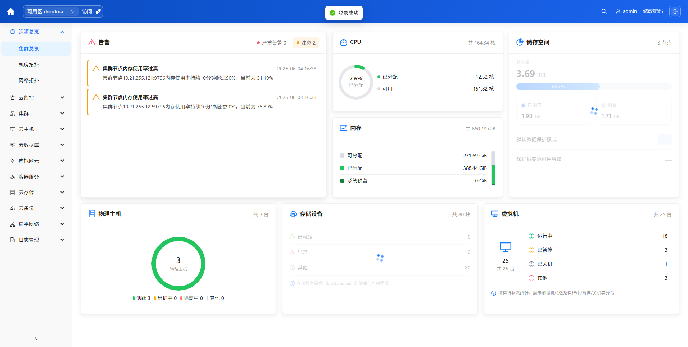
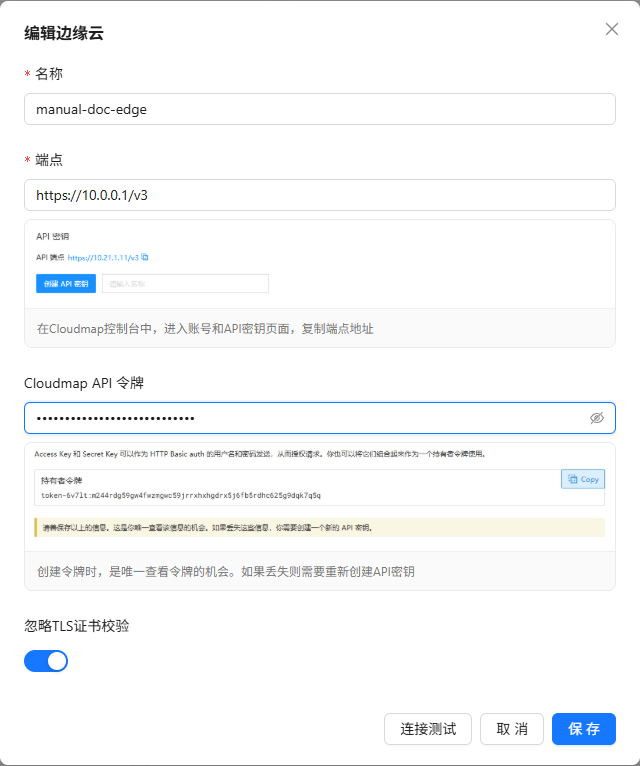
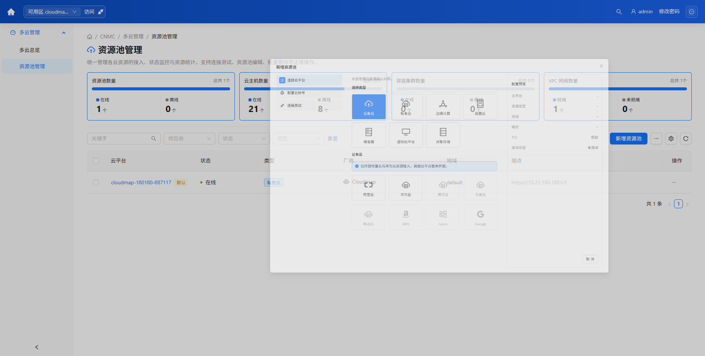
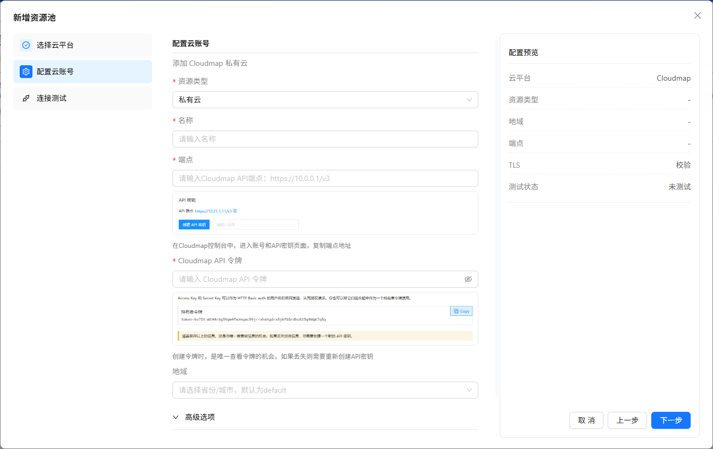
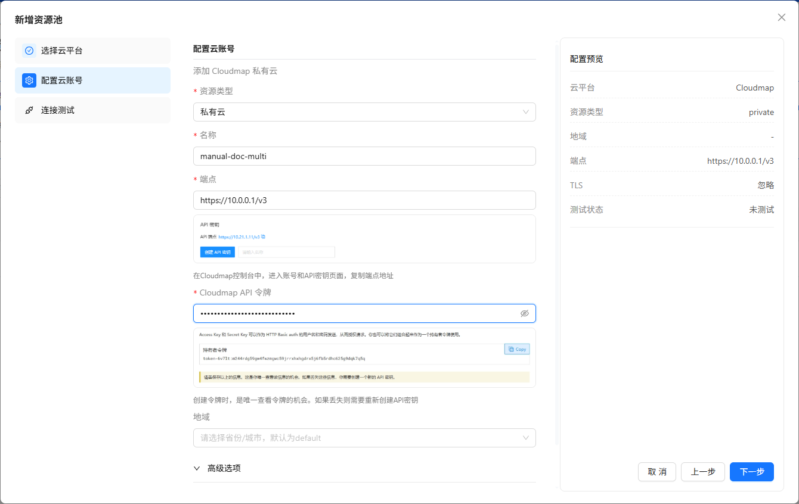
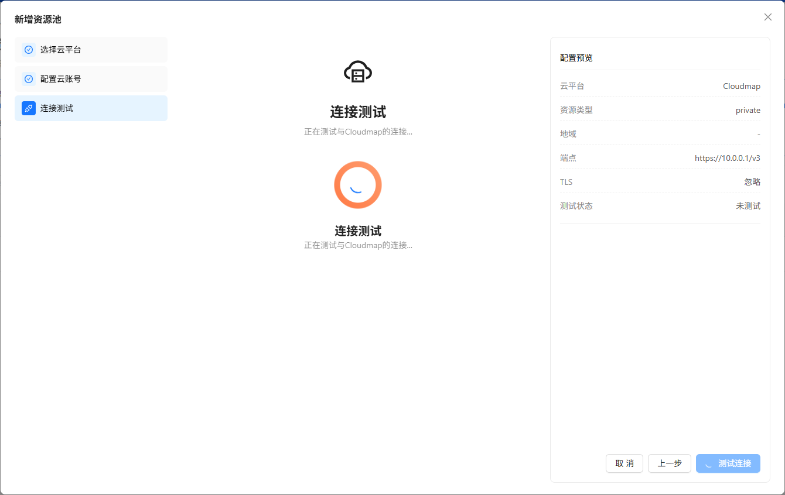

# 二、控制台与资源池

## 1. 登录

**适用角色**：所有已开通账号的用户。

**步骤**：

1. 浏览器访问 Compute Tower 部署地址（开发环境示例：`http://<主机>:5000`）。
2. 输入 **用户名**、**密码**，单击 **登录**。
3. 登录成功后进入默认首页（管理员多为 **多云总览** 或已设首页的 Cloudmap 池 Tab）。

**注意**：生产环境须修改默认密码；租户账号无法进入 **系统设置**（除非同时拥有平台管理员角色）。

---

## 2. 顶部导航栏与平台切换

顶栏左侧为 **产品线切换**（视 License 与 RBAC 显示）：

| 顶栏名称                        | 代码     | 主要内容                                     |
| ------------------------------- | -------- | -------------------------------------------- |
| **多云管理**                    | CNMC     | 多云总览、资源池列表、Cloudmap 池内全部 Tab  |
| **租户管理**                    | TENANTS  | 租户、组织、组织用户                         |
| **SDN 管理 / AI SOC / 容器** 等 | —        | 按授权显示                                   |
| **系统设置**                    | SETTINGS | 用户、角色、审计、授权、离线升级、云桌面网关 |

本手册第三章默认在 **多云管理** 下操作。

---

## 3. 接入与进入资源池

Cloudmap 资源池在 Tower 中有 **两种接入方式**，对应不同 License 与使用场景，请勿混用入口。

| 方式               | 入口                                                | 界面                                              | 典型场景                                                              |
| ------------------ | --------------------------------------------------- | ------------------------------------------------- | --------------------------------------------------------------------- |
| **单池（默认池）** | 顶栏 **可用区** 右侧 **设定默认资源池**（链路图标） | 弹窗 **接入边缘云** / **编辑边缘云**              | 试用版、未开通 **多云管理** 授权；仅维护顶栏当前默认池                |
| **多云**           | `多云管理 > 资源池管理`                             | 向导 **新增资源池**（选云平台 → 配置 → 连接测试） | 已开通 **`platform.multi-cloud`（多云管理）**；可接入多厂商、多资源池 |

**共同前置**：已获取 Cloudmap API **端点**（如 `https://<集群>/v3`）与 **API 令牌**；Tower 后端能访问该端点。

---

### 3.1 单池接入（顶栏 · 接入边缘云）

**适用角色**：平台管理员；须资源池 **新增与编辑** 写权限（`clouds.resource-pools.create:write`）。

**入口**：任意管理页 **顶栏** → **可用区** 下拉旁 **设定默认资源池**（图标按钮；无池时提示为「添加默认资源池」，有池时为「编辑当前默认资源池」）。

**步骤**：

1. 单击上述图标，打开 **接入边缘云** 弹窗（编辑已有池时为 **编辑边缘云**）。
2. 填写 **名称**、**端点**、**Cloudmap API 令牌**；按需开启 **忽略 TLS 证书校验**（内网自签证书常见）。
3. 单击 **连接测试**，页脚显示 **连接成功** 后再点 **保存**。
4. 保存后顶栏 **可用区** 下拉出现该池；可点 **访问** 进入池内总览。

**结果**：写入（或更新）顶栏默认 **边缘类型** 资源池；侧栏进入 Cloudmap 池内操作（第 3 章）。

**注意**：

- 此为 **单页表单**，无「选择公有云/私有云」多步向导。
- 连接失败：检查端点是否含 `/v3`、Token 是否有效、Tower 到集群网络。

---

### 3.2 多云接入（资源池管理 · 新增资源池）

**适用角色**：平台管理员；须 **多云管理** 功能授权（`platform.multi-cloud`）及资源池列表读写权限。

**入口**：`多云管理 > 资源池管理`（侧栏；未授权时 **无此菜单**，见 **系统设置 > 授权管理**）。

**步骤**：

1. 单击工具栏 **新增资源池**。
2. **选择类型** → **私有云** → 卡片 **Cloudmap**（其它厂商按 License 开放情况显示）。

3. **配置云账号**：名称、端点、API 令牌等（与 2.3.1 字段类似，向导右侧有 **配置预览**）。

4. **下一步** 进入 **连接测试**；成功后再点 **完成** 创建。

5. 列表 **状态** 为在线后，可在顶栏 **可用区** 切换该池，或单击名称进入池内（见 2.3.3）。

**结果**：`资源池管理` 列表新增一条池记录；可并存多个 Cloudmap/其它云资源池。

**注意**：

- 无 **多云管理** 授权时，请使用 **3.1 顶栏接入**，不要依赖本节的列表页。
- 试用 License 通常仅开放顶栏单池路径，向导会固定为 Cloudmap 私有云简化流程（以现网为准）。

---

### 3.3 进入池内详情

**入口**：

- 顶栏 **可用区** 选中目标池 → 单击 **访问**；或
- `多云管理 > 资源池管理` → **单击资源池名称**。

**步骤**：

1. 在列表或下拉中找到目标 Cloudmap 实例。
2. 按上述入口进入池内。
3. 左侧菜单切换为 **Cloudmap 资源池** 上下文侧栏；顶栏面包屑显示当前池名称。

**结果**：主内容区展示当前 Tab 页面；URL 含 `cloudId` 与 Tab 路径（如 `…/compute/ecs`）。

**注意**：租户仅能看到已分配的资源池；列表为空时联系管理员分配池与项目。

---

### 3.4 池内侧栏分组（与手册章节对照）

侧栏 **一级分组** 及主要 Tab 如下（无权限的 Tab 不显示）：

| 侧栏分组     | 主要 Tab                                                                                                                                     | 手册章节      |
| ------------ | -------------------------------------------------------------------------------------------------------------------------------------------- | ------------- |
| **资源总览** | 集群总览、机房拓扑、网络拓扑                                                                                                                 | 第三章 4      |
| **云监控**   | 运维监控、运维告警、接入管理                                                                                                                 | 第三章 5      |
| **集群**     | 计算配置、项目管理、GPU 管理；交换机/物理网络/公共子网/VLAN；集群网络/NAD/负载均衡/IP 地址池；存储概览/存储配置/StorageClass/…；USB/PCI/网卡 | 第三章 6      |
| **云主机**   | 云主机实例、云主机镜像、云主机模板、回收站；SSH 密钥、CloudInit 配置、迁移记录                                                               | 第三章 7      |
| **云数据库** | 云 RDS                                                                                                                                       | 第三章 8      |
| **虚拟网元** | 虚拟路由器、负载均衡器                                                                                                                       | 第三章 9      |
| **容器服务** | 工作负载、容器实例、任务、服务、Ingress、网关路由、服务拓扑、Pod 中断保护、网络策略、配置管理、镜像仓库                                      | 第三章 10     |
| **云存储**   | 虚拟云盘、云盘快照                                                                                                                           | 第三章 11     |
| **云备份**   | 云主机备份、云主机快照、定时策略、恢复任务                                                                                                   | 第三章 12     |
| **扁平网络** | 扁平子网、安全组、弹性公网 IP、SNAT、DNAT                                                                                                    | 第三章 13     |
| **VPC 网络** | VPC、子网、弹性公网 IP、SNAT、DNAT                                                                                                           | 第三章 14     |
| **日志管理** | 日志采集对象、日志接收端、日志采集配置                                                                                                       | 第三章 15     |

**全 Tab 索引**：第三章开头的 **资源池功能索引**（含 path 与章节号）。

集群下 **计算资源 / 基础网络 / 平台网络 / 统一存储 / 对象存储 / 直通设备** 为侧栏 **二级折叠菜单**。

---

### 3.5 列表页通用操作

Cloudmap 池内多数数据列表具备统一交互：

| 区域           | 操作                                                           |
| -------------- | -------------------------------------------------------------- |
| **左侧工具栏** | 搜索框、状态下拉筛选、**重置**                                 |
| **右侧工具栏** | 主按钮（如 **创建**）、批量 **…**、**列展示**、**Reload 刷新** |
| **表格**       | 首列名称可点进详情；行末 **…** 为行操作                        |
| **刷新语义**   | 须触发对集群的同步拉取；改配成功后列表应自动重载               |

**列展示**：已冻结的首列、操作列不可关闭；其余列可勾选显示/隐藏。

---

### 3.6 详情抽屉通用结构（以云主机为例）

云主机等资源常采用 **右侧抽屉**（宽约 800px）：

| 区域           | 内容                                                                      |
| -------------- | ------------------------------------------------------------------------- |
| **顶栏**       | 名称、状态 Tag、配置同步/热扩容等状态 Tag、刷新与关闭                     |
| **工具栏**     | **打开终端**、**开机/关机/重启/暂停/恢复**、**资源配置** 下拉、**…** 更多 |
| **Tab**        | **详情** / **性能** / **备份/快照**（云主机）                             |
| **… 更多菜单** | 热迁移、性能调优、调度策略、CloudInit、诊断、删除等                       |

无 **云主机写权限**（`clouds.ecs:write` 或 `clouds:write`）时，电源与改配按钮不显示。
