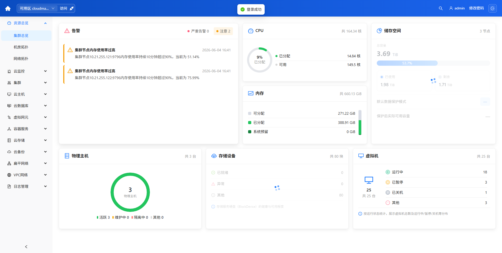
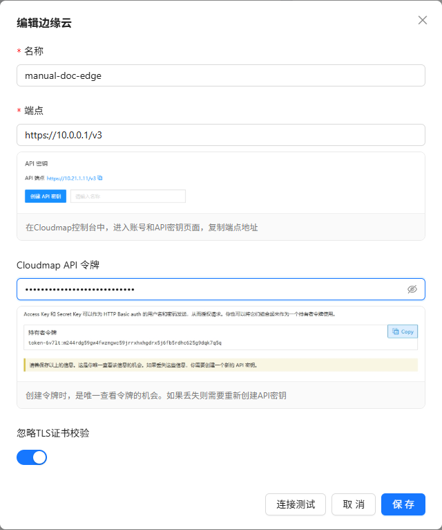
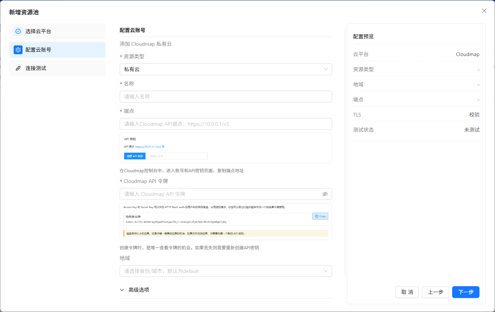
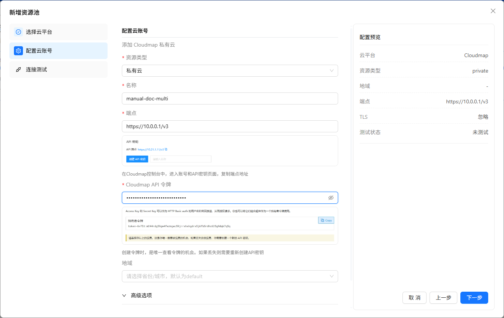
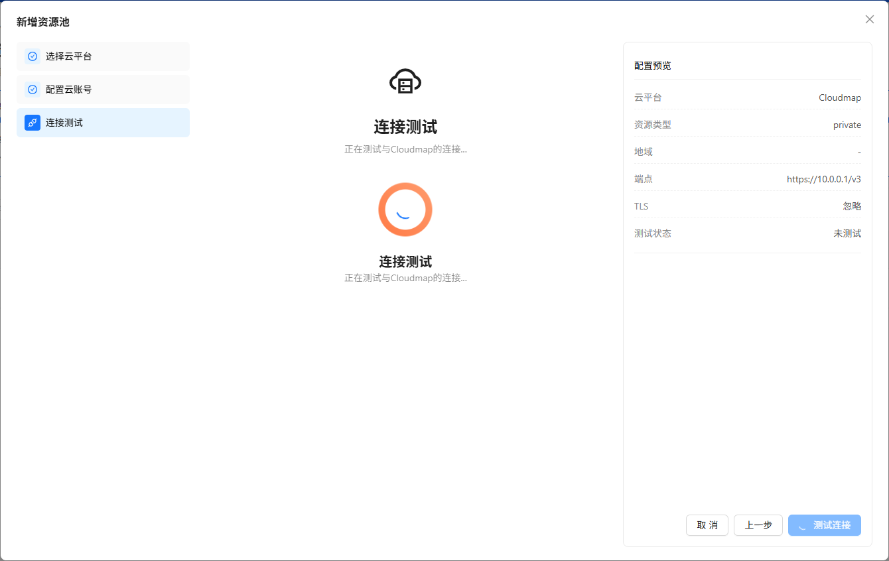

# 2. 控制台与资源池

本章说明用户如何登录控制台、通过顶部导航栏切换平台，以及接入并进入 Cloudmap 资源池。第 3 章按资源池功能菜单继续展开具体操作。

## 2.1 登录

**适用角色**：所有已开通账号的用户。

**步骤**：

1. 浏览器访问 Compute Tower 部署地址（开发环境示例：`http://<主机>:5000`）。
2. 输入 **用户名**、**密码**，单击 **登录**。
3. 登录成功后进入默认首页（管理员多为 **多云总览** 或已设首页的 Cloudmap 池 Tab）。

**注意**：生产环境须修改默认密码；租户账号无法进入 **系统设置**（除非同时拥有平台管理员角色）。

---

## 2.2 顶部导航栏与平台切换

管理后台顶部功能区位于页面最上方，负责全局导航、资源池快捷入口、页面搜索与账号操作。典型布局如下：

`平台切换` → `Logo 与系统标题` → `可用区 / 访问 / 设定默认资源池` → `搜索` → `用户 / 租户 / 组织 / 修改密码 / 退出`

| 功能入口                 | 位置               | 操作                           | 结果                                                              | 权限或显示条件                                           |
| ------------------------ | ------------------ | ------------------------------ | ----------------------------------------------------------------- | -------------------------------------------------------- |
| **平台切换**             | 左侧主页图标       | 单击展开平台列表，选择目标平台 | 跳转到该平台第一个可访问页面                                      | 仅显示当前 License 与 RBAC 允许的平台                    |
| **Logo 与系统标题**      | 平台切换右侧       | 只读展示                       | 用于识别当前系统                                                  | 在 **系统设置 > 界面设置** 中配置                        |
| **可用区**               | 顶栏中部下拉框     | 搜索并选择资源池               | 选中后可进入该资源池上下文                                        | 列表显示当前用户可见的多云资源池                         |
| **访问**                 | 可用区右侧按钮     | 选择资源池后单击               | 进入该资源池默认页面；Cloudmap 池默认进入 **资源总览 > 集群总览** | 须具备资源池读取权限；无多云授权时仍需具备池内基础读权限 |
| **设定默认资源池**       | 可用区右侧图标按钮 | 单击打开接入或编辑弹窗         | 新增默认 Cloudmap 池，或编辑当前默认池                            | 须具备资源池写权限                                       |
| **搜索页面**             | 顶栏右侧放大镜     | 单击打开全局页面搜索           | 与 `Ctrl + K` 相同                                                | 搜索结果按 License 与 RBAC 过滤                          |
| **用户、租户、组织信息** | 顶栏右侧           | 查看当前登录身份               | 显示用户名、租户 Tag、组织 Tag                                    | 有租户或组织信息时显示对应 Tag                           |
| **修改密码**             | 用户信息右侧       | 单击打开改密弹窗               | 修改当前账号密码                                                  | 管理后台租户账号通常不显示                               |
| **退出登录**             | 顶栏最右侧         | 单击退出                       | 返回登录页                                                        | 已登录用户可见                                           |

当前版本顶部功能区 **不包含** 通知中心、语言切换、在线帮助入口；若实际界面未显示某项，优先检查 License、角色权限与当前登录端。

---

### 2.2.1 平台切换

**入口**：顶部功能区左侧 **平台切换** 图标。

| 顶栏名称       | 代码     | 进入后的主要内容                                                 |
| -------------- | -------- | ---------------------------------------------------------------- |
| **多云管理**   | CNMC     | 多云总览、资源池管理；进入 Cloudmap 池后左侧切换为 Cloudmap Menu |
| **租户管理**   | TENANTS  | 租户、组织、组织用户                                             |
| **SDN 控制台** | SDNCC    | SDN 网络管理能力；按授权显示                                     |
| **云安全中心** | CNSOC    | 安全中心能力；按授权显示                                         |
| **系统设置**   | SETTINGS | 用户、角色、审计、授权、离线升级、云桌面网关、界面设置           |

**操作步骤**：

1. 单击顶部功能区左侧的平台切换图标。
2. 在下拉列表选择目标平台，例如 **多云管理**。
3. 系统跳转到该平台的首个可访问菜单页。

**注意**：本手册 Cloudmap 日常操作默认从 **多云管理** 进入；进入具体资源池后，左侧显示的是该资源池的上下文菜单，不再是平台级菜单。

---

### 2.2.2 可用区、访问与默认资源池

**入口**：顶部功能区中部 **可用区** 下拉框及其右侧按钮。

| 操作       | 步骤                                                   | 结果                                         |
| ---------- | ------------------------------------------------------ | -------------------------------------------- |
| 选择资源池 | 展开 **可用区** 下拉框，搜索并选中目标 Cloudmap 资源池 | 顶栏记录当前池；可继续单击 **访问**          |
| 访问资源池 | 选中目标池后单击 **访问**                              | 进入 `Cloudmap 资源池 > 资源总览 > 集群总览` |
| 接入默认池 | 单击 **设定默认资源池** 图标                           | 打开 **接入边缘云** 弹窗                     |
| 编辑默认池 | 已存在默认池时单击同一图标                             | 打开 **编辑边缘云** 弹窗                     |

**接入默认池步骤**：

1. 单击 **设定默认资源池** 图标，打开 **接入边缘云** 弹窗。
2. 填写 **名称**、**端点**、**Cloudmap API 令牌**；内网自签证书场景可按需开启 **忽略 TLS 证书校验**。
3. 单击 **连接测试**，页脚显示 **连接成功** 后单击 **保存**。
4. 保存后，目标资源池出现在顶部功能区 **可用区** 下拉框中。

**结果**：系统写入或更新默认 Cloudmap 资源池；用户可通过顶部功能区直接进入池内 Cloudmap Menu。

**注意**：

- 顶部功能区接入是单页表单，不是多云资源池管理中的多步向导。
- 连接失败时，检查端点是否包含 `/v3`、令牌是否有效、Compute Tower 到 Cloudmap 集群网络是否可达。

---

### 2.2.3 Ctrl + K 全局页面搜索

**入口**：在管理后台任意页面按 `Ctrl + K`，或单击顶部功能区右侧 **搜索** 图标。

**用途**：快速查找并跳转到当前账号有权限访问的页面。它搜索的是 **页面入口**，不是云主机、云盘、告警等资源实例。

**操作步骤**：

1. 按 `Ctrl + K` 打开搜索弹窗。
2. 输入页面关键词，例如「资源池」「云主机」「系统设置」。
3. 使用鼠标单击结果，或使用方向键选择结果后按 `Enter`。
4. 系统跳转到所选页面，并同步左侧菜单高亮。
5. 如需关闭弹窗，按 `Esc` 或单击弹窗外区域。

**结果范围**：

- 只显示当前用户可见的管理后台页面。
- 未授权的平台或菜单不会出现在搜索结果中。
- 租户云控制台不提供管理后台 `Ctrl + K` 搜索。

---

## 2.3 接入与进入资源池

Cloudmap 的完整管理入口在 **多云管理** 中。资源池未接入前，只能看到平台级菜单；接入并进入目标 Cloudmap 池后，左侧才切换为 **Cloudmap Menu**。

### 2.3.1 入口关系

| 场景             | 入口                                                          | 进入后的内容                                   |
| ---------------- | ------------------------------------------------------------- | ---------------------------------------------- |
| 查看多云概况     | `顶部功能区 > 平台切换 > 多云管理 > 多云总览`                 | 多云资源概览、资源池状态概览                   |
| 管理多个资源池   | `顶部功能区 > 平台切换 > 多云管理 > 资源池管理`               | 资源池列表、新增资源池、查看状态、进入资源池   |
| 进入 Cloudmap 池 | `顶部功能区 > 可用区 > 访问` 或 `资源池管理 > 单击资源池名称` | 左侧切换为 Cloudmap Menu，主内容区展示池内页面 |

### 2.3.2 通过资源池管理接入 Cloudmap

**适用角色**：平台管理员；须具备 **多云管理** 功能授权。**参见**：第 4 章 §4.5。

**入口**：`多云管理 > 资源池管理`（未授权时无此菜单）。

**步骤**：

1. 单击工具栏 **新增资源池**。
2. 在 **选择类型** 中选择 **私有云**，再选择 **Cloudmap** 卡片；其它厂商卡片按 License 开放情况显示。

3. 在 **配置云账号** 中填写名称、端点、API 令牌等信息；向导右侧显示 **配置预览**。

4. 单击 **下一步** 进入 **连接测试**；测试成功后单击 **完成**。

5. 返回资源池列表，确认目标池 **状态** 为在线。
6. 单击资源池名称，或在顶部功能区 **可用区** 中选择该池并单击 **访问**。

**结果**：资源池列表新增 Cloudmap 池；进入后左侧显示 Cloudmap Menu。

**注意**：

- 无 **多云管理** 授权时，请使用顶部功能区 **设定默认资源池** 接入单池。
- 试用 License 通常仅开放顶部功能区单池路径，向导可能固定为 Cloudmap 私有云简化流程，以现网为准。
