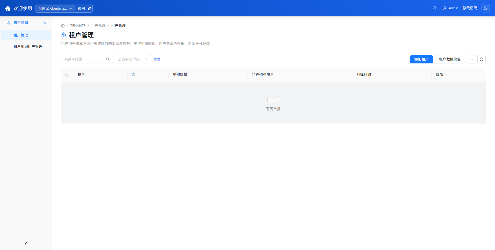
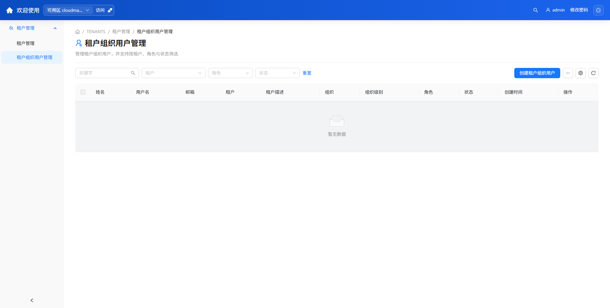

# 5. 租户管理

**入口**：顶栏 **租户管理**

**适用角色**：平台管理员（具备租户管理写权限）。**参见**：第 4 章。

租户管理用于划分多租户边界：先创建租户并为其分配资源池与项目，再在组织下创建租户用户。租户用户登录后只能在被分配的资源池与项目内操作。

---

## 5.1 租户

**入口**：`租户管理 > 租户管理`

**步骤**：

1. 单击 **创建租户**，填写名称、描述与配额（若有）。
2. 编辑租户，**分配资源池**：勾选该租户可访问的 Cloudmap 等资源池。
3. **分配项目**：把命名空间（项目）关联给租户。

**操作效果**：租户获得指定资源池与项目的访问边界；其用户只能在这些范围内创建资源。

**注意**：租户用户创建云主机时只能选择已分配给本租户的项目（见 7.2.2）。

---

## 5.2 组织

**入口**：`租户管理 > 组织`（从租户详情进入）

**步骤**：

1. 维护多级 **组织树**（部门层级）。
2. **创建子组织**、编辑名称。

**操作效果**：组织用于租户用户的归属与配额管理。

---

## 5.3 组织用户管理

**入口**：`租户管理 > 组织用户管理`

**步骤**：

1. 单击 **创建用户**，填写用户名、密码、所属 **租户 / 组织** 与 **角色**。
2. 按 租户、组织、角色、状态筛选。
3. **禁用 / 删除** 离职账号。

**操作效果**：租户用户登录后——

- 顶栏可见 **多云管理**（不含 **系统设置**，除非另具平台角色）；
- 资源池列表仅显示已分配的池；
- 项目下拉仅显示已分配的命名空间（创建云主机的第一步）。

---

## 5.4 租户控制台

**入口**：租户控制台门户（按部署启用）

**步骤**：租户用户在控制台门户中统一访问已分配云主机的 Web SSH / VNC 等远程连接。

**操作效果**：为租户用户提供跨资源池的远程访问入口。

**注意**：是否启用租户控制台门户由部署配置决定。

---

## 5.5 权限叠加

租户用户访问 Cloudmap 资源池内的页面时，须 **同时满足** 两层条件：

1. **平台/租户角色** 提供资源池与页面的读写权限（见第 4 章）。
2. **项目（命名空间）** 限定可创建资源的范围。

二者同时满足方可操作；任一不满足则对应菜单、按钮或项目不可见。
