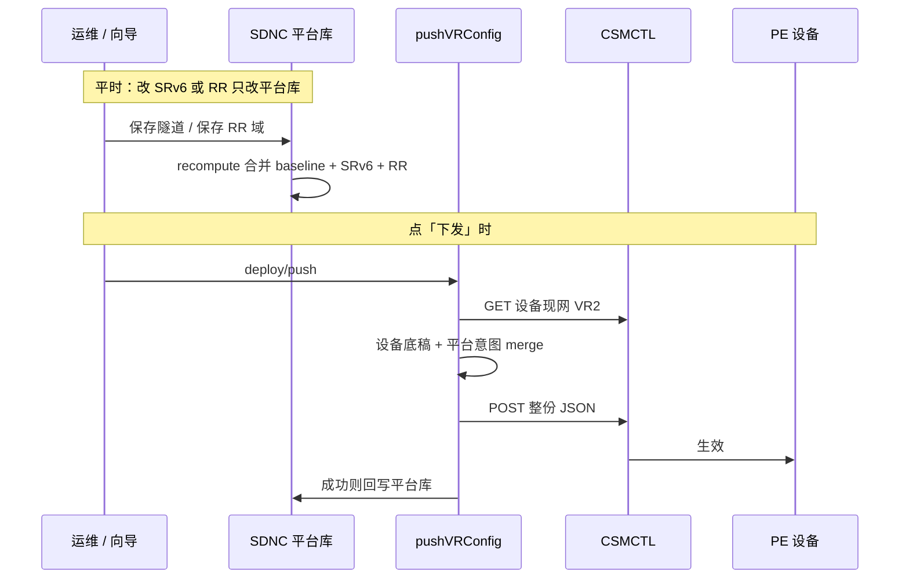

# IBR 配置下发架构

> **适用范围**：SDNC · IBR 管理（ACL / NAT / IPsec / SRv6 / HA·VRRP）及 IBR 初始化通道。  
> **关联**：全栈与 CSMCTL 边界见 [`sdnc-stack-integration.md`](./sdnc-stack-integration.md)；SRv6 隧道专项见 [`srv6-baseline-recompute.md`](./srv6-baseline-recompute.md)；**账本 / 叠加 / 漂移判定**见 [`srv6-config-ledger-and-drift.md`](./srv6-config-ledger-and-drift.md)；**BGP RR 与 SRv6 共存（设计）**见 [`bgp-rr-design.md`](./bgp-rr-design.md)。

---

## 0. 产品命名（用户可见文案）

| 旧称 | 现称 | 说明 |
|------|------|------|
| 网际路由器、虚拟路由器 | **IBR** / **IBR实例** | 侧栏、列表、表单、权限说明、错误提示 |
| VR 实例 | **IBR实例** | 同上 |

**不改名（实现层保留）**：HTTP 路径（`/api/vr-instances`、`/api/vr-config`）、字段名（`vrId`、`uuid`）、CSMCTL 接口（`VR1`/`VR2`）、源码符号（`getVRConfig`、`VRPage`）——与设备/历史 API 契约一致。

---

## 1. 背景与问题

CSMCTL 的 VR 配置更新接口为 **全量 JSON POST**（非 merge / PATCH）。若调用方用不完整快照重复下发，会 **覆盖设备侧历史或未纳管策略**。

平台需要统一约定：

1. 下发前 **先读设备当前配置** 作为底稿；
2. **仅覆盖本业务域** 相关字段，保留其它域与设备独有字段；
3. 对「平台意图 vs 设备现网」做 **漂移检测**，阻塞或要求用户确认后再下发。

---

## 2. 唯一传输语义

无论 ACL、NAT、IPsec、SRv6，**到 CSMCTL 的最后一步永远相同**：

```text
GET 设备 VR 全量 JSON
  → 与平台意图 merge（按域）
  → [可选] 漂移检测 / 用户确认
  → POST 整份 JSON 到 CSMCTL
  → 成功则回写平台 vr_config
```

**不存在** NAT 专用下发协议或其它并行写设备通道（初始化通道见 §5）。

---

## 3. 统一下发网关（后端）

**实现**：`backend/src/services/vrouter/vrConfigDeploy.ts` — `pushVRConfig`。

| 步骤 | 说明 |
|------|------|
| 读设备 | `getVRConfigFromDevice`（CSMCTL GET） |
| 平台意图 | 默认 `getVRConfigFromDB`；或由调用方传入 `platformConfig` / `preMergedConfig` |
| 分域 merge | `mergeDeviceWithPlatformSlice(device, platform, domain)` |
| 漂移 | `detectDeployDrift` → `DOMAIN_OVERWRITE` 阻塞；`PLATFORM_STALE` 提示（SRv6） |
| 下发 | `vrController.updateVRConfig` 全量 POST |
| 回写 | `saveVRConfigToDB` |

**域（`VrConfigDeployDomain`）与覆盖字段**：

| 域 | merge 覆盖的顶层 key | 说明 |
|----|----------------------|------|
| `acl` | `acl` | 由 `syncACLToVRConfig` 从 ACL 表生成 |
| `nat` | `nat_address_group` | 由 `syncNatToVRConfig` 从 NAT 表生成；**不**覆盖设备 `nat[]` |
| `ipsec` | `ipsec` | IPsec 条目规范化后覆盖 |
| `srv6` | 平台意图中除 `acl` / `nat` / `nat_address_group` / `ipsec` 外的业务 key | 保留设备侧 ACL/NAT/IPsec 现网值 |
| `vrrp` | （不走 slice merge） | HA 组：`haGroupVrrpMaterialize` 在设备底稿上定点 upsert `interface[].vrrp` + 顶层 `vrrp[]`，经 `preMergedConfig` 下发 |

**漂移预览 API**：`GET /api/vr-config/:uuid/deploy-drift?domain=acl|nat|ipsec|srv6`

**各域 deploy/push**：

| 路径 | 说明 |
|------|------|
| `POST /api/networks/acl/deploy/push` | `{ vrId, acknowledgeDrift? }` |
| `POST /api/networks/nat/deploy/push` | 先 `syncNatToVRConfig`，再 push |
| `POST /api/networks/ipsec/deploy/push` | 含 preview / verify（向导用） |
| `POST /api/networks/srv6/deploy/push` | 含 preview |
| `POST /api/ibr-ha-groups/:id/deploy` | HA 组 VRRP：主备串行 `pushVRConfig(domain: vrrp, preMergedConfig)`；成功 → `configured`，仅主成功 → `degraded` |

---

## 4. 纳入统一下发的业务（日常运维）

### 4.1 共同原则

- **保存 ≠ 下发**：增删改只写平台库（及 sync 进 `vr_config`）；生效到设备须显式「下发」。
- **列表读平台库**，不遍历每台 VR 解析 `getVRConfig` 冒充权威列表（VR 目录同步除外，见 `ibrVrCatalog`）。

### 4.2 ACL

| 层 | 落点 |
|----|------|
| 实体 | `ACLGroup`、`ACLRule`、`ACLGroupBinding` |
| 同步 | `syncACLToVRConfig` → `config_json.acl` |
| 路由 | `routes/sdn/acl.ts`、`aclGroups.ts` |
| 前端 | `pages/sdncc/ibr/acl/` → `runIbrDeployPushInteractive({ feature: 'acl' })` |

### 4.3 NAT（静态地址池映射）

| 层 | 落点 |
|----|------|
| 实体 | `NATAddressGroup`（`vrId` + `deviceGroupId` + `range`）、`NATStaticMapping` |
| 同步 | `syncNatToVRConfig` → `config_json.nat_address_group` |
| 路由 | `GET/POST/DELETE /api/networks/nat`、`POST .../deploy/push` |
| 前端 API | `getNATStaticMappings` / `createNATStaticMapping` / `deleteNATStaticMapping` |
| 前端页面 | `pages/sdncc/ibr/nat/` → `runIbrDeployPushInteractive({ feature: 'nat' })` |

设备 JSON 片段形态：

```json
"nat_address_group": [
  {
    "group_id": 1,
    "range": ["203.0.113.10/32"],
    "static_mapping": [
      {
        "proto": "tcp",
        "inside": "10.0.0.10",
        "local_port": 80,
        "outside": "203.0.113.10",
        "external_port": 8080
      }
    ]
  }
]
```

### 4.4 IPsec / SRv6 向导

| 能力 | 前端落点 |
|------|----------|
| 统一下发状态机 | `pages/sdncc/ibr/lib/useIbrDeployWizard.ts` |
| 漂移 + 推送封装 | `pages/sdncc/ibr/lib/vrConfigDeployFlow.ts` |
| UI 面板 | `IbrDeployWizardPanel.tsx` |
| IPsec | `ipsec-vpn/IPsecVPNWizard.tsx` — `feature: 'ipsec'` |
| SRv6 | `srv6/Create.tsx` — `feature: 'srv6'` |

注册表：`IBR_DEPLOY_FEATURES`（`acl` | `nat` | `ipsec` | `srv6`）。

---

## 5. 不纳入统一下发的通道（初始化 / 专家）

以下路径带有 **IBR 角色初始化或全量编排** 语义，**刻意不** 接入 `pushVRConfig` / `vrConfigDeployFlow`；现有实现视为正确产品设计。

| 通道 | 前端落点 | 行为 |
|------|----------|------|
| **专家模式** | `pages/sdncc/ibr/routers/EditVRConfig.tsx` | 直接编辑整份 VR JSON；`saveVRConfig` + `proxyApiRequest` 直推 CSMCTL |
| **VR 角色向导** | `routers/wizards/PEWizard.tsx`、`CEWizard.tsx`、`StandardWizard.tsx`、`SASEWizard.tsx` | 角色编排与初始化；先 `saveVRConfig` / `setVRRole`，再 `proxyApiRequest` 按向导语义下发 |

**判定**：日常「分域策略增删改 + 漂移保护下发」走 §4；「新机/改角色/专家改全表」走 §5。

新增功能时：**不得** 在 §5 通道外再增加直推 CSMCTL 的运维列表路径；**不得** 把 §5 强行改为分域 deploy/push（会破坏初始化语义）。

---

## 6. 端到端数据流（总览）

```text
┌─────────────────────────────────────────────────────────────────┐
│  §4 日常运维：ACL / NAT 列表，IPsec / SRv6 向导                    │
└────────────────────────────┬────────────────────────────────────┘
                             │ CRUD → 平台表 + sync → vr_config
                             │ 用户「下发」→ deploy/push
                             ▼
                    pushVRConfig (vrConfigDeploy)
                             │
                             ▼
                      CSMCTL 全量 POST

┌─────────────────────────────────────────────────────────────────┐
│  §5 初始化 / 专家：EditVRConfig，PE/CE/Standard/SASE 向导          │
└────────────────────────────┬────────────────────────────────────┘
                             │ saveVRConfig + proxyApiRequest
                             ▼
                      CSMCTL 全量 POST（无分域漂移网关）
```

### 6.1 统一下发时序（Mermaid）

与 [`bgp-rr-design.md`](./bgp-rr-design.md) §6.6 一致；RR 步骤为规划能力，现网已走 **保存 → recompute（baseline + SRv6）→ deploy/push** 同一网关。



---

## 7. 源码索引

| 职责 | 路径 |
|------|------|
| 下发网关 | `backend/src/services/vrouter/vrConfigDeploy.ts` |
| NAT 同步 | `backend/src/services/vrouter/natSync.ts` |
| ACL 同步 | `backend/src/routes/sdn/aclGroups.ts` — `syncACLToVRConfig` |
| NAT 路由 | `backend/src/routes/sdn/nat.ts` |
| 漂移查询 | `backend/src/routes/sdn/vrConfig.ts` — `deploy-drift` |
| 前端漂移工具 | `frontend/src/utils/vrConfigDeployDrift.ts` |
| 前端统一下发 | `frontend/src/pages/sdncc/ibr/lib/vrConfigDeployFlow.ts` |
| VR 目录加载 | `frontend/src/pages/sdncc/ibr/lib/ibrVrCatalog.ts` |
| 单测 | `vrConfigDeploy.test.ts`、`natSync.test.ts` |

---

## 8. 修订记录

| 日期 | 说明 |
|------|------|
| 2026-07-09 | 初版：统一下发网关、NAT 表模型、§5 初始化通道边界 |
| 2026-07-09 | §0 产品命名：用户可见「网际路由器 / VR」→ IBR / IBR实例 |
