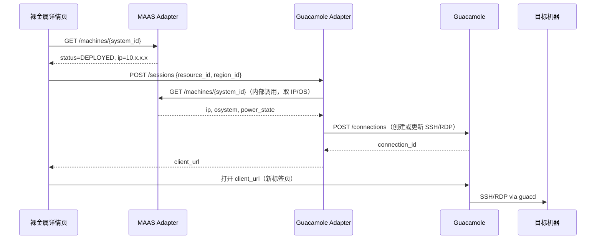

# 云桌面网关对接指南

本文档面向 **Compute Tower 云桌面网关**，说明如何通过 Apache Guacamole REST API 实现**浏览器远程登录**（SSH / RDP / VNC）。

**当前版本范围**：**扁平业务网** + **云桌面用户**（独立实体，不能登录 Tower）+ **管理员分配 VM 连接**；**Cloudmap + MAAS + 云桌面网关** 在该范围内交付。**租户业务（`TenantUser`）暂不纳入云桌面**。

设计前提：

- 各资源类型拥有**独立管理界面**，不做跨云统一资产模型。
- 远程访问通过 **云桌面网关 BFF（Tower）** 对接 Apache Guacamole，**前端不直连** REST。
- Guacamole **不负责**虚拟机/裸金属生命周期，只提供远程终端/桌面协议代理（guacd）。
- Tower 负责：网关注册、**云桌面用户**同步、Connection 按需 upsert、**管理员分配**后赋 READ、统一登录密码。
- 云桌面用户登录 **云桌面网关门户**（统一密码），仅见已分配的 Connection。

总体架构见 [`remote-access-architecture.md`](./remote-access-architecture.md)。

---

## 1. 架构概览

```
┌─────────────────────────────────────────────────────────────────┐
│                       多云管理平台                               │
│  ┌──────────────┐  ┌──────────────┐  ┌──────────────────────┐  │
│  │ 虚拟机管理 UI │  │ 容器管理 UI  │  │ 裸金属管理 UI         │  │
│  └──────┬───────┘  └──────┬───────┘  └──────────┬───────────┘  │
│         │                 │                      │              │
│         │                 │            ┌─────────┴─────────┐    │
│         │                 │            │  MAAS Adapter     │    │
│         │                 │            └─────────┬─────────┘    │
│         ▼                 ▼                      │              │
│     各云 API          各云 API                   │ MAAS API     │
│         │                 │                      ▼              │
│         │                 │            ┌──────────────────┐    │
│         └────────┬────────┘            │  MAAS Region     │    │
│                  │                     └──────────────────┘    │
│                  │  远程登录请求                                 │
│                  ▼                                              │
│         ┌─────────────────┐                                     │
│         │ Guacamole Adapter│  ← 统一远程访问 BFF                │
│         └────────┬────────┘                                     │
└──────────────────┼──────────────────────────────────────────────┘
                   │ HTTPS + Guacamole-Token
                   ▼
        ┌──────────────────────────┐
        │   Apache Guacamole       │
        │   Web (Tomcat) + guacd   │
        └────────────┬─────────────┘
                     │ SSH / RDP / VNC
                     ▼
              目标机器（VM / 裸金属）
```

**职责划分：**

| 组件               | 职责                                                            |
| ------------------ | --------------------------------------------------------------- |
| 裸金属 / 虚拟机 UI | 展示资产列表；提供「远程登录」入口                              |
| MAAS Adapter       | 机器生命周期、状态、IP 信息                                     |
| Guacamole Adapter  | Guacamole 实例管理、Connection 增删改查、生成登录 URL、权限分配 |
| Guacamole          | 协议代理（guacd），浏览器内渲染终端/桌面                        |
| guacd              | 实际连接 SSH/RDP/VNC 的后端守护进程                             |

> **说明：** Guacamole 不会自动发现 MAAS / 云平台中的机器。平台需在用户点击「远程登录」时，通过 Adapter 调用 Guacamole API **按需创建或复用 Connection**。

---

## 2. Guacamole API 说明

### 2.1 基础路径

| 项             | 值                                                |
| -------------- | ------------------------------------------------- |
| Web UI         | `http://<GUAC_HOST>:8080/guacamole/`              |
| REST API       | `http://<GUAC_HOST>:8080/guacamole/api`           |
| 数据源（JDBC） | `postgresql`（PostgreSQL 认证扩展安装后的固定值） |

**示例 Base URL：**

```
http://10.20.180.190:8080/guacamole
```

### 2.2 核心资源

| Guacamole 资源 | 说明                             | 平台侧映射                               |
| -------------- | -------------------------------- | ---------------------------------------- |
| Connection     | 一条远程连接（IP + 协议 + 凭据） | 一台可登录的机器                         |
| User           | Guacamole 用户                   | Tower **系统用户**（admin 体系）1:1 同步 |
| UserGroup      | 用户组                           | **当前不用**；租户 Group 见 §15.3 后续   |
| Permission     | 用户对 Connection 的 READ 等     | admin 点「云桌面」时赋 READ              |

### 2.3 常用 API 路径

以下 `{ds}` 固定为 `postgresql`：

| 操作         | 方法     | 路径                                                  |
| ------------ | -------- | ----------------------------------------------------- |
| 获取 Token   | POST     | `/api/tokens`                                         |
| 列出连接     | GET      | `/api/session/data/{ds}/connections`                  |
| 创建连接     | POST     | `/api/session/data/{ds}/connections`                  |
| 更新连接     | PUT      | `/api/session/data/{ds}/connections/{id}`             |
| 删除连接     | DELETE   | `/api/session/data/{ds}/connections/{id}`             |
| 连接详情     | GET      | `/api/session/data/{ds}/connections/{id}`             |
| 当前用户权限 | GET      | `/api/session/data/{ds}/self/effectivePermissions`    |
| 用户管理     | GET/POST | `/api/session/data/{ds}/users`                        |
| 分配权限     | PATCH    | `/api/session/data/{ds}/users/{username}/permissions` |

官方文档：[Guacamole REST API](https://guacamole.apache.org/doc/gug/guacamole-common.html)

---

## 3. 认证

### 3.1 获取 Token

Guacamole 使用 **Token 认证**，非 OAuth。

```bash
curl -X POST http://10.20.180.190:8080/guacamole/api/tokens \
  -H "Content-Type: application/x-www-form-urlencoded" \
  -d "username=guacadmin&password=guacadmin"
```

响应：

```json
{
  "authToken": "342BA68B86C2930D89DC38816BC62BB3...",
  "username": "guacadmin",
  "dataSource": "postgresql",
  "availableDataSources": ["postgresql", "postgresql-shared"]
}
```

后续请求在 Header 中携带：

```
Guacamole-Token: <authToken>
```

Token 有过期时间，Adapter 应实现**自动续期**（缓存 Token + 401 时重新登录）。

### 3.2 账号策略（当前版本）

| 账号类型                       | 用途                                                       | 谁使用                                    |
| ------------------------------ | ---------------------------------------------------------- | ----------------------------------------- |
| **服务账号**（`platform-svc`） | Tower 后端调 API：建 User、建 Connection、PATCH 赋权       | **仅后端**，不给人类登录                  |
| **admin Guacamole User**       | 与 Tower 系统用户 1:1；Connection READ；`client_url` token | **平台 admin**（`super_admin` / `admin`） |

**禁止（G-Admin 起）**：

- 让所有 Connection 只堆在服务账号下、不给 admin Guacamole User 授 READ。
- 为 **租户用户** 创建 Guacamole 账号或展示「云桌面」入口（当前版本）。

**Connection 归属（当前）**：`parentIdentifier: "ROOT"` 可接受；关键是 **PATCH `connectionPermissions` 给对应 admin User**，而非堆在服务账号可见范围。

**Guest 凭据**：弹窗输入的 `username` / `password` 是 **VM / 裸金属客户机登录凭据**，写入 Connection `parameters`，**不是** Guacamole 账号。

### 3.3 连通性测试

注册 Guacamole 实例时，Adapter 执行：

```
POST /api/tokens  → 200 且返回 authToken
GET  /api/session/data/postgresql/connections → 200
```

### 3.4 安全建议

- 生产环境 Guacamole 前置 HTTPS（Nginx 反代 + TLS）。
- 平台前端只调 Guacamole Adapter，不持有 Guacamole 服务账号。
- 机器 SSH/RDP 密码优先从 MAAS / 密钥管理系统**按需注入**，避免在 Guacamole 中长期明文存储（见 6.3）。
- 限制 Guacamole 实例的网络访问：仅允许 guacd 访问目标机器的管理网段。

---

## 4. 远程访问模块功能

建议作为**跨模块共享能力**（裸金属、虚拟机均可调用），而非独立大模块。

### 4.1 模块划分

```
远程访问（Guacamole）
├── /settings/guacamole          Guacamole 实例接入配置（管理员）
└── （无独立列表页）              入口嵌入各资源详情页
```

### 4.2 嵌入入口

| 来源模块       | Tower 操作             | 谁操作                                 | 前置条件                    |
| -------------- | ---------------------- | -------------------------------------- | --------------------------- |
| Cloudmap VM    | 「分配云桌面」         | 具备 `clouds.desktop:write` 的平台用户 | 池已接入；VM Running；有 IP |
| 云桌面网关门户 | 登录并打开 Connection  | **云桌面用户**（统一密码）             | 已被分配对应 VM             |
| MAAS 裸金属    | 「分配云桌面」（规划） | 同上                                   | DEPLOYED；有 IP             |
| 租户控制台 VM  | —                      | **无云桌面**                           | 仍可用 KubeVirt「访问 VNC」 |

### 4.3 功能与 API 对照

| UI 功能         | BFF 接口                               | 说明                           |
| --------------- | -------------------------------------- | ------------------------------ | --- | ------------------------- | ---------- |
| 注册实例        | `POST /api/remote/guacamole/instances` | 服务账号 + 统一密码            |
| 测试连接        | `POST .../instances/{id}/test`         | 连通性                         |
| 池接入开关      | `PUT .../pools/{cloudId}/config`       | `remoteDesktopGateway.enabled` |
| 云桌面用户 CRUD | `GET                                   | POST                           | PUT | DELETE .../desktop-users` | 同步到网关 |
| 批量同步用户    | `POST .../users/sync`                  | 全部 active 云桌面用户         |
| **分配 VM**     | `POST .../assignments`                 | upsert Connection + 赋 READ    |
| 查询分配        | `GET .../assignments`                  | 某 VM 已分配用户列表           |

---

## 5. Guacamole Adapter 设计

### 5.1 部署模式

**方案 A — 按需创建（推荐）：**

- 用户点击「远程登录」时，Adapter 查找本地映射表是否已有 Connection。
- 无则调用 Guacamole API 创建，有则更新 IP/凭据后返回 URL。
- Adapter 本地表记录 `{platform_resource_id} → {guac_connection_id}`。

**方案 B — 全量同步：**

- MAAS 机器变为 `DEPLOYED` 时，后台任务批量创建 Connection。
- 机器 `RELEASE` 时删除 Connection。
- 适合机器量大、需预热的场景；实现复杂度更高。

**推荐方案 A**，与 MAAS「按需操作」风格一致。

### 5.2 Adapter 对外接口（建议）

| BFF 接口                                         | 说明                                           |
| ------------------------------------------------ | ---------------------------------------------- | ------------------- | ------------------------------------------- | ---------- |
| `POST /api/remote/guacamole/instances`           | 注册 Guacamole（名称、URL、服务账号）          |
| `GET /api/remote/guacamole/instances`            | 实例列表                                       |
| `POST /api/remote/guacamole/instances/{id}/test` | 连通性测试                                     |
| `GET                                             | POST                                           | PUT                 | DELETE /api/remote/guacamole/desktop-users` | 云桌面用户 |
| `POST /api/remote/guacamole/users/sync`          | 同步全部云桌面用户                             |
| `GET                                             | POST /api/remote/guacamole/assignments`        | 查询 / 分配 VM 连接 |
| `GET                                             | PUT /api/remote/guacamole/pools/{cloudId}/...` | 池接入状态与开关    |

### 5.3 创建远程会话 — 请求 / 响应

**请求：**

```json
POST /api/remote/guacamole/sessions
{
  "guacamole_instance_id": "guac-01",
  "resource_type": "bare_metal",
  "resource_id": "abc123",
  "region_id": "bm-region-01",
  "protocol": "ssh",
  "hostname": "10.20.180.189",
  "port": 22,
  "username": "cloudmap",
  "password": "Cloudmap@123",
  "display_name": "MAAS-node-01"
}
```

`protocol` / `hostname` / `port` / 凭据也可由 Adapter 根据 `region_id + resource_id` **从 MAAS 自动补齐**（见第 6 节），前端只传资源 ID。

**响应：**

```json
{
  "session_id": "sess-uuid",
  "client_url": "http://10.20.180.190:8080/guacamole/#/client/Y3Bvc3QtbWFjawBjAG0A...?token=ADMIN_USER_TOKEN",
  "embed_url": "同上（可选别名）",
  "connection_id": "1",
  "expires_at": "2026-05-28T12:00:00Z"
}
```

> **G0 现状**：可能返回无 `token` 的 `client_url`，且 Connection 未赋权给 admin User。**G-Admin** 起须带 **admin Guacamole User** 的 token，勿用服务账号 token。

前端：`window.open(client_url)` 或 iframe 加载 `embed_url`。

### 5.4 Connection 命名与去重（固定方案）

| 字段              | 规则                                                                                                                                           |
| ----------------- | ---------------------------------------------------------------------------------------------------------------------------------------------- |
| Connection `name` | `vm/{资源池名}/{项目名}/{别名(id)}/{ip}`，如 `vm/华东资源池/default/生产Web(id-vm-01)/192.168.1.10`；无别名时为 `vm/.../id-vm-01/192.168.1.10` |
| 去重              | 创建前先 `GET .../connections`，按 `name` 查找；存在则 `PUT` 更新参数                                                                          |
| 父级              | 当前 `parentIdentifier: "ROOT"`；租户 Group 见 §15.3                                                                                           |
| 赋权              | upsert 后 `PATCH .../users/{admin_guac_user}/permissions` 添加 `connectionPermissions/{id}` = `READ`                                           |

### 5.5 client URL 生成

Guacamole 客户端标识符为 **Base64** 编码：

```
{connection_id}\0c\0postgresql
```

Python 示例：

```python
import base64

def client_identifier(connection_id: str, data_source: str = "postgresql") -> str:
    raw = f"{connection_id}\0c\0{data_source}".encode("utf-8")
    return base64.b64encode(raw).decode("ascii")

def client_url(guac_base: str, connection_id: str) -> str:
    ident = client_identifier(connection_id)
    return f"{guac_base.rstrip('/')}/#/client/{ident}"
```

---

## 6. 与 MAAS 裸金属模块联动

### 6.1 联动流程



### 6.2 协议自动选择（固定映射）

Adapter 根据 MAAS 返回的 `osystem` / 平台配置选择协议：

| MAAS osystem / 条件                                     | 协议   | 默认端口 |
| ------------------------------------------------------- | ------ | -------- |
| `ubuntu`, `centos`, `rhel`, `debian`, `custom`（Linux） | `ssh`  | 22       |
| `windows`, `win2022`, `win2019` 等                      | `rdp`  | 3389     |
| 用户手动指定                                            | 按请求 | 自定义   |

```python
LINUX_OS = {"ubuntu", "centos", "rhel", "debian", "fedora", "suse"}

def resolve_protocol(osystem: str, override: str | None = None) -> str:
    if override:
        return override
    return "rdp" if osystem.lower().startswith("win") else "ssh"
```

### 6.3 凭据来源（优先级）

| 优先级 | 来源                       | 说明                                                |
| ------ | -------------------------- | --------------------------------------------------- |
| 1      | 部署时写入 MAAS 的 SSH Key | SSH 公钥认证，Guacamole 配 `private-key` 参数       |
| 2      | 平台密钥库                 | 按 `resource_id` 取解密后的密码                     |
| 3      | MAAS 部署参数              | 若 deploy 时指定了 user-data 中的默认用户           |
| 4      | 用户临时输入               | 弹窗让用户输入密码（不落库，仅当次写入 Connection） |

**推荐：** SSH 优先公钥；RDP 从密钥库或当次输入，**避免**把密码持久写入 Guacamole DB。

### 6.4 「远程登录」按钮可用条件

| 条件                           | 说明                                      |
| ------------------------------ | ----------------------------------------- |
| MAAS `status == 6`（DEPLOYED） | 未部署完成不可登录                        |
| 有有效 IP                      | `ip_addresses[0]` 或 `fqdn` 可解析        |
| 目标端口可达                   | 可选：Adapter 预检 TCP 22/3389            |
| 已配置 Guacamole 实例          | Region 设置中关联 `guacamole_instance_id` |

按钮不可用时的提示：

- 非 DEPLOYED →「机器尚未部署完成」
- 无 IP →「暂无 IP 地址，请等待部署或检查网络」
- 无 Guacamole 实例 →「请先在设置中接入远程访问服务」

---

## 7. 典型业务流程

### 7.1 接入 Guacamole 实例

```
管理员 → 设置 → 远程访问
  → 填写名称、URL（http://10.20.180.190:8080/guacamole）
  → 填写服务账号（platform-svc / 密码）
  → Adapter POST /api/tokens 验证
  → 保存配置，关联到 Region 或全局
```

与 MAAS Region 接入（[integrate-upstream-platform.md §7.1](./integrate-upstream-platform.md)）同级，可放在同一设置页的不同 Tab。

### 7.2 平台 admin 远程登录（Cloudmap VM / MAAS）

```
平台 admin → Cloudmap VM 列表 / MAAS 机器详情 → 点击「云桌面」/「远程登录」
  → Guacamole Adapter：
      1. 校验 admin 角色 + clouds.console:write
      2. 确保当前 admin 已有 Guacamole User（无则 sync）
      3. 从 Harvester / MAAS 取 IP / 协议 / Guest 凭据（或弹窗输入）
      4. upsert Connection → PATCH READ 给 admin Guacamole User
      5. 换取 admin user token → 返回 client_url?token=...
  → 浏览器新标签打开 Guacamole 终端/桌面
```

**租户用户**：不参与此流程；租户 VM 请使用 KubeVirt「访问 VNC」（已有）。

### 7.3 机器释放后清理

```
MAAS Release 完成
  → MAAS Adapter 通知 Guacamole Adapter（或定时扫描）
  → DELETE /connections/{id}
  → 删除本地映射记录
```

MAAS 无 Webhook，可用：

- MAAS Adapter 在 release 成功后**同步调用** Guacamole Adapter 清理；或
- Guacamole Adapter 定时对比 MAAS 机器列表，删除已不存在机器的 Connection。

---

## 8. 创建 Connection — API 示例

### 8.1 SSH

```bash
curl -X POST "http://10.20.180.190:8080/guacamole/api/session/data/postgresql/connections" \
  -H "Guacamole-Token: <token>" \
  -H "Content-Type: application/json" \
  -d '{
    "parentIdentifier": "ROOT",
    "name": "bare_metal/bm-region-01/abc123",
    "protocol": "ssh",
    "parameters": {
      "hostname": "10.20.180.189",
      "port": "22",
      "username": "cloudmap",
      "password": "Cloudmap@123"
    },
    "attributes": {}
  }'
```

### 8.2 RDP

```json
{
  "parentIdentifier": "ROOT",
  "name": "bare_metal/bm-region-01/win-001",
  "protocol": "rdp",
  "parameters": {
    "hostname": "10.20.180.200",
    "port": "3389",
    "username": "Administrator",
    "password": "Win@123456",
    "ignore-cert": "true",
    "security": "any"
  },
  "attributes": {}
}
```

### 8.3 Python（Adapter 内部）

```python
import base64
import requests

GUAC = "http://10.20.180.190:8080/guacamole"
DS = "postgresql"


def guac_token(username: str, password: str) -> str:
    r = requests.post(
        f"{GUAC}/api/tokens",
        data={"username": username, "password": password},
        timeout=10,
    )
    r.raise_for_status()
    return r.json()["authToken"]


def upsert_connection(
    token: str,
    name: str,
    protocol: str,
    hostname: str,
    port: int,
    username: str,
    password: str,
) -> str:
    headers = {"Guacamole-Token": token, "Content-Type": "application/json"}
    base = f"{GUAC}/api/session/data/{DS}/connections"

    existing = requests.get(base, headers=headers, timeout=10).json()
    conn_id = None
    for cid, meta in existing.items():
        if meta.get("name") == name:
            conn_id = cid
            break

    body = {
        "parentIdentifier": "ROOT",
        "name": name,
        "protocol": protocol,
        "parameters": {
            "hostname": hostname,
            "port": str(port),
            "username": username,
            "password": password,
        },
        "attributes": {},
    }
    if protocol == "rdp":
        body["parameters"]["ignore-cert"] = "true"
        body["parameters"]["security"] = "any"

    if conn_id:
        body["identifier"] = conn_id
        requests.put(f"{base}/{conn_id}", json=body, headers=headers, timeout=10).raise_for_status()
    else:
        r = requests.post(base, json=body, headers=headers, timeout=10)
        r.raise_for_status()
        conn_id = r.json()["identifier"]

    return conn_id


def build_client_url(connection_id: str) -> str:
    ident = base64.b64encode(f"{connection_id}\0c\0{DS}".encode()).decode()
    return f"{GUAC}/#/client/{ident}"
```

---

## 9. 多实例与权限

### 9.1 多 Guacamole 实例

- 每个机房 / 网络隔离区可部署独立 Guacamole + guacd。
- Adapter 按 `guacamole_instance_id` 路由；Region 配置中指定关联实例。
- guacd 应部署在**能访问目标机器管理网**的位置。

### 9.2 平台权限（当前版本）

| 能力                           | 权限                           |
| ------------------------------ | ------------------------------ |
| 查看网关、云桌面用户、分配情况 | `clouds.desktop:read`          |
| 管理网关、用户、VM 分配        | `clouds.desktop:write`         |
| 租户（TenantUser）             | **不可用**；API 403；UI 无入口 |

RBAC 原子归属 **CNMC · Cloudmap资源池 · 云主机**；系统设置侧栏 **云桌面 → 云桌面网关** 同样受 `clouds.desktop` 约束。

---

## 10. 错误处理

| Guacamole 错误            | 含义                        | Adapter 处理                           |
| ------------------------- | --------------------------- | -------------------------------------- |
| 401 + invalid credentials | Token 过期或账号错误        | 重新获取 Token；提示检查实例配置       |
| 403                       | 无 Connection 权限          | 检查服务账号是否为管理员               |
| 404                       | Connection 不存在           | 重建 Connection                        |
| 500 INTERNAL_ERROR        | 常见：DB 权限、guacd 不可达 | 查 Guacamole / PostgreSQL / guacd 日志 |
| 连接超时（客户端）        | guacd 无法连目标 IP:port    | 提示检查防火墙、机器是否 DEPLOYED      |

| 业务错误        | 提示                                  |
| --------------- | ------------------------------------- |
| 机器非 DEPLOYED | 「请先完成部署」                      |
| 无 IP           | 「暂无可用 IP」                       |
| 端口不通        | 「无法连接 SSH/RDP 端口，请检查网络」 |

---

## 11. 实施阶段

| 阶段            | 范围                         | 交付物                |
| --------------- | ---------------------------- | --------------------- |
| **G0** ✅       | 云桌面网关注册 + 连通性测试  | 设置页可保存并验证    |
| **G-Users** ✅  | 云桌面用户 + 统一密码 + 同步 | `cloud_desktop_users` |
| **G-Assign** ✅ | VM「分配云桌面」             | `POST /assignments`   |
| **G1**          | MAAS 裸金属分配              | 与 VM 同模型          |
| **G3**          | Release 自动清理 Connection  | 无孤儿连接            |

与 MAAS 对接阶段对齐建议：

| MAAS 阶段           | Guacamole 阶段          |
| ------------------- | ----------------------- |
| P0 机器列表只读     | —                       |
| P1 Deploy / Release | G0 + G1（远程登录可用） |
| P2 完整纳管         | G3（释放清理）          |

---

## 12. 本地验证清单

Guacamole 环境：`http://10.20.180.190:8080/guacamole`（服务账号见部署记录）。

```bash
# 1. 获取 Token
curl -s -X POST http://10.20.180.190:8080/guacamole/api/tokens \
  -H "Content-Type: application/x-www-form-urlencoded" \
  -d "username=guacadmin&password=guacadmin"

# 2. 列出连接（替换 TOKEN）
curl -s http://10.20.180.190:8080/guacamole/api/session/data/postgresql/connections \
  -H "Guacamole-Token: TOKEN"

# 3. 创建 SSH 连接（见 8.1）

# 4. 浏览器打开返回的 client URL，验证能否 SSH 到 10.20.180.189
```

**服务检查（Guacamole 服务器上）：**

```bash
sudo systemctl status guacd tomcat9 postgresql
curl -s -o /dev/null -w "%{http_code}" http://127.0.0.1:8080/guacamole/
# 期望 200
```

---

## 13. 参考链接

- [Guacamole REST API](https://guacamole.apache.org/doc/gug/guacamole-common.html)
- [Guacamole 数据库认证](https://guacamole.apache.org/doc/gug/jdbc-auth.html)
- [MAAS 上层平台对接指南](./integrate-upstream-platform.md)

---

---

## 15. 当前实现：云桌面用户 + 管理员分配

### 15.1 身份模型

```
Tower 管理员（clouds.desktop:write）
    │ 分配 VM + Guest 凭据
    ▼
Connection（按需 upsert）── PATCH READ ──► 云桌面用户（Guacamole User）
    ▲                                          │
    │ 同步（统一密码）                            │ 登录云桌面网关门户
cloud_desktop_users ◄──────────────────────────┘
```

| 账号               | 用途                                                              |
| ------------------ | ----------------------------------------------------------------- |
| **服务账号**       | 仅 Tower 后端调 REST；不给人类登录                                |
| **云桌面用户**     | 独立实体，**不能登录 Tower**；网关统一密码；仅见已分配 Connection |
| **Tower 系统用户** | 在 VM 列表执行「分配云桌面」；**不**自动创建 Guacamole 账号       |

### 15.2 Tower 侧数据模型

| 表 / 实体                       | 用途                                               |
| ------------------------------- | -------------------------------------------------- |
| `guacamole_instances`           | 网关 URL、服务账号、**云桌面用户统一密码**（加密） |
| `cloud_desktop_users`           | 云桌面用户；`guacamoleUsername`；同步状态          |
| `guacamole_desktop_assignments` | VM ↔ 云桌面用户 ↔ `guacConnectionId`               |
| `guacamole_connection_maps`     | `cloudId` + VM → Connection                        |
| `guacamole_user_bindings`       | **已废弃**（早期 admin 自服务）                    |

### 15.3 主流程

| 步骤 | 行为                                                            |
| ---- | --------------------------------------------------------------- |
| 1    | 系统设置注册网关 + 配置统一密码 + 池接入                        |
| 2    | 用户 → 云桌面用户：新建 / 同步到网关                            |
| 3    | VM 列表 → 分配云桌面：选用户 + Guest 凭据 → `POST /assignments` |
| 4    | 云桌面用户浏览器打开网关 URL，统一密码登录，打开 Connection     |

### 15.4 赋权 API（仍由服务账号代发）

```bash
curl -X PATCH ".../users/{guacamoleUsername}/permissions" \
  -H "Guacamole-Token: <service_token>" \
  -H "Content-Type: application/json" \
  -d '[{"op":"add","path":"/connectionPermissions/5","value":"READ"}]'
```

### 15.5 待办（G3+）

| 项                    | 说明                                                                                                          |
| --------------------- | ------------------------------------------------------------------------------------------------------------- |
| ~~VM 删除 / Release~~ | ✅ `cleanupVmDesktopResources`：revoke READ + 删 Connection + 清理 assignment（删除/强制删除/回收站过期清理） |
| MAAS 裸金属           | 复用 assignments 模型                                                                                         |
| G-Embed               | Tower 内嵌客户端（可选）                                                                                      |

---

## 附录 A：Guacamole API 速查

| 路径                                                   | 说明                 |
| ------------------------------------------------------ | -------------------- |
| `POST /api/tokens`                                     | 登录，获取 authToken |
| `GET /api/session/data/postgresql/connections`         | 连接列表             |
| `POST /api/session/data/postgresql/connections`        | 创建连接             |
| `PUT /api/session/data/postgresql/connections/{id}`    | 更新连接             |
| `DELETE /api/session/data/postgresql/connections/{id}` | 删除连接             |
| `GET /api/session/data/postgresql/users`               | 用户列表             |

## 附录 B：协议参数速查

| 协议 | 必填 parameters                                           |
| ---- | --------------------------------------------------------- |
| ssh  | hostname, port, username + (password 或 private-key)      |
| rdp  | hostname, port, username, password；建议 ignore-cert=true |
| vnc  | hostname, port, password                                  |

## 附录 C：给后端的一句话

> **当前版本**：扁平网 + **云桌面用户**（统一密码）+ **管理员分配 VM**；服务账号只调 API；人类通过云桌面网关门户登录；Tower 系统用户负责分配；**租户不涉及**。
