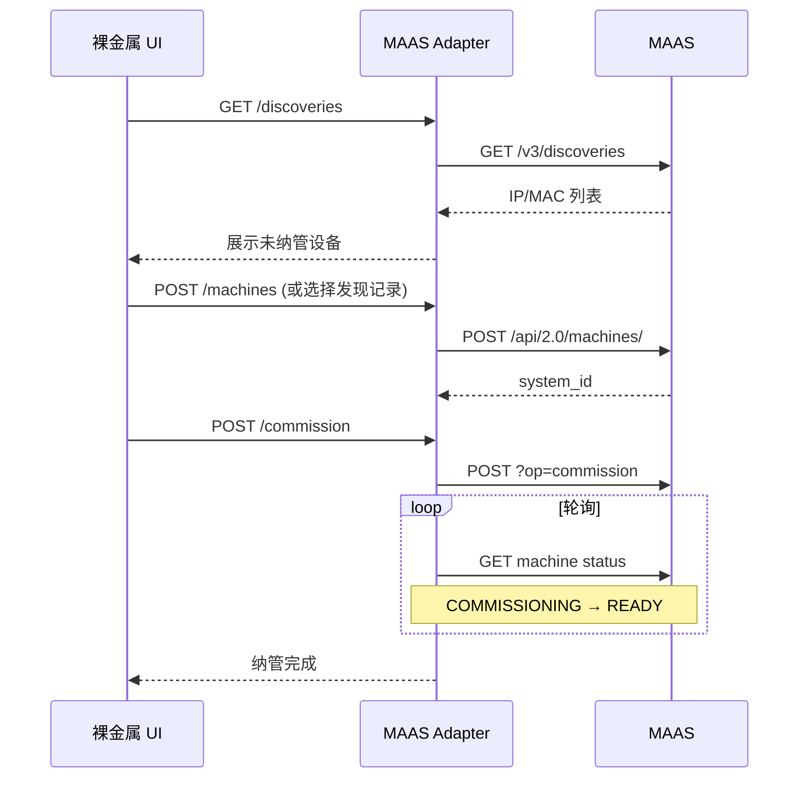
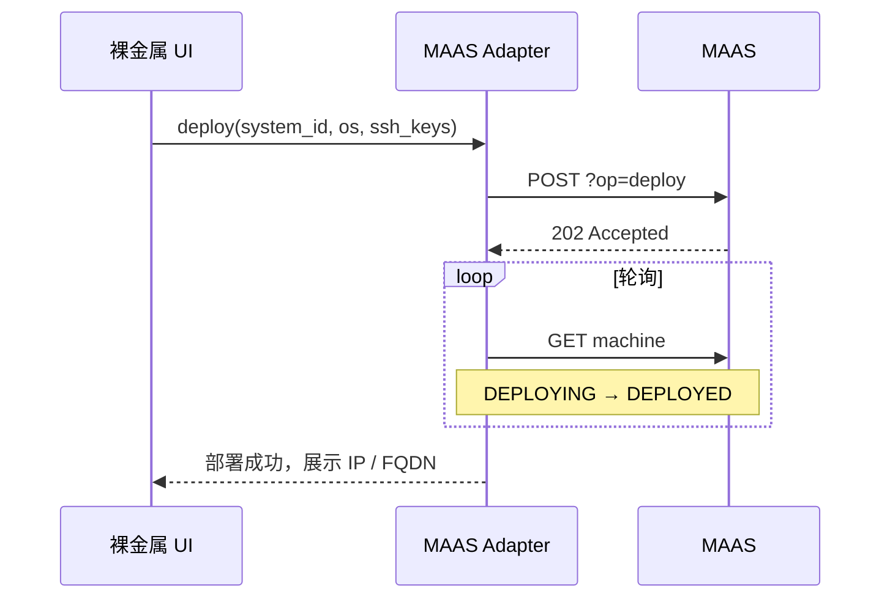
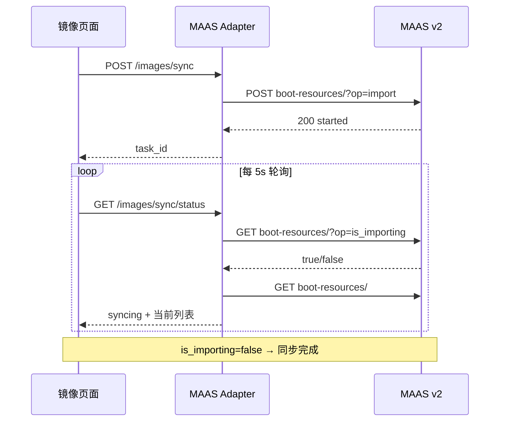

# 上层平台对接 MAAS 指南

本文档面向**多云管理平台**中独立的**裸金属管理模块**，说明如何通过 MAAS 北向 API 完成对接。Tower / MAAS / **云桌面网关**总体关系见 **[云桌面网关总体架构](./remote-access-architecture.md)**。设计前提：

- 各资源类型（虚拟机、容器、裸金属等）拥有**独立管理界面**，不做跨云统一资产模型。
- 裸金属模块通过 **MAAS Adapter（BFF/代理服务）** 直连 MAAS Region。
- 读操作优先使用 **v3 API**；写操作（部署、释放、电源等）使用 **v2 API**。

---

## 1. 架构概览

```
┌─────────────────────────────────────────────────────────┐
│                    多云管理平台                          │
│  ┌──────────────┐  ┌──────────────┐  ┌──────────────┐  │
│  │ 虚拟机管理 UI │  │ 容器管理 UI  │  │ 裸金属管理 UI │  │
│  └──────┬───────┘  └──────┬───────┘  └──────┬───────┘  │
│         │                 │                  │          │
│         ▼                 ▼                  ▼          │
│     各云 API          各云 API         MAAS Adapter     │
└────────────────────────────────────────────┬────────────┘
                                             │ HTTPS
                                             ▼
                              ┌──────────────────────────┐
                              │   MAAS Region Controller │
                              │  v3 API  +  v2 API       │
                              └──────────────────────────┘
```

**职责划分：**

| 组件 | 职责 |
|------|------|
| 裸金属管理 UI | 机器列表、详情、操作入口、任务进度展示 |
| MAAS Adapter | 认证、API 转发、可选短缓存、错误翻译、异步任务跟踪 |
| MAAS | 裸金属全生命周期（发现、纳管、部署、电源、网络） |

平台总览页如需展示裸金属数量，可调用 Adapter 提供的统计接口，**无需**与其他云资源合并存储。

---

## 2. MAAS API 说明

MAAS 提供两套北向 API，对接时需组合使用。

### 2.1 API 路径

| 版本 | 基础路径 | 说明 |
|------|----------|------|
| v3 | `/MAAS/a/v3/` | 现代 REST API，OpenAPI 规范，**以读操作为主** |
| v2 | `/MAAS/api/2.0/` | 传统 API，**覆盖全部生命周期写操作** |

**OpenAPI 文档（v3）：**

```
http://<MAAS_HOST>:5240/MAAS/a/v3/docs
```

**示例 Base URL：**

```
http://10.20.180.189:5240/MAAS
```

### 2.2 读 / 写分工

| 场景 | 推荐 API | 示例 |
|------|----------|------|
| 机器列表、详情 | v3 | `GET /MAAS/a/v3/machines` |
| 事件日志 | v3 | `GET /MAAS/a/v3/events` |
| 网络发现 | v3 | `GET /MAAS/a/v3/discoveries` |
| 子网 / VLAN / 域 | v3 | `GET /MAAS/a/v3/subnets` |
| 镜像 | v3 | `GET /MAAS/a/v3/boot-resources` |
| 标签、资源池 | v3 | `GET /MAAS/a/v3/tags` |
| 部署、释放、纳管 | v2 | `POST /MAAS/api/2.0/machines/{system_id}/?op=deploy` |
| 电源控制 | v2 | `POST ...?op=power_on` |
| 磁盘 / 网卡详情 | v2 | `GET /MAAS/api/2.0/nodes/{system_id}/blockdevices/` |

> **注意：** v3 的 Machines 接口当前以 `GET` 为主；commission、deploy、release 等操作必须通过 v2 完成。

---

## 3. 认证

### 3.1 API Key 格式

在 MAAS Web UI：**Settings → API keys → Generate**，格式为：

```
<consumer_key>:<consumer_token>:<secret>
```

### 3.2 v2 认证（OAuth 1.0）

v2 使用 **0-legged OAuth**，签名方法为 `PLAINTEXT`。

Python 示例：

```python
from oauthlib.oauth1 import SIGNATURE_PLAINTEXT
from requests_oauthlib import OAuth1Session

MAAS_HOST = "http://10.20.180.189:5240/MAAS"
CONSUMER_KEY, CONSUMER_TOKEN, SECRET = "<API-KEY>".split(":")

session = OAuth1Session(
    CONSUMER_KEY,
    resource_owner_key=CONSUMER_TOKEN,
    resource_owner_secret=SECRET,
    signature_method=SIGNATURE_PLAINTEXT,
)

resp = session.get(f"{MAAS_HOST}/api/2.0/machines/")
resp.raise_for_status()
print(resp.json())
```

### 3.3 v3 认证

v3 支持 Bearer Token、OAuth 及 Session 等方式，具体见 v3 OpenAPI 文档中的 Security 定义。Adapter 实现时建议与 v2 共用同一 API Key，由 Adapter 统一签名/换票，**不要**将 Key 暴露给浏览器前端。

### 3.4 安全建议

- 每个 MAAS Region 使用独立 API Key，按最小权限分配。
- API Key 加密存储在 Adapter 配置或密钥管理系统中。
- 前端只访问 Adapter，不直连 MAAS。
- 生产环境建议启用 TLS（`maas config-tls enable`）。

---

## 4. 裸金属管理界面功能模块

建议作为独立前端应用或独立路由域，与其他云管理界面分离加载。

### 4.1 模块划分

```
裸金属管理
├── /dashboard          概览（状态统计、最近事件、Tower 连接只读、控制器明细）
├── /machines           机器列表
├── /machines/:id       机器详情与操作
├── /discoveries        网络发现（未纳管设备）
├── /images             操作系统镜像
└── /network            子网 / VLAN（管理员）
```

> **Tower 实现**：资源池 **编辑 / 测试连接** 在 CNMC「资源池管理」父级操作；概览不含独立 `settings` Tab（旧 `?tab=settings` 重定向至 `dashboard`）。

### 4.2 功能与 API 对照

| 界面功能 | MAAS API | 方法 |
|----------|----------|------|
| 机器列表 | `/MAAS/a/v3/machines` | GET |
| 机器详情 | `/MAAS/a/v3/machines/{id}` | GET |
| 硬件详情（磁盘/网卡） | `/MAAS/api/2.0/nodes/{system_id}/blockdevices/` 等 | GET |
| 网络发现列表 | `/MAAS/a/v3/discoveries` | GET |
| 纳管（Commission） | `/MAAS/api/2.0/machines/{system_id}/?op=commission` | POST |
| 部署 OS | `/MAAS/api/2.0/machines/{system_id}/?op=deploy` | POST |
| 释放 | `/MAAS/api/2.0/machines/{system_id}/?op=release` | POST |
| 开机 / 关机 / 重启 | `?op=power_on` / `power_off` / `power_cycle` | POST |
| 分配 | `?op=allocate` | POST |
| 镜像列表 | `/MAAS/a/v3/boot-resources` | GET |
| 事件 / 操作日志 | `/MAAS/a/v3/events` | GET |
| 控制器状态 | `/MAAS/api/2.0/racks/`、`/regioncontrollers/` | GET |

---

## 5. 机器状态说明

MAAS 机器状态（`NodeStatus`）及界面展示建议：

| MAAS 状态 | 含义 | UI 建议标签 |
|-----------|------|-------------|
| NEW (0) | 新发现，未纳管 | 新建 |
| COMMISSIONING (1) | 硬件检测中 | 纳管中 |
| READY (4) | 可部署 | 可用 |
| ALLOCATED (10) | 已分配 | 已分配 |
| DEPLOYING (9) | 部署中 | 部署中 |
| DEPLOYED (6) | 已部署 | 运行中 |
| RELEASING (12) | 释放中 | 回收中 |
| BROKEN (8) | 故障 | 故障 |
| FAILED_* | 各阶段失败 | 失败 |
| RETIRED (7) | 已退役 | 已下线 |

**主键：** 使用 MAAS 的 `system_id` 作为裸金属模块内的资源唯一标识，无需额外映射层。

v3 机器响应核心字段示例：

```json
{
  "kind": "Machine",
  "system_id": "abc123",
  "fqdn": "node1.maas",
  "status": 4,
  "cpu_count": 32,
  "memory_MiB": 131072,
  "osystem": "ubuntu",
  "distro_series": "jammy",
  "architecture": "amd64/generic",
  "power_type": "ipmi",
  "locked": false
}
```

---

## 6. MAAS Adapter 设计

### 6.1 部署模式

**方案 A — 纯代理（机器量 < 200）：**

- 所有请求实时转发至 MAAS，无本地数据库。
- 实现简单，数据始终最新。

**方案 B — 轻缓存（推荐）：**

- 列表数据缓存 30–60 秒（Redis 或内存）。
- 写操作直调 MAAS，成功后失效相关缓存。
- 详情页按需拉取，可缓存更短时间。

### 6.2 Adapter 对外接口（建议）

以下为裸金属 UI 调用的 BFF 接口示例，非 MAAS 原生 API：

| BFF 接口 | 说明 |
|----------|------|
| `POST /api/bm/regions` | 注册 MAAS Region（URL + API Key） |
| `GET /api/bm/regions/{id}/machines` | 机器列表（分页、筛选） |
| `GET /api/bm/regions/{id}/machines/{system_id}` | 机器详情 |
| `POST /api/bm/regions/{id}/machines/{system_id}/commission` | 纳管 |
| `POST /api/bm/regions/{id}/machines/{system_id}/deploy` | 部署 |
| `POST /api/bm/regions/{id}/machines/{system_id}/release` | 释放 |
| `POST /api/bm/regions/{id}/machines/{system_id}/power` | 电源操作 |
| `GET /api/bm/regions/{id}/tasks/{task_id}` | 异步任务状态 |
| `GET /api/bm/regions/{id}/discoveries` | 网络发现 |
| `GET /api/bm/regions/{id}/events` | 事件日志 |
| `GET /api/bm/regions/{id}/dashboard` | 概览统计 |

### 6.3 异步任务处理

Commission、Deploy、Release 等操作耗时较长（数分钟至数十分钟），**必须异步处理**：

```
1. UI 发起 deploy
2. Adapter 调用 MAAS v2 API，立即返回 task_id
3. 后台轮询 GET machine 状态，或轮询 v3 events
4. 状态到达终态（DEPLOYED / FAILED_*）后更新 task
5. UI 通过 task_id 或 WebSocket 获取进度
```

MAAS **不提供 Webhook**，状态变更依赖：

- 轮询 `GET /MAAS/a/v3/events`（推荐，增量）
- 轮询 `GET /MAAS/a/v3/machines/{id}` 或 v2 机器详情

---

## 7. 典型业务流程

### 7.1 接入 MAAS Region

```
管理员 → 裸金属设置页
  → 填写 Region 名称、URL、API Key
  → Adapter 调用 GET /MAAS/a/v3/machines 验证连通性
  → 保存配置，进入 Dashboard
```

### 7.2 发现并纳管机器



### 7.3 部署操作系统



### 7.4 释放机器

```
UI → Adapter → MAAS POST ?op=release
→ 状态 RELEASING → READY
→ 机器回到可用池
```

---

## 8. 多 Region 与权限

### 8.1 多 Region

- 每个机房 / 可用区对应一个 MAAS Region。
- Adapter 按 `region_id` 路由到不同 MAAS 实例。
- UI 顶部提供 Region 切换器。

### 8.2 租户隔离（可选）

MAAS 支持 Resource Pool 与 RBAC：

- 平台租户 A → MAAS Resource Pool `tenant-a`
- API Key 或 Macaroon 限制可见 Pool
- 裸金属 UI 列表 API 带 `pool` 过滤参数

---

## 9. 错误处理

| MAAS 错误 | Adapter 处理建议 |
|-----------|------------------|
| 401 Unauthorized | 检查 API Key，提示重新配置 |
| 403 Forbidden | 权限不足，展示 MAAS 返回信息 |
| 404 Not Found | 机器已删除，刷新列表 |
| 409 Conflict | 状态不允许该操作（如非 READY 时 deploy） |
| 503 Service Unavailable | Region/Rack 不可用，展示控制器状态 |

写操作前建议 Adapter 侧做**状态前置校验**，减少无效请求。

---

## 10. 实施阶段

| 阶段 | 范围 | 交付物 |
|------|------|--------|
| **P0** | Region 配置 + 机器列表/详情（只读） | 可浏览裸金属资产 |
| **P1** | Deploy / Release / Power + 异步任务 | 可完成基本生命周期 |
| **P2** | Discoveries + Commission + 事件日志 | 完整纳管流程 |
| **P3** | 镜像管理、网络配置、Dashboard 统计 | 运维完善 |

---

## 11. 本地验证清单

在 MAAS 环境就绪后（示例：`http://10.20.180.189:5240/MAAS`），可按以下步骤验证 Adapter 开发：

```bash
# 1. 使用 maas CLI 登录
sudo maas login admin http://10.20.180.189:5240/MAAS/ <API-KEY>

# 2. 列出机器
maas admin machines read

# 3. 查看 v3 OpenAPI
curl -s http://10.20.180.189:5240/MAAS/a/v3/docs | head

# 4. 查看事件
maas admin events query
```

---

## 12. 参考链接

- [MAAS API 登录说明](../reference/api-reference/api-login.md)
- [机器生命周期](../explanation/the-machine-life-cycle.md)
- [Commissioning 说明](../explanation/commissioning-machines.md)
- [部署机器说明](../explanation/deploying-machines.md)
- [MAAS 官方文档](https://maas.io/docs)

---

## 附录 A：v3 主要只读端点速查

| 路径 | 说明 |
|------|------|
| `/MAAS/a/v3/machines` | 机器列表 |
| `/MAAS/a/v3/machines/{id}` | 机器详情 |
| `/MAAS/a/v3/events` | 事件 |
| `/MAAS/a/v3/discoveries` | 网络发现 |
| `/MAAS/a/v3/boot-resources` | 镜像 |
| `/MAAS/a/v3/subnets` | 子网 |
| `/MAAS/a/v3/vlans` | VLAN |
| `/MAAS/a/v3/tags` | 标签 |
| `/MAAS/a/v3/resource_pools` | 资源池 |
| `/MAAS/a/v3/zones` | 可用区 |
| `/MAAS/a/v3/racks` | Rack 控制器 |

## 附录 B：v2 常用写操作速查

| 操作 | v2 调用方式 |
|------|-------------|
| Commission | `POST /api/2.0/machines/{system_id}/?op=commission` |
| Deploy | `POST /api/2.0/machines/{system_id}/?op=deploy` |
| Release | `POST /api/2.0/machines/{system_id}/?op=release` |
| Allocate | `POST /api/2.0/machines/?op=allocate` |
| Power on | `POST /api/2.0/machines/{system_id}/?op=power_on` |
| Power off | `POST /api/2.0/machines/{system_id}/?op=power_off` |
| Mark broken | `POST /api/2.0/machines/{system_id}/?op=mark_broken` |
| 创建机器 | `POST /api/2.0/machines/` |

请求体格式为 `multipart/form-data`（v2 规范），详见 [API v2 文档](../reference/api-reference/index.md)。

---

## 13. 操作系统镜像页面（封装设计）

裸金属模块中独立的 **「操作系统镜像」** 页面，负责展示 MAAS 已同步/已上传的 OS 镜像，并支持从官方源同步、删除、上传自定义镜像。部署机器时的 OS 下拉列表也来自此数据。

### 13.1 设计原则（固定方案）

与 Region 接入认证保持一致，镜像模块**统一使用 v2 API + OAuth 1.0**（`config.apiKey` 拆三段），**不要**混用 v3 Bearer，避免对面再选一套认证。

| 原则 | 说明 |
|------|------|
| 认证 | 与 Region 配置相同：`apiKey` → OAuth1 PLAINTEXT |
| 数据来源 | MAAS `boot-resources`（已落地镜像）+ `boot-sources`（同步源与订阅） |
| 缓存 | 列表缓存 60s；同步/上传任务期间禁用缓存 |
| 异步 | 同步、上传均为长任务，必须任务化 + 轮询 |

### 13.2 镜像在 MAAS 中的两类

| 类型 | MAAS 字段 | 来源 | 界面展示 |
|------|-----------|------|----------|
| **同步镜像** | `rtype=0` (synced) | Ubuntu 官方 simplestreams（images.maas.io） | Ubuntu 22.04 / 24.04 等 |
| **自定义镜像** | `rtype=2` (uploaded) | 用户上传 root.tgz 等 | 自定义名称 |

部署机器时使用 `osystem` + `distro_series`（或 `name` 如 `ubuntu/jammy`），来自 boot-resource 的 `name` 字段。

### 13.3 页面结构

```
裸金属 → 操作系统镜像
├── 工具栏
│   ├── [同步镜像]        触发从 Boot Source 拉取
│   ├── [停止同步]        取消进行中的同步
│   ├── [上传自定义镜像]   打开上传向导
│   └── 刷新
├── Tab：已同步镜像（默认）
│   └── 表格：名称 | 架构 | 大小 | 状态 | 操作(删除)
├── Tab：同步订阅（高级/管理员）
│   └── 表格：OS | Release | 架构 | 已选 | 同步进度
└── 同步进度条（同步中时显示）
```

**列表字段映射（BFF → UI）：**

| UI 列 | MAAS v2 字段 | 说明 |
|-------|-------------|------|
| 名称 | `name` + `title` | 如 `ubuntu/jammy`，展示 `Ubuntu 22.04 LTS` |
| 架构 | `architecture` | 如 `amd64/generic` |
| 类型 | `type` | `synced` / `uploaded` |
| 大小 | 见 **13.3.1** | **列表接口无 size，必须调详情** |
| 状态 | 同步任务状态 | Ready / Downloading（见 13.6） |
| ID | `id` | 删除时使用 |

#### 13.3.1 大小（size）怎么取 —— 必读

**常见错误：** 从 `GET /api/2.0/boot-resources/` 列表里读 `size` —— **该字段不存在**，所以会得到 0 或 null。

**正确做法：** 对每个镜像再调详情接口，从 `sets` 里取。

```
GET {endpoint}/api/2.0/boot-resources/{id}/
```

详情响应结构（节选）：

```json
{
  "id": 5,
  "name": "ubuntu/jammy",
  "architecture": "amd64/ga-22.04",
  "sets": {
    "20260430": {
      "version": "20260430",
      "label": "stable",
      "size": 599809785,
      "complete": true,
      "files": {
        "squashfs": { "size": 468480000, "complete": true },
        "boot-kernel": { "size": 11724904, "complete": true }
      }
    }
  }
}
```

**取 size 的规则（固定算法）：**

1. 读 `sets` 对象（key 为版本号，如 `"20260430"`）
2. 在 `complete=true` 的 set 中，取**版本号最大**的一条
3. 使用该 set 的 **`size` 字段**（单位：**字节**）
4. UI 展示时自行格式化：`599809785` → `572 MiB` 或 `0.56 GB`

Python 示例（BFF 直接复制）：

```python
def extract_size_bytes(detail: dict) -> int | None:
    sets = detail.get("sets") or {}
    if not sets:
        return None
    complete_sets = [
        (version, s) for version, s in sets.items() if s.get("complete")
    ]
    if complete_sets:
        version, s = max(complete_sets, key=lambda x: x[0])
        return s.get("size")
    # 同步未完成时，取最新 set 的 size（可能 partial）
    version, s = max(sets.items(), key=lambda x: x[0])
    return s.get("size")
```

**列表页 BFF 推荐流程：**

```
1. GET /api/2.0/boot-resources/          → 拿到 id、name、architecture
2. 过滤（可选）：name 以 ubuntu/、centos/ 等开头，排除 grub、pxelinux
3. 对当前页每个 id 并行：
     GET /api/2.0/boot-resources/{id}/
4. extract_size_bytes(detail) → size_bytes
5. 返回给前端
```

**同步进度（未完成时）：** 若 `complete=false`，用 `sets[version].progress`（0–100）展示进度条；`size` 仍为预期总大小。

**上传自定义镜像时的 size：** 这是**另一个含义** —— 创建镜像时 POST 参数，来自**本地文件字节数**，不是 API 查出来的：

```python
import hashlib
import os

path = "/path/to/root.tgz"
size = os.path.getsize(path)          # 必填 POST 参数
sha256 = hashlib.sha256(open(path, "rb").read()).hexdigest()
```

#### 13.3.2 普通用户视图：只展示「常规操作系统」（必读）

MAAS 原始列表里混有 **grub / pxelinux 等引导程序**，同一 Ubuntu 还会按内核拆成多行。普通用户只应看到 **Windows、Ubuntu、CentOS** 这类常规 OS。

**原始 10 条 → 用户应看到约 1～3 条：**

| MAAS 原始条目 | 普通用户是否展示 | 用户看到什么 |
|---------------|------------------|--------------|
| `grub-efi-signed/uefi` | ❌ 隐藏 | （内部引导，不展示） |
| `pxelinux/pxe` | ❌ 隐藏 | （内部引导，不展示） |
| `ubuntu/jammy` + `amd64/ga-22.04` | ✅ | **Ubuntu 22.04 LTS** |
| `ubuntu/jammy` + `amd64/hwe-22.04` | ⚙️ 合并 | 同上，默认内核不单独占一行 |
| `ubuntu/jammy` + `amd64/hwe-22.04-edge` | ⚙️ 高级 | 仅在「内核选项」里可选 |
| `centos/centos7` | ✅ | **CentOS 7** |
| `windows/win10` | ✅ | **Windows 10** |

##### 第一步：过滤 —— 只要可部署的操作系统

`boot-resources` 的 `name` 格式为 `{osystem}/{release}`，例如 `ubuntu/jammy`。

**白名单（可部署 OS，与 MAAS 内置注册表一致）：**

```python
DEPLOYABLE_OS = frozenset({
    "ubuntu",
    "ubuntu-core",
    "centos",
    "rhel",
    "windows",
    "suse",
    "ol",          # Oracle Linux
    "esxi",
    "custom",      # 用户自定义镜像
})
```

**黑名单前缀（引导/底层组件，一律不展示）：**

```python
BOOTLOADER_PREFIXES = ("grub", "pxelinux", "syslinux", "bootloader")
```

**过滤函数（BFF 固定使用）：**

```python
def parse_boot_resource_name(name: str) -> tuple[str, str]:
    osystem, _, release = name.partition("/")
    return osystem, release

def is_deployable_os_image(item: dict) -> bool:
    osystem, release = parse_boot_resource_name(item["name"])
    if not release:
        return False
    if osystem.startswith(BOOTLOADER_PREFIXES):
        return False
    return osystem in DEPLOYABLE_OS
```

##### 第二步：分组 —— 同一 OS 版本合并为一行

多条 `ubuntu/jammy` 仅 `architecture` 不同，对用户是 **同一个 Ubuntu 22.04**。

**分组键：** `(osystem, release)`，例如 `("ubuntu", "jammy")`

**展示名映射（BFF 固定）：**

| osystem | release | 用户看到的名称 |
|---------|---------|----------------|
| ubuntu | jammy | Ubuntu 22.04 LTS |
| ubuntu | noble | Ubuntu 24.04 LTS |
| centos | centos7 | CentOS 7 |
| rhel | 8 | Red Hat Enterprise Linux 8 |
| windows | win10 | Windows 10 |
| windows | win2019 | Windows Server 2019 |
| custom | * | 自定义名称（用 `title` 或 release） |

Ubuntu 版本名可用 MAAS 同一逻辑：`jammy` → `22.04 LTS`（见 `format_image_title`）。

**默认变体选择（同组多条 architecture 时只选一条作为默认）：**

优先级从高到低：

1. `architecture` 含 `ga-` 且含主版本（如 `amd64/ga-22.04`）—— **默认推荐**
2. `architecture` 为 `amd64/generic`
3. 不含 `edge`、`lowlatency`、`hwe` 的条目
4. `size` 最大的 completed set（兜底）

同组其余变体放入 `variants[]`，不在主列表占行。

##### 第三步：BFF 返回给前端的结构（普通用户）

**主列表（精简）：**

```json
{
  "items": [
    {
      "group_id": "ubuntu:jammy",
      "display_name": "Ubuntu 22.04 LTS",
      "osystem": "ubuntu",
      "distro_series": "jammy",
      "platform": "linux",
      "default_resource_id": 5,
      "size_bytes": 599809785,
      "size_display": "572 MB",
      "status": "ready",
      "variant_count": 4
    }
  ],
  "total": 1
}
```

**展开/部署时可选内核（高级，可折叠）：**

```json
{
  "group_id": "ubuntu:jammy",
  "variants": [
    {
      "resource_id": 5,
      "label": "通用内核 (GA 22.04)",
      "architecture": "amd64/ga-22.04",
      "is_default": true
    },
    {
      "resource_id": 7,
      "label": "HWE 内核 (22.04)",
      "architecture": "amd64/hwe-22.04",
      "is_default": false
    }
  ]
}
```

##### 页面布局（普通用户 vs 管理员）

```
普通用户 Tab「操作系统」
┌──────────────┬────────┬────────┬────────┐
│ 操作系统     │ 平台   │ 大小   │ 状态   │
├──────────────┼────────┼────────┼────────┤
│ Ubuntu 22.04 │ Linux  │ 572 MB │ 就绪   │
└──────────────┴────────┴────────┴────────┘
  └─ 可选：内核版本 ▼（默认隐藏，点开展开 variants）

管理员 Tab「全部资源 / 同步订阅」
  └─ 仍可见 MAAS 原始 boot-resources（含 grub 等，仅供排障）
```

##### 部署机器时的传参

用户选 **Ubuntu 22.04 LTS**（默认 GA 内核）时，BFF 向 MAAS 传：

```
osystem=ubuntu
distro_series=jammy
```

若用户选了 HWE 变体，额外传 MAAS 所需的 `hwe_kernel` 或使用对应 architecture 的 resource（与 MAAS deploy API 参数一致，由 BFF 根据 `resource_id` 映射）。

##### 给后端的一句话

> 先按 `DEPLOYABLE_OS` 白名单过滤，再按 `(osystem, release)` 分组合并展示；grub/pxelinux 绝不展示；Ubuntu 多内核变体收进 `variants`，主列表只显示「Ubuntu 22.04 LTS」一行。


前端只调 BFF，不直连 MAAS：

| BFF 接口 | 方法 | 说明 |
|----------|------|------|
| `/api/bm/regions/{regionId}/images` | GET | 镜像列表 |
| `/api/bm/regions/{regionId}/images/{id}` | GET | 镜像详情 |
| `/api/bm/regions/{regionId}/images/{id}` | DELETE | 删除镜像 |
| `/api/bm/regions/{regionId}/images/sync` | POST | 开始同步 |
| `/api/bm/regions/{regionId}/images/sync/stop` | POST | 停止同步 |
| `/api/bm/regions/{regionId}/images/sync/status` | GET | 是否同步中 |
| `/api/bm/regions/{regionId}/images/upload` | POST | 创建上传任务（分片） |
| `/api/bm/regions/{regionId}/images/selections` | GET | 同步订阅列表（管理员） |
| `/api/bm/regions/{regionId}/images/selections` | POST | 添加订阅（如 ubuntu jammy amd64） |

**列表响应示例（BFF 归一化）：**

```json
{
  "items": [
    {
      "id": 1,
      "name": "ubuntu/jammy",
      "title": "Ubuntu 22.04 LTS",
      "os": "ubuntu",
      "release": "jammy",
      "architecture": "amd64/generic",
      "type": "synced",
      "size_bytes": 1234567890,
      "status": "ready"
    }
  ],
  "total": 1
}
```

### 13.5 MAAS v2 对接（BFF 内部，唯一实现）

所有请求使用同一 `maas_session(endpoint, apiKey)`（见第 3 节 OAuth1）。

#### 列表已落地镜像

```
GET {endpoint}/api/2.0/boot-resources/
GET {endpoint}/api/2.0/boot-resources/?type=synced
GET {endpoint}/api/2.0/boot-resources/?type=uploaded
```

#### 镜像详情

```
GET {endpoint}/api/2.0/boot-resources/{id}/
```

#### 删除镜像

```
DELETE {endpoint}/api/2.0/boot-resources/{id}/
```

#### 触发同步（从 Boot Source 拉取已订阅版本）

```
POST {endpoint}/api/2.0/boot-resources/?op=import
```

#### 停止同步

```
POST {endpoint}/api/2.0/boot-resources/?op=stop_import
```

#### 查询是否正在同步

```
GET {endpoint}/api/2.0/boot-resources/?op=is_importing
```

返回 `true` / `false`（纯文本）。

#### 管理同步源与订阅（首次配置 / 添加 OS 版本）

```
GET  {endpoint}/api/2.0/boot-sources/
GET  {endpoint}/api/2.0/boot-sources/{source_id}/selections/
POST {endpoint}/api/2.0/boot-sources/{source_id}/selections/
```

添加订阅示例（`multipart/form-data`）：

| 参数 | 示例 | 说明 |
|------|------|------|
| `os` | `ubuntu` | 操作系统 |
| `release` | `jammy` | 版本代号 |
| `arches` | `amd64` | 架构 |
| `subarches` | `*` | 子架构 |
| `labels` | `*` | 标签 |

### 13.6 同步流程（交互 + 后端）



**UI 状态：**

| `is_importing` | 展示 |
|----------------|------|
| `true` | 顶部进度条 + 「停止同步」按钮 |
| `false` | 隐藏进度条，刷新列表 |

### 13.7 上传自定义镜像（高级）

分两步，与 MAAS 原生流程一致：

**Step 1 — 创建资源元数据**

```
POST {endpoint}/api/2.0/boot-resources/
Content-Type: multipart/form-data

name=custom/my-image
architecture=amd64/generic
sha256=<文件sha256>
size=<字节数>
filetype=tgz
title=My Custom Image
```

**Step 2 — 分片上传文件**

```
POST {endpoint}/api/2.0/boot-resources/{resource_id}/upload/{file_id}/
Content-Type: application/octet-stream
Content-Range: bytes {start}-{end}/{total}

<binary chunk>
```

BFF 建议封装为单接口 `POST /images/upload`（multipart），内部完成 create + 分片循环（每片 2–4MB）。

支持的 `filetype`：`tgz`、`tbz`、`txz`、`ddtgz`、`ddraw` 等（见 MAAS 文档）。

### 13.8 与部署页面的关系

机器部署页 OS 下拉**直接复用**镜像列表 API，只展示 `status=ready` 的项：

```
GET /api/bm/regions/{regionId}/images?deployable=true
```

BFF 过滤后返回：

```json
{
  "label": "Ubuntu 22.04 LTS",
  "osystem": "ubuntu",
  "distro_series": "jammy",
  "architecture": "amd64/generic"
}
```

部署时传给 MAAS：

```
POST .../machines/{system_id}/?op=deploy
osystem=ubuntu
distro_series=jammy
```

### 13.9 权限与错误

| 操作 | 所需 MAAS 权限 |
|------|----------------|
| 列表 / 详情 | 查看 Boot 实体 |
| 同步 / 上传 / 删除 | 编辑 Boot 实体 |

| 错误 | UI 提示 |
|------|---------|
| 磁盘空间不足 | 「Region 磁盘空间不足，无法同步镜像」 |
| 同步进行中 | 「同步任务已在运行」 |
| 删除被引用的镜像 | 「镜像正在使用中，无法删除」 |

### 13.10 实施顺序

| 阶段 | 交付 |
|------|------|
| **M1** | 镜像列表 + 详情（只读） |
| **M2** | 触发同步 + 状态轮询 + 停止同步 |
| **M3** | 删除镜像 + 部署页 OS 下拉联动 |
| **M4** | 同步订阅管理 + 自定义镜像上传 |

---

## 14. 概览（Dashboard）开发指南

裸金属模块首页，一屏展示 Region 健康度、机器数量、控制器状态、最近动态。数据全部由 **BFF 聚合**，前端只调 **一个接口**。

### 14.1 固定方案

| 项 | 约定 |
|----|------|
| 前端接口 | `GET /api/bm/regions/{regionId}/dashboard` |
| MAAS 认证 | 同 Region 配置：`config.apiKey` → OAuth1 |
| MAAS API | **统一 v2**（与连通性测试、镜像、机器一致） |
| 刷新 | 前端每 30～60s 轮询；BFF 可缓存 30s |
| v3 | 概览阶段 **不使用** |

### 14.2 页面布局（普通用户）

```
┌─ 概览 ─────────────────────────────────────────────────────┐
│ Region: 勇敢牛牛   http://10.20.180.189:5240/MAAS   v3.5.12 │
├──────────┬──────────┬──────────┬──────────┬──────────────┤
│ 机器总数  │ 可用     │ 运行中   │ 异常     │ 网络发现     │
│   12     │   5      │   6      │   1      │   3          │
├──────────┴──────────┴──────────┴──────────┴──────────────┤
│ 控制器状态                                                  │
│  Region  ● 在线    Rack  ● 在线                           │
├──────────────────────────────────────────────────────────┤
│ 操作系统镜像: Ubuntu 22.04 等 1 个可用                      │
├──────────────────────────────────────────────────────────┤
│ 最近动态（10 条）                                           │
│  10:23  node-01  部署完成                                   │
│  10:15  node-02  Commission 开始                            │
└──────────────────────────────────────────────────────────┘
```

### 14.3 BFF 对外响应（固定 JSON）

```json
{
  "region": {
    "name": "勇敢牛牛",
    "endpoint": "http://10.20.180.189:5240/MAAS",
    "maas_version": "3.5.12",
    "connected": true
  },
  "machines": {
    "total": 12,
    "ready": 5,
    "deployed": 6,
    "provisioning": 1,
    "error": 1,
    "other": 0
  },
  "controllers": {
    "region": [{ "hostname": "cloudmap", "online": true, "version": "3.5.12" }],
    "rack": [{ "hostname": "cloudmap", "online": true, "version": "3.5.12" }]
  },
  "discoveries_count": 3,
  "os_images_count": 1,
  "os_images": ["Ubuntu 22.04 LTS"],
  "recent_events": [
    {
      "time": "2026-05-27T10:23:00Z",
      "hostname": "node-01",
      "description": "Deployed ubuntu jammy",
      "level": "INFO"
    }
  ],
  "sync": {
    "images_importing": false
  }
}
```

### 14.4 BFF 内部：调哪些 MAAS API

全部 OAuth1，Base：`{endpoint}/api/2.0/`。

| 概览字段 | MAAS 调用 | 说明 |
|----------|-----------|------|
| `connected` / `maas_version` | `GET version/` | 无需鉴权也可；建议带 OAuth 一并测 |
| 机器统计 | `GET machines/` | 按 `status` 聚合（见 14.5） |
| Region 控制器 | `GET regioncontrollers/` | 看 `service_set` 状态 |
| Rack 控制器 | `GET rackcontrollers/` | 同上 |
| 网络发现数量 | `GET discoveries/` | 取 `total` 或 len |
| OS 镜像数 | `GET boot-resources/` | 经 **13.3.2 白名单+分组** 后计数 |
| 最近动态 | `GET events/?op=query&limit=10` | 按时间倒序 |
| 镜像同步中 | `GET boot-resources/?op=is_importing` | 返回 `true`/`false` |

**并行请求示例（Python）：**

```python
import asyncio
from oauthlib.oauth1 import SIGNATURE_PLAINTEXT
from requests_oauthlib import OAuth1Session

async def fetch_dashboard(endpoint: str, api_key: str) -> dict:
    session = maas_session(endpoint, api_key)  # 见第 3 节
    base = f"{endpoint.rstrip('/')}/api/2.0"

    version = session.get(f"{base}/version/").json()
    machines = session.get(f"{base}/machines/").json()
    regions = session.get(f"{base}/regioncontrollers/").json()
    racks = session.get(f"{base}/rackcontrollers/").json()
    discoveries = session.get(f"{base}/discoveries/").json()
    boot_resources = session.get(f"{base}/boot-resources/").json()
    importing = session.get(f"{base}/boot-resources/?op=is_importing").text.strip()
    events = session.get(
        f"{base}/events/", params={"op": "query", "limit": 10}
    ).json()

    return build_dashboard_response(
        version, machines, regions, racks,
        discoveries, boot_resources, importing, events,
    )
```

### 14.5 机器状态聚合（固定映射）

MAAS `machines[].status` 为**整数**，BFF 按下列规则汇总：

| MAAS status | 值 | 归入概览桶 |
|-------------|-----|-----------|
| NEW | 0 | `other` |
| COMMISSIONING, TESTING | 1, 21 | `provisioning` |
| READY | 4 | `ready` |
| ALLOCATED, RESERVED | 10, 5 | `ready`（或单独 `allocated`） |
| DEPLOYING | 9 | `provisioning` |
| DEPLOYED | 6 | `deployed` |
| RELEASING, DISK_ERASING | 12, 14 | `provisioning` |
| FAILED_*, BROKEN | 2,8,11,... | `error` |
| RETIRED | 7 | `other` |

```python
PROVISIONING = {1, 9, 12, 14, 21}
ERROR = {2, 3, 8, 11, 13, 15, 18, 20, 22}
READY = {4, 5, 10}
DEPLOYED = {6}

def aggregate_machines(machines: list) -> dict:
    counts = dict(total=0, ready=0, deployed=0, provisioning=0, error=0, other=0)
    for m in machines:
        counts["total"] += 1
        s = m["status"]
        if s in READY:
            counts["ready"] += 1
        elif s in DEPLOYED:
            counts["deployed"] += 1
        elif s in PROVISIONING:
            counts["provisioning"] += 1
        elif s in ERROR:
            counts["error"] += 1
        else:
            counts["other"] += 1
    return counts
```

### 14.6 控制器在线判断

`rackcontrollers` / `regioncontrollers` 返回的 `service_set` 示例：

```json
"service_set": [
  { "name": "rackd", "status": "running" },
  { "name": "agent", "status": "running" }
]
```

**规则：** 所有 `service_set` 中 `status == "running"` → `online: true`，否则 `false`。

### 14.7 最近动态（events）

v2 查询：

```
GET /api/2.0/events/?op=query&limit=10
```

BFF 映射为：

| 字段 | 来源 |
|------|------|
| `time` | `created` |
| `hostname` | `hostname` |
| `description` | `description` |
| `level` | `type` 或日志级别 |

列表按 `created` **倒序**，最多 10 条。

### 14.8 空 Region / 异常处理

| 情况 | 概览表现 |
|------|----------|
| MAAS 连不上 | `connected: false`，卡片显示 `--`，提示检查连接配置（资源池管理中编辑/测连） |
| 无机器 | 各计数为 0，显示「暂无机器，前往网络发现或添加机器」 |
| 无镜像 | `os_images_count: 0`，提示「前往镜像页同步 Ubuntu」 |
| API 401 | 同 Region 认证失败，勿缓存 |

### 14.9 前端交互

| 卡片 | 点击跳转 |
|------|----------|
| 机器总数 / 可用 / 运行中 / 异常 | `/machines?status=...` |
| 网络发现 | `/discoveries` |
| 操作系统镜像 | `/images` |
| Region / Rack 控制器 | 概览页内锚点 `#maas-controllers`（明细表） |

### 14.10 实施顺序

| 阶段 | 内容 |
|------|------|
| **D1** | `GET dashboard` + Region 信息 + 机器计数 |
| **D2** | 控制器状态 + 最近动态 |
| **D3** | 发现数 + OS 镜像摘要 + 同步状态 |
| **D4** | 30s 自动刷新 + 骨架屏 |

### 14.11 给后端的一句话

> 概览 = 一个 BFF 接口聚合 v2 的 `version`、`machines`、`regioncontrollers`、`rackcontrollers`、`discoveries`、`boot-resources`、`events`；机器按 status 整数聚合；镜像数用 13.3.2 过滤后再数；全部 OAuth1，不要 v3。
