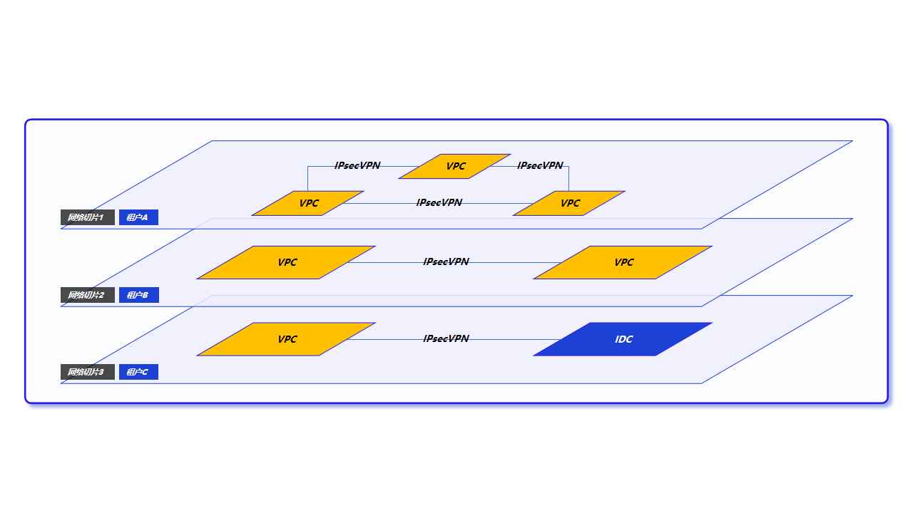
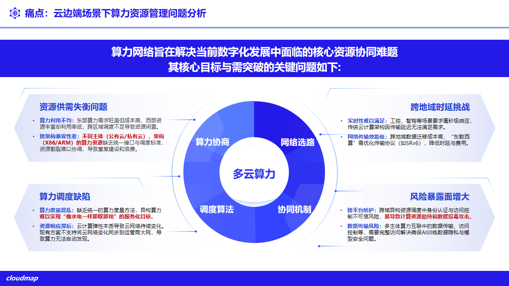
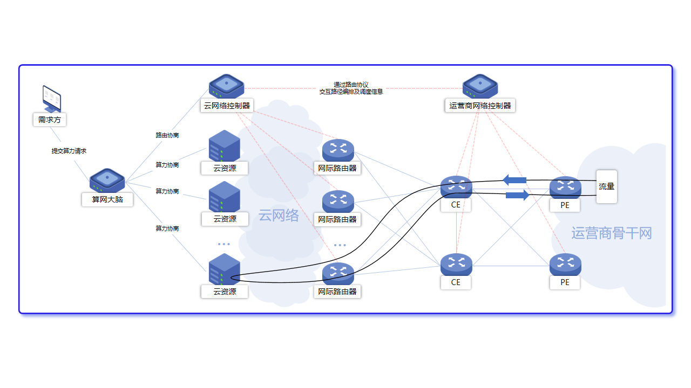
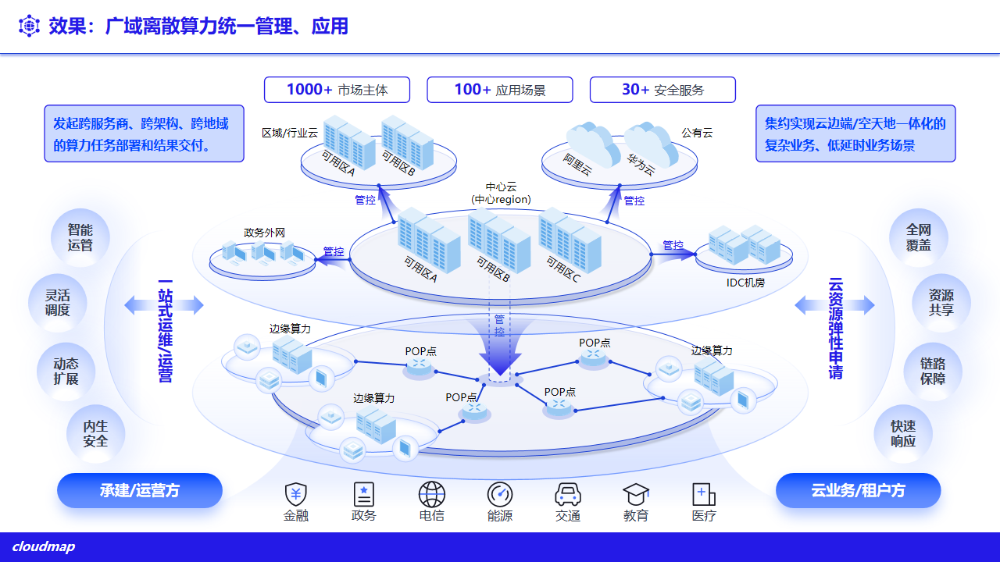
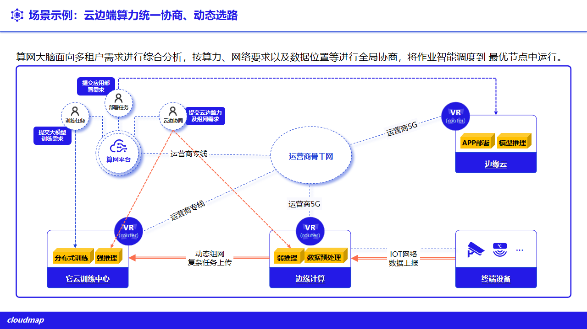

# 1. 产品概述

## 1.1 多云管理的背景与挑战

从当前业务现状剖析，云计算正迈向“中心 + 边缘”的新趋势，动力源自三大业务引擎：一是**本地化应用兴起**，AR/VR 设备、工业智造、自动驾驶等场景日益丰富，促使计算资源向边缘贴近、精准适配多样化需求；二是**基础设施向边缘拓展**，形成现场边缘（1-5ms）、近场边缘（5-20ms）、云边缘（20-40ms）三级形态，应对不同时延挑战；三是**算网融合诉求迫切**，企业依托分布式基础设施渴求最优算力访问路径，推动算力与网络深度融合。

**图 1-1 业务驱动云计算走向边缘**

在这一趋势下，政企普遍同时使用公有云（阿里云、华为云、腾讯云）、私有虚拟化与超融合、裸金属以及边缘节点。多云与云边端并存，算力资源管理面临四类核心协同难题：

- **资源供需失衡**：算力利用不均，东部需求旺盛但成本高、西部资源丰富却利用率低，跨区域调度不足导致资源闲置；不同主体（公有云/私有云）与架构（x86/ARM）缺乏统一接口与调度标准，资源割裂、重复建设。
- **跨地域时延挑战**：工控、自动驾驶等场景要求毫秒量级响应，传统云计算架构因传输延迟难以满足；跨地域数据迁移成本高，需优化传输协议（如 SRv6）以降低时延与费用。
- **算力调度缺陷**：缺乏统一的算力度量方法，异构算力难以按需取用、服务化交付；云资源弹性变化未能同步到广域网络，算力难以自动发现。
- **风险暴露面增大**：跨域异构资源调度中身份认证与访问控制不足，易导致算力劫持与数据投毒攻击；多主体算力互联的数据传输与访问控制需完整方案，保障 AI 训练数据隐私与模型安全。

**图 1-2 云边端场景下算力资源管理挑战**

多云管理平台的目标，是在不改变各云自身能力的前提下，提供一层**统一纳管、统一操作、统一安全与统一运维**的管理面，把分散在多云与云边端的异构资源收敛到同一视图、同一套权限与审计体系，实现资源整合与高效利用。

## 1.2 产品定位

ComputerTower 多云管理平台面向私有化部署的政企用户，统一纳管阿里云、华为云、腾讯云等公有云，以及 Harvester（KubeVirt）、MAAS 裸金属、Rancher 集群等私有与边缘资源。针对新型广域网架构下“节点孤岛、重复建设、运维困难、多头管理”的长期痛点，平台整合云、网、算资源，目标是实现云网一体、资源整合、自动编排与一点运营。

**图 1-3 新广域网架构下的算网调度**

平台以**资源池**为组织单元，将多云实例、云主机、网络、存储、镜像、容器与控制台访问纳入同一管理体系，并叠加多租户、权限、审计、监控、计量与安全运营能力；各云经统一适配层接入，新增云类型按适配能力扩展（总体架构见 **第 2 章**）。

平台与 Cloudmap 融合边缘云为并列产品线：前者解决“把多种云统一管起来”，后者提供“私有化超融合与边缘的自建资源”。两者可同平台协同——Cloudmap 资源池可作为一种被纳管对象接入多云管理平台。

## 1.3 核心价值

**图 1-4 广域离散算力统一管理与应用**

### 1.3.1 统一纳管

在同一平台接入公有云、私有虚拟化、裸金属与容器集群，形成统一资源视图与统一操作入口，减少跨系统切换与重复建设。各云以**资源池 / 多云实例**模型抽象，新增云类型按适配能力扩展。

### 1.3.2 跨云一致操作

云主机、云盘、镜像、网络等常用资源在平台侧提供一致的操作方式与表单，运维经验跨云复用；控制台访问（WebSSH、VNC、KubeVirt 控制台）统一从平台发起，无需逐一登录各云。

### 1.3.3 资源同步与一致性

平台通过后台同步服务定时从各云权威数据源拉取资源状态，保持平台视图与对端一致；用户显式刷新与写操作成功后均触发对端真实拉取，避免陈旧缓存与“假刷新”。

### 1.3.4 多租户与资源隔离

平台以租户—组织—租户用户三级模型组织使用方，资源经资源池绑定按需授予，租户间资源与策略相互隔离，支撑多部门、多项目在同一平台安全共用（详见 **第 10 章**）。

### 1.3.5 跨域互联

平台支持跨云、跨站点的网络互通：依托 SD-WAN 与加密隧道（SRv6、IPsec）打通数据中心、分支与边缘，配合虚拟路由器与租户专线，实现统一编排、智能选路与安全传输（详见 **第 5 章**）。

### 1.3.6 云边协同

平台中心侧统一纳管中心、区域与边缘的分布式资源：中心下发策略、镜像、模型与权限，区域和边缘节点就近承载业务并回传监控与审计；中心链路异常时，边缘侧在既有策略下维持本地运行。云边一体形态与算网大脑见 **第 12 章** 与融合边缘云白皮书（`../../cloudmap/whitepaper/`）。

**图 1-5 云边端算力统一协商与动态选路**

### 1.3.7 安全与合规一致性

基于角色的访问控制（RBAC）在所有被纳管资源上保持一致；关键操作统一审计、可追溯。安全运营、流量编排与国密/等保相关能力按项目选配，统一纳入平台管理。
