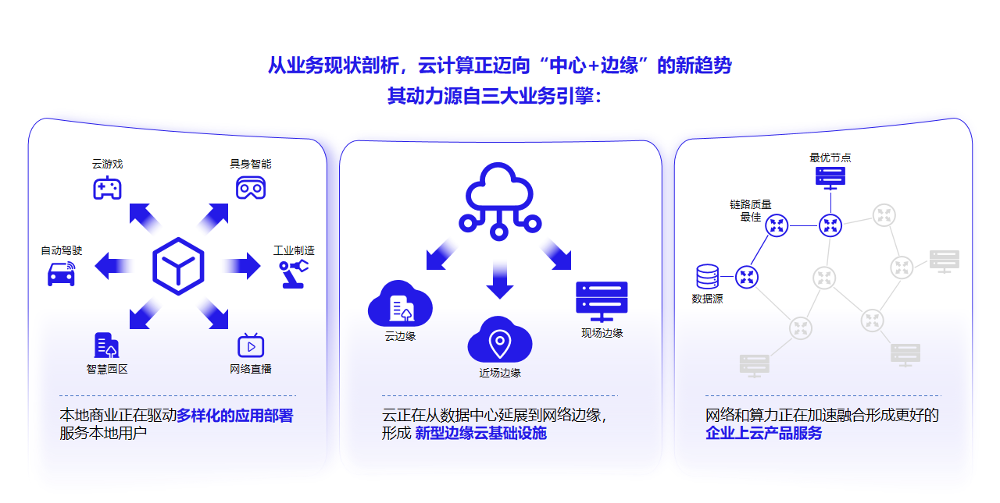
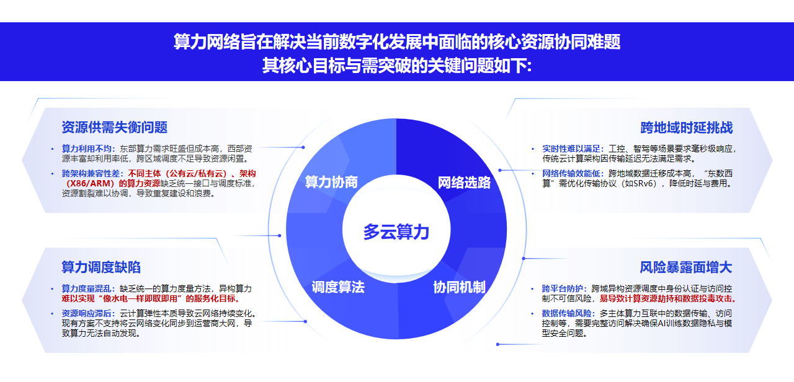
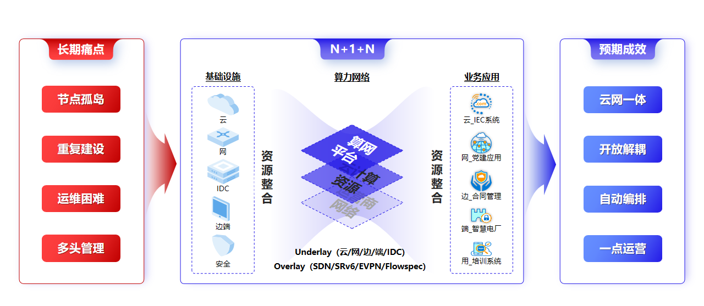
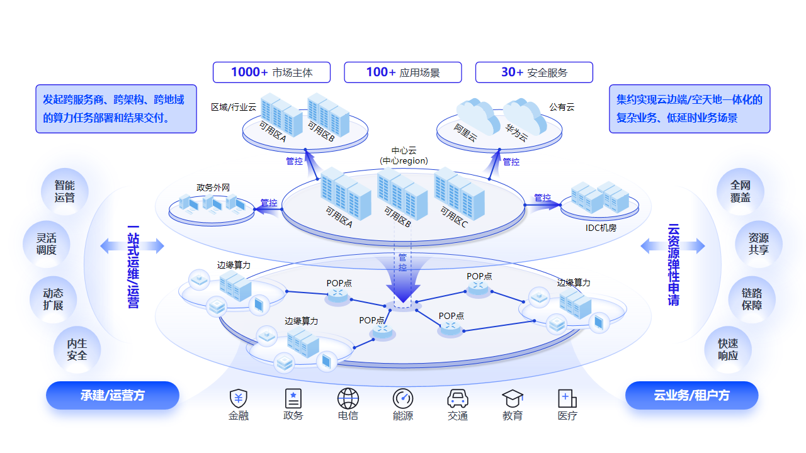

# 1. 产品概述

## 1.1 多云管理的背景与挑战

云计算正从集中式数据中心向“中心 + 边缘”分布演进，主要有三方面原因：一是**本地化应用增多**，AR/VR、工业制造、自动驾驶等场景要求计算靠近现场处理；二是**基础设施向边缘延伸**，形成现场边缘（1–5ms）、近场边缘（5–20ms）、云边缘（20–40ms）等不同时延层次；三是**算力与网络需要协同**，资源分散后，业务要在合适的位置取用算力并规划访问路径。

**图 1-1 业务驱动云计算走向边缘**

在这一趋势下，政企普遍同时使用公有云（阿里云、华为云、腾讯云）、私有虚拟化与超融合、裸金属以及边缘节点。多云与云边端并存，算力资源管理面临四类核心协同难题：

- **资源供需失衡**：算力利用不均，东部需求旺盛但成本高、西部资源丰富却利用率低，跨区域调度不足导致资源闲置；不同主体（公有云/私有云）与架构（x86/ARM）缺乏统一接口与调度标准，资源割裂、重复建设。
- **跨地域时延挑战**：工控、自动驾驶等场景要求毫秒量级响应，传统云计算架构因传输延迟难以满足；跨地域数据迁移成本高，需优化传输协议（如 SRv6）以降低时延与费用。
- **算力调度缺陷**：缺乏统一的算力度量方法，异构算力难以按需取用、服务化交付；云资源弹性变化未能同步到广域网络，算力难以自动发现。
- **风险暴露面增大**：跨域异构资源调度中身份认证与访问控制不足，易导致算力劫持与数据投毒攻击；多主体算力互联的数据传输与访问控制需完整方案，保障 AI 训练数据隐私与模型安全。

**图 1-2 云边端场景下算力资源管理挑战**

多云管理平台的目标，是在不改变各云自身能力的前提下，提供一层**统一纳管、统一操作、统一安全与统一运维**的管理面，把分散在多云与云边端的异构资源收敛到同一视图、同一套权限与审计体系，实现资源整合与高效利用。

## 1.2 产品定位

ComputerTower **多云管理平台**（CNMC）是 Compute Tower 中负责**异构多云统一纳管**的产品线，面向政企私有化部署：平台部署在用户侧，通过统一适配层对接各云 API，不改变各云自身能力与控制台，在其之上提供**同一套资源视图、操作入口、权限与审计**。

**面向用户**：同时使用或计划接入多家公有云、私有虚拟化、裸金属与 Kubernetes 集群的政企与行业单位；运维、资源管理员与租户管理员可在同一 Web 界面完成日常纳管，无需为每个云单独维护一套运维流程与账号体系。

**管理对象**：各云以**多云实例**登记、以**资源池**组织；池内云主机、云盘、镜像、网络、容器工作负载及 WebSSH/VNC 等远程控制台访问，均纳入同一管理面。具体可纳管厂商与操作项以**适配清单**为准（见 **2.2**、**第 3 章**），界面仅展示该云实际支持的能力。

**纳管范围**：平台可登记并纳管的资源池如下。

| 纳管对象 | 资源池类型 | 能力概要 |
| --- | --- | --- |
| 阿里云 | 公有云 | ECS、VPC、云盘、镜像等标准资源 |
| 华为云 | 公有云 | 云主机、网络、存储等标准资源 |
| 腾讯云 | 公有云 | 云主机、网络、存储等标准资源 |
| Cloudmap 私有云 | 私有 | 私有化超融合：虚拟机、卷、镜像、网络与容器 |
| Cloudmap 融合边缘云 | 边缘 | 边缘节点计算、存储、网络与容器 |
| Cloudmap 裸金属集群 | 裸金属 | 物理机发现、装机、电源、镜像与网络 |
| Cloudmap 边缘一体机 | 边缘 | 边缘站点推理、轻量应用与现场监控一体纳管 |
| Rancher 容器集群 | 容器云 | 下游 Kubernetes 集群（一池对应一个集群） |
| CSM 安全控制面 | 安全 | SDN 业务域安全资源，非通用 IaaS 池 |

上述资源池可分布在中心、区域、分支与公有云等多处节点；运维在同一门户内完成跨节点资源查看、变更与审计，无需按站点或云厂商分别登录（跨域网络与选路见 **第 5 章**）。

**图 1-3 新广域网架构下的算网调度**

**与 Cloudmap 融合边缘云**：Cloudmap 侧重私有化超融合与边缘**自建**资源；多云管理平台侧重**纳管已有或外部的异构云**。两者共用 ComputerTower 管理面，Cloudmap 资源池也可作为被纳管对象接入，形成「自建 + 纳管」同一视图（详见 **2.4**）。

## 1.3 核心价值

政企上多云，通常不是换掉已有云，而是**在保留各云投资的前提下，把运维和交付收拢到一个管理面**。对项目负责人，这意味着建设节奏可按资源池逐步扩展，而不必一次性重做流程；对运维负责人，这意味着日常看资源、改配置、进控制台、查谁动了什么，在一套 Web 界面里完成，而不是按厂商切换系统、按站点切换账号。

### 1.3.1 一屏看清家底

业务分布在阿里云、华为云、腾讯云与自建 Cloudmap 等多处时，最怕「不知道资源在哪、占了多少、谁在用」。平台把各资源池登记进统一门户，云主机、存储、网络、容器等按池展示与检索；中心、区域、分支与公有云节点可在同一运营视图里对照查看，减少跨系统拼报表、跨控制台对账的时间。

### 1.3.2 会一套，管多家

各云底层 API 不同，但平台侧对云主机、云盘、镜像、网络等标准资源提供一致的列表、详情与常用操作路径；远程运维（终端、图形控制台、容器日志与 Shell）也从平台统一发起。新增一家云或一类资源池时，运维不必从零学习另一套界面和流程，有利于团队稳定交接与扩容。

### 1.3.3 多部门能共用，权责能划清

同一平台往往要同时服务信息中心、业务部门、外包驻场等多类使用方。平台以租户、组织与用户分级管理，把资源池按需绑定给租户；谁能看、谁能改，在各资源池上规则一致，关键操作留审计记录，便于内控检查与问题追溯，而不是每个云各管各的账号、各查各的日志。

### 1.3.4 利旧接入，按需扩展

已有公有云合约、已有 Cloudmap 私有云或边缘节点，均可作为资源池接入，无需迁移业务才能「上平台」。网络编排、智算推理、安全运营等能力可按项目选配叠加；默认交付聚焦 IaaS 级多云纳管与统一运维，避免为未采购的能力做过度承诺。

典型政企环境中，中心、公有云与边缘站点纳入同一运营视图的关系如下。

**图 1-4 广域离散算力统一管理与应用**
