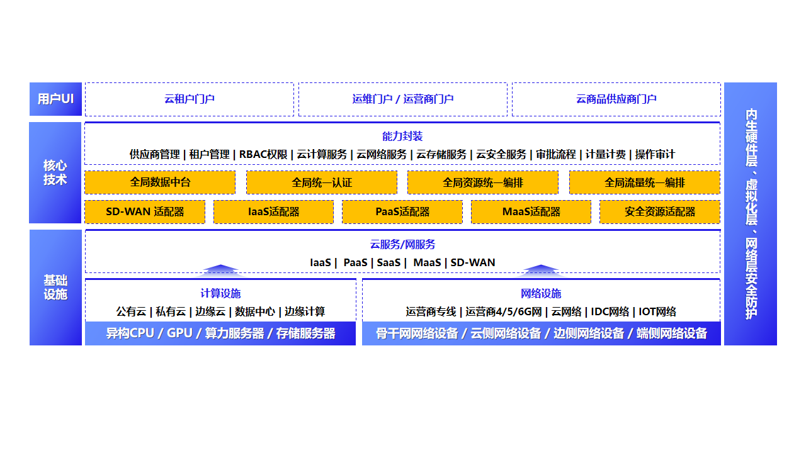
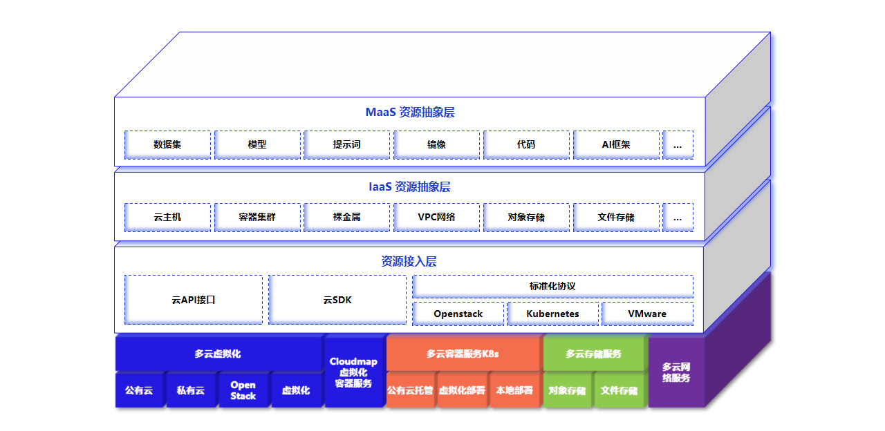
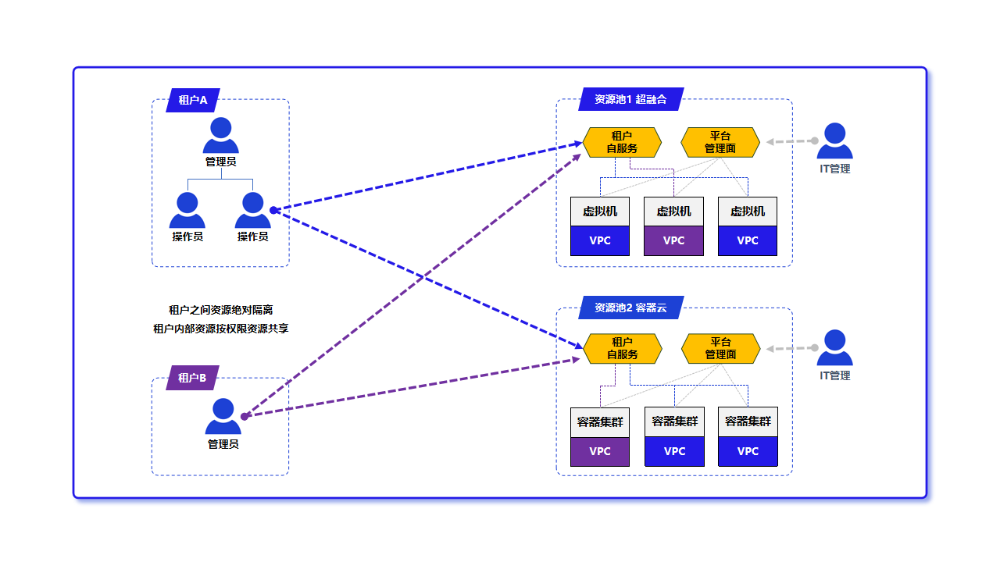

# 2. 总体架构

## 2.1 三层架构

平台整体分为三层，自上而下分别面向“使用、管理、资源”：

- **用户门户层**：按角色提供入口——租户使用资源、运维运营平台、供应商上架云商品，各角色看到的功能与数据相互隔离。
- **核心能力与适配层**：平台的中枢，统一承载供应商管理、租户与权限、计算/网络/存储/安全服务、审批、计量计费与操作审计；并通过一层“适配器”对接各类异构资源，新增一种云只在这一层扩展。
- **基础设施层**：被纳管的实际资源，覆盖公有云、私有云、边缘云与数据中心的异构算力（x86/ARM、CPU/GPU）与存储，以及运营商专线、移动网络（4G/5G）、云网络与物联网等承载网络。

各类云经适配层接入，门户与上层编排不感知厂商差异；新增云类型时上层无需改动（详见 **2.6**）。平台按“中心 — 区域 — 边缘”分级纳管：中心侧统一下发策略、镜像、模型与权限并汇聚监控、告警与审计，区域与边缘节点就近承载业务，中心链路异常时边缘在既有策略下维持本地运行（部署形态见 **第 12 章**）。

**图 2-1 多云管理平台组成架构**

## 2.2 标准化资源模型

平台把各云资源抽象为统一模型，屏蔽厂商差异，使运维面对的是“同一种资源”而非“某家云的某个产品”：

- **资源池 / 多云实例**：每个被纳管的云登记为一个实例（连接信息、区域、能力范围），再归入资源池统一组织。
- **标准资源**：云主机、云盘、镜像、快照、网络（VPC、子网、安全组、EIP、NAT）、容器工作负载等映射为平台标准资源类型，列表、详情与操作口径一致。
- **能力边界**：各云能力并不完全对齐，平台以“适配清单”界定每个云**实际可用**的操作，界面据此显隐，不对不支持的能力做出承诺。

**图 2-2 异构屏蔽与多云资源接入**

## 2.3 多租户与权限模型

多租户是平台的架构性能力，贯穿所有被纳管资源。平台以“租户 — 组织 — 租户用户”三级模型组织使用方，租户间资源与策略相互隔离；资源通过“租户绑定资源池”按需授予，租户仅能看到并操作被授予的部分。基于角色的访问控制（RBAC）与审计在公有云、私有虚拟化、裸金属与容器上一致生效，并可下发到被纳管的 Kubernetes 集群，保持平台与集群两侧权限一致（详见 **第 10 章**）。

**图 2-3 资源重组与多租户隔离**

## 2.4 与融合边缘云的关系

多云管理平台与 Cloudmap 融合边缘云共用 ComputerTower 管理面：Cloudmap 提供私有化超融合与边缘的**自建**资源（计算、存储、网络、安全虚拟化），多云管理平台在其上叠加**对异构外部云的统一纳管**。Cloudmap 资源池本身也可作为被纳管对象接入，形成“自建 + 纳管”的同一视图。融合边缘云能力细节见 `../../cloudmap/whitepaper/`。

## 2.5 关键技术与差异化

平台的价值不在于功能多少，而在于以下几项工程能力，使“统一纳管异构多云”在生产环境可信、可控：

- **适配清单驱动**：各云能力差异在适配层归一为标准资源，界面再按每个云的适配清单**动态显隐**操作——只暴露该云真正支持的能力，从源头避免误操作与过度承诺（见 **2.2**）。
- **权限下发到被纳管集群**：RBAC 不止作用于平台侧，还能同步进被纳管的 Kubernetes 集群，避免“平台已收权、集群侧仍可越权”的权限漂移（见 **10.3**）。
- **数据一致性纪律**：后台定时回拉各云权威数据；用户刷新与写操作成功后均经后端向对端真实拉取并跳过陈旧缓存，杜绝“假刷新”与脏视图（见 **3.4**）。
- **统一远程通道**：终端、图形控制台与容器日志/Shell 经平台统一通道直连目标资源，跨异构资源一套入口，并纳入权限与审计（见 **3.5**）。
- **跨域网络编排**：依托 SRv6、IPsec 与 SD-WAN，结合转控分离的虚拟路由器，打通数据中心、分支与边缘，支持统一编排与智能选路（见 **第 5 章**）。

## 2.6 对外接口与扩展

平台对外提供统一的资源管理与系统接口，资源管理按厂商/控制面分派，远程终端与控制台经独立通道承载（接口清单以交付文档为准）。扩展遵循同一原则：**新增一种云，只需补充对应的适配层与标准资源映射**即可接入统一视图，门户、权限与审计体系无需改动——这使平台的可纳管范围可随业务增长持续扩展，而不必重做管理面。
