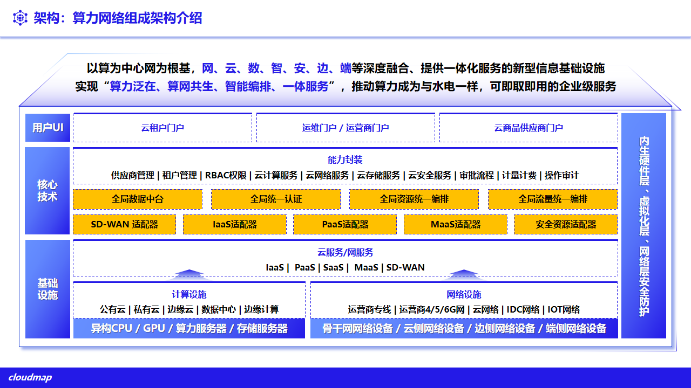
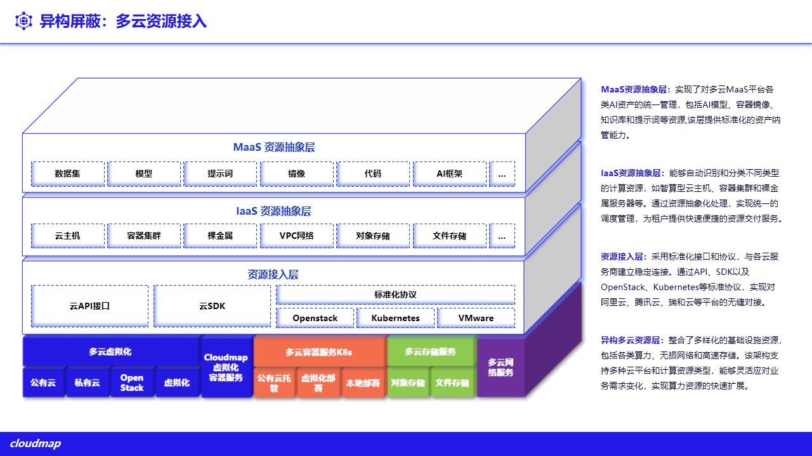
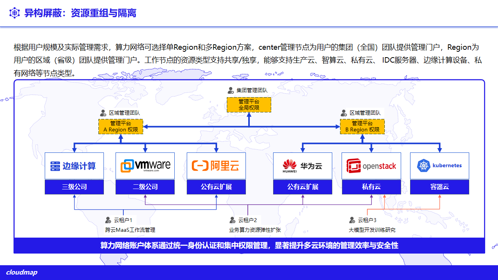

# 2. 总体架构

## 2.1 统一纳管架构

平台以算力为中心、网络为根基，融合网、云、数、智、安、边、端，构建提供一体化服务的新型信息基础设施。整体采用“用户门户 — 核心能力与适配 — 基础设施”三层架构，并以内生硬件层、虚拟化层与网络层安全防护贯穿其中：

- **用户门户层**：面向不同角色提供云租户门户、运维/运营门户与云商品供应商门户。
- **核心技术层**：统一封装供应商管理、租户管理、RBAC 权限、云计算/网络/存储/安全服务、审批流程、计量计费与操作审计；由全局数据中台、全局统一认证、全局资源统一编排与全局流量统一编排支撑；经 SD-WAN、IaaS、PaaS、MaaS 与安全资源等适配器对接异构资源。
- **基础设施层**：计算设施覆盖公有云、私有云、边缘云、数据中心与边缘计算（异构 CPU/GPU、算力与存储服务器）；网络设施覆盖运营商专线、4/5/6G、云网络、IDC 网络与 IOT 网络（骨干、云侧、边侧、端侧网络设备）。

各云经核心技术层的适配器接入，新增云类型在此层扩展，不影响门户与全局编排；控制台访问（WebSSH、VNC、KubeVirt 控制台）经平台 WebSocket 通道直连目标资源。对外统一以 `/api/clouds` 为多云入口，按厂商/控制面分派（如 `/api/clouds/aliyun/*`、`/api/clouds/huawei/*`、`/api/clouds/harvester/*`、`/api/clouds/{id}/maas/*`）。

平台管理面按“中心 — 区域 — 边缘”分级纳管分布式资源：中心侧统一下发策略、镜像、模型与权限并汇聚监控、告警与审计；区域与边缘节点就近承载业务，中心链路异常时在既有策略下维持本地运行（云边协同见 **1.3.6**；部署形态见 **第 12 章**）。

**图 2-1 多云管理平台组成架构**

## 2.2 标准化资源模型

平台将各云资源抽象为统一模型，屏蔽厂商差异：

- **资源池 / 多云实例**：纳管的每个云以实例形式登记（连接信息、区域、能力范围），并归入资源池组织。
- **标准资源**：云主机、云盘、镜像、快照、网络（VPC/子网/安全组/EIP/NAT）、容器工作负载等映射为平台标准资源类型，提供一致的列表、详情与操作。
- **能力边界**：不同云能力不完全对齐，平台以“适配清单”界定每个云实际可用的操作，界面据此显隐，避免对不支持的能力做出承诺。

**图 2-2 异构屏蔽与多云资源接入**

## 2.3 多租户与权限模型

多租户是平台的架构性能力，贯穿所有被纳管资源。平台以“租户 — 组织 — 租户用户”三级模型组织使用方，租户间资源与策略相互隔离；资源通过“租户绑定资源池”按需授予，租户仅可见与操作被授予的资源。基于角色的访问控制（RBAC）与审计在公有云、私有虚拟化、裸金属与容器上一致生效，并可经 IAM CRD 下发到被纳管集群，保持平台与集群侧权限一致。详见 **第 10 章**。

**图 2-3 资源重组与多租户隔离**

## 2.4 与融合边缘云的关系

多云管理平台与 Cloudmap 融合边缘云共用 ComputerTower 管理面。Cloudmap 提供私有化超融合与边缘的自建资源（计算、存储、网络、安全虚拟化）；多云管理平台在其上叠加“对异构外部云的统一纳管”。Cloudmap 资源池本身也可作为被纳管对象接入，形成“自建 + 纳管”的统一视图。融合边缘云能力细节见 `../../cloudmap/whitepaper/`。

## 2.5 对外接口与扩展

- **HTTP API**：统一以 `/api/clouds` 及各厂商子路径提供资源管理；系统能力经 `/api/system`、`/api/audit-logs`、`/api/dashboard` 等提供。
- **WebSocket**：`/ws/ssh`、`/ws/vnc`、`/ws/kv-vnc`、`/ws/kv-pod-log`、`/ws/kv-pod-exec` 承载终端、远程控制与日志。
- **扩展方式**：新增云类型时，新增对应适配层与标准资源映射即可接入统一视图，管理面与权限/审计体系无需改动。
