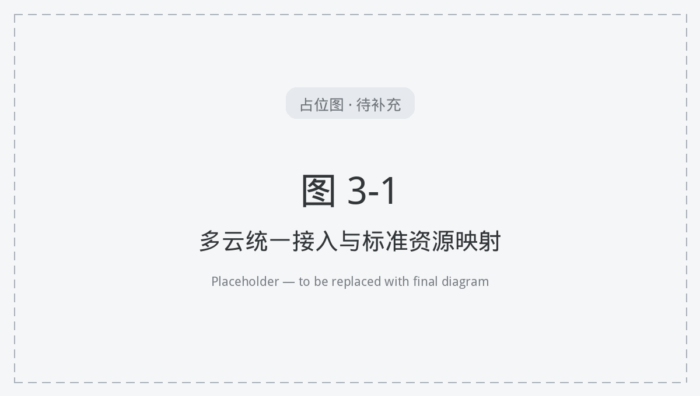
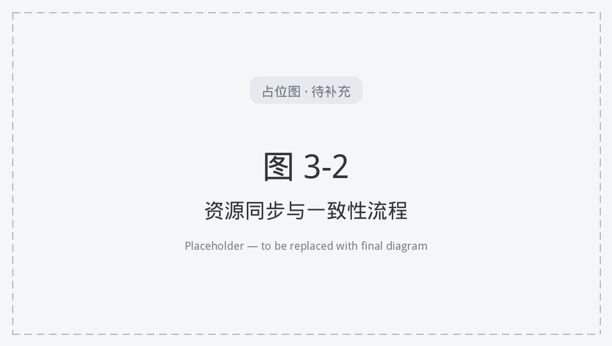

# 3. 多云资源统一纳管

本章说明平台如何接入与统一管理异构云资源，包括公有云、私有与裸金属、资源池模型、资源同步与统一控制台。各云的具体能力以适配清单为准（见 **2.2**）。

**图 3-1 多云统一接入与标准资源映射**

## 3.1 公有云纳管

平台统一纳管阿里云、华为云、腾讯云等主流公有云。运维在平台登记云实例（凭证、区域、能力范围）后，即可在统一视图中查看与操作其云主机、云盘、镜像、网络等资源。

- **统一接入**：按云厂商封装认证与 API 调用，凭证集中保管、统一连通性校验；
- **统一资源视图**：各云实例的云主机、网络、存储等映射为平台标准资源，列表与详情口径一致；
- **能力对齐**：不同公有云能力差异由适配层归一，平台仅暴露该云实际支持的操作。

## 3.2 私有云与裸金属纳管

平台同样纳管私有虚拟化、裸金属与容器集群，与公有云同视图管理：

- **Harvester / KubeVirt**：纳管私有超融合虚拟化，管理虚拟机、卷、镜像、网络与容器资源；
- **MAAS 裸金属**：经 BFF 对接 MAAS，纳管物理机的发现、部署、电源与镜像/网络（见 `docs/maas-integration.md`）；
- **Rancher 集群**：纳管 Kubernetes 集群资源；
- **CSM 控制面**：作为一类控制面接入，统一登记与管理。

## 3.3 资源池与多云实例模型

平台以**资源池**为组织单元、以**多云实例**为纳管单位：

- **多云实例**：每个被纳管的云以实例登记，记录连接信息、区域与能力范围；
- **资源池**：将实例与其资源归入池，按池维度组织视图、权限与运维；资源池也是**租户授权的单位**，可绑定给租户实现隔离供给（见 **第 10 章**）；
- **标准资源**：池内资源统一为云主机、云盘、镜像、网络等标准类型，跨云一致呈现。

## 3.4 资源同步与一致性

平台通过后台同步服务（`CloudSyncService`）定时从各云权威数据源拉取资源状态，使平台视图与对端保持一致；服务在平台启动时自动初始化。

- **定时同步**：周期性回拉各云资源，刷新平台缓存；
- **显式刷新**：用户在界面触发刷新时，经后端对端真实拉取，不以陈旧缓存冒充最新状态；
- **写后重载**：创建/编辑/删除成功后触发列表重载并跳过陈旧缓存，操作结果无需整页刷新即可见。

**图 3-2 资源同步与一致性流程**

## 3.5 统一远程控制台

平台统一提供对被纳管资源的远程访问，无需逐一登录各云控制台：

- **WebSSH 终端**：经 `/ws/ssh` 提供云主机/节点终端；
- **WebVNC 远程控制**：经 `/ws/vnc` 提供图形化远程控制；
- **KubeVirt 控制台与容器运维**：经 `/ws/kv-vnc`、`/ws/kv-pod-log`、`/ws/kv-pod-exec` 提供虚拟机 VNC、Pod 日志与 Pod 终端。

所有控制台访问统一从平台发起，纳入平台权限与审计（见 **第 10 章**）。
