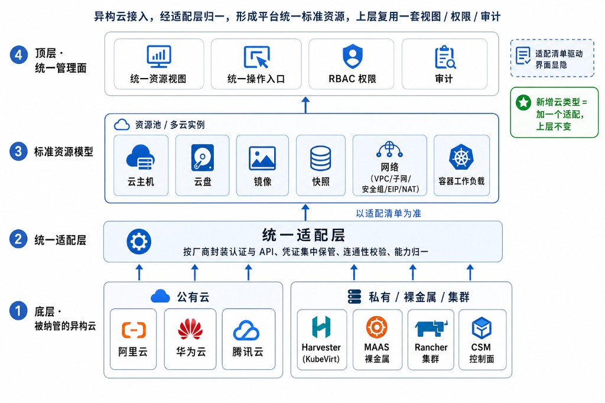
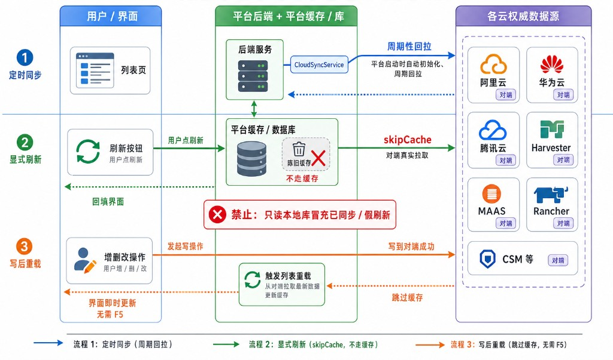

# 3. 多云资源统一纳管

本章说明平台如何接入并统一管理异构云资源，涵盖公有云、私有与裸金属、资源池模型、资源同步与统一控制台。各云的具体能力以适配清单为准（见 **2.2**）。

**图 3-1 多云统一接入与标准资源映射**

## 3.1 公有云纳管

平台统一纳管阿里云、华为云、腾讯云等主流公有云。运维在平台登记一个云实例（填入凭证、区域与能力范围）后，即可在统一视图中查看与操作其云主机、云盘、镜像、网络等资源，无需再登录各云控制台。

- **统一接入**：按厂商封装认证与接口调用，凭证集中保管，纳管前先做连通性校验；
- **统一资源视图**：各云的云主机、网络、存储等映射为平台标准资源，列表与详情口径一致；
- **能力对齐**：公有云之间的能力差异由适配层归一，平台只暴露该云实际支持的操作。

## 3.2 私有云与裸金属纳管

私有虚拟化、裸金属与容器集群同样纳管，与公有云在同一视图下管理：

- **Cloudmap 私有云与边缘**：纳管私有化超融合与边缘节点，统一管理虚拟机、卷、镜像、统一网络、统一存储与容器资源，作为被纳管资源池统一接入（见 **2.4**）；
- **Cloudmap 裸金属集群**：纳管物理机的发现、装机、电源与镜像/网络；
- **Rancher 集群**：纳管下游 Kubernetes 集群资源；
- **CSM 控制面**：作为一类安全控制面接入，统一登记与管理。

Cloudmap 边缘一体机（智算推理、LLM 应用）等专用资源亦以资源池形式纳管，详见 **第 7 章**。

## 3.3 资源池与多云实例模型

平台以**资源池**为组织单元、以**多云实例**为纳管单位，两者构成全书反复出现的基础模型：

- **多云实例**：每个被纳管的云登记为一个实例，记录连接信息、区域与能力范围；
- **资源池**：把实例及其资源归入池，按池组织视图、权限与运维；资源池也是**租户授权的单位**，可整池绑定给租户实现隔离供给（见 **第 10 章**）；
- **标准资源**：池内资源统一为云主机、云盘、镜像、网络等标准类型，跨云一致呈现。

> **【待补齐】跨云统一资源浏览器与 CMDB**
> 价值：把各云资源汇成一张可检索、可关联（主机—网络—存储—应用）的全局资源图谱，而非逐池分别查看，便于影响分析与审计。
> 现状：部分支持——已有资源池/标准资源与总览聚合，但仍按池进入各自详情，无统一资源浏览器与配置项(CI)关系建模。
> 建议落点：后端在标准资源层之上建跨云资源索引与关系表，前端新增“全局资源”检索页。

> **【待补齐】腾讯云纳管控制台**
> 价值：与阿里云/华为云对齐，提供腾讯云资源的统一操作界面。
> 现状：部分支持——后端已有腾讯云列表接口，前端缺独立厂商页面。
> 建议落点：补 `pages/cnmc/clouds/Tencent*` 页面与 section，复用标准资源视图。

## 3.4 资源同步与一致性

界面看到的状态必须与对端真实一致，否则运维据此决策就会出错。平台为此坚持一条数据纪律：**凡可能变化的数据，都向对端权威数据源拉取，不拿陈旧缓存充数**。

- **定时同步**：后台服务周期性回拉各云资源，刷新平台视图，平台启动时即自动运行；
- **显式刷新**：用户点刷新时，由后端向对端真实拉取，而非重绘本地缓存；
- **写后重载**：新增、编辑、删除成功后立即重载当前列表并跳过陈旧缓存，结果无需整页刷新即可见。

**图 3-2 资源同步与一致性流程**

## 3.5 统一远程控制台

对被纳管资源的远程访问统一从平台发起，运维不必为每个云另开控制台、另记账号；所有会话都纳入平台的权限与审计（见 **第 10 章**）。

- **终端**：云主机与节点的 WebSSH 命令行终端；
- **图形控制台**：虚拟机的图形化远程桌面（VNC）；
- **容器运维**：Pod 日志查看与 Pod 内 Shell。

## 3.6 多类型算力池统一接入与算力台账

平台以资源池模型（见 **3.3**）统一接入多厂商、多架构的算力池，并向“算力（CPU / GPU）”维度延伸：

- **多类型算力池统一接入**：公有云、私有超融合、裸金属、容器集群与边缘节点均以资源池统一纳管、集中管控，新增算力池按适配能力接入（见 **3.1**–**3.3**）；
- **CPU 与 GPU 算力纳管**：除 CPU 通用算力外，平台可发现私有超融合集群内的 GPU 算力（物理 GPU、vGPU）并分配给虚拟机；智算推理算力经 Cloudmap 边缘一体机纳管（见 **第 7 章**）；
- **连通性校验**：算力池纳管前做连通性校验，识别接入异常。

在“把 CPU/GPU 统一抽象为算力、做跨池台账与专项总览/监控”方面仍有缺口：

> **【待补齐】统一算力台账与跨池算力总览**
> 价值：对所有算力池建立统一台账（类型/区域/运行状态、CPU 核数、GPU 卡数与型号、总算力/已分配/可用余量），并跨池聚合算力池数、CPU/GPU 总规模、分配率、利用率、实例数，按算力池类型/区域/GPU 型号多维可视化、一键下钻单池明细——是算力调度与扩容决策的基础。
> 现状：部分支持——资源池接入、列表与状态、平台总览聚合已具备，但缺统一“算力（CPU/GPU）”口径的台账与跨池算力聚合视图。
> 建议落点：后端建跨池算力台账与聚合统计（CPU/GPU 规模、分配、余量），前端加算力总览与下钻页面。

> **【待补齐】GPU / 算力实时监控与报表**
> 价值：持续监控各算力池在线/离线/异常/维护状态并实时标记算力不可用；统计各池 CPU/GPU 利用率、GPU 型号分布与空闲/已分配卡数；按时间/区域/算力池类型/GPU 型号输出报表，支撑调度与扩容。
> 现状：部分支持——节点 CPU/内存等运行指标与告警已具备（见 **第 11 章**），但缺面向“算力/GPU”的利用率台账、维护状态标记与多维报表；连通性测试以单池为主，批量巡检待补齐。
> 建议落点：后端补算力/GPU 指标采集、报表导出与批量连通性巡检，前端加算力监控与报表页面。
