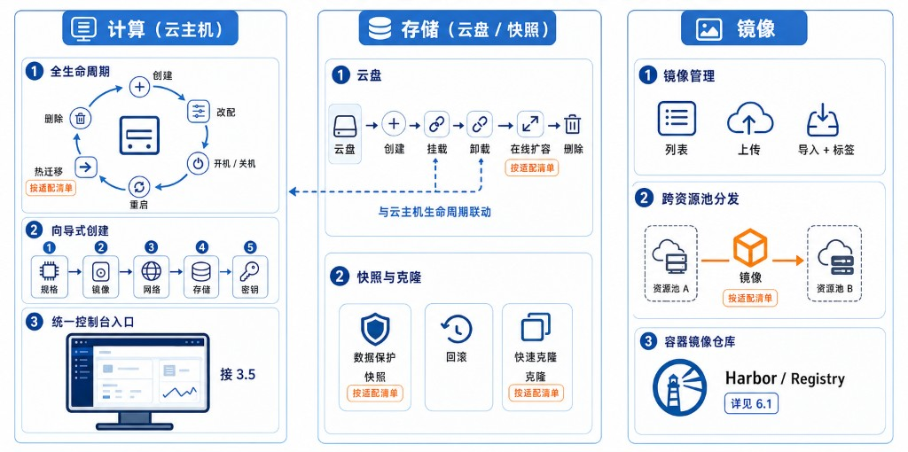

# 4. 统一计算、存储与镜像

计算、存储与镜像是日常用量最大的三类资源。平台对它们提供一致的操作方式与资源视图，使运维经验可跨云复用——会在一家云上开机、扩盘、做镜像，到另一家云上做法基本相同。各云能力深度不同（私有超融合最完整、公有云以其原生能力为准），具体以适配清单为准（见 **2.2**）。

**图 4-1 计算、存储与镜像统一管理**

## 4.1 云主机统一管理

云主机在平台侧提供统一的生命周期、创建流程与控制台：

- **全生命周期**：创建、改配、开关机、重启、热迁移、磁盘/网卡热插拔、重装系统与删除，跨云使用同一套表单与状态呈现；
- **向导式创建与模板**：按规格 → 镜像 → 网络 → 存储 → 密钥的向导逐步创建，也可基于虚拟机模板快速创建同规格实例；
- **调度与可靠性**：可结合部署集与反亲和策略，把同组实例分散到不同节点，降低单点故障影响；
- **统一控制台**：云主机的终端与远程控制统一从平台发起（见 **3.5**）。

> **【待补齐】蓝图与编排工作流（IaC）**
> 价值：把“一组资源（主机+网络+存储+应用）+ 依赖顺序”做成可复用蓝图，一键交付整套环境，并支持参数化与版本管理，是 CMP 供应编排的核心能力。
> 现状：未支持——当前仅单资源的向导式创建，无多资源蓝图、无 IaC（Terraform/模板）或工作流编排引擎。
> 建议落点：后端引入蓝图/编排定义与执行引擎（可基于已有标准资源 API 编排），前端加“蓝图”设计与实例化页面。

## 4.2 云盘与快照

存储围绕云盘与快照展开，并与云主机生命周期联动：

- **云盘管理**：创建、挂载、卸载、在线扩容与删除；
- **快照与克隆**：基于快照做数据保护、回滚与快速克隆，应对误删与版本回退；
- **能力边界**：各云的快照与克隆能力不完全一致，以适配清单为准。

## 4.3 统一存储管理

面向私有云与超融合场景，平台对统一存储提供管理（具体随资源池与存储方案而定，以适配清单为准）：

- **块/文件/对象存储**：统一管理存储池、文件系统与对象存储，并支持对象存储的 S3 兼容访问；
- **容量与节点**：查看存储节点状态与容量分布；
- **存储网络**：统一存储可使用管理网或独立存储网，按部署规划配置，兼顾隔离与带宽。

## 4.4 镜像统一管理

镜像贯穿主机交付与容器交付两条线：

- **镜像列表与导入**：支持控制台上传或工具导入云主机镜像，大镜像可分片上传并自动同步到集群节点，并提供标签管理；
- **跨资源池分发**：镜像可在资源池与站点之间分发，减少重复上传；
- **容器镜像仓库**：容器镜像由平台纳管的镜像仓库（Harbor / Registry）统一管理，详见 **6.1**。

## 4.5 数据保护、迁移与容灾

平台已具备围绕单一资源池的数据保护能力——卷快照、虚拟机备份与恢复、定时备份策略、存储池间迁盘优化，以及回收站软删除与保留期、集群内虚拟机热迁移。在此基础上，面向多云的迁移与容灾仍有缺口：

> **【待补齐】跨云/跨站点迁移**
> 价值：把业务从一朵云平滑搬到另一朵云或另一站点，规避厂商锁定、支撑容量腾挪与平滑演进。
> 现状：未支持——仅私有超融合集群内虚拟机热迁移，无跨云镜像/数据导出—转换—导入的迁移编排。
> 建议落点：后端新增跨云迁移编排（镜像与数据搬运、格式转换、网络重映射），前端在主机详情提供“迁移到…”向导。

> **【待补齐】容灾与跨站点切换（DR）**
> 价值：站点级故障时按 RPO/RTO 目标自动/半自动切换，保障业务连续性。
> 现状：未支持——备份/快照属数据保护，存储池间迁盘（SDRS）属同集群优化，均非跨站点容灾编排。
> 建议落点：后端建容灾计划（保护组、复制、演练、切换/回切编排），前端加容灾计划与演练页面。

## 4.6 能力边界与适配清单

各云在计算、存储、镜像上的能力差异，由适配层归一并以适配清单界定；界面按适配清单显隐操作（见 **2.2**），不对不支持的能力做出承诺。
