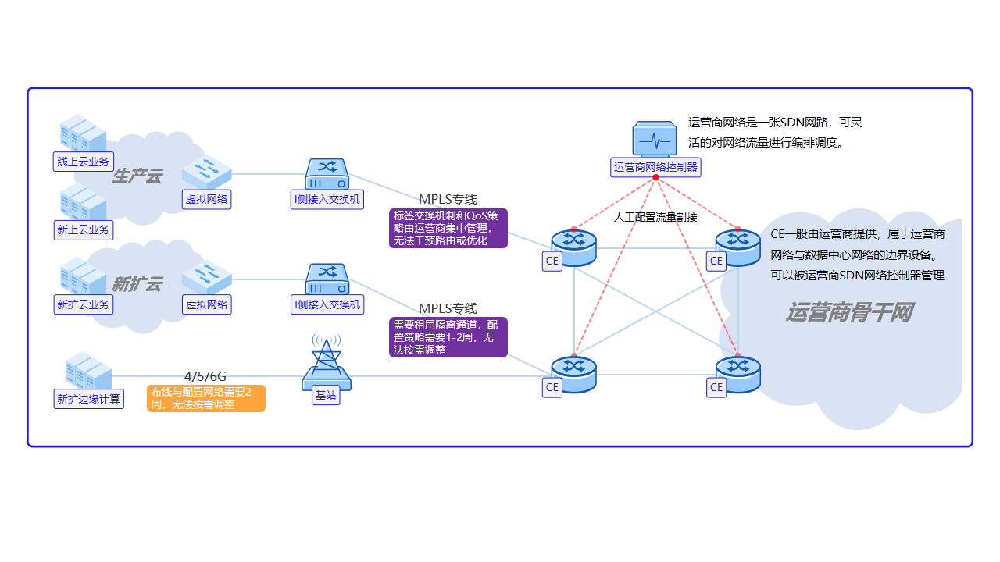
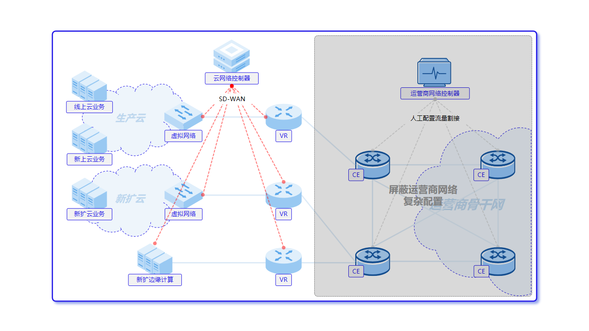
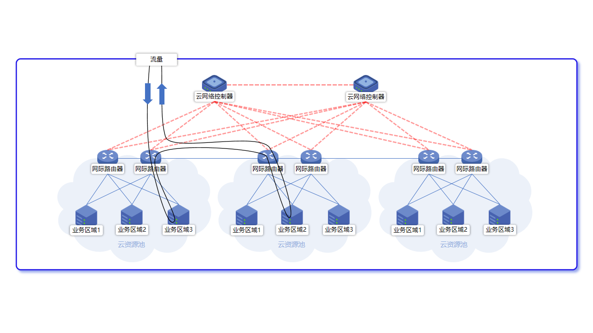

# 5. 统一网络与 SDN

网络是多云协同最难拉通的一环：各云的网络模型不同，跨站点、跨云的互通往往要逐台改物理设备。平台一方面把各云网络资源收进统一视图，一方面叠加自有的 SDN 编排，让跨域组网在界面上完成。公有云网络以各云原生能力为准；平台 SDN 编排能力按项目部署范围交付。

**图 5-1 传统混合多云广域网痛点**

## 5.1 云网络资源统一管理

- **统一视图**：VPC、子网、安全组、NAT、EIP 等网络资源跨云一致呈现与管理；
- **租户隔离**：网络资源按租户与资源池授权，隔离供给（见 **第 10 章**）。

## 5.2 SDN 网络编排

平台内置软件定义网络编排，采用转发与控制分离的架构，把组网策略集中到控制面、下发到转发设备：

- **隧道与 VPN**：SRv6 隧道、IPsec VPN；
- **访问控制**：ACL 规则与分组；
- **地址转换**：NAT 规则；
- **虚拟路由器**：承载跨网路由与边界能力，设备状态在平台侧统一缓存与呈现。

**图 5-2 网络转控分离**

## 5.3 跨域与跨站点互联

平台把分散在数据中心、分支与边缘的资源池在网络上连成一张可编排的广域网：

- **SD-WAN 广域互联**：依托加密隧道打通各站点，支持统一编排与按链路质量智能选路；
- **租户专线**：为租户登记跨站点/跨云的专线接入，纳入租户网络视图；
- **云边协同基础**：作为中心—区域—边缘三级联动的网络底座（见 **第 12 章**）。

**图 5-3 跨资源池流量编排**

## 5.4 能力边界

公有云网络能力以各云原生为准；SDN 编排、虚拟路由器与 SD-WAN 等能力按项目部署与组网方案交付。
