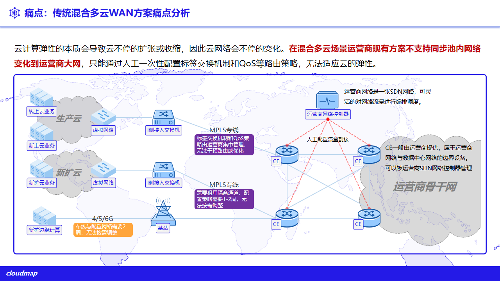
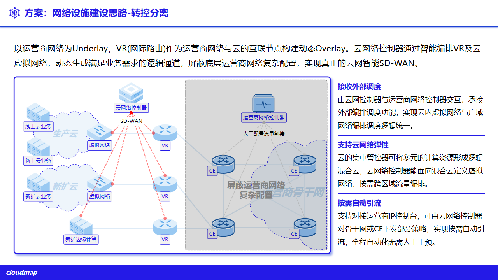
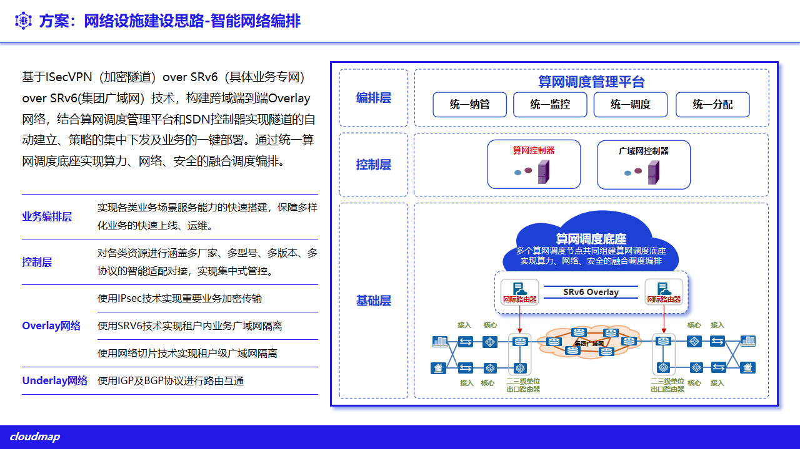
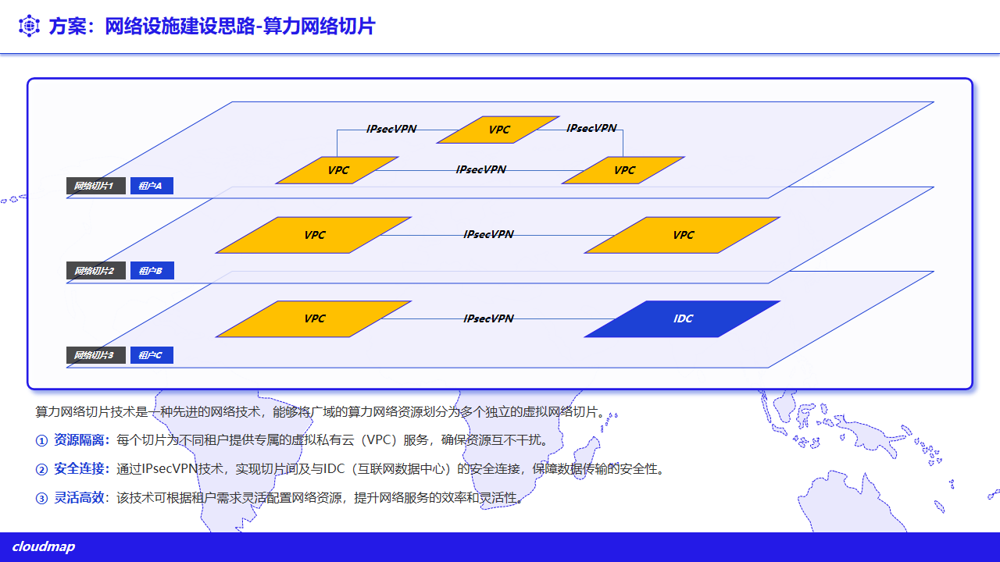
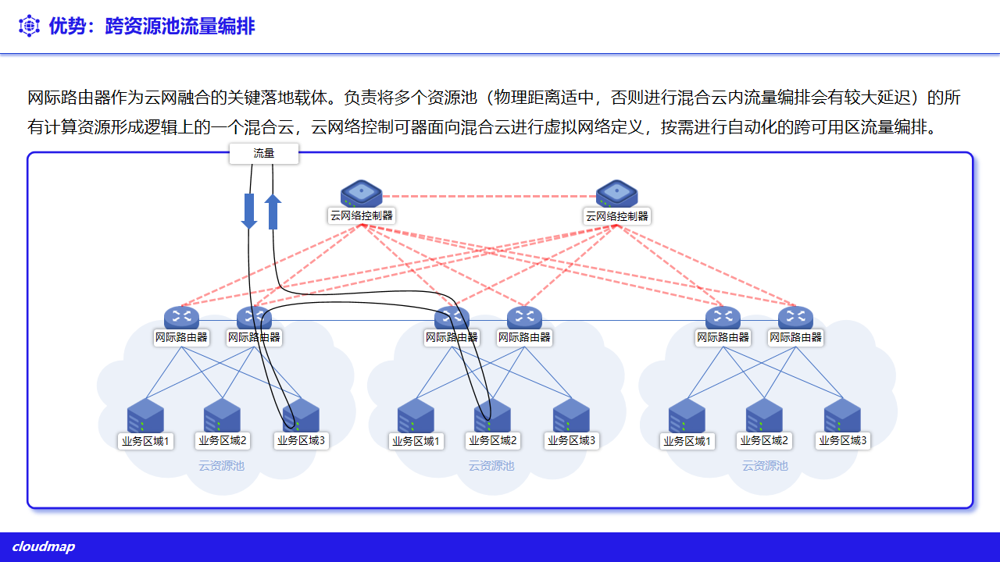
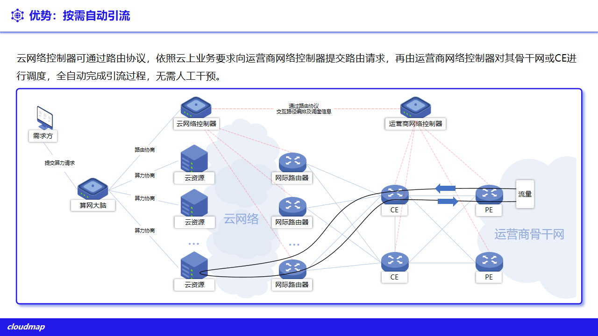

# 5. 统一网络与 SDN

平台对各云网络资源提供统一视图，并叠加自有的 SDN 编排能力，支撑跨云、跨站点的网络互通。公有云网络以各云原生能力为准；平台 SDN 编排能力按项目部署范围交付。

## 5.1 云网络资源统一管理

- **统一视图**：VPC、子网、安全组、NAT、EIP 等网络资源跨云一致呈现与管理；
- **租户隔离**：网络资源按租户与资源池授权，隔离供给（见 **第 10 章**）。

**图 5-1 传统混合多云广域网痛点**

## 5.2 SDN 网络编排

平台提供软件定义网络编排能力（对外路径见 `/api/networks/*`、`/api/vr-config`、`/api/vr-cache`）：

- **隧道与 VPN**：SRv6 隧道、IPsec VPN；
- **访问控制**：ACL 规则与 ACL 分组；
- **地址转换**：NAT 规则；
- **虚拟路由器**：虚拟路由器配置与设备缓存，承载跨网路由与边界能力。

**图 5-2 网络转控分离**

**图 5-3 智能网络编排**

## 5.3 跨域与跨站点互联

- **SD-WAN 广域互联**：依托加密隧道打通数据中心、分支与边缘，支持统一编排与智能选路；
- **租户专线**：为租户登记专线（`TenantLeasedLine`），适配跨站点/跨云的租户网络接入；
- **云边协同基础**：作为中心—区域—边缘三级联动的网络基础（见 **1.3.6**、**第 12 章**）。

**图 5-4 算力网络切片**

**图 5-5 跨资源池流量编排**

**图 5-6 按需自动引流**

## 5.4 能力边界

公有云网络能力以各云原生为准；SDN 编排、虚拟路由器与 SD-WAN 等能力按项目部署与组网方案交付。
