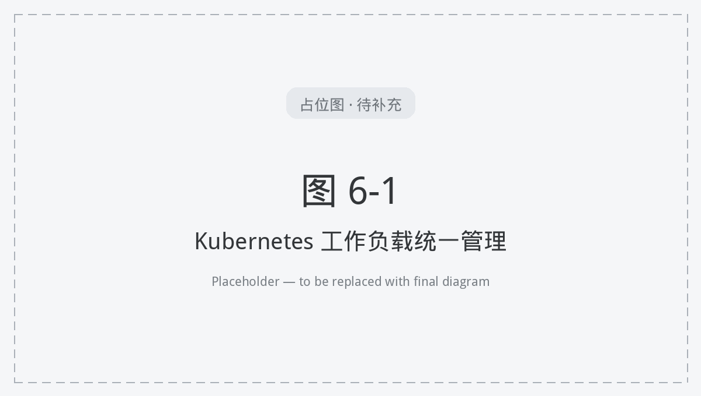

# 6. 容器与云原生统一管理

平台对被纳管的 Kubernetes 集群提供统一的容器与云原生资源管理，与虚拟机、裸金属、网络、存储同平台协同。容器编排能力以各集群实际纳管能力为准。

**图 6-1 Kubernetes 工作负载统一管理**

## 6.1 Kubernetes 工作负载管理

统一管理容器工作负载与配套资源（对外路径见 `/api/clouds/{id}/resources/harvester/containers/*`）：

- **工作负载与任务**：Deployment、StatefulSet、DaemonSet、Job、CronJob；
- **服务与流量**：Service、Ingress、Gateway、HTTPRoute、GRPCRoute；
- **配置与仓库**：ConfigMap、Secret、镜像仓库（Harbor/Registry）；
- **运行保障**：PodDisruptionBudget、网络策略；Pod 日志与终端（`/ws/kv-pod-log`、`/ws/kv-pod-exec`）。

## 6.2 集群纳管

- **多集群纳管**：纳管 Rancher 等 Kubernetes 集群，统一资源视图与操作；
- **统一入口**：集群资源与虚拟化、裸金属资源同平台呈现。

## 6.3 与计算、网络、存储协同

容器与虚拟机、裸金属共享统一网络与存储；调度、网络策略与持久化卷在同一平台编排，降低跨栈协同成本。

## 6.4 能力边界

容器编排与高级能力以各集群纳管能力与版本为准；界面按适配清单显隐（见 **2.2**）。
