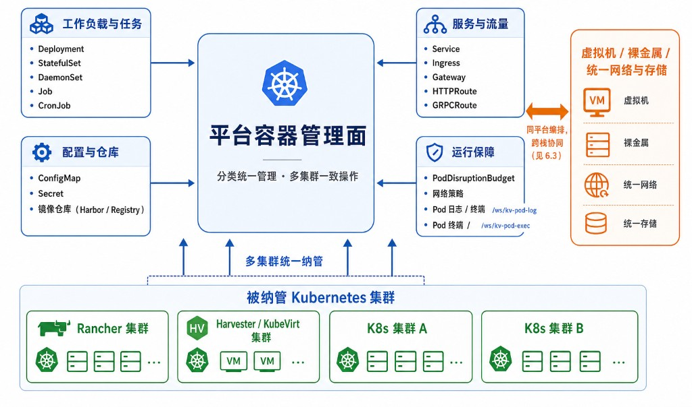

# 6. 容器与云原生统一管理

越来越多业务跑在 Kubernetes 上。平台把被纳管集群的容器与云原生资源也收进同一管理面，与虚拟机、裸金属、网络、存储同平台协同，运维不必在容器平台与云平台之间反复切换。容器编排能力以各集群实际纳管能力为准。

**图 6-1 Kubernetes 工作负载统一管理**

## 6.1 Kubernetes 工作负载管理

平台覆盖容器工作负载从部署到运行保障的常用资源，按四类组织：

- **工作负载与任务**：Deployment、StatefulSet、DaemonSet、Job、CronJob；
- **服务与流量**：Service、Ingress、Gateway、HTTPRoute、GRPCRoute；
- **配置与仓库**：ConfigMap、Secret，以及镜像仓库（Harbor / Registry）；
- **运行保障**：PodDisruptionBudget、网络策略，以及 Pod 日志查看与 Pod 内 Shell。

## 6.2 集群纳管

- **多集群纳管**：纳管 Rancher 等 Kubernetes 集群，一池对应一个集群，统一资源视图与操作；
- **统一入口**：集群资源与虚拟化、裸金属资源在同一平台呈现。

## 6.3 与计算、网络、存储协同

容器与虚拟机、裸金属共享同一套网络与存储；调度、网络策略与持久化卷在同一平台编排，降低跨栈协同成本——例如容器服务可直接复用平台已纳管的网络与镜像，而非另起一套。

## 6.4 能力边界

容器编排与高级能力以各集群纳管能力与版本为准，界面按适配清单显隐（见 **2.2**）。
