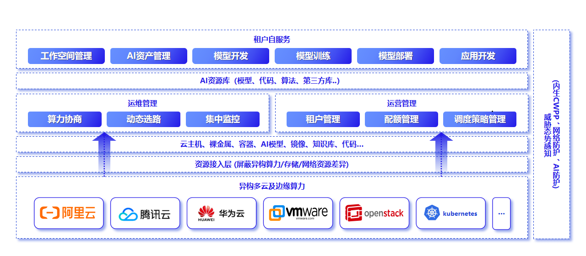
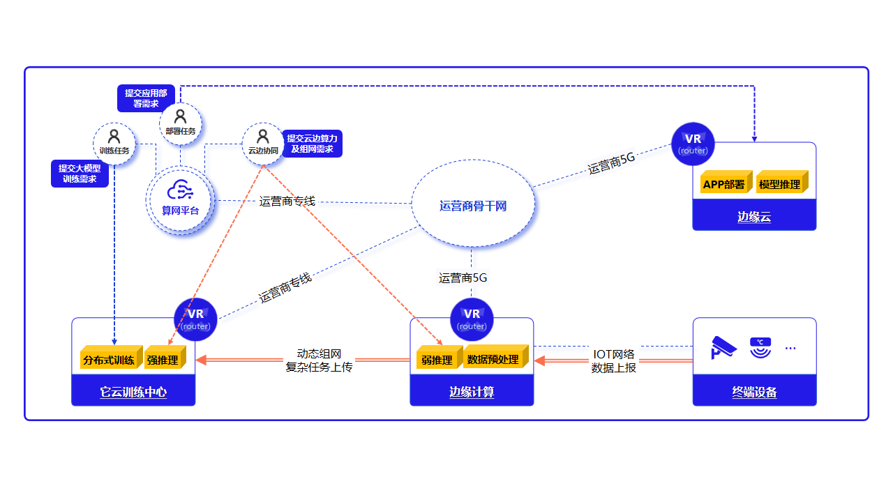

# 7. 智算与 AI 服务纳管

平台可把分散的 AI 算力与应用服务纳入统一管理：用户按需创建计算、存储、网络资源，发起跨服务商、跨架构、跨地域的 AI 任务，由调度策略、监控与配额支撑，底层异构算力/存储/网络差异由资源接入层屏蔽。**本章能力均为选配**，需按项目部署与对接，不作为默认交付。

**图 7-1 基于算网的 AI 算力整合及运用**

本章智算与 AI 能力主要由 Cloudmap 边缘一体机承载。

## 7.1 推理服务纳管

- **推理集群与模型**：纳管推理集群（如 Cloudmap 边缘一体机），提供模型库浏览、模型注册、推理服务启动与运行管理；
- **运维监控**：采集推理集群与模型的运行指标，纳入统一监控（见 **第 11 章**）。

## 7.2 LLM 应用平台

- **应用接入**：纳管 LLM 应用平台，提供统一入口；
- **统一身份**：经单点登录与嵌入代理与平台身份打通，用户无需二次登录。

## 7.3 模型服务 MaaS

模型即服务（Model as a Service，简称 MaaS）面向模型的端到端生产：

- **端到端能力**：覆盖数据标注、模型训练与推理；
- **投产方式**：推理可独立投产，训练与微调按项目部署。

跨云编排智算业务时，租户门户侧完成算力协商与链路质量感知，广域互联能力见 **第 5 章**。

**图 7-2 跨云智算算力协商与动态选路**

## 7.4 能力边界

智算与 AI 能力（推理、LLM 应用、模型服务训练）均为选配，须在方案阶段单独确认；具体模型、并发与上下文长度以项目选型与硬件配置为准。
