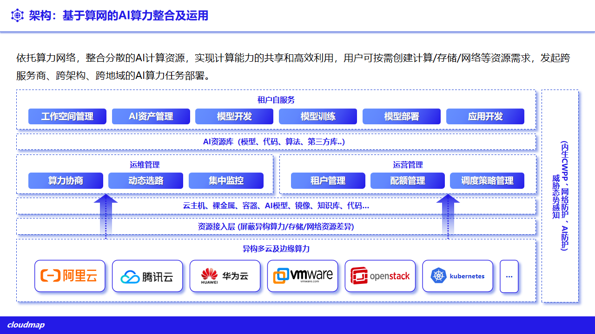
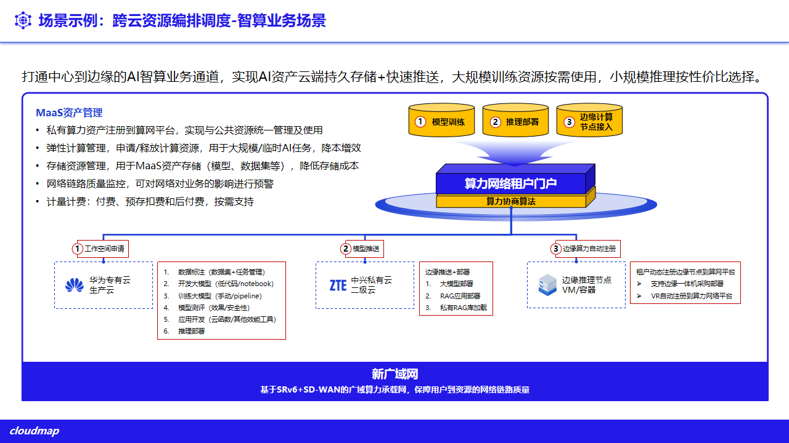

# 7. 智算与 AI 服务纳管

平台可纳管智算推理与 AI 应用服务，与统一算力、存储与网络协同。本章能力均为**选配**，需按项目部署与对接，不应表述为默认能力。

## 7.1 推理服务纳管

- **推理集群**：纳管 Xinference 等推理集群，管理模型与推理服务（对外路径见 `/api/clouds` 下 Xinference 相关路由）；
- **运维监控**：采集推理集群与模型运行指标，纳入统一监控（见 **第 11 章**）。

**图 7-1 基于算网的 AI 算力整合**

## 7.2 LLM 应用平台

- **应用接入**：纳管 Dify 等 LLM 应用平台，提供统一入口；
- **统一身份**：经 SSO 与嵌入代理与平台身份打通（`difySso`、`difyEmbedProxy`）。

## 7.3 MaaS 模型服务

- **模型即服务**：提供数据标注、模型训练与推理的端到端能力；
- **投产方式**：推理可独立投产；训练与微调按项目部署。

**图 7-2 跨云编排智算业务场景**

## 7.4 能力边界

智算与 AI 能力（推理、LLM 应用、MaaS 训练）均为选配，须在方案阶段单独确认，具体模型、并发与上下文能力以项目选型与硬件配置为准。
