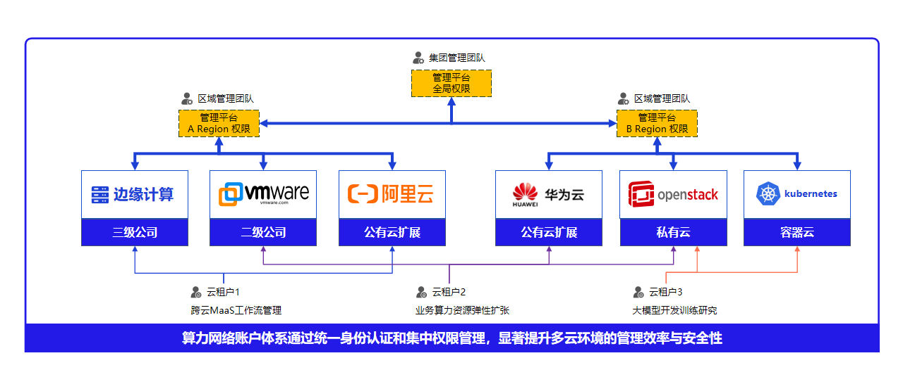
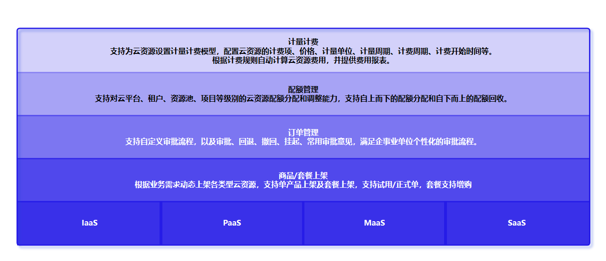

# 10. 多租户、权限与审计

多租户是平台的一等能力，租户管理与多云管理是平级产品线。平台提供统一的租户、组织、用户、角色、配额与审计体系，并在所有被纳管资源（公有云、私有虚拟化、裸金属、容器）上一致生效，使多部门、多项目能在同一平台上安全隔离地共用资源。

## 10.1 租户、组织与租户用户

平台以“租户 — 组织 — 租户用户”三级模型组织使用方：

- **租户**：独立的权限域与资源视图，租户之间资源与策略相互隔离；
- **组织**：租户内的部门或项目分组，用于分权与资源归属；
- **租户用户**：归属某个组织的使用者，按角色获得操作权限。

## 10.2 租户与资源池绑定

平台通过“租户绑定资源池”把多云资源按需授予租户，实现隔离供给：

- **资源池绑定**：把资源池或其中资源授予指定租户，租户只能看到并操作被授予的部分；
- **解绑与回收**：支持资源池解绑与租户资源阻断，资源下线时安全回收；
- **租户专线**：可为租户登记跨站点/跨云的专线接入，纳入租户网络视图。

## 10.3 基于角色的访问控制

平台采用 RBAC，并把权限在平台与被纳管集群两侧拉齐：

- **角色**：内置超级管理员、管理员、租户、设备等角色，并支持自定义角色与按角色分配权限；
- **按页面与操作授权**：权限细到“某个页面的查看 / 操作”；当用户能看到功能但没有写权限时，操作入口**直接隐藏而非置灰**，避免误导；
- **集群侧一致**：平台权限可下发并同步到被纳管的 Kubernetes 集群，避免“平台已收权、集群侧仍可越权”的权限漂移。

**图 10-1 全局资源权限细粒度分配**

## 10.4 配额与分权

- **资源配额**：按租户/用户分配资源与空间配额，防止互相争抢；
- **组织分权**：按组织划分资源归属与审批范围；
- **三权分立**：关键环境可采用管理、业务、审计三权分立，降低越权风险。

**图 10-2 智能计量计费**

## 10.5 审计

- **操作审计**：关键操作统一记录审计日志，支持查询与追溯；
- **留存策略**：审计日志按策略留存，满足合规要求；
- **身份与令牌**：基于令牌的身份认证，登录态由平台统一管理。
