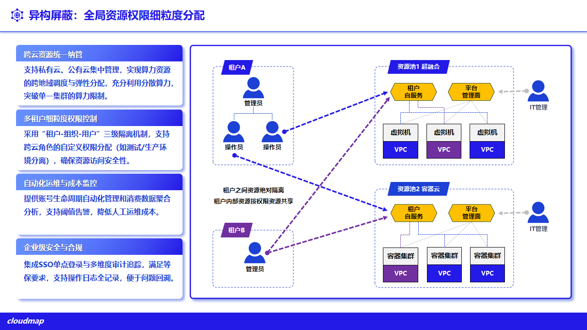
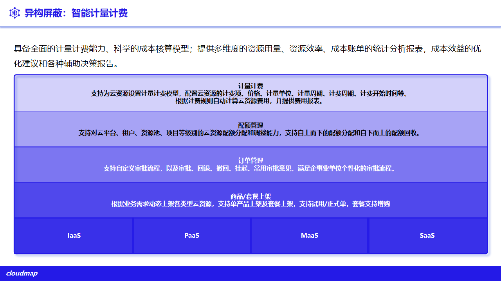

# 10. 多租户、权限与审计

多租户是平台的一等能力：租户管理（TENANTS）与多云管理（CNMC）为平级产品线。平台提供统一的租户、组织、用户、角色、配额与审计体系，并在所有被纳管资源（公有云、私有虚拟化、裸金属、容器）上一致生效，使多部门、多项目可在同一平台安全隔离地使用资源。

## 10.1 租户、组织与租户用户

平台以“租户 — 组织 — 租户用户”三级模型组织使用方（对外路径见 `/api/tenants`，页面见 `pages/tenants/`）：

- **租户**：独立的权限域与资源视图，租户间资源与策略相互隔离；
- **组织**：租户内的部门/项目分组，用于分权与资源归属；
- **租户用户**：归属组织的使用者，按角色获得操作权限。

## 10.2 租户与资源池绑定

平台通过“租户绑定资源池”把多云资源按需授予租户，实现资源的隔离供给：

- **资源池绑定**：将资源池或其资源授予指定租户，租户仅可见与操作被授予的资源；
- **解绑与阻断**：支持资源池解绑与租户资源阻断，下线时安全回收；
- **租户专线**：支持为租户登记专线（`TenantLeasedLine`），适配跨站点/跨云的租户网络接入。

## 10.3 基于角色的访问控制

平台采用 RBAC，权限在平台与被纳管集群侧保持一致：

- **角色**：内置 `super_admin`、`admin`、`tenant`、`sase_device`，并支持自定义角色（`RBACRole`）与角色分配（`RoleAssignment`）；权限以 `permissions` 数组表达，`*` 表示全部权限。
- **以页面为实体的权限原子**：按页面与操作（入口/展示/操作）授权；功能可见但无写权限时，操作入口**隐藏而非置灰**（前端 `WriteGuard` 等）。
- **集群侧一致**：平台权限可经 IAM CRD 下发并同步到被纳管集群（`iamCrdSync`），避免平台与集群权限漂移。

**图 10-1 全局资源权限细粒度分配**

## 10.4 配额与分权

- **资源配额**：按租户/用户分配资源与空间配额（`UserSpace` / `UserSpaceAllocation`），防止资源争抢；
- **组织分权**：按组织划分资源归属与审批范围；
- **三权分立**：关键环境可采用管理、业务、审计分权模式，降低越权风险。

**图 10-2 智能计量计费**

## 10.5 审计

- **操作审计**：关键操作统一记录审计日志（`AuditLog`，对外路径见 `/api/audit-logs`），支持查询与追溯；
- **留存策略**：审计日志按策略留存（`AuditLogRetentionService`），满足合规要求；
- **身份与令牌**：基于 JWT 的身份认证，令牌经统一存储管理（`utils/tokenStorage`）。
