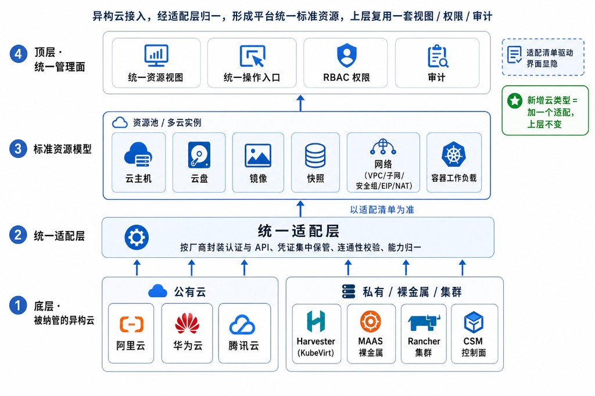
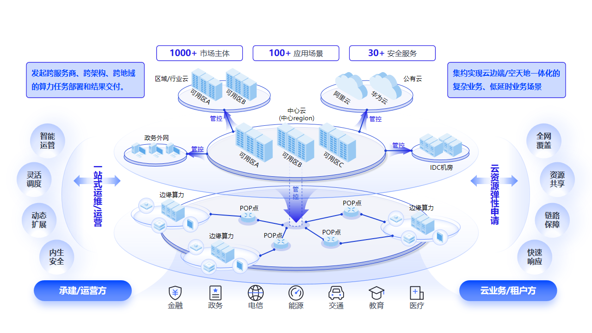
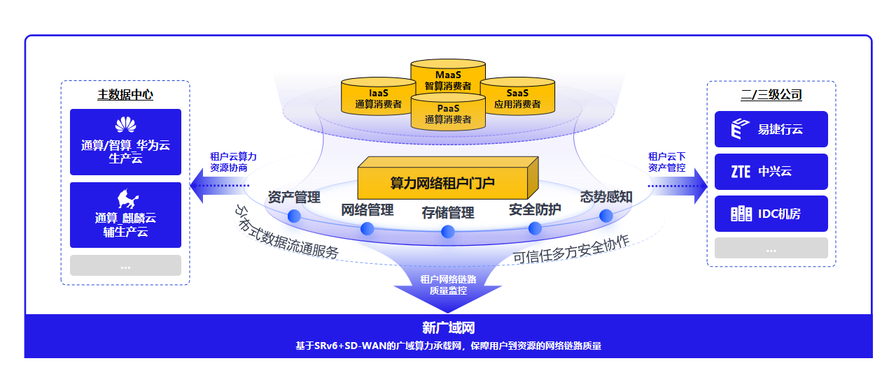
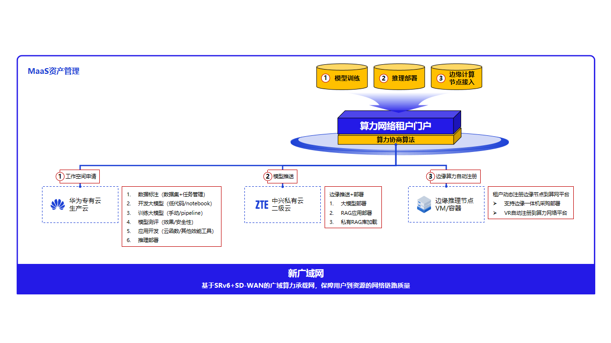

# 13. 典型应用场景

本章按「场景痛点 → 方案要点 → 业务价值」说明平台的典型落地方式。

## 13.1 多云统一纳管与一屏运维

**图 13-1 多云统一纳管与一屏运维**

**场景痛点**：阿里云、华为云、腾讯云与本地资源各自独立，运维需多系统切换，资源视图割裂。  
**方案要点**：统一纳管各云为多云实例与资源池（**3.1**–**3.3**）；资源同步保持一致（**3.4**）；统一控制台与运维大盘（**3.5**、**11.1**）。  
**业务价值**：一屏总览全量资源，跨云一致操作，运维效率提升。

## 13.2 公私混合与业务上云

**图 13-2 某企业混合多云统一管理**

**场景痛点**：存量私有虚拟化/裸金属与公有云并存，业务分级承载与迁移困难。  
**方案要点**：私有 Harvester/MAAS 与公有云同平台纳管（**3.1**、**3.2**）；跨域互联打通（**第 5 章**）；按需扩展智算等选配能力（**第 7 章**）。  
**业务价值**：核心保留本地、弹性用公有云，平滑演进、投资保护。

## 13.3 跨云资源编排调度

**图 13-3 某企业跨云资源编排调度**

**场景痛点**：生产、辅生产与分支/子公司资源分散，租户申请与网络质量缺乏统一协商入口。  
**方案要点**：租户门户统一资产、网络、存储与安全视图；跨云算力资源协商与链路质量监控（**第 5 章** SRv6 + SD-WAN）；IaaS/PaaS/SaaS 消费与多云实例联动（**3.3**、**4.1**）。  
**业务价值**：跨域资源按需编排，网络与算力协同交付，减少多头对接。

## 13.4 跨云 MaaS 与 SaaS 业务编排

**图 13-4 跨云 MaaS 与 SaaS 业务编排**

**场景痛点**：模型训练、推理部署与边缘节点接入分属不同云与环境，资产推送与注册流程割裂。  
**方案要点**：算力网络租户门户统一工作空间申请、模型推送与边缘算力注册（**第 7 章**）；经新广域网保障用户到资源的链路质量（**第 5 章**）。  
**业务价值**：训练—部署—边缘推理一条链路上平台编排，智算与业务应用跨云协同。

## 13.5 多租户行业云

**场景痛点**：多部门/多项目共用平台，权限、配额与隔离要求高。  
**方案要点**：租户—组织—租户用户与资源池绑定隔离（**第 10 章**）；RBAC 与审计一致（**10.3**、**10.5**）。  
**业务价值**：按部门/项目安全交付资源，分权清晰、操作可追溯。

## 13.6 跨云容灾与数据一致

**场景痛点**：跨云/跨站点的数据一致与容灾衔接困难。  
**方案要点**：资源同步与一致性（**3.4**）；跨站点网络与租户专线（**第 5 章**）；统一备份与运维（**第 11 章**）。  
**业务价值**：跨域数据可同步、可追溯，容灾与运维统一管理。
