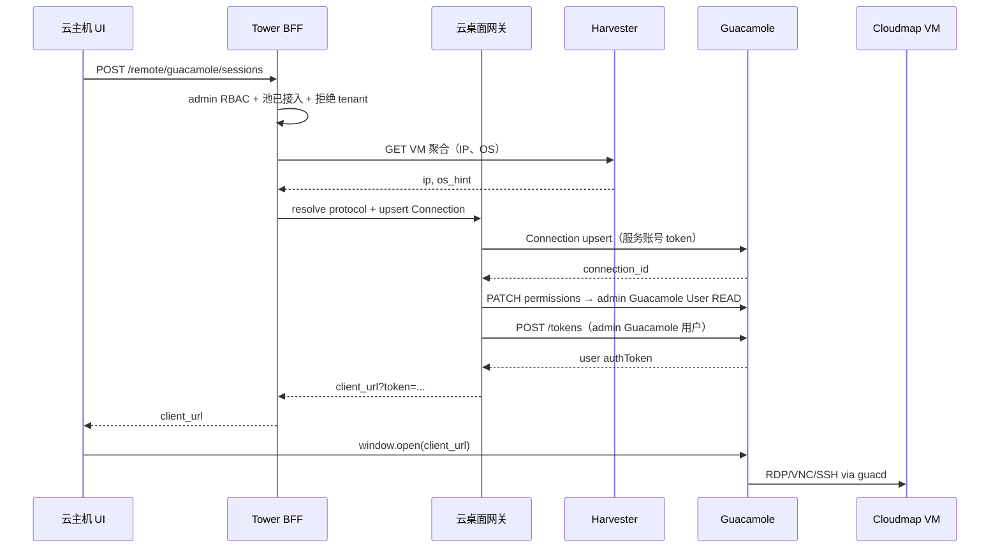
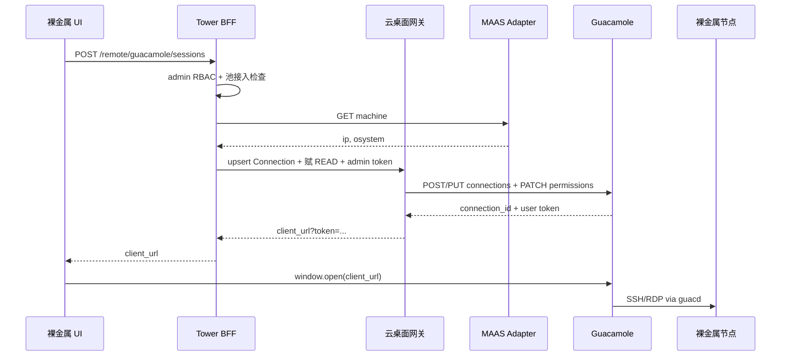

# Compute Tower · 云桌面网关总体架构

> **文档定位**：说明 **Compute Tower**、**云桌面网关**、**MAAS**、**Cloudmap 虚拟机** 的职责边界、部署关系与协作流程。  
> **产品名称**：平台统一远程桌面/终端能力称为 **云桌面网关**；底层协议引擎为 **Apache Guacamole + guacd**（实现细节见 [`integrate-guacamole.md`](./integrate-guacamole.md)）。  
> **适用范围（当前版本）**：**扁平业务网** + **平台 admin 用户体系**；**Cloudmap + MAAS + 云桌面网关** 在该范围内交付。**租户业务暂不纳入云桌面**（无 Guacamole 账号、无入口、API 拒绝）。  
> **接入模型**：**平台注册网关** + **多云资源池接入**（各 `Cloud` 资源池启用后，池内 VM / 裸金属方可对 **admin 用户** 显示「云桌面」）。  
> **细则文档**：MAAS 北向 API 见 [`maas-integration.md`](./maas-integration.md)；Guacamole REST / Connection 见 [`integrate-guacamole.md`](./integrate-guacamole.md)。

---

## 1. 术语

| 术语                 | 含义                                                                                                       |
| -------------------- | ---------------------------------------------------------------------------------------------------------- |
| **云桌面网关**       | Tower 内嵌的远程访问 BFF 模块：实例管理、会话编排、RBAC、`client_url` 生成；对用户/运维的统一产品名。      |
| **网关引擎**         | Apache Guacamole（Web + guacd），由云桌面网关通过 REST 调用；用户不直接配置 guacd。                        |
| **网关注册**         | 平台管理员在系统设置登记 Guacamole 地址与服务账号（全局默认一份）。                                        |
| **资源池接入**       | 某个 `Cloud` 资源池（Cloudmap、MAAS 等）在配置中**启用**云桌面网关后，池内资源才显示「云桌面」入口。       |
| **云桌面**           | **平台 admin 用户**操作：浏览器打开 Guacamole 客户端，经 guacd 连接目标 **业务 IP**（RDP/VNC/SSH）。       |
| **Guacamole 用户**   | 与 Tower **系统用户**（`User`，`super_admin` / `admin`）同步；用于 Connection READ 与 `client_url` token。 |
| **访问 VNC**（已有） | KubeVirt 虚拟化层控制台（`/ws/kv-vnc`），与云桌面网关**互补**，不替代；租户控制台仍可用。                  |

---

## 2. 设计前提

| 前提                     | 说明                                                                                                             |
| ------------------------ | ---------------------------------------------------------------------------------------------------------------- |
| **扁平业务网**           | 单一层业务网段；无 Kube-OVN 租户 VPC、跨网路由、EIP/NAT。目标 IP 即 guacd 连接地址。                             |
| **同网部署**             | Tower、Guacamole、Cloudmap VM、MAAS Region 与已部署裸金属均在业务网。                                            |
| **独立管理界面**         | 虚拟机（Cloudmap）、裸金属（MAAS）等各有独立 UI Tab；**不做**跨云统一资产模型。                                  |
| **Tower 统一 BFF**       | 前端 **只调 Tower**；不直连 MAAS、不直连 Guacamole。                                                             |
| **网关内嵌后端**         | 云桌面网关不是独立微服务，而是 `routes/remote/` + `services/remote/guacamole/`（与 `maas.routes.ts` 同级心智）。 |
| **生命周期与云桌面分离** | Harvester / MAAS 管资源生命周期；云桌面网关只管浏览器远程会话，不纳管、不发现机器。                              |
| **用户范围（当前）**     | 仅 **admin 体系**（系统设置 · 用户）；**租户用户（`TenantUser`）不涉及云桌面**。                                 |
| **延后能力**             | 租户云桌面、Tower 内嵌 guacd 门户、按租户 Connection Group — 见 §13 后续阶段。                                   |

---

## 3. 总体架构

```
                         扁平业务网
    ┌────────────────────────────────────────────────────────────┐
    │                                                            │
    │   浏览器 ──HTTPS──► Compute Tower（前端 + 后端 BFF）        │
    │                          │                                 │
    │            ┌─────────────┼─────────────┐                   │
    │            │             │             │                   │
    │            ▼             ▼             ▼                   │
    │     Harvester/      MAAS          云桌面网关                 │
    │     Cloudmap API    Adapter       （Guacamole BFF）         │
    │     (已有)          (裸金属)      (规划)                     │
    │            │             │             │                   │
    │            ▼             ▼             ▼                   │
    │     Harvester         MAAS         Guacamole                │
    │     集群控制面      Region         Web + guacd              │
    │            │             │             │                   │
    │            │             │             │ SSH/RDP/VNC        │
    │            ▼             ▼             ▼                   │
    │     Cloudmap VM    裸金属节点 ◄────────┘                   │
    │     (业务 IP)      (业务 IP)                                │
    │                                                            │
    └────────────────────────────────────────────────────────────┘
```

**一句话**：Tower 是控制面与门户；MAAS 管裸金属生命周期；**云桌面网关**提供统一浏览器远程桌面/终端；Cloudmap VM 生命周期走 Harvester，进桌面走云桌面网关。

---

## 4. 云桌面网关：两层接入

云桌面网关采用 **「平台注册 + 资源池接入」** 模型：先登记网关，再由各多云资源池启用。

```
┌─────────────────────────────────────────────────────────┐
│  第一层：平台 · 网关注册（系统设置）                      │
│  · Guacamole URL、服务账号、连通性测试                    │
│  · 默认全局单实例（扁平业务网）                           │
│  · API：POST/GET /api/remote/guacamole/instances         │
└──────────────────────────┬──────────────────────────────┘
                           │ 被引用
         ┌─────────────────┼─────────────────┐
         ▼                 ▼                 ▼
   Cloudmap 资源池    MAAS 裸金属池     （未来其他池）
   第二层：资源池接入
   cloud.config.remoteDesktopGateway
         │                 │
         ▼                 ▼
   VM →「云桌面」      机器 →「云桌面」/「远程登录」
```

### 4.1 第一层：网关注册（平台管理员）

| 项       | 说明                                                                              |
| -------- | --------------------------------------------------------------------------------- |
| **UI**   | 系统设置 → **云桌面网关**（规划路径 `/admin/settings/desktop-gateway`）           |
| **内容** | 名称、Guacamole Base URL、服务账号、数据源（默认 `postgresql`）                   |
| **验收** | `POST .../instances/{id}/test`：`POST /api/tokens` + `GET .../connections` 均 200 |
| **存储** | Tower 实体 `GuacamoleInstance`；服务账号密码加密存储                              |

### 4.2 第二层：资源池接入（池管理员 / 建池时）

每个 Tower **`Cloud` 资源池**（Cloudmap Harvester 池、MAAS 裸金属池等）通过 `config` **接入**已注册的网关：

```json
{
  "remoteDesktopGateway": {
    "enabled": true,
    "instanceId": "default"
  }
}
```

| 字段         | 说明                                                        |
| ------------ | ----------------------------------------------------------- |
| `enabled`    | `true` 时池内显示「云桌面」类入口；`false` 或未配置则不显示 |
| `instanceId` | 指向 `GuacamoleInstance.id`；省略时使用平台**默认实例**     |

**接入位置（规划）**：

| 资源池类型            | 配置入口                                |
| --------------------- | --------------------------------------- |
| Cloudmap（Harvester） | 资源池编辑 / 概览 · 云桌面网关接入      |
| MAAS 裸金属           | 资源池编辑 / MAAS 概览 · 云桌面网关接入 |

未接入网关的池：隐藏「云桌面」按钮，提示「请为本资源池接入云桌面网关」或「请联系管理员在系统设置注册网关」。

### 4.3 第三层：资源使用（平台 admin）

入口嵌入 **CNMC 管理员视角** 资源 UI，**无**独立「云桌面列表」大模块；**租户控制台（`/console`）不展示「云桌面」**。

| 资源池      | 入口文案                  | 谁可见                                | 前置条件                            |
| ----------- | ------------------------- | ------------------------------------- | ----------------------------------- |
| Cloudmap VM | **云桌面**                | 平台 admin（`super_admin` / `admin`） | 池已接入网关；VM Running；有业务 IP |
| MAAS 裸金属 | **云桌面** / **远程登录** | 平台 admin                            | 池已接入网关；DEPLOYED；有 IP       |

### 4.4 云桌面用户与管理员分配（当前实现）

```
云桌面用户（cloud_desktop_users，不能登录 Tower）
    │ 同步到云桌面网关（统一密码）
    ▼
Guacamole User
    │ PATCH connectionPermissions READ（分配时）
    ▼
Connection（vm，按需 upsert）
    ▼
Cloudmap VM（扁平业务网 IP）
```

| 账号               | 用途                                                   |
| ------------------ | ------------------------------------------------------ |
| **服务账号**       | Tower 后端调 REST（建 User、Connection、赋权）         |
| **云桌面用户**     | 登录云桌面网关门户；仅见已分配 Connection              |
| **Tower 系统用户** | 具备 `clouds.desktop:write` 时在 VM 列表「分配云桌面」 |

| 事件               | 行为                                         |
| ------------------ | -------------------------------------------- |
| 新建云桌面用户     | 同步 Guacamole User（统一密码）              |
| 管理员分配 VM      | upsert Connection → 赋 READ 给所选云桌面用户 |
| VM Release / 删 VM | 清理 Connection + assignment（G3，待完善）   |

**租户侧**：不创建云桌面用户、不展示分配入口；相关 API 返回 **403**。

---

## 5. 职责边界

### 5.1 Compute Tower

| 维度               | 职责                                                                                                                                    |
| ------------------ | --------------------------------------------------------------------------------------------------------------------------------------- |
| **产品**           | 多云管理平台：Cloudmap 池、MAAS 池、租户控制台、系统设置、RBAC。                                                                        |
| **云桌面网关**     | 服务账号调 API；admin User 同步；Connection upsert/delete、**按 admin 赋权**、带用户 token 的 `client_url`；`/api/remote/guacamole/*`。 |
| **对 MAAS**        | 裸金属 BFF：`/api/clouds/{id}/maas/*`；为云桌面提供 IP / `osystem`。                                                                    |
| **对 Cloudmap VM** | Harvester BFF（已有）；云桌面会话内调 VM 聚合接口取 IP / OS。                                                                           |
| **不做**           | 不替代 MAAS / Harvester 做生命周期；不把网关凭据下发浏览器。                                                                            |

### 5.2 MAAS

| 维度             | 职责                                                                                                                 |
| ---------------- | -------------------------------------------------------------------------------------------------------------------- |
| **产品**         | 裸金属全生命周期。                                                                                                   |
| **对云桌面网关** | **无直接集成**；Tower 读 MAAS 后代网关建 Connection。                                                                |
| **资源池**       | 一个 MAAS Region = 一个 `Cloud`（`type=bare_metal`，`config.provider=maas`），需 **接入** 云桌面网关后开放远程入口。 |

### 5.3 云桌面网关 / Guacamole

| 维度       | 职责                                                                                                           |
| ---------- | -------------------------------------------------------------------------------------------------------------- |
| **产品名** | **云桌面网关**（Tower 模块）                                                                                   |
| **引擎**   | Guacamole：浏览器 ↔ guacd ↔ 目标 `IP:port`                                                                     |
| **对资源** | 不自动发现 VM/裸金属；用户点击「云桌面」时 **按需 upsert Connection**                                          |
| **RBAC**   | Tower 在 `POST /sessions` 前校验 **admin 角色**；Connection READ 赋给对应 Guacamole User；**当前不做租户隔离** |

---

## 6. Tower 后端落位

| 能力           | 路由                               | 服务层                       |
| -------------- | ---------------------------------- | ---------------------------- |
| MAAS 裸金属    | **已有** `/api/clouds/{id}/maas/*` | `services/clouds/maas/`      |
| **云桌面网关** | **规划** `/api/remote/guacamole/*` | `services/remote/guacamole/` |
| Cloudmap VM    | **已有** Harvester 路由            | `services/clouds/harvester/` |
| KubeVirt VNC   | **已有** `/ws/kv-vnc`              | `ws/kvVnc.ts`                |

**持久化（规划）**：

| 实体                           | 用途                                                            |
| ------------------------------ | --------------------------------------------------------------- |
| `GuacamoleInstance`            | 网关注册（URL、服务账号密文、`isDefault`）                      |
| `GuacamoleConnectionMap`       | `vm\|bare_metal` + `cloud_id` + `resource_id` → `connection_id` |
| `GuacamoleUserBinding`（规划） | Tower `User.id` → `guacamole_username`、密码密文（可选）        |

**资源池**：沿用 `Cloud.config.remoteDesktopGateway`，不新增 Region 表。

---

## 7. 网络与部署

### 7.1 扁平业务网（当前唯一拓扑）

```
业务网段（例：10.20.180.0/24）
├── Tower 后端
├── Guacamole Web + guacd（云桌面网关引擎）
├── MAAS Region
├── Cloudmap / Harvester 控制面
├── Cloudmap VM（业务 IP）
└── MAAS 已部署裸金属（业务 IP）
```

**连通性**：guacd → 目标 `IP:port`；Tower → Guacamole REST / MAAS / Harvester；浏览器 → Tower 与 Guacamole Web。

**当前不支持**：跨 VPC、管理网/业务网分离、多业务网域多实例（可后续扩展）。

### 7.2 网关实例策略

| 项                        | 当前约定                                                                       |
| ------------------------- | ------------------------------------------------------------------------------ |
| 默认实例                  | **全局一份**，系统设置注册                                                     |
| 资源池                    | 通过 `remoteDesktopGateway.enabled` 接入，可指定 `instanceId`                  |
| 服务账号                  | `platform-svc` 等，加密存 Tower；仅后端调 API                                  |
| admin 打开云桌面          | Tower 点「云桌面」→ BFF 赋权 → `client_url?token={admin 用户 token}`（新标签） |
| admin 登录 Guacamole 门户 | 使用已同步的 Guacamole 账号，仅见已赋 READ 的 Connection                       |

---

## 8. 业务线：Cloudmap VM 与 MAAS

云桌面网关是**跨池共享能力**；各池接入后，按资源类型编排会话。

### 8.1 Cloudmap 虚拟机 · 云桌面

| 项                | 说明                                                                             |
| ----------------- | -------------------------------------------------------------------------------- |
| **入口**          | `VmSection`（**CNMC 管理员资源池**）行操作「云桌面」；租户 `/console` **不展示** |
| **前置**          | 池已接入网关；VM **Running**；`readVmIp` 有 IP                                   |
| **协议**          | Windows → RDP 3389；Linux 桌面 → VNC/xrdp；Linux 服务器 → SSH                    |
| **数据**          | `GET .../resources/ecs/{ns}/{name}/aggregated`                                   |
| **会话 API**      | `POST /api/remote/guacamole/sessions`，`resource_type=vm`                        |
| **Connection 名** | `vm/{资源池名}/{namespace}/{别名(id)}/{ip}`                                      |

**与「访问 VNC」并存**：

| 能力             | 通路                       | 场景                       |
| ---------------- | -------------------------- | -------------------------- |
| 访问 VNC（已有） | `/ws/kv-vnc` → KubeVirt    | 装系统、Agent 未就绪、救急 |
| 云桌面           | 云桌面网关 → guacd → VM IP | Windows RDP 日常桌面       |

**Cloudmap VM 实施要点**：

| 阶段                    | 内容                                                                                   |
| ----------------------- | -------------------------------------------------------------------------------------- |
| **G-VM1**（已实现）     | G0 网关注册；池接入；`resolveVmDesktop`；VmSection「云桌面」+ Guest 凭据弹窗           |
| **G-Admin**（当前目标） | admin User ↔ Guacamole User；赋 READ；`client_url` 带 admin token；租户 403 / 隐藏入口 |
| **验收**                | admin 登录；Running Windows VM 有 IP；RDP 进桌面；Guacamole 门户仅见已分配 Connection  |

### 8.2 MAAS 裸金属 · 云桌面 / 远程登录

| 项                | 说明                                            |
| ----------------- | ----------------------------------------------- |
| **入口**          | 机器详情 / 列表                                 |
| **前置**          | 池已接入网关；`status=DEPLOYED`；有 IP          |
| **协议**          | Linux → SSH 22；Windows → RDP 3389              |
| **会话 API**      | `resource_type=bare_metal`；内部调 MAAS Adapter |
| **Connection 名** | `bare_metal/{cloud_id}/{system_id}`             |
| **清理**          | Release 成功后 DELETE Connection                |

细则：[`maas-integration.md`](./maas-integration.md)、[`integrate-guacamole.md`](./integrate-guacamole.md) §6。

---

## 9. 协作时序

### 9.1 Cloudmap VM 云桌面



### 9.2 MAAS 裸金属云桌面



---

## 10. API 索引

### 10.1 云桌面网关（规划）

前缀：`/api/remote/guacamole/`（产品名：**云桌面网关 API**；路径可保持不变）

| 路径                              | 说明                                    |
| --------------------------------- | --------------------------------------- |
| `POST/GET /instances`             | 网关注册 / 列表                         |
| `POST /instances/{id}/test`       | 连通性测试                              |
| `POST /sessions`                  | **核心**：创建云桌面会话 → `client_url` |
| `GET /sessions/{id}`              | 会话状态                                |
| `DELETE /sessions/{id}`           | 结束 / 清理 Connection                  |
| `GET /instances/{id}/connections` | 管理员查看 Connection                   |

`POST /sessions` 请求体：

```json
{
  "cloud_id": "<Cloud UUID>",
  "resource_type": "vm | bare_metal",
  "resource_id": "<vm_name | system_id>",
  "namespace": "<vm only>",
  "protocol": "auto | ssh | rdp | vnc",
  "username": "optional",
  "password": "optional"
}
```

响应：

```json
{
  "session_id": "uuid",
  "client_url": "http://<guac>/guacamole/#/client/<base64>?token=<admin_user_token>",
  "connection_id": "1",
  "expires_at": "ISO8601"
}
```

> **G0 现状**：`client_url` 可能无 `token`，Connection 仅堆在服务账号下；**G-Admin** 起须带 admin 用户 token 并完成赋权。

REST 细则：[`integrate-guacamole.md`](./integrate-guacamole.md)。

### 10.2 MAAS（已有）

前缀：`/api/clouds/{cloudId}/maas/` — 见 [`AGENTS.md`](../AGENTS.md) 与 [`maas-integration.md`](./maas-integration.md)。

### 10.3 KubeVirt VNC（已有，非云桌面网关）

| 路径         | 说明          |
| ------------ | ------------- |
| `/ws/kv-vnc` | KubeVirt VNC  |
| `/ws/vnc`    | 通用 VNC 代理 |
| `/ws/ssh`    | WebSSH        |

---

## 11. 前端落位

| 模块                   | 路径                                       | UI                                   |
| ---------------------- | ------------------------------------------ | ------------------------------------ |
| **网关注册**           | `pages/settings/`                          | 云桌面网关配置                       |
| **资源池接入**         | 资源池编辑 / 各池概览                      | 启用网关、选择 `instanceId`          |
| Cloudmap VM            | `Harvester/ecs/`（管理员池）               | 「云桌面」+ 已有「访问 VNC」         |
| 租户控制台             | `console/`                                 | **仅「访问 VNC」**；**无「云桌面」** |
| MAAS                   | `pages/cnmc/clouds/maas/`                  | 「云桌面」/「远程登录」（admin）     |
| admin 用户同步（规划） | `pages/settings/` 用户管理 或 云桌面网关页 | 同步 Guacamole User                  |

**权限**：

| 操作                      | 权限 / 角色                                  |
| ------------------------- | -------------------------------------------- |
| 打开云桌面                | `clouds.console:write` 且 **非 tenant 角色** |
| 网关注册 / 资源池接入配置 | `system.integration:write` 或管理员          |
| Guacamole 用户同步        | 管理员                                       |

---

## 12. 安全要点

| 项       | 约定                                                                |
| -------- | ------------------------------------------------------------------- |
| 凭据     | MAAS API Key、网关服务账号仅存 Tower                                |
| 会话密码 | G1 弹窗当次注入；避免长期明文存 Guacamole DB                        |
| RDP      | `ignore-cert=true`；生产 Guacamole 前置 HTTPS                       |
| 审计     | 云桌面会话创建记 Tower 审计日志（G4）；记录 **Tower admin 用户 id** |
| 租户隔离 | **当前**：租户不可调用云桌面 API；与 Guacamole 租户 Group **无关**  |

---

## 13. 实施阶段

| 阶段         | 内容                                                      | 交付                                  |
| ------------ | --------------------------------------------------------- | ------------------------------------- |
| **G0** ✅    | 网关注册 + 测试 + 设置页                                  | 系统设置 · 云桌面网关                 |
| **G0-P** ✅  | 资源池 `remoteDesktopGateway` 配置 UI                     | Cloudmap / MAAS 池可接入              |
| **G-VM1** ✅ | Cloudmap VM 云桌面（RDP/SSH）                             | VmSection「云桌面」（Guest 凭据弹窗） |
| **G-Admin**  | admin User ↔ Guacamole User；赋 READ；token URL；租户 403 | 生产可用（admin 体系）                |
| **G1**       | MAAS 裸金属云桌面（SSH）                                  | 机器详情远程入口                      |
| **G2**       | RDP + 凭据优化                                            | Windows 裸金属桌面                    |
| **G3**       | Release / 删 VM 清理 Connection                           | 无孤儿连接                            |
| **G4**       | 审计、运维完善                                            | 运维闭环                              |

**推荐顺序（当前）**：G0 → G0-P → G-VM1 → **G-Admin** → G1 → G3 → G4。

**后续（不在当前范围）**：

| 阶段         | 内容                                                       |
| ------------ | ---------------------------------------------------------- |
| **G-Tenant** | 租户云桌面、租户 Guacamole 账号、Connection Group 按租户   |
| **G-Embed**  | Tower 内嵌桌面组件，直连 guacd，弱化 Guacamole Tomcat 门户 |

---

## 14. 文档索引

| 文档                                                 | 内容                                                 |
| ---------------------------------------------------- | ---------------------------------------------------- |
| **本文**                                             | 云桌面网关、资源池接入、Tower / MAAS / Cloudmap 关系 |
| [`integrate-guacamole.md`](./integrate-guacamole.md) | 网关引擎（Guacamole）REST、Connection、协议参数      |
| [`maas-integration.md`](./maas-integration.md)       | MAAS BFF、Deploy、镜像                               |
| [`AGENTS.md`](../AGENTS.md)                          | 项目总览、API 路径                                   |

---

## 附录：给实施者的一句话

> **云桌面网关**是 Tower 统一远程桌面能力（引擎为 Guacamole）；**扁平业务网 + admin 用户体系**；**平台注册网关** + **资源池接入** 后，**平台 admin** 对 Cloudmap VM / MAAS 裸金属点「云桌面」→ upsert Connection → **赋 READ 给 admin 的 Guacamole User** → 打开带 token 的 `client_url`；**租户业务暂不涉及**；与 KubeVirt VNC 互补。
