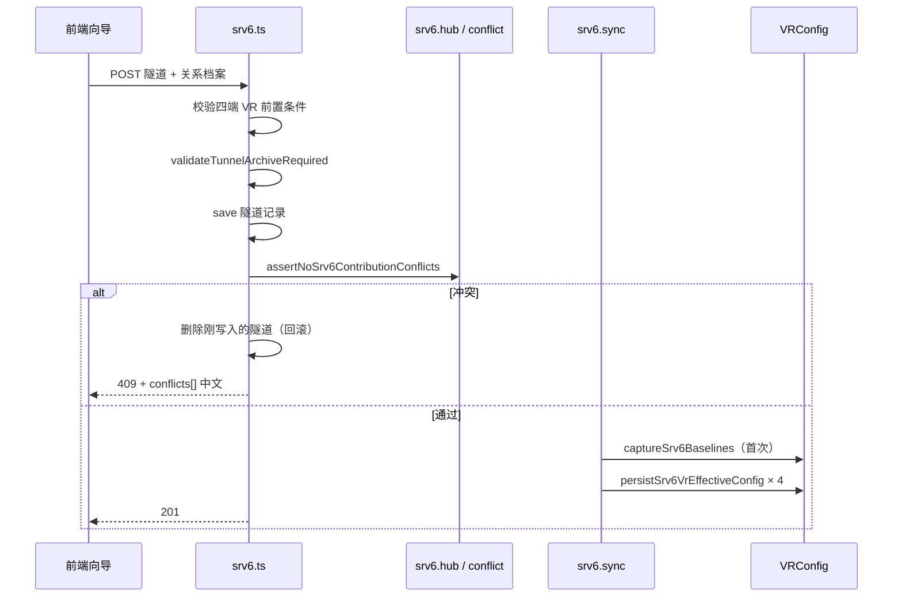

# SRv6 隧道配置管理 · baseline + 贡献 + recompute 实现方案

> **状态**：已落地（P1–P4）  
> **关联发版说明**：[`docs/srv6-release-notes.md`](./srv6-release-notes.md)  
> **冒烟用例**：[`frontend/src/pages/sdncc/interconnect/srv6/testcases.md`](../frontend/src/pages/sdncc/interconnect/srv6/testcases.md)  
> **对外 API 索引**：[`AGENTS.md`](../AGENTS.md) · API 规范 · SDN 网络

---

## 1. 背景与动机

### 1.1 原模型（eject 主路径）的问题

早期 SRv6 隧道创建后，四端 VR 的 `config_json` 由前端拼装并直写平台库；删除时通过 **eject**（从当前配置中逐项删除 `injectedDelta` 记录的条目）尝试回退。

该模型在以下场景不可靠：

| 问题 | 说明 |
|------|------|
| **Hub 多隧道** | 同一 PE 上多条隧道共享设备时，eject 易误删其它隧道仍需要的邻居/路由 |
| **手改漂移** | 用户或下发后改动了配置，eject 只删「仍匹配」项，回退不完整 |
| **无双态分离** | 无法区分「向导基线」与「隧道叠加后的生效态」，难以对账与修复 |
| **前端写库** | 创建成功后前端再调 `saveVRConfig`，与服务端隧道档案可能不一致 |

### 1.2 目标

采用 **基线 + 贡献 + 重算** 三层模型，使平台库中的生效配置恒满足：

```text
生效 config_json = merge(向导基线, Σ 存活隧道对该 VR 的贡献)
```

删除隧道不再以 eject 为主路径，而是 **exclude 该隧道贡献后 recompute**，回到「基线 + 其余隧道」的合意态。

---

## 2. 设计原则

1. **Layer 0 · 向导基线**：`VRConfig.srv6BaselineJson` — 该 VR **首次**被 SRv6 隧道引用前（或零隧道对齐后）的向导态快照。  
2. **Layer 1 · 隧道贡献**：`SRv6Tunnel.injectedDelta` — 各端（peA/peB/ceA/ceB）相对基线新增的 neighbors、路由、RD/RT、activate AF 等结构化清单。  
3. **Layer 2 · 平台生效配置**：`VRConfig.config_json` — 由服务端 **merge + recompute** 写入，为下发与对账的权威来源。  
4. **关系档案**：除 `injectedDelta` 外，隧道须持久化 `rdRtMeta`、`endpointFingerprint`、内网口等，用于 Hub 冲突检测与 VR 配置锁。  
5. **不做历史隧道自动兼容**：无完整档案或无基线的旧隧道，删除回退返回 **400/409** 并给出中文引导（仅删记录 / 配置对账 / 手工清理）。  
6. **用户可见文案**：API `message`、409 `conflicts[]`、对账 UI 均使用中文业务描述；内部规则码（如 `C-N1`）仅用于程序与单测，不展示给终端用户。

---

## 3. 数据模型

### 3.1 `VRConfig` 新增字段

| 字段 | 类型 | 含义 |
|------|------|------|
| `srv6BaselineJson` | `string \| null` | SRv6 向导基线（JSON 字符串） |
| `srv6BaselineAt` | `Date \| null` | 基线捕获/对齐时间 |
| `srv6BaselineTunnelId` | `string \| null` | 首次捕获基线时的隧道 ID；零隧道对齐后为 `null` |

实体：`backend/src/entities/vRouter/VRConfig.ts`

### 3.2 `SRv6Tunnel` 关系档案（创建/更新必填）

| 字段 | 含义 |
|------|------|
| `peAInnerIf` / `peBInnerIf` | PE 内网接口名 |
| `rdRtMeta` | 公共 RT + PE-A/PE-B 的 RD 映射 |
| `injectedDelta` | 四端配置变更清单（结构化，非整段 JSON diff） |
| `endpointFingerprint` | 四端关键指纹（公网 IP/ASN、SID 前缀、内网口/VRF 等） |

类型定义：`backend/src/entities/vRouter/srv6Tunnel.types.ts`  
校验：`backend/src/routes/sdn/srv6.archive.ts` · `validateTunnelArchiveRequired`

---

## 4. 核心算法

### 4.1 merge（基线 + 单端贡献 → 局部叠加）

模块：`backend/src/routes/sdn/srv6.merge.ts` · `mergeBaselineWithContributions(baseline, contributions[])`

按贡献顺序叠加各隧道在四端写入的：

- BGP `neighbor`
- `neighbor_disable_connected_check`
- `activate_address_family`（ipv4 vpn）
- `ipv4_route` / `ipv6_route`
- RD/RT（ipv4 unicast vpn 地址族）

纯函数、可单测；**PE22 类**「创建后叠加、删光隧道回基线」为回归基准。

### 4.2 recompute（单 VR 生效配置）

模块：`backend/src/routes/sdn/srv6.recompute.ts`

1. `listAliveContributionsForVr(vrUuid)` — 收集引用该 VR 的存活隧道及其对应 slot 的 `injectedDelta` 片段。  
2. `recomputeVrEffectiveConfig(vrUuid)` — `parseSrv6Baseline` + merge 全部贡献。  
3. 无基线且有存活隧道引用时抛错（中文）：「该设备尚未保存向导基线，无法生成生效配置」。

### 4.3 基线捕获与对齐

模块：`backend/src/routes/sdn/srv6.baseline.ts`

| 函数 | 时机 |
|------|------|
| `captureSrv6BaselinesForTunnel` | 隧道 **首次** sync 前；若 VR 尚无基线，将当前 `config_json` 写入 `srv6BaselineJson`（仅写一次） |
| `resetSrv6BaselineWhenNoTunnels` | 某 VR **无存活隧道** 时，将基线对齐为当前 `config_json` |
| `forceResetSrv6BaselineFromConfig` | 管理员 API；须零隧道，否则 409 |

---

## 5. 业务流程

### 5.1 创建隧道（POST `/api/networks/srv6`）



要点：

- **冲突检测在 save 之后、sync 之前**；sync 失败则 **删除隧道记录** 回滚。  
- 前端 **不再** 在创建成功后对四端调用 `saveVRConfig` 直写注入预览态（P2）。

### 5.2 更新隧道（PUT `/api/networks/srv6/:id`）

1. 合并 payload + 关系档案校验。  
2. **`assertNoSrv6ContributionConflicts` 先于 `save`**（评审修复：避免冲突已落库未 sync）。  
3. `save` → `syncSrv6TunnelPlatformConfigs`（四端 recompute 落库）。

### 5.3 删除隧道（DELETE `/api/networks/srv6/:id`）

模块：`backend/src/routes/sdn/srv6.delete.ts`

- 默认 `revertPlatform=1`、`revertDevice=1`（query 传 `0` / `false` 可关闭）。  
- **回退平台库**：对该隧道四端各执行 `recomputeVrEffectiveConfig`（exclude 本隧道），写回 `config_json`。  
- 可选 **push 设备**（与 IPsec 同源 `vrController.updateVRConfig`）。  
- 删除成功后对四端尝试 `resetSrv6BaselineWhenNoTunnels`（零隧道基线对齐）。  
- 无 `injectedDelta` / 无基线：**400**，中文提示 + 操作建议。

> `srv6.eject.ts` 已标记 **@deprecated**，仅保留单测与历史对照，**不得**作为新流程写库依据。

### 5.4 VR 配置保存（`/api/vr-config` upsert）

模块：`backend/src/routes/sdn/vrConfig.ts` + `srv6.vrLock.ts`

| 场景 | 行为 |
|------|------|
| 被存活隧道引用 + 已有基线 | **忽略**请求体中的 `config_json` 直接改库；强制 `persistSrv6VrEffectiveConfig`（恒等 recompute） |
| 有基线、无存活隧道 | 允许更新 `config_json`，并 **同步刷新** `srv6BaselineJson` |
| 无基线 | 普通 upsert |
| 指纹变更 | `assertSrv6VrConfigUpsertAllowed` → **409**，列中文关键项（公网 IPv6、SID 前缀等） |

### 5.5 下发设备（不变更架构，路径对齐 IPsec）

- `GET /api/networks/srv6/deploy/preview?vrId=` — 读库 → stripMeta → sanitize  
- `POST /api/networks/srv6/deploy/push` — 推送设备控制面  

生效配置须先由 §5.1–5.3 写入平台库，再走进下发向导。

---

## 6. Hub 多隧道与冲突检测

### 6.1 Hub 语义

同一 VR（通常 PE）被 **≥2 条存活隧道** 引用时为 Hub。  
`GET /api/networks/srv6/vr/:vrUuid/hub` 返回引用列表、是否 Hub、冲突预检状态。

模块：`backend/src/routes/sdn/srv6.hub.ts`

- 有其它存活隧道但 **缺基线** → 返回 `NO_BASELINE` 中文提示（不再静默跳过）。

### 6.2 冲突规则（内部 code → 用户 message）

模块：`backend/src/routes/sdn/srv6.conflict.ts` · `detectContributionConflicts`

| Code | 检测内容 | 用户可见摘要 |
|------|----------|--------------|
| C-N1 | 与已有隧道重复 neighbor（同 bgpIndex） | 公网 BGP 邻居已被某隧道使用 |
| C-N2 | neighbor 已存在于向导基线 | 已在基线中，勿重复建隧道 |
| C-A1 | activate AF 重复 | 公网 VPN 已激活对端冲突 |
| C-D1 | neighbor_disable_connected_check 重复 | 直连检查豁免重复 |
| C-R1 / C-R2 | RD/RT 重复 | 内网 VPN 路由标识占用 |
| C-I1 | IPv6 路由重复 | IPv6 路由已被占用 |
| C-V1 | 内网口 + VRF 重复 | 内网口+VRF 已被占用 |

聚合文案：`formatSrv6ContributionConflicts` → 「无法保存隧道：与已有隧道的网络配置冲突。…」

创建/更新前：`assertNoSrv6ContributionConflictsForTunnel`；409 响应含 `conflicts: [{ message, ... }]`。

---

## 7. 配置对账（P4）

模块：`backend/src/routes/sdn/srv6.reconcile.ts`

| Issue Code | 含义 | 可修复 |
|------------|------|--------|
| `NO_BASELINE` | 有存活隧道但无基线 | 否（需人工） |
| `BASELINE_PARSE_ERROR` | 基线 JSON 损坏 | 否 |
| `CONFIG_PARSE_ERROR` | 生效配置无法解析 | 否 |
| `ORPHAN_BASELINE_DRIFT` | 零隧道但生效配置 ≠ 基线 | 是：基线对齐当前配置 |
| `INVARIANT_DRIFT` | 有隧道但生效配置 ≠ merge 结果 | 是：recompute 写回 |

API：

- `GET /api/networks/srv6/reconcile?vrUuid=` — 只读扫描  
- `POST /api/networks/srv6/reconcile` — `{ repair?: boolean, vrUuid?: string }`  
- `POST /api/networks/srv6/vr/:vrUuid/baseline/reset` — 零隧道强制基线重置  

审计：`srv6.audit.ts` · `SRv6 Reconcile` / `SRv6 Baseline Reset` / 隧道 CRUD。

前端：隧道列表 ·「配置对账」弹窗（`frontend/src/pages/sdncc/interconnect/srv6/index.tsx`）。

---

## 8. 分阶段交付（P1–P4）

| 阶段 | 范围 | 关键交付 |
|------|------|----------|
| **P1** | 数据模型 + merge/recompute + 删除回退 | `srv6BaselineJson`；`srv6.merge/recompute/baseline/delete`；eject 退出主路径 |
| **P2** | 创建/更新 sync + VR upsert 恒等 | `srv6.sync`；POST/PUT 后四端落库；失败回滚；`vrConfig` upsert recompute；前端去掉创建后直写 |
| **P3** | Hub + 冲突 | `srv6.conflict/hub`；409 conflicts；前端 Hub 提示与列表标签 |
| **P4** | 对账 + 审计 + 文案 | `srv6.reconcile/audit`；零隧道基线对齐；对账 UI；用户可见中文优化 |

---

## 9. 源码地图

### 9.1 后端（`backend/src/routes/sdn/`）

| 文件 | 职责 |
|------|------|
| `srv6.ts` | HTTP 路由装配、创建/更新/删除/对账/下发/hub |
| `srv6.baseline.ts` | 基线捕获、零隧道对齐、强制重置 |
| `srv6.merge.ts` | 基线 + 贡献 merge 纯函数 |
| `srv6.recompute.ts` | 单 VR 重算、存活贡献枚举 |
| `srv6.sync.ts` | 四端 sync、持久化生效配置 |
| `srv6.delete.ts` | 删除 + recompute 回退 + 可选 push |
| `srv6.conflict.ts` | 贡献冲突检测与文案格式化 |
| `srv6.hub.ts` | Hub 状态、创建前冲突断言 |
| `srv6.reconcile.ts` | 对账扫描与修复 |
| `srv6.archive.ts` | 关系档案解析/校验/指纹 |
| `srv6.validation.ts` | 隧道 payload 与四端前置校验 |
| `srv6.vrLock.ts` | 被引用 VR 的 upsert / set-role 锁 |
| `srv6.references.ts` | VR ↔ 隧道引用查询 |
| `srv6.audit.ts` | 审计日志封装 |
| `srv6.eject.ts` | **deprecated** 历史 eject |
| `srv6.*.test.ts` | 单测；`srv6.scenarios.test.ts` 为 P1–P4 场景矩阵（18 条） |

关联：`vrConfig.ts` upsert/set-role 集成 SRv6 锁与 recompute。

### 9.2 前端（`frontend/src/pages/sdncc/interconnect/srv6/`）

| 文件 | 职责 |
|------|------|
| `Create.tsx` | 创建/编辑向导；Hub 提示；保存后不再直写 VR；下发向导 |
| `index.tsx` | 隧道列表、删除、配置对账弹窗 |
| `srv6Archive.ts` | 前端构建 `injectedDelta` / 指纹 / RD·RT 档案 |
| `testcases.md` | 发版前手工冒烟用例 R1–R7 |

API 封装：`frontend/src/services/api.ts`；409 时 `conflicts` 经 `requestManager` 透传。

---

## 10. 测试策略

### 10.1 自动化

```bash
cd backend
npx jest src/routes/sdn/srv6
npx tsc --noEmit
```

覆盖：merge 恒等、PE22 删除回退、冲突码、校验、对账纯函数、scenarios 矩阵。

### 10.2 手工冒烟

见 [`testcases.md`](../frontend/src/pages/sdncc/interconnect/srv6/testcases.md)：R1 创建、R2 删除回退、R3/R4 Hub、R5 对账、R6 VR 锁、R7 零隧道基线。

---

## 11. 运维与排障

| 现象 | 排查 |
|------|------|
| 创建 409 冲突 | 响应 `conflicts[]`；查 Hub API；确认 neighbor/RD/内网口是否与已有隧道重复 |
| 删除 400 | 多为历史隧道无档案/无基线；按提示仅删记录或走对账 |
| 保存 VR 409 | 设备被隧道引用且改了指纹；先删隧道或勿改关键 WAN/内网项 |
| 对账 INVARIANT_DRIFT | POST reconcile `repair: true`；查审计 `SRv6 Reconcile` |
| 生效态与预期不符 | 确认四端是否 sync 成功；PUT 是否先冲突检测；是否有人 bypass upsert 直写库 |

---

## 12. 已知限制与后续可选

- **历史隧道**：不自动迁移档案/基线，需人工或对账后重建。  
- **设备态**：平台 recompute 不保证与设备实时一致；须走下发向导 push。  
- **eject 模块**：未删除，避免单测/对照断裂；新功能禁止依赖。  
- **可选增强**：对账定时任务、Hub 可视化拓扑、PostgreSQL 生产库迁移后的批量 reconcile CLI。

---

## 13. 修订记录

| 日期 | 说明 |
|------|------|
| 2026-06 | P1–P4 落地；PUT 冲突检测顺序修复；用户可见文案中文化；testcases 归档 |
