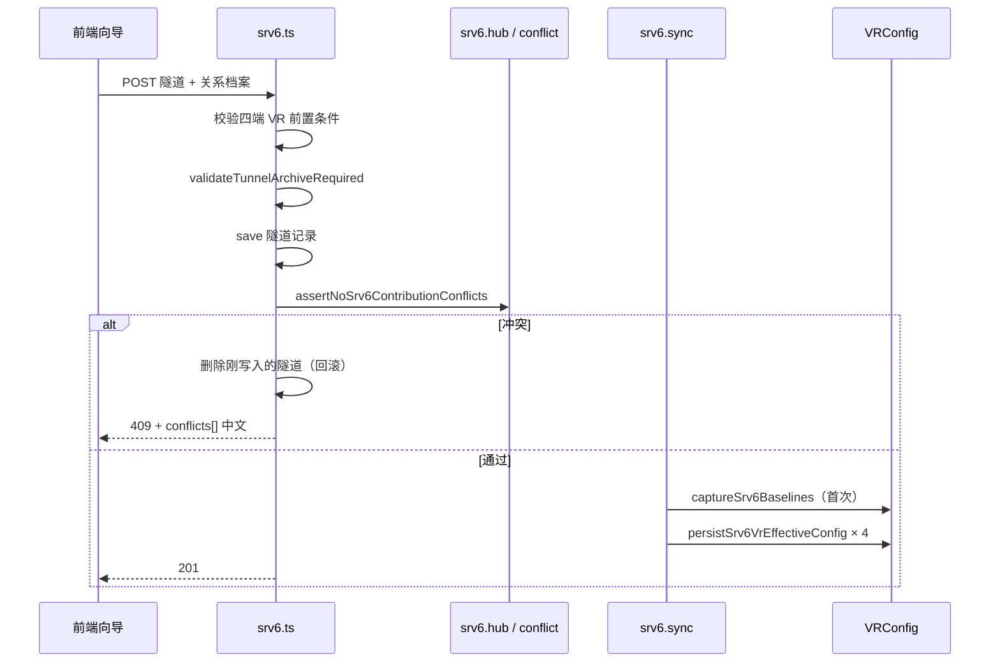
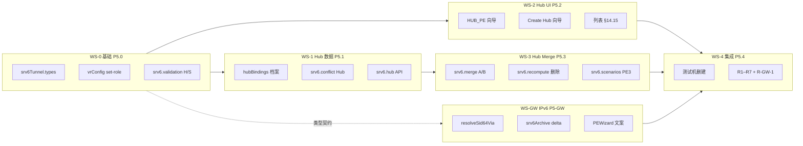

# SRv6 隧道配置管理 · baseline + 贡献 + recompute 实现方案

> **状态**：P1–P4 已落地；**P5 代码 WS-0～WS-4 本地合入**（2026-06-17）：Hub 档案/UI/merge/单测 + 发版文档；**测试机 10.21.49.59 手工 H1–H7 待运维**；Post-P5 多 RT 见 §14.4.7 / §16。  
> **当前生产范围**：**CE-A ↔ PE-A ↔ PE-B ↔ CE-B** 四端单会话（Spoke 点对点）；Hub 多 Spoke 待 P5 交付。  
> **关联发版说明**：[`docs/srv6-release-notes.md`](./srv6-release-notes.md)  
> **Hub PE 产品约束与遗留（查阅用）**：[`docs/srv6-hub-pe-spec.md`](./srv6-hub-pe-spec.md)  
> **冒烟用例**：[`frontend/src/pages/sdncc/interconnect/srv6/testcases.md`](../frontend/src/pages/sdncc/interconnect/srv6/testcases.md)
> **对外 API 索引**：[`AGENTS.md`](../AGENTS.md) · API 规范 · SDN 网络

---

## 1. 背景与动机

### 1.1 原模型（eject 主路径）的问题

早期 SRv6 隧道创建后，四端 VR 的 `config_json` 由前端拼装并直写平台库；删除时通过 **eject**（从当前配置中逐项删除 `injectedDelta` 记录的条目）尝试回退。

该模型在以下场景不可靠：

| 问题 | 说明 |
|------|------|
| **Hub 多隧道** | 同一 PE 上多条隧道共享设备时，eject 易误删其它隧道仍需要的邻居/路由 |
| **手改漂移** | 用户或下发后改动了配置，eject 只删「仍匹配」项，回退不完整 |
| **无双态分离** | 无法区分「向导基线」与「隧道叠加后的生效态」，难以对账与修复 |
| **前端写库** | 创建成功后前端再调 `saveVRConfig`，与服务端隧道档案可能不一致 |

### 1.2 目标

采用 **基线 + 贡献 + 重算** 三层模型，使平台库中的生效配置恒满足：

```text
生效 config_json = merge(向导基线, Σ 存活隧道对该 VR 的贡献)
```

删除隧道不再以 eject 为主路径，而是 **exclude 该隧道贡献后 recompute**，回到「基线 + 其余隧道」的合意态。

---

## 2. 设计原则

1. **Layer 0 · 向导基线**：`VRConfig.srv6BaselineJson` — 该 VR **首次**被 SRv6 隧道引用前（或零隧道对齐后）的向导态快照。  
2. **Layer 1 · 隧道贡献**：`SRv6Tunnel.injectedDelta` — 各端（peA/peB/ceA/ceB）相对基线新增的 neighbors、路由、RD/RT、activate AF 等结构化清单。  
3. **Layer 2 · 平台生效配置**：`VRConfig.config_json` — 由服务端 **merge + recompute** 写入，为下发与对账的权威来源。  
4. **关系档案**：除 `injectedDelta` 外，隧道须持久化 `rdRtMeta`、`endpointFingerprint`、内网口等，用于 Hub 冲突检测与 VR 配置锁。  
5. **不做历史隧道自动兼容**：无完整档案或无基线的旧隧道，删除回退返回 **400/409** 并给出中文引导（仅删记录 / 配置对账 / 手工清理）。  
6. **用户可见文案**：API `message`、409 `conflicts[]`、对账 UI 均使用中文业务描述；内部规则码（如 `C-N1`）仅用于程序与单测，不展示给终端用户。

---

## 3. 数据模型

### 3.1 `VRConfig` 新增字段

| 字段 | 类型 | 含义 |
|------|------|------|
| `srv6BaselineJson` | `string \| null` | SRv6 向导基线（JSON 字符串） |
| `srv6BaselineAt` | `Date \| null` | 基线捕获/对齐时间 |
| `srv6BaselineTunnelId` | `string \| null` | 首次捕获基线时的隧道 ID；零隧道对齐后为 `null` |

实体：`backend/src/entities/vRouter/VRConfig.ts`

### 3.2 `SRv6Tunnel` 关系档案（创建/更新必填）

| 字段 | 含义 |
|------|------|
| `peAInnerIf` / `peBInnerIf` | PE 内网接口名 |
| `rdRtMeta` | 公共 RT + PE-A/PE-B 的 RD 映射 |
| `injectedDelta` | 四端配置变更清单（结构化，非整段 JSON diff） |
| `endpointFingerprint` | 四端关键指纹（公网 IP/ASN、SID 前缀、内网口/VRF 等） |

类型定义：`backend/src/entities/vRouter/srv6Tunnel.types.ts`  
校验：`backend/src/routes/sdn/srv6.archive.ts` · `validateTunnelArchiveRequired`

---

## 4. 核心算法

### 4.1 merge（基线 + 单端贡献 → 局部叠加）

模块：`backend/src/routes/sdn/srv6.merge.ts` · `mergeBaselineWithContributions(baseline, contributions[])`

按贡献顺序叠加各隧道在四端写入的：

- BGP `neighbor`
- `neighbor_disable_connected_check`
- `activate_address_family`（ipv4 vpn）
- `ipv4_route` / `ipv6_route`
- RD/RT（ipv4 unicast vpn 地址族）

纯函数、可单测；**PE22 类**「创建后叠加、删光隧道回基线」为回归基准。

### 4.2 recompute（单 VR 生效配置）

模块：`backend/src/routes/sdn/srv6.recompute.ts`

1. `listAliveContributionsForVr(vrUuid)` — 收集引用该 VR 的存活隧道及其对应 slot 的 `injectedDelta` 片段。  
2. `recomputeVrEffectiveConfig(vrUuid)` — `parseSrv6Baseline` + merge 全部贡献。  
3. 无基线且有存活隧道引用时抛错（中文）：「该设备尚未保存向导基线，无法生成生效配置」。

### 4.3 基线捕获与对齐

模块：`backend/src/routes/sdn/srv6.baseline.ts`

| 函数 | 时机 |
|------|------|
| `captureSrv6BaselinesForTunnel` | 隧道 **首次** sync 前；若 VR 尚无基线，将当前 `config_json` 写入 `srv6BaselineJson`（仅写一次） |
| `resetSrv6BaselineWhenNoTunnels` | 某 VR **无存活隧道** 时，将基线对齐为当前 `config_json` |
| `forceResetSrv6BaselineFromConfig` | 管理员 API；须零隧道，否则 409 |

---

## 5. 业务流程

### 5.1 创建隧道（POST `/api/networks/srv6`）



要点：

- **冲突检测在 save 之后、sync 之前**；sync 失败则 **删除隧道记录** 回滚。  
- 前端 **不再** 在创建成功后对四端调用 `saveVRConfig` 直写注入预览态（P2）。

### 5.2 更新隧道（PUT `/api/networks/srv6/:id`）

1. 合并 payload + 关系档案校验。  
2. **`assertNoSrv6ContributionConflicts` 先于 `save`**（评审修复：避免冲突已落库未 sync）。  
3. `save` → `syncSrv6TunnelPlatformConfigs`（四端 recompute 落库）。

### 5.3 删除隧道（DELETE `/api/networks/srv6/:id`）

模块：`backend/src/routes/sdn/srv6.delete.ts`

- 默认 `revertPlatform=1`、`revertDevice=1`（query 传 `0` / `false` 可关闭）。  
- **回退平台库**：对该隧道四端各执行 `recomputeVrEffectiveConfig`（exclude 本隧道），写回 `config_json`。  
- 可选 **push 设备**（与 IPsec 同源 `vrController.updateVRConfig`）。  
- 删除成功后对四端尝试 `resetSrv6BaselineWhenNoTunnels`（零隧道基线对齐）。  
- 无 `injectedDelta` / 无基线：**400**，中文提示 + 操作建议。

> `srv6.eject.ts` 已标记 **@deprecated**，仅保留单测与历史对照，**不得**作为新流程写库依据。

### 5.4 VR 配置保存（`/api/vr-config` upsert）

模块：`backend/src/routes/sdn/vrConfig.ts` + `srv6.vrLock.ts`

| 场景 | 行为 |
|------|------|
| 被存活隧道引用 + 已有基线 | **忽略**请求体中的 `config_json` 直接改库；强制 `persistSrv6VrEffectiveConfig`（恒等 recompute） |
| 有基线、无存活隧道 | 允许更新 `config_json`，并 **同步刷新** `srv6BaselineJson` |
| 无基线 | 普通 upsert |
| 指纹变更 | `assertSrv6VrConfigUpsertAllowed` → **409**，列中文关键项（公网 IPv6、SID 前缀等） |

### 5.5 下发设备（不变更架构，路径对齐 IPsec）

- `GET /api/networks/srv6/deploy/preview?vrId=` — 读库 → stripMeta → sanitize  
- `POST /api/networks/srv6/deploy/push` — 推送设备控制面  

生效配置须先由 §5.1–5.3 写入平台库，再走进下发向导。

---

## 6. Hub 多隧道与冲突检测

### 6.1 Hub 语义

同一 VR（通常 PE）被 **≥2 条存活隧道** 引用时为 Hub。  
`GET /api/networks/srv6/vr/:vrUuid/hub` 返回引用列表、是否 Hub、冲突预检状态。

模块：`backend/src/routes/sdn/srv6.hub.ts`

- 有其它存活隧道但 **缺基线** → 返回 `NO_BASELINE` 中文提示（不再静默跳过）。

### 6.2 冲突规则（内部 code → 用户 message）

模块：`backend/src/routes/sdn/srv6.conflict.ts` · `detectContributionConflicts`

| Code | 检测内容 | 用户可见摘要 |
|------|----------|--------------|
| C-N1 | 与已有隧道重复 neighbor（同 bgpIndex） | 公网 BGP 邻居已被某隧道使用 |
| C-N2 | neighbor 已存在于向导基线 | 已在基线中，勿重复建隧道 |
| C-A1 | activate AF 重复 | 公网 VPN 已激活对端冲突 |
| C-D1 | neighbor_disable_connected_check 重复 | 直连检查豁免重复 |
| C-R1 / C-R2 | RD/RT 重复 | 内网 VPN 路由标识占用 |
| C-I1 | IPv6 路由重复 | IPv6 路由已被占用 |
| C-V1 | 内网口 + VRF 重复 | 内网口+VRF 已被占用 |

聚合文案：`formatSrv6ContributionConflicts` → 「无法保存隧道：与已有隧道的网络配置冲突。…」

创建/更新前：`assertNoSrv6ContributionConflictsForTunnel`；409 响应含 `conflicts: [{ message, ... }]`。

### 6.3 当前版本适用范围（**非**真·Hub PE）

| 维度 | P1–P4 已支持 | **不在**当前范围（见 §14） |
|------|-------------|---------------------------|
| 拓扑 | 一条隧道固定四 VR：`CE-A↔PE-A↔PE-B↔CE-B` | 同一 Hub PE（如 PE3）对 **多个 Spoke PE**（PE22、PE2…）各建一条隧道 |
| 接口 | PE 公网 implicit **port0**；内网 **单** `peAInnerIf` / `peBInnerIf` | Hub **多 WAN / 多 LAN**、口级占用注册表 |
| 冲突 | 同 VR 上 `injectedDelta` **字段级**互斥（含 C-I1 同内网口+VRF、C-R1 同 bgpIndex 等） | 以 **PE–PE 公网 neighbor** 为主键、**CE/VRF 复用**、Hub **单 RD + 多 RT** |
| 单测 Hub | `scenarios.test` 中 t2Ok 要求 **不同 bgpIndex/VRF 段** | 同 VRF7777 + 同 CE3 + 不同 Spoke 邻居 |

**产品决策（2026-06）**：现网验收以 **标准四端 Spoke 点对点** 为准；真 Hub 按 **§14 P5 定稿** 实施，审核见 **§15**。

---

## 7. 配置对账（P4）

模块：`backend/src/routes/sdn/srv6.reconcile.ts`

| Issue Code | 含义 | 可修复 |
|------------|------|--------|
| `NO_BASELINE` | 有存活隧道但无基线 | 否（需人工） |
| `BASELINE_PARSE_ERROR` | 基线 JSON 损坏 | 否 |
| `CONFIG_PARSE_ERROR` | 生效配置无法解析 | 否 |
| `ORPHAN_BASELINE_DRIFT` | 零隧道但生效配置 ≠ 基线 | 是：基线对齐当前配置 |
| `INVARIANT_DRIFT` | 有隧道但生效配置 ≠ merge 结果 | 是：recompute 写回 |

API：

- `GET /api/networks/srv6/reconcile?vrUuid=` — 只读扫描  
- `POST /api/networks/srv6/reconcile` — `{ repair?: boolean, vrUuid?: string }`  
- `POST /api/networks/srv6/vr/:vrUuid/baseline/reset` — 零隧道强制基线重置  

审计：`srv6.audit.ts` · `SRv6 Reconcile` / `SRv6 Baseline Reset` / 隧道 CRUD。

前端：隧道列表 ·「配置对账」弹窗（`frontend/src/pages/sdncc/interconnect/srv6/index.tsx`）。

---

## 8. 分阶段交付（P1–P4）

| 阶段 | 范围 | 关键交付 |
|------|------|----------|
| **P1** | 数据模型 + merge/recompute + 删除回退 | `srv6BaselineJson`；`srv6.merge/recompute/baseline/delete`；eject 退出主路径 |
| **P2** | 创建/更新 sync + VR upsert 恒等 | `srv6.sync`；POST/PUT 后四端落库；失败回滚；`vrConfig` upsert recompute；前端去掉创建后直写 |
| **P3** | Hub + 冲突 | `srv6.conflict/hub`；409 conflicts；前端 Hub 提示与列表标签 |
| **P4** | 对账 + 审计 + 文案 | `srv6.reconcile/audit`；零隧道基线对齐；对账 UI；用户可见中文优化 |

---

## 9. 源码地图

### 9.1 后端（`backend/src/routes/sdn/`）

| 文件 | 职责 |
|------|------|
| `srv6.ts` | HTTP 路由装配、创建/更新/删除/对账/下发/hub |
| `srv6.baseline.ts` | 基线捕获、零隧道对齐、强制重置 |
| `srv6.merge.ts` | 基线 + 贡献 merge 纯函数 |
| `srv6.recompute.ts` | 单 VR 重算、存活贡献枚举 |
| `srv6.sync.ts` | 四端 sync、持久化生效配置 |
| `srv6.delete.ts` | 删除 + recompute 回退 + 可选 push |
| `srv6.conflict.ts` | 贡献冲突检测与文案格式化 |
| `srv6.hub.ts` | Hub 状态、创建前冲突断言 |
| `srv6.reconcile.ts` | 对账扫描与修复 |
| `srv6.archive.ts` | 关系档案解析/校验/指纹 |
| `srv6.validation.ts` | 隧道 payload 与四端前置校验 |
| `srv6.vrLock.ts` | 被引用 VR 的 upsert / set-role 锁 |
| `srv6.references.ts` | VR ↔ 隧道引用查询 |
| `srv6.audit.ts` | 审计日志封装 |
| `srv6.eject.ts` | **deprecated** 历史 eject |
| `srv6.*.test.ts` | 单测；`srv6.scenarios.test.ts` 为 P1–P4 场景矩阵（18 条） |

关联：`vrConfig.ts` upsert/set-role 集成 SRv6 锁与 recompute。

### 9.2 前端（`frontend/src/pages/sdncc/interconnect/srv6/`）

| 文件 | 职责 |
|------|------|
| `Create.tsx` | 创建/编辑向导；Hub 提示；保存后不再直写 VR；下发向导 |
| `index.tsx` | 隧道列表、删除、配置对账弹窗 |
| `srv6Archive.ts` | 前端构建 `injectedDelta` / 指纹 / RD·RT 档案 |
| `testcases.md` | 发版前手工冒烟用例 R1–R7 |

API 封装：`frontend/src/services/api.ts`；409 时 `conflicts` 经 `requestManager` 透传。

---

## 10. 测试策略

### 10.1 自动化

```bash
cd backend
npx jest src/routes/sdn/srv6
npx tsc --noEmit
```

覆盖：merge 恒等、PE22 删除回退、冲突码、校验、对账纯函数、scenarios 矩阵。

### 10.2 手工冒烟

见 [`testcases.md`](../frontend/src/pages/sdncc/interconnect/srv6/testcases.md)：R1 创建、R2 删除回退、R5 对账、R6 VR 锁、R7 零隧道基线；**R3/R4 为 P5 遗留**（见 §14）。

---

## 11. 运维与排障

| 现象 | 排查 |
|------|------|
| 创建 409 冲突 | 响应 `conflicts[]`；查 Hub API；确认 neighbor/RD/内网口是否与已有隧道重复 |
| 删除 400 | 多为历史隧道无档案/无基线；按提示仅删记录或走对账 |
| 保存 VR 409 | 设备被隧道引用且改了指纹；先删隧道或勿改关键 WAN/内网项 |
| 对账 INVARIANT_DRIFT | POST reconcile `repair: true`；查审计 `SRv6 Reconcile` |
| 生效态与预期不符 | 确认四端是否 sync 成功；PUT 是否先冲突检测；是否有人 bypass upsert 直写库 |

---

## 12. 已知限制与后续可选

- **历史隧道**：不自动迁移档案/基线，需人工或对账后重建。  
- **设备态**：平台 recompute 不保证与设备实时一致；须走下发向导 push。  
- **eject 模块**：未删除，避免单测/对照断裂；新功能禁止依赖。  
- **真·Hub PE**：P5 规格见 **§14**；审核与开工门禁见 **§15**。  
- **其它可选增强**：对账定时任务、Hub 可视化拓扑、PostgreSQL 生产库迁移后的批量 reconcile CLI。

---

## 14. P5 实施规格：真·Hub PE 组网

> **产品约束摘要**（多 WAN ASN、RD/RT REUSE、inventory 入口、阻断规则、遗留事项）以 **[`srv6-hub-pe-spec.md`](./srv6-hub-pe-spec.md)** 为准；本节保留实现与 merge/recompute 详述。

> **状态**：**已定稿**（2026-06），可启动开发。  
> **架构决策**：在保留四端联动、baseline + 贡献 + recompute 主链前提下，引入 **VR 设备角色** `HUB_PE` / `SPOKE_PE` 分流规则；Hub 多 WAN/LAN 由 **角色向导（能力）+ 隧道向导（绑定）** 两层表达。  
> **与 §6.3**：P5 完成前生产仍仅保证 Spoke 点对点；本节为实现与验收唯一权威。

### 14.0 架构总览（定稿）

#### 14.0.1 两层模型

```text
┌──────────────────────────────────────────────────────────────┐
│ Layer A · VR 设备角色（角色配置向导，持久 · VRConfig.role）      │
│   SPOKE_PE（分支 PE）：Locator/SID/默认 1 WAN + 1 LAN 骨架     │
│   HUB_PE（中心 PE）  ：+ 多 WAN / 多 LAN 口清单（inventory）    │
│   CE                 ：不拆 Hub CE / Spoke CE 子类型             │
└──────────────────────────────────────────────────────────────┘
                            ↓ 被 SRv6 隧道引用
┌──────────────────────────────────────────────────────────────┐
│ Layer B · 隧道级 Hub 绑定（SRv6 向导 Step2 / Hub 互联子步）    │
│   hubPeSlot: peA | peB                                       │
│   hubBindings: wanIf, lanIf, vrf, peerPeUuid, peerPublicNeighbor, rt │
│   rdRtMeta v2：Hub 单 RD + 本隧道/对端 RT                      │
└──────────────────────────────────────────────────────────────┘
                            ↓
         injectedDelta → merge → recompute → 四端下发（不变）
```

**职责分界**：

| 层级 | 职责 | 不负责 |
|------|------|--------|
| **Layer A** | Hub 设备 **有哪些口**、基线 BGP/SID 骨架 | 某条隧道占哪几口、PE–PE neighbor 具体值 |
| **Layer B** | 本隧道 **占哪几口**、对端 Spoke、判重键、RT | 改写 Spoke/CE 默认策略 |

#### 14.0.2 VR 设备角色命名（定稿）

| 存储值 | 中文展示 | 说明 |
|--------|----------|------|
| **`SPOKE_PE`** | 分支 PE（Spoke） | 单 Spoke、默认 1 WAN + 1 LAN；点对点隧道端点 |
| **`HUB_PE`** | 中心 PE（Hub） | 汇聚多 Spoke；走 P5 Hub 规则 |
| **`CE`** | CE | 不变；Hub 侧 CE 复用由隧道绑定表达，**不**新增 `HUB_CE` |

**角色列表定稿（2026-06 修订）**：

- VR 角色下拉 **仅** 展示：`SPOKE_PE`、`HUB_PE`、`CE`、`SASE`、`标准`（与现网其它产品线一致部分保留）。  
- **取消 `PE` 枚举**；**不提供** `PE` → `SPOKE_PE` 读写别名或自动迁移。  
- 库内历史 `role='PE'` 的 VR：**不在 P5 兼容**；创建/更新隧道时若槽位 VR 角色非法 → **409**，提示运维在 VR 管理页 **重新指定** `SPOKE_PE` 或 `HUB_PE`。  
- SRv6 向导 PE 下拉：`SPOKE_PE` 与 `HUB_PE` **分列表或分 Tab**，避免混选。

**隧道槽位（peA / peB / ceA / ceB）不改名**：槽位表示「本条隧道上的位置」，UI 可加徽标（如「PE-B · 中心 Hub」）。

#### 14.0.3 隧道拓扑类型（定稿）

| 类型 | 条件 | 规则集 | 示例 |
|------|------|--------|------|
| **S · Spoke 点对点** | 两端 PE 均为 **`SPOKE_PE`** | P1–P4（现有） | PE22 ↔ PE99 |
| **H · Hub–Spoke** | **恰好一端** `HUB_PE`、另一端 **`SPOKE_PE`** | P5 Hub 分支 | PE22 ↔ PE3(Hub) |
| **禁止** | 两端均为 `HUB_PE` | 创建 **409** | — |
| **禁止** | 任一端 PE 槽位角色为 `PE`（旧值）或未设置 | 创建 **409**，须先设 `SPOKE_PE`/`HUB_PE` | — |
| **禁止** | Hub 槽位 VR 非 `HUB_PE` | 创建 **409**，引导改设备角色 | Spoke 设备被选为 Hub 槽 |

**Hub 槽位判定**：创建载荷显式 `hubPeSlot: 'peA' | 'peB'`（推荐）；或后端由两端角色推断（仅一端为 `HUB_PE` 时自动赋值）。

#### 14.0.4 Hub 判定与展示（定稿）

| 用途 | 依据 | 说明 |
|------|------|------|
| **规则执行**（conflict / merge / delta） | `VRConfig.role === 'HUB_PE'` | **唯一权威** |
| **UI 展示**（列表 Hub 标签、引用数） | `findAliveTunnelsByVr` 引用数 | 可与 `HUB_PE` 并存；`引用数>1` 仅作提示 |
| **禁止** | 仅用 `tunnels.length > 1` 推断 Hub 规则 | 避免与 P1–P4 动态 `isHub` 双标准冲突 |

#### 14.0.5 与 P1–P4 的继承关系（定稿）

- **不变**：四端 CRUD、sync、recompute、deploy preview/push、对账、VR 指纹锁主流程。  
- **Spoke 路径**：槽位 `role === 'SPOKE_PE'` 时 **原样** 调用现有 conflict / merge / archive。  
- **Hub 路径**：`role === HUB_PE` 的槽位走 **Hub 策略分发**（`resolvePeRole` → 分支），不 fork 主链。  
- **实现约束**：后端以 **策略分发** 为主，避免复制整段 Spoke 逻辑。

---

**典型组网**（测试机 PE3 类）：

```text
T1: PE22/CE22  ←→  PE3/CE3   （已存在隧道 test-20260508）
T2: PE2/CE2    ←→  PE3/CE3   （期望：Hub PE3 再接纳新 Spoke，对端 PE 不同即允许）
```

**业务期望**：

- 每条隧道仍走 **四端创建 + 四端下发**（流程不变）。  
- **Hub PE/CE** 可被多条隧道引用，但须记录 **WAN/LAN 与已有隧道的对应关系**。  
- **判重主键**：Hub 上 **PE–PE 公网 neighbor（对端 Spoke PE）** 唯一；**CE、VRF、Hub RD 可复用**。  
- **RD/RT（Hub 侧，定稿口径）**：**RD 在 Hub PE 上可仅有一个**（VRF/设备级）；**RT 按隧道/对端各自生成**，**不**继承已有隧道 RT。  
- **409 提示**：仅报 **Blocking** 原因（主键冲突），避免 C-A1/C-R1/C-V1/C-I1 等从属项堆砌（体验项，随 P5 一并改）。

### 14.2 当前实现与真 Hub 的差距

| 维度 | 当前实现（P1–P4） | 真 Hub 目标 |
|------|-------------------|-------------|
| WAN | `extractPortIpv6(cfg, 0)`，固定第一口为公网 | 每隧道绑定 **Hub WAN 口**；口占用注册表 |
| LAN | 向导选 **一个** `peBInnerIf` | **可复用**同一 LAN/VRF；也可按 Spoke **分开配置** |
| PE–PE BGP | `injectNeighborsForPEPeer` 从对端 PE **自动推导** | 按 **本隧道 WAN ↔ 对端 WAN** 建会话；不宜仅放在「角色配置向导」 |
| `rdRtMeta` | 每隧道随机 `rtCommon` + `rdMap.peA/peB` | Hub：**单 RD**；**每隧道/对端新 RT** |
| `mergeRdRt` | 同 `bgpIndex` **覆盖**一套 RD/RT | 须支持 **单 RD + 多 RT**（或每 Spoke 独立 bgp 段，见 14.4） |
| 冲突 C-N1 | 所有 `neighbors` 同 bgpIndex+IP 即冲突（文案写「公网」易误导） | Hub：**仅 PE–PE 公网段** neighbor 作 Blocking；CE/VRF 段复用允许 |
| 冲突 C-I1/C-R1/C-V1 | 同内网口+VRF / 同 bgpIndex RD / 同 ::/0 即拒 | Hub：**允许复用**；按 14.5 规则重写 |
| CE-B 共用 | `buildCeInjectedDelta` 相同 → CE 侧贡献完全相同 → 误报 C-N1 | 共享 CE **零增量**或 **按隧道区分** CE 贡献 |
| `endpointFingerprint` | 无 `wanIf` | Hub PE 指纹须含 **wanIf + 会话标识** |
| Hub API | 隧道引用列表 | 升级为 **口占用表 + 可复用 CE/VRF 提示** |

### 14.3 建议数据模型（P5 设计稿）

#### 14.3.1 隧道级 Hub 绑定（示例）

对处于 Hub 角色的槽位（如 `peB`）扩展档案（字段名实施时可调整）：

```typescript
// 概念类型，非当前库表
type Srv6HubSlotBinding = {
  wanIf: string;              // 本隧道 PE–PE 用的 Hub WAN
  lanIf: string;              // 本隧道 PE–CE 用的 Hub LAN（可与它隧道相同）
  vrf?: string | number;
  peerPeUuid: string;         // 对端 PE（peA 实例 UUID）
  peerWanIf?: string;         // 对端 WAN（若不能从实例默认推导）
  peerPublicNeighbor: string; // 判重主键（IPv6 或 IPv4，与 injectedDelta 一致）
  rt?: string;                // 本隧道 RT（Hub 侧写入值）
};

type Srv6HubPortRegistryEntry = {
  tunnelId: string;
  tunnelName: string;
  slot: 'peA' | 'peB' | 'ceA' | 'ceB';
  wanIf?: string;
  lanIf?: string;
  vrf?: string | number;
  peerPublicNeighbor?: string;
  rt?: string;
};
```

**Hub 口占用表**：`HubPePortRegistry[vrUuid] → Srv6HubPortRegistryEntry[]`（可落库或 Hub API 聚合）。

**Blocking 判重键（定稿）**：`(hubPeUuid, peerPublicNeighbor)`。  
- WAN 口可复用，只要 **对端 Spoke 公网 neighbor 唯一**（H1/H2）。  
- 不采用 `(hubPeUuid, wanIf, peerPublicNeighbor)` 三元组，除非实测出现「同 neighbor 不同 WAN」合法场景。

#### 14.3.2 RD/RT 档案（Hub 定稿）

```typescript
// 替代/扩展现有 rdRtMeta { rtCommon, rdMap }
type Srv6RdRtMetaV2 = {
  hubPeSlot?: 'peA' | 'peB';           // 哪一端为 Hub（或由注册表推断）
  hubRd?: string;                      // Hub PE 上唯一 RD（首条隧道确立，后续复用）
  rtByPeer?: Record<string, string>;   // key=对端 PE UUID → RT
  rtBySlot?: { peA?: string; peB?: string }; // 或按槽位，与 Spoke 成对
  rdMap?: Record<string, string>;      // Spoke 侧 RD 仍可按 peA/peB 生成
};
```

**规则**：

- Hub PE：**RD 全局唯一**（同一 VR/VRF 段一个值）。  
- **RT**：**每条隧道、每个对端 Spoke 新建**，不与其它隧道 RT 碰撞；**不**继承旧隧道 RT。  
- Spoke PE：RD/RT 与 Hub 侧成对约定（Spoke 规则在 P5 需求中单独列）。

### 14.4 设备 RD/RT 语义（G2 门禁 · 须产品/网络确认）

本节说明 **P5.3 merge 改造前你必须拍板的内容**。P5.0～P5.2（角色、hubBindings、Hub conflict、向导 UI）**不依赖**本节，可并行开发。

#### 14.4.1 问题从哪来（与代码对齐）

Hub PE 上多条隧道（多个 Spoke）时，**期望**：

- **同一个 Hub 内网 VRF**（例如 VRF 7777）上 **只有一个 RD**（H4）  
- **每条隧道 / 每个 Spoke 各有一个不同的 RT**（H5）  
- 平台库生效配置 = `merge(基线, 隧道1贡献, 隧道2贡献, …)`

当前 `mergeRdRt`（`srv6.merge.ts`）对**同一 `bgpIndex`** 的内网 IPv4 unicast 段：

```text
af.route_distinguisher = 后写入隧道的 RD   // 覆盖
af.route_target      = 后写入隧道的 RT   // 覆盖
```

因此若 T1、T2 都把 RD/RT 写在 **同一个 bgpIndex**（同一 VRF 段），**后建隧道会抹掉先建隧道的 RT**，无法满足 H5，删除/recompute 也无法按隧道粒度拆 RT。

P1–P4 单测 `scenarios.test` 里「多隧道共存」能过，是因为 **刻意用了不同 bgpIndex**（VRF 9999 vs 8888），**不是**「同 VRF7777 + 多 RT」的真 Hub 形态。

#### 14.4.2 Hub RD/RT 双模式（已定稿 · 2026-06-16，**2026-06-17 阶段策略修订**）

**Q-RT-1**：**路线 A（`REUSE_VRF`）与路线 B（`DEDICATED_VRF`）均须支持**；档案字段 `hubVrfMode` 为 **内部实现标记**（§14.16 UI 映射），用户界面 **不展示**「REUSE_VRF」等枚举名。

| 模式 | 内部枚举 | 用户侧文案（建议） | P5 当前阶段 |
|------|----------|-------------------|-------------|
| **路线 A · 共用客户网络** | `REUSE_VRF` | 「**与已有隧道共用客户侧网络（同一 CE / 专网）**」 | **见 §14.4.6 过渡策略**（单 RT，非多 RT 列表） |
| **路线 B · 独立客户网络** | `DEDICATED_VRF` | 「**为本 Spoke 使用独立客户侧网络（新 CE / 新专网）**」 | **完整支持**（每隧道独立 `bgp[N]`） |

**Q-RT-2**：**每个内网 VRF 一个 RD**。

**Q-RT-4**：Spoke 与 Hub **RT 成对相同**（同一隧道两端相同 RT 值）。

**Q-RT-5**：`bgp[0]` 公网；`bgp[1]`→VRF7777；`bgp[2]`→VRF8888…

**Q-RT-6（2026-06-17 修订）** — 删除单条 Hub 隧道时 recompute：

| 模式 | 公网 `bgp[0]` | 私网 VRF 段 |
|------|---------------|-------------|
| `DEDICATED_VRF` | 移除本 Spoke 的 neighbor / activate / ndc | **删除该隧道对应的整个 `bgp[N]` 段** |
| `REUSE_VRF`（**当前阶段**） | 移除本 Spoke 的 neighbor / activate / ndc | **不修改 `route_target` / RD**（与首条隧道相同）；**仅当该 VRF 上最后一条 Spoke 隧道删除时**，再 **删除整个 `bgp[vrfIndex]` 段** |

> **遗留（完整多 RT）**：设备 + CSM 均支持空格多 RT 后，路线 A 再切换为 §14.4.3③ 的 RT 并集合并与按隧道摘 RT（见 §14.4.7）。

#### 14.4.3 真机 JSON 样例（PE3 · Q-RT-3 已提供）

来源：`实现Hub-Spoke组网的一些相关需求疑点确认_20260616.txt`。

**① 单隧道：PE22 ↔ PE3 ↔ CE22/CE3（节选 `bgp`）**

- 公网 `bgp[0]`：neighbor `203::22`，activate / ndc 同 IP；asn 430。  
- 私网 `bgp[1]`：`vrf: 7777`，asn 106，router_id `102.1.1.33`，RD `200:12851`，RT `200:40988`，neighbor `102.1.1.22`（CE22）。

**② 双隧道共存：PE22 + PE2，共用 CE3 / VRF7777**

- 公网 `bgp[0]`：**两个** neighbor（`203::22`、`203::44`），activate / ndc 列表同步扩展。  
- 私网 `bgp[1]`：vrf 7777、asn、router_id、**RD 不变**；示例片段中 `route_target` 仍为单值 `200:40988`（PE2 应对应 `200:40944`，见下条设备能力）。

**③ 路线 A · 完整形态（多 RT · 遗留，待 CSM+设备）**

```json
"route_target": "200:40988 200:40944"
```

> **Q-CSM-1（2026-06-17 定稿）**：设备与 CSM **当前均不支持** 多 RT 列表/空格串下发；**完整支持须双方改造**，列为 **遗留事项**（§14.4.7）。**P5 当前阶段不以此作为验收阻塞**。

#### 14.4.6 路线 A 过渡策略（P5 当前实现 · 已定稿）

在 multi-RT 未就绪前，**复用 CE + 复用 VRF** 时：

| 项 | 行为 |
|----|------|
| **RT 生成** | 第 2 条及以后 Spoke 隧道 **沿用该 VRF 上首条存活隧道的 RT**（与首条相同），**不**为新 Spoke 生成新 RT |
| **RD** | 与首条相同，不变 |
| **公网** | 按 Spoke 正常 **叠加 neighbor / activate / ndc**（判重仍用 `peerPublicNeighbor`） |
| **私网 neighbor** | 共用 CE 时 **零增量**（与 §14.9 #3 一致） |
| **删除** | 只摘本 Spoke 公网项；**不动 RT/RD**；**最后一条** Spoke 删除时再 **清空整个私网 `bgp[vrfIndex]`** |

**Q-RT-LIM / Q-RT-ORD（当前阶段）**：`REUSE_VRF` 下 **恒为 1 个 RT**；其它 `A:B` 校验规则不变；**不排序**（仅 1 个 RT 时不涉及；完整多 RT 阶段按配置顺序叠加，不强制字典序）。

#### 14.4.7 遗留：完整多 RT（Post-P5）

| 项 | 说明 |
|----|------|
| 触发条件 | CSM + 设备支持 `route_target` 空格多 RT（及校验规则 Q-RT-LIM 全文） |
| Tower | `mergeRdRt` 并集/减集；`injectedDelta` 每 Spoke 独立 RT；H5 恢复「每 Spoke 新 RT」验收 |
| 档案 | 可增加 `rtMergePolicy: 'shared' \| 'per_spoke'` 或按平台版本切换 |

#### 14.4.4 Tower merge 改造要点（P5.3 · 当前阶段）

| 合并对象 | `REUSE_VRF`（**当前**） | `REUSE_VRF`（**遗留完整版**） | `DEDICATED_VRF` |
|----------|-------------------------|------------------------------|-----------------|
| 公网 neighbor / activate / ndc | 按 IP 去重合并 | 同左 | 同左 |
| `route_distinguisher` | 首隧道确立，后续 **不变** | 多隧道相同，写一次 | 每段独立 |
| `route_target` | **始终与首条隧道相同**，后续隧道 **不写/不覆盖** | 空格串 **并集/减集** | 随 `bgp` 段删除 |
| 私网 neighbor | 共用 CE **不重复** | 同左 | 每段独立 |

#### 14.4.5 与 RD/RT 相关的次级确认（见 §16 待对齐）

| 编号 | 状态 |
|------|------|
| Q-RT-1～6、Q-RT-3 样例 | **已闭合**（除 CSM 多 RT 下发能力） |
| **Q-CSM-1** | CSM/设备多 `route_target` 修复 **责任方与版本** — **待对齐** |
| **Q-GW-1** | **已闭合**：SID/64 `via` **择优**见 §14.14.1；`::/0` + `nexthop-vrf 0` **不变**；页面关键字见 §14.14.2 |

**G2 门禁（2026-06-17）**：Q-RT-3 已提供；**路线 B 完整实现 + 路线 A 过渡策略** 可进入 P5.3；**完整多 RT** 不阻塞当前 P5 交付。
### 14.5 端到端目标行为（P5 验收规格 · 定稿口径）

下表为真 Hub **可验证规格**；P5 完成时须全部满足（自动化 + 手工）。

| ID | 规格 | 验收要点 |
|----|------|----------|
| **H1** | 同一 Hub PE VR 允许多条隧道，每条绑定一个 Spoke PE | 公网 **PE–PE neighbor 唯一**；第二条不同 Spoke 可创建成功 |
| **H2** | Hub WAN | 默认 **每隧道独立 WAN 口**；若允许 WAN 复用，则 neighbor 仍须唯一 |
| **H3** | Hub LAN / VRF / CE | **允许复用**；公网 neighbor 随 Spoke 区分；**B** 私网整段独立；**A** 共用 CE 私网零增量 |
| **H4** | Hub RD | **每 VRF 一个 RD**；复用 VRF 时后续隧道 **复用同一 RD** |
| **H5** | RT | **B**：每 Spoke **新 RT**。**A（P5 当前）**：共用 VRF 时 **与首条隧道相同 RT**（§14.4.6）。**A（遗留）**：每 Spoke 新 RT + 多 RT 串 |
| **H6** | 409 提示 | 仅报 **Blocking** 主因（如重复 PE–PE neighbor）；**不**堆砌从属项 |
| **H7** | 删除单条隧道 | 摘本 Spoke 公网项；**A** 非最后一条 **不动 RT/RD**；最后一条或 **B** 删私网 `bgp` 段 |

**与冒烟用例映射**：P5 完成后将 [`testcases.md`](../frontend/src/pages/sdncc/interconnect/srv6/testcases.md) 中 **R3/R4** 从「遗留/跳过」改为按 **H1–H7** 验收。

### 14.6 向导与下发（P5 UX · 定稿）

| 项 | 定稿 |
|----|------|
| 四端下发 | **保留** PE-A → PE-B → CE-A → CE-B；push merge 后生效配置 |
| **HUB_PE 角色配置向导** | Locator/SID/BGP 骨架 + **WAN/LAN inventory**（可用口清单，非隧道占用） |
| **SPOKE_PE 角色配置向导** | **保持现状**（1 WAN + 1 LAN 默认策略） |
| **CE 角色配置向导** | **保持现状** |
| SRv6 Step2 | Spoke 槽位：现有互联 UI；**Hub 槽位**：扩展 **「Hub 互联」** — 选 WAN/LAN、口占用表、neighbor/RT 预览 |
| PE–PE BGP neighbor | **在 SRv6 隧道向导配置**（Layer B），**不**仅在角色向导配置 |
| Hub API | `GET .../hub` 返回引用列表 + **口占用表** + 可复用 CE/VRF 提示 |

前端落位：`frontend/src/pages/sdncc/ibr/srv6/Create.tsx`（及 `srv6Archive.ts`）。

### 14.7 改造影响清单（按模块）

| 模块 | 改造内容 | 风险 |
|------|----------|------|
| **产品/网络** | 多 RT 完整能力（遗留 §14.4.7） | 不阻塞 P5 |
| **数据模型** | `hubBindings`、`hubVrfMode`、Hub 注册表、`endpointFingerprint` | 档案 |
| **frontend `Create.tsx` / `srv6Archive.ts`** | **§14.17** 双轴 Hub 互联、inventory 下拉/内联新建；RD/RT；§14.16 文案；SID/64 via | 高 |
| **`frontend/.../ibr/routers/wizards/PEWizard.tsx`** | HUB_PE `hubInventory` 卡片序列化 | 高 |
| **`frontend/.../srv6/srv6Ipv6.ts`** | `resolveSid64Via` 共享解析（Create + Archive 同源） | 中 |
| **`srv6.conflict.ts`** | Hub 专用规则 + 409 Blocking | R3/R4 |
| **`srv6.merge.ts`** | Hub 双模式；**A 过渡** 共享 RT；**B** 整段 | 高 |
| **`srv6.reconcile.ts`** | Hub 恒等式；见 **§17** | 中 |
| **向导 UI 文案（§14.14.2）** | PE 角色向导路由相关 **展示用语** | 低 |
| **`srv6.hub.ts`** | 口占用 API + **hubInventory 占用标注** | 中 |
| **`srv6.recompute` / delete** | 共享 CE/RD 删除不误删 | 中 |
| **`srv6.vrLock.ts`** | Hub 多 WAN 指纹锁定策略 | 中 |
| **`vrConfig.ts` set-role** | 角色枚举 **`SPOKE_PE`/`HUB_PE`**，**移除 `PE`**；被引用时改角色 **409** | 中 |
| **文档** | 更新 §6、发版说明、testcases | 低 |

**与 P1–P4 关系**：**S 类型**直连场景须 **行为不变**（§17）；**H 类型**走 Hub 分支。**§14.14.1** 为 SID/64 `via` 唯一 inject 语义变更；`::/0` 等其余路由 **不变**。  
**历史数据**：`role='PE'` **不兼容**；`hubBindings` 缺失的旧 Hub 隧道 **不自动迁移**（§14.9 #6）。

### 14.12 产品 / 网络确认清单（2026-06-16 / **2026-06-17 第三轮闭合**）

> 来源：`实现Hub-Spoke组网的一些相关需求疑点确认_20260616.txt` 及第三轮批复。

#### A. RD/RT 与 merge

| 编号 | 批复 |
|------|------|
| **Q-RT-1** | A+B 均支持；UI 见 §14.16 |
| **Q-RT-2～5** | 见 §14.4.2（已固化） |
| **Q-RT-6** | **A（当前）**：非最后一条 **不动 RT**；最后一条删私网段。**B**：删整段 |
| **Q-CSM-1** | 多 RT **设备+CSM 均不支持** → **遗留 §14.4.7**；P5 用 **§14.4.6 过渡** |
| **Q-RT-LIM** | **当前 A 模式恒 1 RT**；其它规则不变 |
| **Q-RT-ORD** | **不排序**；按配置顺序（当前单 RT 不涉及） |

#### B～D

| 编号 | 批复 |
|------|------|
| **Q-ROLE-1 / Q-TOPO-1/2 / Q-BLK-1** | 已固化 |
| **Q-CE-1/2** | Hub CE、ceA 共用 **零增量** |
| **Q-MIG-1/2** | 重建；角色手工设定 |

#### E. 运维与 UI

| 编号 | 批复 |
|------|------|
| **Q-OPS-1** | **否** |
| **Q-OPS-2** | **采用** §14.15 |
| **Q-GW-1** | **§14.14.1** SID/64 `via` 择优；**§14.14.2** 页面文案；`::/0` + `nexthop-vrf 0` **保持** |
| **Q-HUB-IPV6** | **Hub 保留下发**，与原有 PE 一致 |
| **Q-HUB-WIZ-1** | **确认** inventory + 隧道叠加（§14.13） |

---

### 14.8 实施路线（P5 · 定稿摘要）

> **完整并行开发计划**见 **§18**（工作流、依赖、合流点、验收）。

| 阶段 | 内容 | 产出 | 门禁 |
|------|------|------|------|
| **P5.0** | `HUB_PE`/`SPOKE_PE` 角色；隧道类型 H/S 校验；§14.9 产品项签字 | 角色 API、校验单测 | §15.2 **可并行开工** |
| **P5-GW** | §14.14.1 `resolveSid64Via`；§14.14.2 文案 | 单测 + R-GW-1 | **可与 P5.0 并行** |
| **P5.1** | `hubBindings` 档案；Hub conflict 分支；409 Blocking 聚合 | H6、R4 误报消除 | 依赖 P5.0 类型 |
| **P5.2** | HUB_PE 角色向导 inventory；SRv6 Hub 互联 UI；Hub 口占用 API | H1–H3 手工可验 | 依赖 P5.0；UI 可与 P5.1 并行 |
| **P5.3** | Hub merge（A 过渡 + B 完整）；对账 §17 | H4–H7、R3/R4 | 依赖 P5.1 |
| **P5.4** | 测试机删建、全量回归、发版说明 | **G3** | 依赖 P5.2 + P5.3 + P5-GW |

**不推荐**：用「换 VRF/bgp 段绕过冲突」作生产 Hub 方案（仅 `scenarios.test` t2Ok 级别）。

### 14.9 产品决策清单（定稿答复）

| # | 问题 | **定稿答复** |
|---|------|-------------|
| 1 | 同 VRF 多 RT？ | **A 过渡：首条 RT 共享**；完整多 RT **遗留 §14.4.7**；**B 完整支持** |
| 2 | Hub WAN 是否必须不同物理口？ | **默认每隧道独立 WAN**；**允许 WAN 复用**，以 `(hubPeUuid, peerPublicNeighbor)` 唯一为准（H2） |
| 3 | 多隧道共用 Hub CE（如 CE3） | **Hub 侧 CE 第二条起零增量**；**ceA 共用亦零增量** |
| 4 | Hub RD 范围 | **每个内网 VRF 一个 RD**；复用 VRF 时后续隧道复用同一 RD（H4） |
| 5 | RT 粒度 | **每隧道 / 每 Spoke 一个新 RT**；Spoke 与 Hub **成对相同**（H5） |
| 6 | 历史 `test-20260508` | **删除重建**；VR 角色手工设为 Q-MIG-2 |

### 14.10 P5 开发入口（文件索引）

| 区域 | 路径 |
|------|------|
| VR 角色 | `backend/src/routes/sdn/vrConfig.ts`（`set-role`）、`VRConfig.role` |
| 冲突 / Hub | `backend/src/routes/sdn/srv6.conflict.ts`、`srv6.hub.ts` |
| merge / recompute | `backend/src/routes/sdn/srv6.merge.ts`、`srv6.recompute.ts` |
| 档案 | `backend/src/routes/sdn/srv6.archive.ts`、`frontend/.../ibr/srv6/srv6Archive.ts` |
| 向导 | `frontend/.../ibr/srv6/Create.tsx` |
| IPv6 via | `frontend/.../ibr/srv6/srv6Ipv6.ts` · `resolveSid64Via` |
| PE 文案 | `frontend/.../ibr/routers/wizards/PEWizard.tsx` |
| 校验 | `backend/src/routes/sdn/srv6.validation.ts` |
| 类型 | `backend/src/entities/vRouter/srv6Tunnel.types.ts` |
| 单测 | `srv6.scenarios.test.ts`（P5 新增 PE3/PE2/PE22 Hub fixture） |
| 验收 | **§14.5 H1–H7** + [`testcases.md`](../frontend/src/pages/sdncc/interconnect/srv6/testcases.md) |

### 14.11 隧道档案扩展（定稿字段）

在 `SRv6Tunnel` 关系档案上扩展（实施时字段名可微调，语义须一致）：

| 字段 | 类型 | 必填（H 类型） | 含义 |
|------|------|----------------|------|
| `hubPeSlot` | `'peA' \| 'peB'` | 是 | Hub PE 落在哪个槽位 |
| `hubBindings` | `Srv6HubSlotBinding` | 是 | 见 §14.3.1 |
| `hubVrfMode` | `'REUSE_VRF' \| 'DEDICATED_VRF'` | 是（H 类型） | 路线 A / 路线 B，见 §14.4.2 |
| `rdRtMeta` | `Srv6RdRtMetaV2` | 是 | Hub 场景扩展 v2；S 类型仍可用现有形态 |
| `tunnelTopology` | `'S' \| 'H'` | 否（可推断） | 缓存拓扑类型，便于列表/审计 |

`endpointFingerprint` Hub 扩展：`wanIf`、`peerPublicNeighbor`（Hub PE 槽位）。

### 14.13 Hub 侧 inventory 与分层职责（定稿 · 2026-06-22）

> 回应 2026-06-16 补充意见 #1 及路线 B（8.1）验收反馈。原则：**角色向导 = 设备能力与 inventory 能力池**；**隧道向导 = 绑定 + 内联补建 + 叠加预览**；**merge/recompute 物化生效配置**。  
> **Hub 互联交互细则**见 **§14.17**（双轴 UI、下拉标注、取消手工填口名）。

#### 14.13.1 分层职责

| 层级 | 配置内容 | 是否按 Spoke「一组组叠加」 |
|------|----------|---------------------------|
| **HUB_PE 角色向导** | Locator、公网 ASN（`bgp[0]` 骨架）、**WAN 口清单**、**LAN 口清单**（含默认 vrf/asn/router_id 模板） | **否** — 只声明 inventory |
| **SRv6 隧道向导 · Hub 互联** | 选 WAN/LAN、是否复用 CE/VRF、本 Spoke 的 neighbor/RT、预览 | **是** — 每条隧道一条绑定 |
| **merge / recompute** | 把各隧道贡献合成生效 `config_json` | 自动 |

#### 14.13.2 HUB_PE 角色向导建议字段

**公网（一次配置，全 Hub 共用）**

- SRv6 Locator / SID 前缀  
- 公网 ASN、`bgp[0].router_id`（如 `203.100.100.33`）  
- **WAN inventory**：`[{ ifName, ipv6, optional ipv4 }]` — 供隧道选「本 Spoke 走哪口」  

**私网 LAN inventory（可多条，不绑定 Spoke）**

```text
lanInventory[]: {
  lanIf, vrf, privateAsn, router_id,
  optional: rdSeed, rtPoolHint
}
```

- 首条使用 VRF7777 的隧道可从 inventory 选「CE3 所在 LAN」；  
- **路线 B** 新建 VRF 时：优先在 **隧道向导内联新建** LAN Bundle（§14.17）；inventory **永久并入 Hub 基线**（§14.17.5），删除隧道 **不回收** inventory 口项。  
- **取消** §15.4「手工填 `wanIf` 口名」过渡方案；口名 **仅下拉选用或内联新建**。

#### 14.13.3 隧道创建时「叠加」规则（Hub 槽位）

| 对象 | `REUSE_VRF`（路线 A） | `DEDICATED_VRF`（路线 B） |
|------|----------------------|---------------------------|
| `bgp[0]` 公网 | +neighbor、+activate、+ndc（本 Spoke PE 公网 IP） | 同左 |
| `bgp[vrfIndex]` 私网 | RD **不变**；RT **与首条相同**（§14.4.6）；私网 neighbor **已有 CE 则不重复** | **新增整段** `bgp[N]`：vrf、asn、router_id、rd、rt、私网 neighbor |
| `ipv4_route` / 私网静态 | 一般 **不新增**（走 BGP） | 新 CE 网段若需静态路由，按 CE 拓扑 **可选一条** |
| `ipv6_route` | **§14.14.1**：SID/64 `via` 择优；VRF `::/0`（`nexthop-vrf 0`）**不变** | 同左 |

#### 14.13.4 Hub / Spoke 公网 IPv6 路由（SID/64 + VRF 默认路由）

**Q-HUB-IPV6（2026-06-17 定稿）**：**Hub 与 Spoke 均保留下发 SID/64 及相关路由**；是否与 BGP 冗余 **后续再评估**，P5 **不删减** Hub 侧注入。

| 路由项 | P5 行为 |
|--------|---------|
| **SID/64（无 vrf）** | `destination` = 对端 SID `/64`；`via` = **§14.14.1 择优**（本端公网 IPv6 网关 **或** 对端 PE 公网 IPv6） |
| **VRF `::/0`（带 vrf）** | **不变**：`via: "nexthop-vrf 0"` |
| **本端 WAN 公网静态路由** | 角色向导已写入基线 `ipv6_route`（目的网段 + **IPv6 网关**）；隧道 **不重复注入** 该条，仅 **读取** 其 `via` 供 SID/64 择优 |
| **UI** | 展示文案 §14.14.2 |

---

### 14.14 IPv6 路由（2026-06-17 第四轮定稿 · Q-GW-1）

#### 14.14.1 SID/64 的 `via` 择优（inject 语义 · **唯一路由逻辑变更**）

> **背景**：原实现假定 **PE–PE 公网直连**，SID/64 的 `via` 固定取 **对端 PE 公网 IPv6**。现网存在 **经上游 IPv6 网关转发** 的场景：用户已在角色向导配置 **公网 IPv6 静态路由** 且填写了 **IPv6 网关**（下一跳），此时 SID/64 应走该网关，而非对端地址。

**规则（本端 PE 视角，S / H 类型相同）**

| 条件 | SID/64 路由 `via` |
|------|-------------------|
| 本端基线（`srv6BaselineJson` / 向导态 `config_json`）存在 **公网 IPv6 静态路由**：`ipv6_route[]` 中 **不带 `vrf`**、且 `via` 为 **有效 IPv6 地址**（非空、非 `nexthop-vrf *`） | 取该条的 **`via`**（即用户配置的 **IPv6 网关**） |
| 否则（无此类路由 / 无 `via` / 仅直连） | 取 **对端 PE 公网 IPv6**（`extractPortIpv6(peerCfg, 0)`，与 P1–P4 直连场景一致） |

**实现要点**

| 项 | 约定 |
|----|------|
| 共享函数 | `frontend/src/pages/sdncc/ibr/srv6/srv6Ipv6.ts` · `resolveSid64Via(selfCfg, peerCfg)` |
| 调用点 | `Create.tsx` · `buildInjectedPeConfig`；`srv6Archive.ts` · `buildPeInjectedDelta`（**两处须同源**，保证 `injectedDelta.ipv6Routes` 与预览一致） |
| 不变项 | `::/0` + `nexthop-vrf 0`；merge / recompute / conflict 对 `ipv6Routes` 的合并规则 **不变** |
| 指纹 / 锁 | **不**因 SID/64 `via` 变更扩展 VR 指纹锁字段（`via` 仍属隧道贡献，随 recompute 修正） |

**回归口径**

| 场景 | 期望 |
|------|------|
| 测试机 **直连**（无本端公网 `ipv6_route` 或无有效 `via`） | 与 P1–P4 **完全一致** → R1/R2 **零差异** |
| 本端已配 WAN 静态路由 + IPv6 网关 | SID/64 `via` = 网关；新增单测 + 手工用例 **R-GW-1** |

#### 14.14.2 路由相关 UI 文案

| 原页面用语（示例） | 建议改为 | 说明 |
|-------------------|----------|------|
| IPv6 next-hop / 下一跳 | **IPv6 网关** | 与 §14.14.1「读取本端静态路由 via」语义对齐 |
| 默认路由（WAN） | **静态路由（WAN）** | 与专家配置静态路由表一致；**不**改变 `::/0` 的 `nexthop-vrf 0` 下发 |

| 项 | 定稿 |
|----|------|
| 代码范围 | `PEWizard.tsx`（及同类 PE 角色向导）标签、placeholder、预览表头 |
| 与 14.14.1 关系 | 文案帮助用户 **正确填写** 网关；inject 以 **`config_json.ipv6_route`** 为准，不单独解析表单态 |

---

### 14.15 列表展示（回应 Q-OPS-2）

| 位置 | 展示内容 | 示例 |
|------|----------|------|
| 隧道列表 · 类型列/标签 | `tunnelTopology` | `H` 显示「Hub–Spoke」；`S` 显示「Spoke 点对点」 |
| 隧道列表 · Hub 列 | `hubPeSlot` + Hub VR 名 | `中心 PE · PE-B（PE3）` |
| 创建页 / 详情 | `hubVrfMode`（内部） | 用户见 §14.16 **中文文案**，不见枚举名 |
| Tooltip | `hubBindings` 摘要 | `WAN: Gi0/0/0 → Spoke 203::44；RT: 200:40944` |

**Q-OPS-1（定稿）**：**否**，不增加人工确认。

**Q-OPS-2（定稿）**：**采用** §14.15 列表展示，上线后视效果微调。

---

### 14.16 `hubVrfMode` 与 UI（用户可见 vs 内部）

| 层 | 内容 |
|----|------|
| **档案 / API / 单测** | `hubVrfMode`: `REUSE_VRF` \| `DEDICATED_VRF` |
| **SRv6 创建向导（用户）** | 单选，例如：<br>• **「与已有隧道共用客户侧网络」**（选已有 CE / 专网时自动带出）<br>• **「为本 Spoke 配置独立客户侧网络」**（选新 CE 或新专网段） |
| **列表 Tooltip** | 展示 CE 名、Hub WAN、对端 Spoke 邻居、RT 值；**不写**「VRF 复用」 |

用户 **不需要理解 VRF**；是否共用由 **是否选择同一 CE / 同一客户专网** 驱动，后端映射为 `hubVrfMode`。

**修订（2026-06-22）**：用户界面拆为 **两条正交轴**（§14.17.1）——**轴 1 · 客户内网** 仍映射 `hubVrfMode`（路线 A/B）；**轴 2 · Hub 公网 WAN** 独立选择（可复用口 / 独立口），**不与** 路线 A/B 绑死。路线 A 下 **允许** WAN 与 T1 不同口。

---

### 14.17 Hub 互联交互定稿（2026-06-22）

> **状态**：定稿，待 P5.2b 实施。覆盖 testcases **8.1 路线 B** 及 Hub WAN/LAN 选口不全问题。

#### 14.17.1 双轴模型（路线 A/B 与 WAN 解耦）

| 轴 | 用户问题（中文） | 内部字段 | 可选值 |
|----|------------------|----------|--------|
| **轴 1 · 客户内网** | 是否与已有隧道 **共用客户侧网络（CE/专网/私网 BGP 段）**？ | `hubVrfMode` | `REUSE_VRF`（路线 A）/ `DEDICATED_VRF`（路线 B） |
| **轴 2 · Hub 公网 WAN** | 本 Spoke 的 PE–PE 会话走 **哪条 Hub WAN**？ | `hubBindings.wanIf` + `wanInventoryId?` | 从 inventory **选用**（可复用已占用口）或 **内联新建** |

**组合合法示例**（均需满足 H1–H7）：

| 轴 1 | 轴 2 | 典型场景 |
|------|------|----------|
| A · 共用内网 | WAN 复用 T1 同口 | 第二条 Spoke，同 CE/VRF，同 `GE 2/2/0` |
| A · 共用内网 | WAN 独立新口 | 第二条 Spoke，同 CE/VRF，**不同** Hub WAN（**已定稿允许**） |
| B · 独立内网 | WAN 复用 | 新 VRF/新 `bgp[N]`，公网仍走已有 WAN 口 |
| B · 独立内网 | WAN 独立 | 8.1 典型：新 WAN + 新 LAN/VRF |

**Blocking 不变**：`(hubPeUuid, peerPublicNeighbor)` 唯一（C-H1）。WAN 口 **可复用**（H2）。路线 B：**私网 VRF / 已绑定的 LAN inventory 段不可复用**。

#### 14.17.2 Bundle 定义（「一组配置」）

**Bundle W · 公网 PE–PE**（叠加到 `bgp[0]`）

| 字段 | 角色向导 | 隧道向导 |
|------|----------|----------|
| `ifName`、IPv4/IPv6 | inventory 卡片 | 选用 / 内联新建 |
| ASN、Router-ID | **Hub 级一次**（`bgp[0]` 骨架） | **只读** |
| neighbor / activate / ndc | — | 按对端 Spoke 公网 IP **自动生成** |

**Bundle L · 私网 PE–CE**（路线 A 复用首条；路线 B 新建 `bgp[N]`）

| 字段 | 角色向导 | 隧道向导 |
|------|----------|----------|
| `lanIf`、`vrf`、接口 IP | LAN inventory 卡片 | 路线 A：**只读**沿用首条；路线 B：选用 / 内联新建 |
| 私网 ASN、Router-ID | LAN inventory 卡片 | 路线 B 新建时必填；路线 A 只读 |
| RD/RT | — | 隧道向导 **生成并预览**（A 继承首条 RT §14.4.6；B 独立 RT） |

#### 14.17.3 `hubInventory` 数据模型（Layer A · 存 Hub PE 基线）

写入 **`VRConfig.srv6BaselineJson._towerHubInventory`**（逻辑名 **hubInventory**；Hub PE 专属；merge / 设备下发前剥离，API 响应字段仍为 `hubInventory`）：

```typescript
type HubWanInventoryItem = {
  id: string;              // 稳定 UUID，隧道 binding 引用
  ifName: string;
  ipv4?: string;
  ipv6: string;            // 必填，Hub WAN 会话标识
  source: 'role_wizard' | 'tunnel_inline';
  createdByTunnelId?: string;
  createdAt: string;       // ISO
};

type HubLanInventoryItem = {
  id: string;
  ifName: string;
  vrf: number;             // ≥4001
  ipv4?: string;
  ipv6?: string;
  privateAsn: number;
  routerId: string;
  source: 'role_wizard' | 'tunnel_inline';
  createdByTunnelId?: string;
  createdAt: string;
};

type HubInventory = {
  wan: HubWanInventoryItem[];
  lan: HubLanInventoryItem[];
};
```

**隧道级 binding 扩展**（`hubBindings`，语义须一致）：

```typescript
type Srv6HubSlotBinding = {
  wanIf: string;
  wanInventoryId?: string;
  lanIf?: string;
  lanInventoryId?: string;
  vrf?: string | number;
  peerPeUuid: string;
  peerPublicNeighbor: string;
  rt?: string;
};
```

**上线口径（2026-06-22）**：系统 **未落地上线**，**不做** 从 `config_json` 反推 inventory 的存量兼容。Hub PE **须** 在 HUB_PE 角色向导或隧道内联新建时写入 `hubInventory`；缺失时 Hub API 返回 **空 inventory + 引导文案**（409/前端 Alert：请先完成 Hub 角色配置）。

#### 14.17.4 UI：Hub 互联 Step（Layer B）

**布局**（`Create.tsx` · Hub 槽位）：

1. **占用表**（接 `GET .../hub`）：已有隧道 · WAN · 邻居 · LAN/VRF。  
2. **① Hub 公网 WAN**（轴 2）：单选「从清单选用 | 为本隧道新建 WAN」→ **仅下拉**（禁止手工填口名）。  
3. **② 客户内网**（轴 1）：单选路线 A/B 中文文案（§14.16）。  
   - **路线 A**：只读卡片展示沿用隧道的 LAN Bundle（来源隧道名 + VRF/ASN/Router-ID）；`peAInnerIf`/`peBInnerIf` **与首条隧道一致**。  
   - **路线 B**：「从 LAN 清单选用 | 新建专网 Bundle」→ 下拉 + 同构内联卡片。  
4. **总预览**：本隧道将写入的 `bgp[0]` 公网项 + 私网 `bgp[N]` / 复用段 + RT/RD。

**下拉选项标注**（由 Hub API 占用表 + inventory 合并）：

| 标注 | 含义 | WAN 可选 | LAN 可选（路线 B） |
|------|------|----------|-------------------|
| `[空闲]` | 无隧道绑定 | ✅ | ✅ |
| `[已用于 T1 · 可复用]` | 该 WAN 已被占用，H2 允许同口多 neighbor | ✅ | — |
| `[已用于 T1 · 专网占用]` | 该 LAN/VRF 已作为某隧道私网段 | — | ❌ |
| `[本隧道将新建]` | 内联表单待提交 | 提交后写入 inventory | 同左 |

无可用 WAN/LAN 时：引导 **内联新建** 或 **打开 HUB_PE 角色向导补 inventory**（保存后刷新占用表）。

#### 14.17.5 内联新建 inventory 生命周期（定稿）

| 事件 | 行为 |
|------|------|
| **隧道创建提交** | 若内联新建：先将 WAN/LAN 项 **append 到 Hub PE `srv6BaselineJson.hubInventory`**，再写隧道 `hubBindings` + `injectedDelta`；**同一事务或先 Hub 基线后隧道**（失败则整单 409，不落半套） |
| **永久保留** | inventory 项 **不随隧道删除而删除**（2026-06-22 定稿） |
| **删除隧道** | 仅摘本隧道 neighbor/activate/ndc/私网贡献；inventory 口项仍在基线 |
| **对账 / 运维** | Hub API 可标注「无存活隧道引用的 inventory 口」（**孤儿提示**，非 Blocking）；配置对账不自动删 inventory |
| **编辑隧道** | 已绑定 `wanInventoryId`/`lanInventoryId` **可改选**，但改选须重新过 conflict；**不可**删改已被其它隧道引用的 inventory 口定义（仅 Hub 角色向导改 inventory 模板） |

#### 14.17.6 merge / recompute 物化规则（补充）

inventory 声明 **能力**；生效 `config_json` 须 **物化**：

| 来源 | merge 职责 |
|------|------------|
| Hub 基线 | `bgp[0]` 骨架、Locator/SID、已有 `interfaces_*` |
| inventory 项首次被某隧道引用 | 若基线 `config_json` **尚无** 该 `ifName` 的 `interfaces_*` 条目，由 **首引用的隧道贡献** 或 **baseline 扩展 merge** 写入接口 IP（与 Bundle 一致） |
| 路线 A 私网 | 不新增 `bgp[N]`；RD/RT §14.4.6 |
| 路线 B 私网 | 按 LAN inventory **新增整段** `bgp[N]`（§14.13.3） |
| 公网 | 各隧道 +neighbor / +activate / +ndc（同左表） |

**疏漏补记**：内联新建 WAN 后，Hub 侧 **PE–PE neighbor 的本地更新源** 须用 **所选 WAN 口的 IPv6**（`hubInventory.wan[].ipv6`），不再假定 `extractPortIpv6(cfg, 0)`。

#### 14.17.7 CE 与四端联动（补充）

| 轴 1 | CE 选择 | Hub CE 贡献 |
|------|---------|-------------|
| 路线 A | 通常与首条隧道 **同一 CE**（UI 默认带出，可改须提示） | Hub 侧 CE **零增量**（§14.9 #3） |
| 路线 B | **新 CE** 或明确独立专网 | 按 CE 拓扑正常注入；Hub CE 仍可按零增量规则若共用 Hub CE 实例 |

Spoke 槽位 CE 与 Hub 侧 CE **独立选择**；路线 A 默认对齐首条隧道 ce 绑定，减少误配。

#### 14.17.8 验收要点（映射 testcases 8.1+）

- 路线 B + WAN 复用 / WAN 独立 各 1 例。  
- 路线 A + WAN 与 T1 **不同口** 1 例（共用内网）。  
- 内联新建 WAN/LAN 后 Hub 基线 `hubInventory` 可查；删隧道后 inventory **仍在**。  
- 下拉 **无** 手工口名输入；占用标注与 Hub API 一致。  
- 预览与下发：`bgp[0]` 多 neighbor；路线 B 多 `bgp[N]` + 独立 RT。

#### 14.17.9 非回归边界（P5.2b · 路线 B 增补不影响现有流程）

> **2026-06-22 定稿**：路线 B / inventory / 双轴 UI 为 **Hub 第二条及以后隧道** 的增补能力；**不得**改变 Spoke–Spoke 单条隧道与 Hub–Spoke **首条（路线 A）** 的既有创建路径。

**隔离原则（代码与验收强制）**

| 场景 | `tunnelTopology` | `hubVrfMode` | P5.2b 是否介入 | 预期行为 |
|------|------------------|--------------|----------------|----------|
| **Spoke–Spoke 点对点** | `S` | —（无） | **否** | 与 P1–P4 **完全一致**；不出现 Hub 互联区、不读 `hubInventory`、不写 `hubBindings` |
| **Hub–Spoke 首条 / 路线 A** | `H` | `REUSE_VRF` | **仅 UI 增强**（inventory 下拉替代手工口名） | merge/conflict/delete **仍走既有 REUSE 分支**（§14.4.6）；无新增 `bgp[N]` |
| **Hub–Spoke 路线 B（增补）** | `H` | `DEDICATED_VRF` | **是** | 独立内网 `bgp[N]` + inventory 内联新建；**仅在此分支** 启用 Bundle L 新建与物化规则 |

**实现约束（开发时遵守）**

1. **入口分叉**：`Create.tsx` Hub 互联双轴 / inventory 下拉 **仅在** `inferredTopology === 'H'` 时渲染；`S` 型 Step2 **零改动**（或仅无关样式）。  
2. **后端分叉**：`hubInventory` 读写、`appendInventoryOnTunnelSave`、merge **物化 inventory** 等新增逻辑 **包在** `tunnelTopology === 'H'`（及路线 B 再包 `hubVrfMode === 'DEDICATED_VRF'`）内；`listAliveContributionsForVr` / Spoke PE 路径 **不调用**。  
3. **HUB_PE 角色向导**：`hubInventory` 序列化 **仅** `role === 'HUB_PE'`；`SPOKE_PE` 向导 **保持** 现有 1 WAN + 1 LAN，不写 `hubInventory`。  
4. **Hub API**：`GET .../hub` 对非 Hub VR 或 `S` 型隧道创建流程 **可不调用**；调用亦不得改变 Spoke 校验。  
5. **禁止全局改**：不得修改 `buildInjectedPeConfig` / `srv6Archive` 的 **S 型默认路径**；Hub 专用 helper **旁路新增**，避免替换 Spoke 函数体。

**回归门禁（WS-2b DoD 必跑）**

| 编号 | 场景 | 通过标准 |
|------|------|----------|
| **NR-1** | Spoke–Spoke 新建 + 删 | 与 P5.2b 前用例 **无 diff**（`srv6.scenarios` 直连 fixture + testcases R1/R2） |
| **NR-2** | Hub–Spoke **首条** 路线 A 新建 | `hubVrfMode=REUSE_VRF`；单 `bgp[1]`；RT/RD 确立；Hub 互联可用 inventory **选用**（无路线 B 卡片） |
| **NR-3** | Hub–Spoke 首条删建后再建路线 A 第二条 | REUSE RT 继承（§14.4.6）；**不**误走 `DEDICATED_VRF` merge |
| **NR-4** | 路线 B（8.1） | **在 NR-1～NR-3 全绿后** 再验；路线 B 失败 **不得** 以改动 S/A 路径为代价修复 |

**评估结论**：P5.2b 与现有流程 **可互不影响**——前提是 merge/archive/Create **按拓扑与 `hubVrfMode` 策略分发**（与 §14.0.5 一致），且单测 **NR-1～NR-3** 作为合入前硬门禁。

---

## 15. P5 方案审核与开工门禁

> **审核日期**：2026-06-17（第三轮闭合）  
> **结论**：**P5 方案可全面编码**；完整多 RT 为 **Post-P5 遗留**（§14.4.7）。

### 15.1 审核范围

对照 §14 与现有代码（P1–P4），从 **架构一致性、影响面、可验收性、阻塞风险** 四维把关。

### 15.2 开工门禁（Gate）

| Gate | 条件 | 状态 |
|------|------|------|
| **G0 · 方案定稿** | §14.0 角色模型、两层架构、H/S 拓扑、H1–H7 已写入 | **通过** |
| **G1 · P5.0–P5.2** | 角色 API、hubBindings、Hub conflict/UI **不依赖** merge 多 RT | **准予开工** |
| **G2 · P5.3 merge** | A 过渡 + B 完整 | **通过** |
| **G2' · 完整多 RT** | CSM+设备 + §14.4.7 | **遗留，不阻塞 P5** |
| **G3 · 生产 Hub** | H1–H7 全绿 + R3/R4 转正 + 测试机 PE3 场景复验 | P5 交付标准 |

### 15.3 审核项明细

| ID | 审核项 | 结论 | 说明 |
|----|--------|------|------|
| A1 | baseline + 贡献 + recompute 主链是否保留 | **通过** | Hub 仅改 delta/conflict/merge 分支，不改恒等式 |
| A2 | VR 角色分流是否最小影响 Spoke/CE | **通过** | 仅 `SPOKE_PE`/`HUB_PE`，**取消 `PE` 别名**；CE 不拆子类型 |
| A3 | 槽位 peA/peB 是否保持稳定 | **通过** | 避免 API/库表四端字段重命名 |
| A4 | Blocking 键是否可测 | **通过** | `(hubPeUuid, peerPublicNeighbor)` 对应 R4/H6 |
| A5 | 共享 Hub CE 误报是否可解 | **通过** | idempotent CE 贡献（§14.9 #3） |
| A6 | `mergeRdRt` Hub 分支 | **通过（修订）** | A 过渡：共享 RT、非最后一条不删 RD/RT |
| A7 | 历史隧道兼容 | **接受** | 与 P1–P4 一致：不自动迁移；人工 + 对账 |
| A8 | Hub 槽位误选 Spoke 设备 | **通过** | 创建校验 409 + 引导改 `HUB_PE` |
| A9 | 双 Hub PE 隧道 | **通过** | 明确禁止 |
| A10 | Spoke 点对点回归 | **通过（修订）** | **直连场景** R1/R2 零差异；§14.14.1 网关场景为新能力 + R-GW-1 |
| A11 | VR set-role 扩展 | **已通过（P5.0 + P5.2b.1）** | `SPOKE_PE`/`HUB_PE`；`srv6.vrLock.test.ts` |
| A12 | 指纹锁多 WAN | **已通过（P5.2b.1）** | Hub 仅锁已绑定 `wanIf` 相关项；`srv6.vrLock.test.ts` |
| A13 | Hub inventory 双入口 | **已通过（P5.2b）** | HUB_PE 角色向导 + 隧道内联新建；`srv6.hubInventory.ts` |
| A14 | 双轴 UI（WAN 与路线 A/B 解耦） | **已通过（P5.2b）** | `Create.tsx`；取消手工填口名 |

### 15.4 已知风险与缓解

| 风险 | 等级 | 缓解 |
|------|------|------|
| 设备/CSM 多 RT 未就绪 | 中 | **§14.4.6 过渡**；Post-P5 §14.4.7 |
| Hub inventory + 双轴 UI 工作量 | 中 | **§14.17** 分 P5.2b 迭代；**取消** 手工填口名 |
| 内联新建与基线同事务 | 中 | 隧道 POST 先写 Hub `hubInventory` 再写隧道；失败 409 回滚 |
| inventory 孤儿口 | 低 | Hub API 提示；对账文档化，不自动删除 |

### 15.5 不在 P5 范围（明确排除）

- **Hub–Hub**、**多 Hub 单隧道**  
- **`HUB_CE` 设备子类型**  
- **历史 `role=PE` 自动迁移**  
- **历史隧道自动补 `hubBindings`**  
- **设备侧自动 push**（仍走进下发向导）

### 15.6 正式开工检查单（复制到 PR / 迭代 kickoff）

- [ ] 已读 §14.0–§14.17、**§18**  
- [ ] P5.0：`set-role` 仅 `SPOKE_PE`/`HUB_PE`  
- [ ] P5-GW：`resolveSid64Via` + `srv6Ipv6` 单测 + R-GW-1  
- [ ] 测试机：`test-20260508` 删除重建 + Q-MIG-2 角色  
- [ ] P5.3：§17 Hub merge/reconcile 适配项纳入同一迭代  
- [ ] P5.2：§14.14.2 PE 向导文案 + Hub UI  
- [ ] Post-P5：§14.4.7 多 RT（CSM+设备）排期  

---

## 17. 对现有四端一体化能力的影响复核（2026-06-17）

> 回应补充意见 #2：**S 类型直连场景**须零回归；Hub 相关 merge/reconcile 须 **显式适配 + 回归**。**§14.14.1** 为 SID/64 `via` 择优，**不影响** merge 算法与 `::/0` 语义。

### 17.1 能力矩阵

| 能力 | S 类型（双 Spoke 点对点） | H 类型（Hub–Spoke） | P5 适配要求 |
|------|---------------------------|---------------------|-------------|
| 创建 / 更新 / 删除 | **不变**（无 `hubBindings`） | Hub 档案 + 分支 merge/conflict | H 单测 + PE3 场景 |
| sync 四端 + recompute | 恒等式不变 | A/B merge 分支 | `srv6.recompute` Hub 路径 |
| **配置对账** `reconcile` | **须回归** | **须扩展** | 对账仍用 `effectiveConfigMatches(merge(baseline,Σcontrib))`；Hub 贡献须与线上一致 |
| VR 指纹锁 | 现逻辑 | Hub 多 WAN：锁 **已绑定 wanIf** | `srv6.vrLock` 分支 |
| deploy preview/push | 读库不变 | 读库不变 | 无 API 变更 |
| Hub API | 可选调用 | 口占用表 | `srv6.hub.ts` |
| 角色 `PE` 移除 | **须改库** `SPOKE_PE` | 同左 | 409 引导 |
| **IPv6 路由 inject** | **直连零差异**；网关场景 SID/64 `via` 择优 | 同左 | **§14.14.1** `resolveSid64Via`；`::/0` 不变 |
| 列表展示 §14.15 | 显示 `S` | 显示 `H` + Hub 列 | 仅 UI |

### 17.2 配置对账（重点）

| 项 | 说明 |
|----|------|
| 原理 | 不变：`config_json` ≟ `merge(srv6BaselineJson, Σ alive injectedDelta)` |
| Hub 增量 | 对账 **不单独写 Hub 规则**；只要 merge/recompute 正确，对账 **自动成立** |
| P5 必做 | ① `srv6.scenarios` 增加 PE3 **A 过渡**（双 Spoke 同 RT）与 **B**（双 bgp 段）fixture；② `reconcile` 集成测试各 1 例 |
| 漂移文案 | 已有中文描述；若 diff 含 `route_target`，提示「与隧道档案合并结果不一致」 |
| 修复 | `repair: true` → 现有 `persistSrv6VrEffectiveConfig`（recompute） |

### 17.3 不应影响 / 明确边界

- **eject**：已废弃，对账/删除不依赖。  
- **租户 / RBAC**：无变更。  
- **IPsec / 其它 SDN**：无交叉。  
- **完整多 RT**：未实现前，对账 **不** 按 §14.4.3③ 校验。

### 17.4 回归清单（P5 合入前）

- [ ] `npx jest src/routes/sdn/srv6` 全绿（含 Hub A/B scenario）  
- [ ] R1/R2（S 类型 **直连场景零差异**）  
- [ ] R-GW-1（本端配 IPv6 网关 → SID/64 `via` 为网关）  
- [ ] R5 对账：Hub VR 人为漂移 → 扫描检出 → repair  

---

## 18. P5 完整开发计划（并行 · 2026-06-17 定稿）

> **目标**：在 **baseline + 贡献 + recompute** 主链上交付真·Hub–Spoke（H1–H7），并落地 §14.14 IPv6 网关择优。  
> **原则**：能并行的 **不同文件域** 同时开工；**同一文件的串行依赖** 在子任务内顺序做；合流前各流自带单测。

### 18.1 工作流总览



### 18.2 工作流明细

#### WS-0 · P5.0 基础（串行优先，**第 1 周前半**）

| 任务 ID | 内容 | 文件 | 产出 | 依赖 |
|---------|------|------|------|------|
| 0-1 | VR 角色枚举：`SPOKE_PE` / `HUB_PE`；`PE` → 409 | `vrConfig.ts`、实体/常量 | API + 单测 | — |
| 0-2 | `tunnelTopology` `S`/`H` 校验；H 禁止双 Hub 槽位 | `srv6.validation.ts` | 409 中文 | 0-1 |
| 0-3 | 类型扩展占位：`hubBindings`、`hubVrfMode`、`Srv6HubSlotBinding` | `srv6Tunnel.types.ts` | 类型合入 | 0-1 |
| 0-4 | 前端角色下拉/校验对齐 | 路由、VR 列表、Create 端点选择 | 仅 `SPOKE_PE`/`HUB_PE` 可选 PE 槽 | 0-1 |

**门禁**：`srv6.validation.test` 绿；手工 `set-role` 拒绝 `PE`。

#### WS-GW · P5-GW IPv6（**与 WS-0 并行**，可第 1 天起）

| 任务 ID | 内容 | 文件 | 产出 | 依赖 |
|---------|------|------|------|------|
| GW-1 | `extractWanIpv6Gateway(cfg)` + `resolveSid64Via(self, peer)` | `srv6Ipv6.ts` | **单元测试**（直连/网关/无 vrf 路由） | — |
| GW-2 | 预览注入改用 `resolveSid64Via` | `Create.tsx` · `buildInjectedPeConfig` | 预览与现网直连 fixture 一致 | GW-1 |
| GW-3 | 档案 `injectedDelta.ipv6Routes` 同源 | `srv6Archive.ts` · `buildPeInjectedDelta` | 与 GW-2 快照一致 | GW-1 |
| GW-4 | §14.14.2 文案 | `PEWizard.tsx` | 标签改「IPv6 网关」「静态路由（WAN）」 | 可与 GW-1 并行 |

**注意**：`injectIpv6RouteTop` **保留**；仅改传入的 `via` 参数来源。**不**改 `::/0` 分支。

**门禁**：`srv6Ipv6` 单测绿；现有 `srv6.scenarios` / merge 用例 **直连 fixture 无 diff**。

#### WS-1 · P5.1 Hub 数据层（**WS-0 合入后**，与 WS-2 并行）

| 任务 ID | 内容 | 文件 | 产出 | 依赖 |
|---------|------|------|------|------|
| 1-1 | `hubBindings` / `hubVrfMode` 档案读写与校验 | `srv6.archive.ts`、POST/PUT | 400 缺字段 | 0-3 |
| 1-2 | Blocking：`(hubPeUuid, peerPublicNeighbor)` | `srv6.conflict.ts` | R4 单测 | 1-1 |
| 1-3 | Hub 口占用查询 API | `srv6.hub.ts`、路由挂载 | GET 占用表 | 0-1 |
| 1-4 | `endpointFingerprint` Hub 扩展 | `srv6.archive.ts` | wanIf + neighbor | 1-1 |
| 1-5 | VR 锁：Hub 仅锁已绑定 `wanIf` | `srv6.vrLock.ts` | 单测 | 1-1 |

#### WS-2 · P5.2 Hub UI（**WS-0 合入后**，与 WS-1 并行）

| 任务 ID | 内容 | 文件 | 产出 | 依赖 |
|---------|------|------|------|------|
| 2-1 | `HUB_PE` 角色向导：Locator、WAN/LAN inventory | 新/扩 `HUB_PE` wizard | 写基线 skeleton | 0-1 |
| 2-2 | Create：拓扑 `H`、Hub 槽位、`hubVrfMode` §14.16 文案 | `Create.tsx` | 表单 + 校验 | 0-2、1-1（可 mock API） |
| 2-3 | Hub 互联步骤：选 WAN/LAN、预览 | `Create.tsx` | 调 `buildTunnelArchive` | GW-3、2-2 |
| 2-4 | 列表 §14.15：类型 H/S、Hub 列 | 隧道列表页 | UI | 0-2 |
| 2-5 | Hub 口占用展示 | 接 `srv6.hub` | 防重复选口 | 1-3 |

#### WS-2b · P5.2b Hub inventory 与双轴互联 UI（**2026-06-22 补充 · 8.1 阻塞项**）

> **状态（2026-06-23）**：**代码与单测已合入**；测试机 **8.1 手工**待验收。  
> **取消** 手工填 `wanIf` 过渡。口名 **仅下拉 + 内联新建**（§14.17）。

| 任务 ID | 内容 | 落点 | 验收 | 状态 |
|---------|------|------|------|------|
| 2b-1 | `hubInventory` 类型 + 基线读写 | `srv6.hubInventory.ts` | 单测 | **已实施** |
| 2b-2 | HUB_PE 角色向导：WAN/LAN **inventory 卡片** | `PEWizard.tsx`、`hubPeInventory.ts` | 基线 `_towerHubInventory` | **已实施** |
| 2b-3 | Hub API 返回 `hubInventory` | `srv6.hub.ts` | GET hub | **已实施** |
| 2b-4 | Hub API：**占用标注** | `buildHubInventoryUi` | 下拉 labels | **已实施** |
| 2b-5 | Create：**双轴 UI**；移除手工填口名 | `Create.tsx` | §14.17.4 | **已实施** |
| 2b-6 | 隧道内联新建 → Hub 基线 append | `srv6.ts` POST/PUT + `hubInventoryInline` | §14.17.5 | **已实施** |
| 2b-7 | `srv6Archive`：inventory WAN IPv6 | `srv6Archive.ts` | 单测 | **已实施** |
| 2b-8 | merge **物化** inventory | `srv6.merge.ts` | 单测 | **已实施** |
| 2b-9 | 路线 A/B + **NR-1～NR-3** 场景单测 | `srv6.scenarios.test.ts` | 自动化 | **已实施** |
| 2b-10 | `testcases.md` 8.1 + NR | 文档 + 单测 | 手工 8.1 | **已实施（文档）** |

**备注**：PUT 与 POST 共用 `resolveHubBindingsWithInventory`（P5.2b.1）。

**合入门禁**：**NR-1～NR-3 全绿**（`srv6.scenarios.test.ts` · `P5.2b NR`）；路线 B（8.1）在 NR 通过后测试机验收。

#### WS-3 · P5.3 Hub Merge（**WS-1 合入后**）

| 任务 ID | 内容 | 文件 | 产出 | 依赖 |
|---------|------|------|------|------|
| 3-1 | `mergeRdRt` Hub **A 过渡**：共享 RT、非最后一条不删 RD/RT | `srv6.merge.ts` | 单测 | 1-1 |
| 3-2 | `mergeRdRt` Hub **B**：每 Spoke 独立 `bgp[N]` | `srv6.merge.ts` | 单测 | 3-1 |
| 3-3 | 删除 / recompute：§14.4.6 语义 | `srv6.recompute.ts`、`srv6.delete.ts` | H7 | 3-1 |
| 3-4 | PE3 fixture：双 Spoke A + B | `srv6.scenarios.test.ts` | 自动化 H4–H5 | 3-2 |
| 3-5 | `reconcile` Hub 集成测 | `srv6.reconcile` 测试 | R5 扩展 | 3-3 |

#### WS-4 · P5.4 集成验收（**WS-2 + WS-3 + WS-GW 合流**）

| 任务 ID | 内容 | 产出 |
|---------|------|------|
| 4-1 | 删 `test-20260508`；角色 Q-MIG-2 | **测试机手工**（不阻塞发版包） |
| 4-2 | 建 H 型隧道 ×2（A 模式）+ S 型回归 | **测试机手工** H1–H7、R1/R2 |
| 4-3 | R-GW-1：Spoke 配 IPv6 网关后建 S 隧道 | **测试机手工**；`srv6Ipv6.test.ts` 已覆盖 |
| 4-4 | 更新 `testcases.md`、`srv6-release-notes.md` | **已完成** |
| 4-5 | `jest` + `tsc` 全绿 | **G3**（发版前必跑） |

### 18.3 并行分工建议（2 人示例）

| 开发者 | 主线 | 并行辅线 |
|--------|------|----------|
| **A · 后端** | WS-0 → WS-1 → WS-3 | — |
| **B · 前端** | WS-GW（尽早合入）→ WS-2 | GW-4 与 GW-1 并行 |
| **合流日** | D+0：WS-0 类型 PR；D+2：WS-GW PR；D+5：WS-1+WS-2；D+10：WS-3；D+12：WS-4 |

单人实施顺序：**0 → GW → 1 → 2 → 3 → 4**（GW 与 0 交错：先 0-3 类型，立刻 GW-1～3，再 1）。

### 18.4 PR 切分建议（便于 Review）

| PR | 范围 | 可合并时机 |
|----|------|------------|
| **PR-1** | P5.0 角色 + 校验 + 类型 | 独立合入 |
| **PR-2** | P5-GW `srv6Ipv6` + Create/Archive + PEWizard 文案 | 独立合入（仅 touch 前端 srv6 子树） |
| **PR-3** | P5.1 Hub 档案 + conflict + hub API + vrLock | 依赖 PR-1 |
| **PR-4** | P5.2 Hub UI（可拆 PR-4a 向导 / PR-4b Create） | 依赖 PR-1；预览依赖 PR-2 |
| **PR-5** | P5.3 merge/recompute/scenarios | 依赖 PR-3 |
| **PR-6** | 测试机验收 + testcases + release notes | 最后 |

### 18.5 不在此计划内（Post-P5）

- §14.4.7 多 `route_target` 字符串 merge  
- Hub 省略 SID/64 下发  
- 历史 `PE` 角色 / 旧隧道自动迁移  
- 设备侧自动 push（仍走进下发向导）

### 18.6 完成定义（DoD）

1. §14.5 **H1–H7** 自动化或手工清单全绿。  
2. S 类型 **直连** R1/R2 与 P4 行为一致（git diff 仅 `via` 解析函数路径）。  
3. R-GW-1 通过。  
4. `config_json` ≟ merge(baseline, Σcontrib) 对 Hub PE3 场景成立。  
5. `backend` jest + `frontend` 相关单测 + `tsc` 无新增错误。

| 编号 | 项 | 状态 |
|------|-----|------|
| **Q-CSM-1 / §14.4.7** | 设备+CSM 支持空格多 `route_target`；Tower merge 并集/减集；H5 完整版 | **Post-P5** |
| **Q-RT-LIM** | 多 RT 条数上限、位数规则全文 | 随 CSM 修复一并提供 |
| **Hub SID 冗余** | Hub 是否可省略 SID/64 | **后续评估**（当前保留下发） |

§14.12 其余项 **均已闭合**。

---

## 13. 修订记录

| 日期 | 说明 |
|------|------|
| 2026-06 | P1–P4 落地；PUT 冲突检测顺序修复；用户可见文案中文化；testcases 归档 |
| 2026-06 | **§14 真·Hub PE 遗留规划**；§6.3 明确当前仅支持四端单会话组网 |
| 2026-06 | **§14.4 详述 RD/RT 确认项**；**§14.12 一次性确认清单**；取消 `PE` 角色别名 |
| 2026-06-17 | **第三轮闭合**：§14.4.6 A 过渡（共享 RT）；§14.16 UI；§17 四端/对账影响复核 |
| 2026-06-17 | **§14.14 澄清**：仅 UI 文案（IPv6 网关 / 静态路由 WAN）；**保持** SID/64 `via`、`::/0` + `nexthop-vrf 0`；S 类型 **零行为**、**无** 单独 R1/R2 |
| 2026-06-17 | **第四轮闭合**：§14.14.1 SID/64 `via` 择优（网关 / 对端 IPv6）；§18 并行开发计划；Q-GW-1 最终定稿 |
| 2026-06-22 | **§14.17 Hub 互联交互定稿**：双轴 UI；`hubInventory`；内联新建永久入基线；取消手工填口名；**§14.17.9 非回归边界**；**WS-2b** |
| 2026-06-23 | **WS-2b 代码合入**：`srv6.hubInventory`、merge 物化、Create/PEWizard 双轴 UI；NR-1～NR-3 单测；`testcases.md` 8.1 扩充 |
| 2026-06-23 | **P5.2b.1**：PUT `hubInventoryInline`；`srv6.vrLock.test.ts`；`hubPeInventory.test.ts` |
