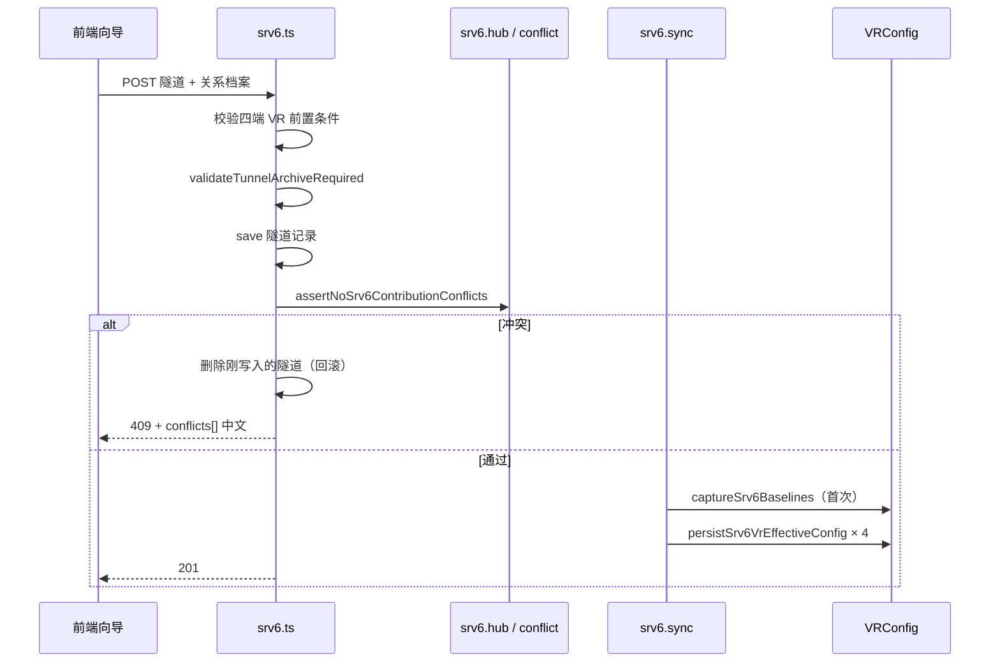

# SRv6 隧道配置管理 · baseline + 贡献 + recompute 实现方案

> **状态**：已落地（P1–P4）；**真·Hub PE 组网**见 §14（遗留，未实现）  
> **当前组网范围**：**CE-A ↔ PE-A ↔ PE-B ↔ CE-B** 四端单会话（每角色默认 1 WAN + 1 LAN），**不支持**同一 Hub PE/CE 承载多条 Spoke 隧道。  
> **关联发版说明**：[`docs/srv6-release-notes.md`](./srv6-release-notes.md)  
> **冒烟用例**：[`frontend/src/pages/sdncc/interconnect/srv6/testcases.md`](../frontend/src/pages/sdncc/interconnect/srv6/testcases.md)  
> **对外 API 索引**：[`AGENTS.md`](../AGENTS.md) · API 规范 · SDN 网络

---

## 1. 背景与动机

### 1.1 原模型（eject 主路径）的问题

早期 SRv6 隧道创建后，四端 VR 的 `config_json` 由前端拼装并直写平台库；删除时通过 **eject**（从当前配置中逐项删除 `injectedDelta` 记录的条目）尝试回退。

该模型在以下场景不可靠：

| 问题 | 说明 |
|------|------|
| **Hub 多隧道** | 同一 PE 上多条隧道共享设备时，eject 易误删其它隧道仍需要的邻居/路由 |
| **手改漂移** | 用户或下发后改动了配置，eject 只删「仍匹配」项，回退不完整 |
| **无双态分离** | 无法区分「向导基线」与「隧道叠加后的生效态」，难以对账与修复 |
| **前端写库** | 创建成功后前端再调 `saveVRConfig`，与服务端隧道档案可能不一致 |

### 1.2 目标

采用 **基线 + 贡献 + 重算** 三层模型，使平台库中的生效配置恒满足：

```text
生效 config_json = merge(向导基线, Σ 存活隧道对该 VR 的贡献)
```

删除隧道不再以 eject 为主路径，而是 **exclude 该隧道贡献后 recompute**，回到「基线 + 其余隧道」的合意态。

---

## 2. 设计原则

1. **Layer 0 · 向导基线**：`VRConfig.srv6BaselineJson` — 该 VR **首次**被 SRv6 隧道引用前（或零隧道对齐后）的向导态快照。  
2. **Layer 1 · 隧道贡献**：`SRv6Tunnel.injectedDelta` — 各端（peA/peB/ceA/ceB）相对基线新增的 neighbors、路由、RD/RT、activate AF 等结构化清单。  
3. **Layer 2 · 平台生效配置**：`VRConfig.config_json` — 由服务端 **merge + recompute** 写入，为下发与对账的权威来源。  
4. **关系档案**：除 `injectedDelta` 外，隧道须持久化 `rdRtMeta`、`endpointFingerprint`、内网口等，用于 Hub 冲突检测与 VR 配置锁。  
5. **不做历史隧道自动兼容**：无完整档案或无基线的旧隧道，删除回退返回 **400/409** 并给出中文引导（仅删记录 / 配置对账 / 手工清理）。  
6. **用户可见文案**：API `message`、409 `conflicts[]`、对账 UI 均使用中文业务描述；内部规则码（如 `C-N1`）仅用于程序与单测，不展示给终端用户。

---

## 3. 数据模型

### 3.1 `VRConfig` 新增字段

| 字段 | 类型 | 含义 |
|------|------|------|
| `srv6BaselineJson` | `string \| null` | SRv6 向导基线（JSON 字符串） |
| `srv6BaselineAt` | `Date \| null` | 基线捕获/对齐时间 |
| `srv6BaselineTunnelId` | `string \| null` | 首次捕获基线时的隧道 ID；零隧道对齐后为 `null` |

实体：`backend/src/entities/vRouter/VRConfig.ts`

### 3.2 `SRv6Tunnel` 关系档案（创建/更新必填）

| 字段 | 含义 |
|------|------|
| `peAInnerIf` / `peBInnerIf` | PE 内网接口名 |
| `rdRtMeta` | 公共 RT + PE-A/PE-B 的 RD 映射 |
| `injectedDelta` | 四端配置变更清单（结构化，非整段 JSON diff） |
| `endpointFingerprint` | 四端关键指纹（公网 IP/ASN、SID 前缀、内网口/VRF 等） |

类型定义：`backend/src/entities/vRouter/srv6Tunnel.types.ts`  
校验：`backend/src/routes/sdn/srv6.archive.ts` · `validateTunnelArchiveRequired`

---

## 4. 核心算法

### 4.1 merge（基线 + 单端贡献 → 局部叠加）

模块：`backend/src/routes/sdn/srv6.merge.ts` · `mergeBaselineWithContributions(baseline, contributions[])`

按贡献顺序叠加各隧道在四端写入的：

- BGP `neighbor`
- `neighbor_disable_connected_check`
- `activate_address_family`（ipv4 vpn）
- `ipv4_route` / `ipv6_route`
- RD/RT（ipv4 unicast vpn 地址族）

纯函数、可单测；**PE22 类**「创建后叠加、删光隧道回基线」为回归基准。

### 4.2 recompute（单 VR 生效配置）

模块：`backend/src/routes/sdn/srv6.recompute.ts`

1. `listAliveContributionsForVr(vrUuid)` — 收集引用该 VR 的存活隧道及其对应 slot 的 `injectedDelta` 片段。  
2. `recomputeVrEffectiveConfig(vrUuid)` — `parseSrv6Baseline` + merge 全部贡献。  
3. 无基线且有存活隧道引用时抛错（中文）：「该设备尚未保存向导基线，无法生成生效配置」。

### 4.3 基线捕获与对齐

模块：`backend/src/routes/sdn/srv6.baseline.ts`

| 函数 | 时机 |
|------|------|
| `captureSrv6BaselinesForTunnel` | 隧道 **首次** sync 前；若 VR 尚无基线，将当前 `config_json` 写入 `srv6BaselineJson`（仅写一次） |
| `resetSrv6BaselineWhenNoTunnels` | 某 VR **无存活隧道** 时，将基线对齐为当前 `config_json` |
| `forceResetSrv6BaselineFromConfig` | 管理员 API；须零隧道，否则 409 |

---

## 5. 业务流程

### 5.1 创建隧道（POST `/api/networks/srv6`）



要点：

- **冲突检测在 save 之后、sync 之前**；sync 失败则 **删除隧道记录** 回滚。  
- 前端 **不再** 在创建成功后对四端调用 `saveVRConfig` 直写注入预览态（P2）。

### 5.2 更新隧道（PUT `/api/networks/srv6/:id`）

1. 合并 payload + 关系档案校验。  
2. **`assertNoSrv6ContributionConflicts` 先于 `save`**（评审修复：避免冲突已落库未 sync）。  
3. `save` → `syncSrv6TunnelPlatformConfigs`（四端 recompute 落库）。

### 5.3 删除隧道（DELETE `/api/networks/srv6/:id`）

模块：`backend/src/routes/sdn/srv6.delete.ts`

- 默认 `revertPlatform=1`、`revertDevice=1`（query 传 `0` / `false` 可关闭）。  
- **回退平台库**：对该隧道四端各执行 `recomputeVrEffectiveConfig`（exclude 本隧道），写回 `config_json`。  
- 可选 **push 设备**（与 IPsec 同源 `vrController.updateVRConfig`）。  
- 删除成功后对四端尝试 `resetSrv6BaselineWhenNoTunnels`（零隧道基线对齐）。  
- 无 `injectedDelta` / 无基线：**400**，中文提示 + 操作建议。

> `srv6.eject.ts` 已标记 **@deprecated**，仅保留单测与历史对照，**不得**作为新流程写库依据。

### 5.4 VR 配置保存（`/api/vr-config` upsert）

模块：`backend/src/routes/sdn/vrConfig.ts` + `srv6.vrLock.ts`

| 场景 | 行为 |
|------|------|
| 被存活隧道引用 + 已有基线 | **忽略**请求体中的 `config_json` 直接改库；强制 `persistSrv6VrEffectiveConfig`（恒等 recompute） |
| 有基线、无存活隧道 | 允许更新 `config_json`，并 **同步刷新** `srv6BaselineJson` |
| 无基线 | 普通 upsert |
| 指纹变更 | `assertSrv6VrConfigUpsertAllowed` → **409**，列中文关键项（公网 IPv6、SID 前缀等） |

### 5.5 下发设备（不变更架构，路径对齐 IPsec）

- `GET /api/networks/srv6/deploy/preview?vrId=` — 读库 → stripMeta → sanitize  
- `POST /api/networks/srv6/deploy/push` — 推送设备控制面  

生效配置须先由 §5.1–5.3 写入平台库，再走进下发向导。

---

## 6. Hub 多隧道与冲突检测

### 6.1 Hub 语义

同一 VR（通常 PE）被 **≥2 条存活隧道** 引用时为 Hub。  
`GET /api/networks/srv6/vr/:vrUuid/hub` 返回引用列表、是否 Hub、冲突预检状态。

模块：`backend/src/routes/sdn/srv6.hub.ts`

- 有其它存活隧道但 **缺基线** → 返回 `NO_BASELINE` 中文提示（不再静默跳过）。

### 6.2 冲突规则（内部 code → 用户 message）

模块：`backend/src/routes/sdn/srv6.conflict.ts` · `detectContributionConflicts`

| Code | 检测内容 | 用户可见摘要 |
|------|----------|--------------|
| C-N1 | 与已有隧道重复 neighbor（同 bgpIndex） | 公网 BGP 邻居已被某隧道使用 |
| C-N2 | neighbor 已存在于向导基线 | 已在基线中，勿重复建隧道 |
| C-A1 | activate AF 重复 | 公网 VPN 已激活对端冲突 |
| C-D1 | neighbor_disable_connected_check 重复 | 直连检查豁免重复 |
| C-R1 / C-R2 | RD/RT 重复 | 内网 VPN 路由标识占用 |
| C-I1 | IPv6 路由重复 | IPv6 路由已被占用 |
| C-V1 | 内网口 + VRF 重复 | 内网口+VRF 已被占用 |

聚合文案：`formatSrv6ContributionConflicts` → 「无法保存隧道：与已有隧道的网络配置冲突。…」

创建/更新前：`assertNoSrv6ContributionConflictsForTunnel`；409 响应含 `conflicts: [{ message, ... }]`。

### 6.3 当前版本适用范围（**非**真·Hub PE）

| 维度 | P1–P4 已支持 | **不在**当前范围（见 §14） |
|------|-------------|---------------------------|
| 拓扑 | 一条隧道固定四 VR：`CE-A↔PE-A↔PE-B↔CE-B` | 同一 Hub PE（如 PE3）对 **多个 Spoke PE**（PE22、PE2…）各建一条隧道 |
| 接口 | PE 公网 implicit **port0**；内网 **单** `peAInnerIf` / `peBInnerIf` | Hub **多 WAN / 多 LAN**、口级占用注册表 |
| 冲突 | 同 VR 上 `injectedDelta` **字段级**互斥（含 C-I1 同内网口+VRF、C-R1 同 bgpIndex 等） | 以 **PE–PE 公网 neighbor** 为主键、**CE/VRF 复用**、Hub **单 RD + 多 RT** |
| 单测 Hub | `scenarios.test` 中 t2Ok 要求 **不同 bgpIndex/VRF 段** | 同 VRF7777 + 同 CE3 + 不同 Spoke 邻居 |

**产品决策（2026-06）**：现网验收与发版以 **标准四端单隧道** 为准；P3 的 Hub API/提示/冲突为 **有限预研能力**，**不得**将「PE3 再接 PE2」类真 Hub 场景作为当前 SLA。完整 Hub 方案见 **§14**，下迭代（P5）启动开发时以 §14 为唯一入口。

---

## 7. 配置对账（P4）

模块：`backend/src/routes/sdn/srv6.reconcile.ts`

| Issue Code | 含义 | 可修复 |
|------------|------|--------|
| `NO_BASELINE` | 有存活隧道但无基线 | 否（需人工） |
| `BASELINE_PARSE_ERROR` | 基线 JSON 损坏 | 否 |
| `CONFIG_PARSE_ERROR` | 生效配置无法解析 | 否 |
| `ORPHAN_BASELINE_DRIFT` | 零隧道但生效配置 ≠ 基线 | 是：基线对齐当前配置 |
| `INVARIANT_DRIFT` | 有隧道但生效配置 ≠ merge 结果 | 是：recompute 写回 |

API：

- `GET /api/networks/srv6/reconcile?vrUuid=` — 只读扫描  
- `POST /api/networks/srv6/reconcile` — `{ repair?: boolean, vrUuid?: string }`  
- `POST /api/networks/srv6/vr/:vrUuid/baseline/reset` — 零隧道强制基线重置  

审计：`srv6.audit.ts` · `SRv6 Reconcile` / `SRv6 Baseline Reset` / 隧道 CRUD。

前端：隧道列表 ·「配置对账」弹窗（`frontend/src/pages/sdncc/interconnect/srv6/index.tsx`）。

---

## 8. 分阶段交付（P1–P4）

| 阶段 | 范围 | 关键交付 |
|------|------|----------|
| **P1** | 数据模型 + merge/recompute + 删除回退 | `srv6BaselineJson`；`srv6.merge/recompute/baseline/delete`；eject 退出主路径 |
| **P2** | 创建/更新 sync + VR upsert 恒等 | `srv6.sync`；POST/PUT 后四端落库；失败回滚；`vrConfig` upsert recompute；前端去掉创建后直写 |
| **P3** | Hub + 冲突 | `srv6.conflict/hub`；409 conflicts；前端 Hub 提示与列表标签 |
| **P4** | 对账 + 审计 + 文案 | `srv6.reconcile/audit`；零隧道基线对齐；对账 UI；用户可见中文优化 |

---

## 9. 源码地图

### 9.1 后端（`backend/src/routes/sdn/`）

| 文件 | 职责 |
|------|------|
| `srv6.ts` | HTTP 路由装配、创建/更新/删除/对账/下发/hub |
| `srv6.baseline.ts` | 基线捕获、零隧道对齐、强制重置 |
| `srv6.merge.ts` | 基线 + 贡献 merge 纯函数 |
| `srv6.recompute.ts` | 单 VR 重算、存活贡献枚举 |
| `srv6.sync.ts` | 四端 sync、持久化生效配置 |
| `srv6.delete.ts` | 删除 + recompute 回退 + 可选 push |
| `srv6.conflict.ts` | 贡献冲突检测与文案格式化 |
| `srv6.hub.ts` | Hub 状态、创建前冲突断言 |
| `srv6.reconcile.ts` | 对账扫描与修复 |
| `srv6.archive.ts` | 关系档案解析/校验/指纹 |
| `srv6.validation.ts` | 隧道 payload 与四端前置校验 |
| `srv6.vrLock.ts` | 被引用 VR 的 upsert / set-role 锁 |
| `srv6.references.ts` | VR ↔ 隧道引用查询 |
| `srv6.audit.ts` | 审计日志封装 |
| `srv6.eject.ts` | **deprecated** 历史 eject |
| `srv6.*.test.ts` | 单测；`srv6.scenarios.test.ts` 为 P1–P4 场景矩阵（18 条） |

关联：`vrConfig.ts` upsert/set-role 集成 SRv6 锁与 recompute。

### 9.2 前端（`frontend/src/pages/sdncc/interconnect/srv6/`）

| 文件 | 职责 |
|------|------|
| `Create.tsx` | 创建/编辑向导；Hub 提示；保存后不再直写 VR；下发向导 |
| `index.tsx` | 隧道列表、删除、配置对账弹窗 |
| `srv6Archive.ts` | 前端构建 `injectedDelta` / 指纹 / RD·RT 档案 |
| `testcases.md` | 发版前手工冒烟用例 R1–R7 |

API 封装：`frontend/src/services/api.ts`；409 时 `conflicts` 经 `requestManager` 透传。

---

## 10. 测试策略

### 10.1 自动化

```bash
cd backend
npx jest src/routes/sdn/srv6
npx tsc --noEmit
```

覆盖：merge 恒等、PE22 删除回退、冲突码、校验、对账纯函数、scenarios 矩阵。

### 10.2 手工冒烟

见 [`testcases.md`](../frontend/src/pages/sdncc/interconnect/srv6/testcases.md)：R1 创建、R2 删除回退、R5 对账、R6 VR 锁、R7 零隧道基线；**R3/R4 为 P5 遗留**（见 §14）。

---

## 11. 运维与排障

| 现象 | 排查 |
|------|------|
| 创建 409 冲突 | 响应 `conflicts[]`；查 Hub API；确认 neighbor/RD/内网口是否与已有隧道重复 |
| 删除 400 | 多为历史隧道无档案/无基线；按提示仅删记录或走对账 |
| 保存 VR 409 | 设备被隧道引用且改了指纹；先删隧道或勿改关键 WAN/内网项 |
| 对账 INVARIANT_DRIFT | POST reconcile `repair: true`；查审计 `SRv6 Reconcile` |
| 生效态与预期不符 | 确认四端是否 sync 成功；PUT 是否先冲突检测；是否有人 bypass upsert 直写库 |

---

## 12. 已知限制与后续可选

- **历史隧道**：不自动迁移档案/基线，需人工或对账后重建。  
- **设备态**：平台 recompute 不保证与设备实时一致；须走下发向导 push。  
- **eject 模块**：未删除，避免单测/对照断裂；新功能禁止依赖。  
- **真·Hub PE**：**当前不支持**；需求、改造清单、验收口径见 **§14**（P5 遗留）。  
- **其它可选增强**：对账定时任务、Hub 可视化拓扑、PostgreSQL 生产库迁移后的批量 reconcile CLI。

---

## 14. 遗留事项：真·Hub PE 组网（P5 规划，未实现）

> **用途**：下步启动 Hub PE 开发时 **直接参照** 本节；与 §6.3「当前不支持」一致。  
> **决策日期**：2026-06 — 先交付 **CE-A↔PE-A↔PE-B↔CE-B** 标准组网；Hub 完整实现延后。

### 14.1 背景与目标场景

**典型组网**（测试机 PE3 类）：

```text
T1: PE22/CE22  ←→  PE3/CE3   （已存在隧道 test-20260508）
T2: PE2/CE2    ←→  PE3/CE3   （期望：Hub PE3 再接纳新 Spoke，对端 PE 不同即允许）
```

**业务期望**：

- 每条隧道仍走 **四端创建 + 四端下发**（流程不变）。  
- **Hub PE/CE** 可被多条隧道引用，但须记录 **WAN/LAN 与已有隧道的对应关系**。  
- **判重主键**：Hub 上 **PE–PE 公网 neighbor（对端 Spoke PE）** 唯一；**CE、VRF、Hub RD 可复用**。  
- **RD/RT（Hub 侧，定稿口径）**：**RD 在 Hub PE 上可仅有一个**（VRF/设备级）；**RT 按隧道/对端各自生成**，**不**继承已有隧道 RT。  
- **409 提示**：仅报 **Blocking** 原因（主键冲突），避免 C-A1/C-R1/C-V1/C-I1 等从属项堆砌（体验项，随 P5 一并改）。

### 14.2 当前实现与真 Hub 的差距

| 维度 | 当前实现（P1–P4） | 真 Hub 目标 |
|------|-------------------|-------------|
| WAN | `extractPortIpv6(cfg, 0)`，固定第一口为公网 | 每隧道绑定 **Hub WAN 口**；口占用注册表 |
| LAN | 向导选 **一个** `peBInnerIf` | **可复用**同一 LAN/VRF；也可按 Spoke **分开配置** |
| PE–PE BGP | `injectNeighborsForPEPeer` 从对端 PE **自动推导** | 按 **本隧道 WAN ↔ 对端 WAN** 建会话；不宜仅放在「角色配置向导」 |
| `rdRtMeta` | 每隧道随机 `rtCommon` + `rdMap.peA/peB` | Hub：**单 RD**；**每隧道/对端新 RT** |
| `mergeRdRt` | 同 `bgpIndex` **覆盖**一套 RD/RT | 须支持 **单 RD + 多 RT**（或每 Spoke 独立 bgp 段，见 14.4） |
| 冲突 C-N1 | 所有 `neighbors` 同 bgpIndex+IP 即冲突（文案写「公网」易误导） | Hub：**仅 PE–PE 公网段** neighbor 作 Blocking；CE/VRF 段复用允许 |
| 冲突 C-I1/C-R1/C-V1 | 同内网口+VRF / 同 bgpIndex RD / 同 ::/0 即拒 | Hub：**允许复用**；按 14.5 规则重写 |
| CE-B 共用 | `buildCeInjectedDelta` 相同 → CE 侧贡献完全相同 → 误报 C-N1 | 共享 CE **零增量**或 **按隧道区分** CE 贡献 |
| `endpointFingerprint` | 无 `wanIf` | Hub PE 指纹须含 **wanIf + 会话标识** |
| Hub API | 隧道引用列表 | 升级为 **口占用表 + 可复用 CE/VRF 提示** |

### 14.3 建议数据模型（P5 设计稿）

#### 14.3.1 隧道级 Hub 绑定（示例）

对处于 Hub 角色的槽位（如 `peB`）扩展档案（字段名实施时可调整）：

```typescript
// 概念类型，非当前库表
type Srv6HubSlotBinding = {
  wanIf: string;              // 本隧道 PE–PE 用的 Hub WAN
  lanIf: string;              // 本隧道 PE–CE 用的 Hub LAN（可与它隧道相同）
  vrf?: string | number;
  peerPeUuid: string;         // 对端 PE（peA 实例 UUID）
  peerWanIf?: string;         // 对端 WAN（若不能从实例默认推导）
  peerPublicNeighbor: string; // 判重主键（IPv6 或 IPv4，与 injectedDelta 一致）
  rt?: string;                // 本隧道 RT（Hub 侧写入值）
};

type Srv6HubPortRegistryEntry = {
  tunnelId: string;
  tunnelName: string;
  slot: 'peA' | 'peB' | 'ceA' | 'ceB';
  wanIf?: string;
  lanIf?: string;
  vrf?: string | number;
  peerPublicNeighbor?: string;
  rt?: string;
};
```

**Hub 口占用表**：`HubPePortRegistry[vrUuid] → Srv6HubPortRegistryEntry[]`（可落库或 Hub API 聚合）。

**Blocking 判重键（R4）**：`(hubPeUuid, peerPublicNeighbor)` 或 `(hubPeUuid, wanIf, peerPublicNeighbor)`（产品确认 WAN 是否与 neighbor 一一对应后择一）。

#### 14.3.2 RD/RT 档案（Hub 定稿）

```typescript
// 替代/扩展现有 rdRtMeta { rtCommon, rdMap }
type Srv6RdRtMetaV2 = {
  hubPeSlot?: 'peA' | 'peB';           // 哪一端为 Hub（或由注册表推断）
  hubRd?: string;                      // Hub PE 上唯一 RD（首条隧道确立，后续复用）
  rtByPeer?: Record<string, string>;   // key=对端 PE UUID → RT
  rtBySlot?: { peA?: string; peB?: string }; // 或按槽位，与 Spoke 成对
  rdMap?: Record<string, string>;      // Spoke 侧 RD 仍可按 peA/peB 生成
};
```

**规则**：

- Hub PE：**RD 全局唯一**（同一 VR/VRF 段一个值）。  
- **RT**：**每条隧道、每个对端 Spoke 新建**，不与其它隧道 RT 碰撞；**不**继承旧隧道 RT。  
- Spoke PE：RD/RT 与 Hub 侧成对约定（Spoke 规则在 P5 需求中单独列）。

### 14.4 设备语义阻塞项（启动 P5 前必须确认）

`mergeRdRt` 当前对同一 `bgpIndex` **后写覆盖** RD/RT，无法在同一 VRF 段并存多个 RT。真 Hub 须 **三选一**（与 CSM/PE 控制器确认）：

1. 设备支持 **RT 列表**（import/export 多 RT），扩展 `mergeRdRt` 合并多个 `route_target`，RD 只设一次。  
2. **每 Spoke 独立 VRF/bgp 段**（接近现有 `scenarios.test` t2Ok），Hub RD 相同、每段一个 RT。  
3. 其它设备原生形态（以实测 JSON 为准）。

**未确认前不得开工 merge 改造。**

### 14.5 端到端目标行为（P5 验收规格 · 定稿口径）

下表为真 Hub **可验证规格**；P5 完成时须全部满足（自动化 + 手工）。

| ID | 规格 | 验收要点 |
|----|------|----------|
| **H1** | 同一 Hub PE VR 允许多条隧道，每条绑定一个 Spoke PE | 公网 **PE–PE neighbor 唯一**；第二条不同 Spoke 可创建成功 |
| **H2** | Hub WAN | 默认 **每隧道独立 WAN 口**；若允许 WAN 复用，则 neighbor 仍须唯一 |
| **H3** | Hub LAN / VRF / CE | **允许复用**；PE–CE neighbor、RT **随隧道/对端区分** |
| **H4** | Hub RD | **设备/VRF 级一个**；首隧道确立，后续隧道 **复用同一 RD 值** |
| **H5** | RT | **每隧道（或每 Spoke 对端）新建**；与已有隧道 **RT 不得碰撞**；**不**继承旧 RT |
| **H6** | 409 提示 | 仅报 **Blocking** 主因（如重复 PE–PE neighbor）；**不**堆砌从属项 |
| **H7** | 删除单条隧道 | recompute 只移除 **该隧道绑定** 的 Spoke 项；**不**拆共享 LAN/CE/Hub RD |

**与冒烟用例映射**：P5 完成后将 [`testcases.md`](../frontend/src/pages/sdncc/interconnect/srv6/testcases.md) 中 **R3/R4** 从「遗留/跳过」改为按 H1–H7 验收；并新增 **H 系列**用例编号。

### 14.6 向导与下发（P5 UX）

| 项 | 建议 |
|----|------|
| 四端下发 | **保留** PE-A → PE-B → CE-A → CE-B 顺序；push 的仍是 merge 后生效配置 |
| PE–PE BGP | **不宜**仅放在「角色配置向导」；在 **SRv6 创建向导** Step2 扩展或 **Step2.5「Hub 互联」** 中配置 WAN 绑定与 neighbor 预览 |
| 角色配置向导 | 继续负责 Locator/SID/BGP **baseline 骨架** |
| Step2 | Hub PE 选中后：展示 **口占用**、可选 WAN/LAN、Hub 提示；过滤/标注已占用 WAN |
| Hub API | `GET .../hub` 返回 **口占用表** + 可复用 CE/VRF 说明 |

### 14.7 改造影响清单（按模块）

| 模块 | 改造内容 | 风险 |
|------|----------|------|
| **产品/网络** | 确认 14.4 设备多 RT 写法 | **阻塞** |
| **数据模型** | `hubBindings`、Hub 注册表；扩展 `endpointFingerprint`（含 `wanIf`） | 档案迁移 |
| **frontend `Create.tsx` / `srv6Archive.ts`** | 口选择、RD/RT 生成、按绑定口生成 `injectedDelta` | 高 |
| **`srv6.conflict.ts`** | Hub 专用规则 + 409 聚合 | R3/R4 核心 |
| **`srv6.merge.ts`** | 多 RT / 多 neighbor 同 VRF 合并 | 高 |
| **`srv6.hub.ts`** | 口占用 API | 中 |
| **`srv6.recompute` / delete** | 共享 CE/RD 删除不误删 | 中 |
| **`srv6.vrLock.ts`** | Hub 多 WAN 指纹锁定策略 | 中 |
| **单测** | PE3/PE2/PE22 fixture；H1–H7 场景矩阵 | 低 |
| **文档** | 更新 §6、发版说明、testcases | 低 |

**与 P1–P4 关系**：Spoke 单隧道、非 Hub PE 路径 **保持不变**；Hub 逻辑建议 **特性开关**（检测到 Hub VR 才启用 P5 规则）。已有隧道无 `hubBindings` → **不自动兼容** 或 **迁移工具补绑定**（与历史隧道策略一致）。

### 14.8 推荐实施路线（P5）

| 阶段 | 内容 | 产出 |
|------|------|------|
| **P5.0** | 14.4 设备语义确认 + §14.9 决策清单签字 | 设备 JSON 样例、Blocking 键定义 |
| **P5.1** | 数据模型 + conflict/409 聚合（可暂用手工指定 WAN 口名） | R4 类误报消除、H6 |
| **P5.2** | 向导 Hub UI + Hub 口注册表 | H1–H3 可手工验收 |
| **P5.3** | merge 多 RT + 旧隧道迁移 + H 系列单测 | H4–H7、R3/R4 转正 |

**不推荐**：在 P5 完成前依赖「换 VRF/bgp 段绕过冲突」作为生产 Hub 方案（仅单测 t2Ok 级别，与 PE3 组网不符）。

### 14.9 启动 P5 前决策清单

1. 设备：同 VRF 上能否 **一个 RD + 多个 RT**？配置 JSON 形态？  
2. Hub WAN：PE3 接 PE22 / PE2 是否 **必须不同物理 WAN**？  
3. Hub CE3：多条隧道共用 CE3 时，CE 侧 **零增量** 还是 **per-tunnel neighbor**？  
4. Hub RD：**整个 Hub VR 一个 RD** 是否准确？  
5. RT：**每隧道一对（PE-A/PE-B）** 还是 **每 Spoke PE 一个**？  
6. 兼容：已有 `test-20260508` **迁移绑定** 还是 **仅新隧道走 Hub**？

### 14.10 P5 开发入口（文件索引）

| 区域 | 路径 |
|------|------|
| 冲突 / Hub | `backend/src/routes/sdn/srv6.conflict.ts`、`srv6.hub.ts` |
| merge / recompute | `backend/src/routes/sdn/srv6.merge.ts`、`srv6.recompute.ts` |
| 档案 | `backend/src/routes/sdn/srv6.archive.ts`、`frontend/.../srv6Archive.ts` |
| 向导 | `frontend/.../srv6/Create.tsx` |
| 类型 | `backend/src/entities/vRouter/srv6Tunnel.types.ts` |
| 单测样板 | `backend/src/routes/sdn/srv6.scenarios.test.ts`（t2Ok ≠ 真 Hub，P5 须新 fixture） |
| 验收 | 本节 **§14.5 H1–H7** + [`testcases.md`](../frontend/src/pages/sdncc/interconnect/srv6/testcases.md) |

---

## 13. 修订记录

| 日期 | 说明 |
|------|------|
| 2026-06 | P1–P4 落地；PUT 冲突检测顺序修复；用户可见文案中文化；testcases 归档 |
| 2026-06 | **§14 真·Hub PE 遗留规划**；§6.3 明确当前仅支持四端单会话组网 |
