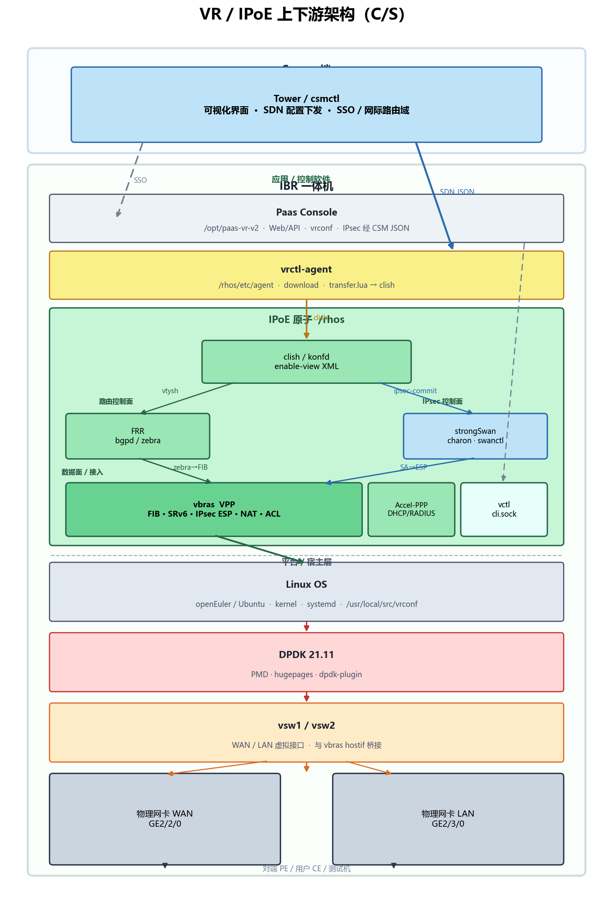
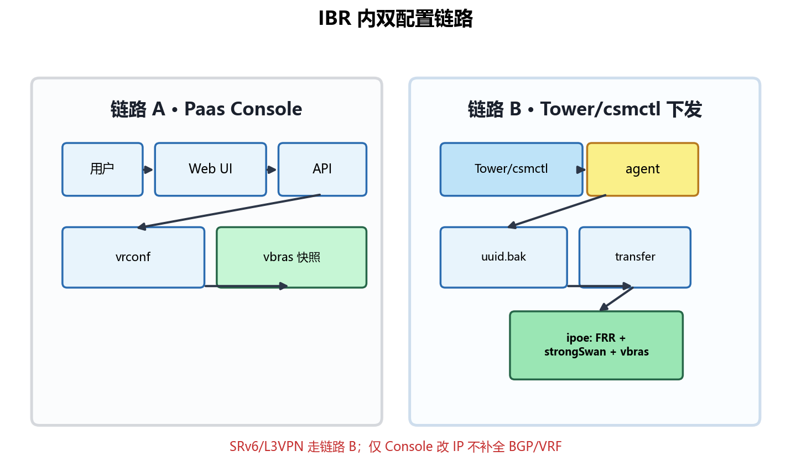

# VR / IPoE 上下游架构说明

> **受众**：Paas Console、VR 联调、SRv6/L3VPN 实验、agent/ipoe 排障  
> **范围**：从云平台 / Tower 到 VR 设备控制面、数据面的端到端链路  
> **仓库路径**：`docs/reference/`（参考材料，**不参与** `npm run deploy:remote`）

---

## 1. 术语速查

| 术语 | 含义 |
|------|------|
| **IBR** | 一体机（Integrated Branch Router），同机部署 Console + agent + ipoe |
| **Tower** | Server 端可视化界面，运维入口、SSO、网际路由域编排 |
| **csmctl** | Server 端配置下发能力（CSM Controller），SDN JSON → agent |
| **IPoE / ipoe** | **IPoE 原子**整款产品：云化虚拟 BRAS（接入 + 路由 + 转发） |
| **vbras** | ipoe 的**数据面**进程，基于 **VPP**，负责报文转发（含 SRv6） |
| **FRR** | ipoe **控制面**路由协议栈（BGP、OSPF 等），经 clish/vtysh 配置 |
| **clish** | ipoe 命令行外壳，XML + `/rhos/bin/ipsec_*.sh` → 调用 vtysh / swanctl / vbras |
| **CSM（设备侧）** | **JSON→clish 适配壳**（`csm_agent_cmd_exector.sh` + `ipsec_clish_config.sh`）；Console IPsec API 经此转 clish，**不是** IKE 实现 |
| **strongSwan** | IPsec **控制面**（charon + swanctl 5.x）：IKE 协商、SA 生命周期；配置落 `/etc/swanctl/conf.d/` |
| **agent / vrctl-agent** | IBR 内配置代理：向 csmctl 拉取 JSON、经 `transfer.lua` 转 clish |
| **CSM** | csmctl 背后的资源池编排（安全域、网元组、SDN 专家模式等）；经 Tower UI 操作 |
| **网际路由域（IRD）** | 原「安全域」更名后的编排对象，与 CSM 安全域 1:1 |
| **Paas Console** | 本仓库 `web/` + `server/`，VR **本地管理 UI/API** |
| **vsw1 / vsw2** | Linux 侧虚拟网卡，对应 WAN/LAN，与 vbras 桥接 |

**关系一句话**：**Server 端 Tower（csmctl 可视化）管编排与下发；IBR 一体机里 Console 本地运维、agent 接云配置、ipoe 跑转发。**

---

## 2. 总体架构（C/S 纵向）



| 层级 | 组件 | 职责 |
|------|------|------|
| **Server 端** | Tower / csmctl | Tower 为可视化界面；csmctl 为配置下发（SDN JSON → agent）、SSO、网际路由域 |
| **IBR 一体机** | Paas Console | 本地 Web/API、`vrconf` 文件 |
| **IBR 一体机** | vrctl-agent | `download` → `transfer.lua` → clish |
| **IBR 一体机** | IPoE 原子 `/rhos` | clish + FRR + strongSwan + vbras + Accel-PPP |
| **IBR 平台层** | Linux OS | kernel、systemd、`/usr/local/src/vrconf` |
| **IBR 平台层** | DPDK 21.11 | PMD、hugepages、dpdk-plugin（**非 SPDK**） |
| **IBR 平台层** | vsw1 / vsw2 | Linux 虚拟接口，与 vbras 桥接 |
| **IBR 平台层** | 物理网卡 | GE2/2/0 (WAN)、GE2/3/0 (LAN) 等 |

**硬约束**：Console、agent、ipoe **同机部署于 IBR**；分离会导致 `cli.sock`、`/usr/local/src/vrconf/` 不可用。

---

## 3. Server 端：Tower / csmctl

Tower 与 csmctl **不是两个并列产品**：**Tower 是 csmctl 的可视化界面**，运维人员在 Tower 上完成的网际路由域、SDN 专家模式、安全服务等操作，最终由 csmctl 落库并下发给 IBR agent。

### 3.1 Tower（csmctl 可视化）

- 运维入口：网际路由域编排、安全服务、SSO 等
- IBR 通过 `vrcontrol.conf` 注册 Tower 地址；Console「配置服务」读写该地址

### 3.2 csmctl（配置下发能力）

| 阶段 | 说明 |
|------|------|
| 注册/认证 | agent 向 Tower/csmctl 注册，取得 auth |
| 轮询下载 | `monitoring.agent --mode download` 拉 NetJSON |
| 落盘 | `{uuid}.bak` → `/rhos/etc/agent/download/` |
| 应用 | `transfer.lua` diff 后执行 clish |

**SDN 专家模式 JSON**（SRv6 双站实验等）经 **Tower UI → csmctl → agent**，不经过 Console 的 `deploy:remote`。

### 3.3 IBR 本地配置（Console 写 vrconf）

| 文件 | 路径 | 作用 |
|------|------|------|
| `vrcontrol.conf` | `/usr/local/src/vrconf/` | Tower、SDWAN、AI SOC 等地址 |
| `registervr.conf` | 同上 | VR uuid、名称、资源池身份 |
| `nic_roles.conf` | 同上 | 网卡角色、IP 快照（Console「设定网卡 IP」） |

Console 通过 `GET/POST /api/sys/vrcontrol` 等读写上述文件（见 `knowledge-base.md` §3.1）。

### 3.4 网际路由域（IRD）

Tower 侧重命名与 SSO 代理；字段与 API 见 [`internetwork-routing-domain-downstream.md`](internetwork-routing-domain-downstream.md)。

| 字段 | 含义 |
|------|------|
| `linkedCsmSecurityDomainId` | CSM 安全域 ID |
| `securityServices` | CSM 网元组投影 |
| `ssoEndpoint` | Tower SSO 代理路径 |

---

## 4. Paas Console（本仓库产品）

### 4.1 部署边界

| 项 | 值 |
|----|-----|
| 源码 | `web/`、`server/` |
| 设备路径 | `/opt/paas-vr-v2/` |
| 服务 | `paas-vr-v2.service` |
| 发布 | `npm run deploy:remote` |

**不部署**：`products/` 下 csmctl、vrctl-agent、ipoe（见 [`products/README.md`](../../products/README.md)）。

### 4.2 Console 能做什么 / 不能做什么

| 能力 | 路径 | 生效方式 |
|------|------|----------|
| 配置服务（Tower/SDWAN 地址） | `/device/service` | 写 `vrcontrol.conf` |
| 设定网卡 IP | `/device/config/set-ip` | `nic_roles.conf` + vbras 快照 |
| IPsec / 子接口等 | `/forwarding/*` | CSM JSON → clish → strongSwan；ESP 在 vbras |
| SDN 专家模式整段 JSON | **云侧 CSM** | agent → transfer（Console 仅可读展示/探测） |

Console 与 agent 是**并行两条配置链**，见下节。

---

## 5. 双配置体系（最易混淆）



| 维度 | Console（链路 A） | agent（链路 B） |
|------|-------------------|-----------------|
| 配置目录 | `/usr/local/src/vrconf/` | `/rhos/etc/agent/download/` |
| 典型场景 | 改管理 IP、网卡 IP、Tower 地址 | BGP、SRv6、IPsec、VRF 整包 |
| 生效 | 写字段/文件；部分调 vbras | Lua → clish（云侧经 Tower/csmctl 下发） |
| 仓库参考 | `server/`、`web/` | `products/vrctl-agent/` |

**注意**：仅 Console 改 LAN IP **不会**自动补全 BGP/VRF；SRv6 实验必须用 **链路 B 整段 SDN 下发**。

---

## 6. IBR 内部分层（应用 → 平台 → 硬件）

IBR 自上而下分为 **应用/控制软件** 与 **平台/宿主层**：

```
应用层
├── Paas Console        /opt/paas-vr-v2
├── vrctl-agent         /rhos/etc/agent
└── IPoE 原子 /rhos
    ├── clish + enable-view XML（ipsec.xml 等）
    ├── FRR (bgpd/zebra)              ← 路由/SRv6 控制面
    ├── strongSwan (charon/swanctl)   ← IPsec IKE/SA 控制面
    ├── vbras (VPP 数据面)            ← FIB/SRv6/IPsec ESP 转发
    └── Accel-PPP / DHCP / RADIUS

平台层
├── Linux OS            openEuler/Ubuntu · kernel · systemd
├── DPDK 21.11          PMD · hugepages · dpdk-plugin
├── vsw1 / vsw2         WAN/LAN 虚拟接口，与 vbras hostif 桥接
└── 物理网卡            GE2/2/0 (WAN) · GE2/3/0 (LAN)
```

> **说明**：ipoe 数据面网络 I/O 使用 **DPDK**（Poll Mode Driver），不是存储领域的 **SPDK**。vbras 经 DPDK PMD 绑定物理网卡，经 vsw 与 Linux 宿主机协议栈互通。

### 6.1 控制面 vs 数据面 vs 平台

| 层次 | 组件 | 职责 |
|------|------|------|
| **控制面** | FRR (bgpd/zebra) | BGP 邻居、VRF、VPN 路由、SRv6 locator、SID 策略 |
| **控制面** | clish / konfd | 命令解析、配置持久化；分发至 vtysh / ipsec 脚本 / vbras |
| **控制面** | strongSwan (charon) | IKE 协商、SA 建立/拆除（`swanctl --load-all` / `--initiate` / `--list-sas`） |
| **适配** | CSM + `ipsec_clish_config.sh` | Console `ipsec_*` JSON opt → clish（agent 云下发可直接 clish） |
| **数据面** | vbras (VPP) | 线速转发、SRv6 封装/解封装、End.DT4、IPsec ESP、NAT、ACL |
| **平台** | Linux OS | 进程调度、文件系统、vrconf、管理网 |
| **平台** | DPDK | 用户态网卡驱动、大页内存、高速收发包 |
| **平台** | vsw1 / vsw2 | 宿主机侧 WAN/LAN 虚拟网卡 |
| **硬件** | 物理网卡 | GE 口绑定 DPDK PMD，对外互联 |
| **接入面** | Accel-PPP / DHCP | 终端用户 IPoE 上下线 |

### 6.2 数据面到底层路径

```
报文 → vbras (VPP/SRv6/IPsec ESP) → DPDK PMD → 物理网卡
私网 ping → vsw2 → vbras hostif → VRF 查表
FRR 路由/SID → zebra → vbras FIB 同步
IPsec：clish ipsec-commit → ipsec_cache.json → /etc/swanctl/conf.d/ → swanctl → charon → vbras ESP
```

### 6.3 关键 systemd 服务

| 服务 | 进程 | 说明 |
|------|------|------|
| `vbras.service` | `/usr/bin/vbras` | VPP 数据面；启动后可能执行 `restartIPOE.sh` |
| `frr` / watchfrr | bgpd, zebra | 路由协议；**zebra 与 vbras FIB 同步** |
| `strongswan` / `strongswan-starter` | charon | IPsec IKE/SA（设备实测 5.9.x） |
| `konfd.service` | clish 后端 | 命令分发、配置持久化（agent 依赖 `Requires=konfd`） |
| `vrctl-agent.service` | vrctl.init → monitoring.agent | 云配置拉取与应用 |
| `paas-vr-v2.service` | Node server | 本仓库 Console |

### 6.4 控制面互联（FRR / IPsec ↔ vbras）

`clish` 是 IBR 内**统一命令适配层**，按 XML 把操作分发到不同后端：

| 路径 | 配置入口 | 后端 | 同步到 vbras |
|------|----------|------|--------------|
| 路由 / BGP / SRv6 | BGP/SRv6 clish 命令 | `vtysh` → FRR | **zebra → FIB/SRv6** |
| IPsec 隧道 | `ipsec.lua` / Console CSM JSON | clish → `ipsec_*.sh` → **strongSwan** | **SA → ESP 转发** |
| 接口 / NAT / ACL | clish / Console | vbras CLI (`cli.sock`) | 直接 |

### 6.5 IPsec 链路（109 设备实测）

命名约定（swanctl JSON）：IKE 连接 `conn{id}`，子 SA / 流量选择器 `net{id}`。

```
Console /forwarding/ipsec
  → csm_agent_cmd_exector.sh（JSON opt: ipsec_create_ipsec, ipsec_commit_config, …）
  → ipsec_clish_config.sh（opt → clish 命令映射）
  → clish ipsec.xml
       ├─ ipsec_add.sh / ipsec_sa_helper.sh … 维护 /root/tmp/ipoe_ipsec/ipsec_cache.json
       ├─ ipsec-commit → ipsec_commit.sh
       │     → 写 /etc/swanctl/conf.d/swanctl.conf
       │     → swanctl --load-all
       ├─ sa-initiate → swanctl --initiate --child net{id}
       ├─ sa-terminate → swanctl --terminate --child net{id}
       └─ show ipsec sas → ipsec_show_sa_list.sh → swanctl --list-sas
  → strongSwan charon（IKE 协商）
  → vbras VPP（ipsec enable，ESP 数据面）

agent 云下发：ipsec.lua → clish（同上 clish 语义，不经 Console CSM JSON）
```

Console `server/src/services/forwarding/ipsec.ts` 解析的 SA 列表格式即 **swanctl --list-sas** 输出（`INSTALLED` / `REKEYING` / `TUNNEL-in-UDP, ESP:…`）。

设备关键路径：

| 文件 | 作用 |
|------|------|
| `/rhos/bin/ipsec_clish_config.sh` | CSM JSON opt → clish 映射表 |
| `/rhos/etc/cli/enable-view/ipsec.xml` | clish 命令 → shell / swanctl |
| `/rhos/bin/ipsec_commit.sh` | cache JSON → swanctl.conf + `swanctl --load-all` |
| `/etc/swanctl/conf.d/swanctl.conf` | strongSwan 运行配置 |

---

## 7. agent 下发链路（链路 B 详解）

### 7.1 transfer.lua 编排顺序（全量 add）

```
vrf → interfaces → ipv4/ipv6 routes → prefix-list → segment-routing
    → route-map → bgp → vrrp → ipsec → acl
```

增量 update 时对各模块做 `cmp_add` / `cmp_del`；**不是全量覆盖** running-config。

### 7.2 Lua 模块与 JSON 键

| Lua 模块 | JSON 键（典型） | 能力 |
|----------|-----------------|------|
| `vrf.lua` | `vrf` | VRF 创建 |
| `interfaces.lua` | `interfaces_GigabitEthernet` 等 | 接口 IP、绑 VRF |
| `ipv4_routes.lua` | `ipv4_route` | 静态路由 |
| `segment-routing.lua` | `segment_routing_srv6` | SRv6 locator/prefix |
| `bgp.lua` | `bgp` | BGP、RD/RT、network、sid vpn export |
| `ipsec.lua` | `ipsec` | IPsec 隧道 |

完整对照见 [`../knowledge-base.md`](../knowledge-base.md) §9.1。

### 7.3 配置三层（排障必看）

| 层 | 是什么 | 路径/命令 |
|----|--------|-----------|
| ① 云意图 | SDN 专家模式当前 JSON | CSM / Tower |
| ② 下发存档 | agent 上次成功包 | `/rhos/etc/agent/download/{uuid}.bak` |
| ③ 实际运行 | FRR/clish 真配置 | `clish -c 'do show running-config'` |

**云 1 份 bak ≠ 设备只执行一次**；**applied ≠ running 完整**（transfer 增量 diff 可能漏段，需单参数重跑 transfer）。

### 7.4 bgp.lua 应用顺序（SRv6 相关）

私网地址族当前顺序（`bgp.lua` → `add_address_family_part`）：

```
export/import vpn → rd → rt → network → sid vpn export auto
```

设计文档建议 **先 sid 后 network**；若 VPN 路由 invalid，除 FRR 能力外也应检查此顺序（需 ipoe 正式仓修改）。

---

## 8. 数据面转发路径（以 SRv6 L3VPN 为例）

### 8.1 控制面（应先打通）

```
SDN JSON
  → bgp.lua: segment-routing + router bgp + vrf bgp
  → clish → vtysh → FRR
  → BGP VPN 路由 + SRv6 SID 通告对端 PE
```

### 8.2 数据面（依赖控制面路由）

```
出方向：VRF 查路由 → 封装 SRv6（外层 IPv6 + SRH）→ WAN 发出
入方向：End.DT4 解封装 → VRF IPv4 查表 → LAN vsw2 发出
```

VPP 图节点（简化）：`ethernet-input → ip6-lookup → srv6-localsid → ip4-lookup → vrf-lookup → ethernet-output`

源码参考：`ipoe_product-…/data-plane/vbras/src/vnet/srv6/`

### 8.3 L3VPN / SRv6 组网角色（现网）

现网为用户侧 **CE** + 运营商 **PE**，不存在「双端均为 PE、用户 LAN 直挂 PE」的实验模型。

| 角色 | 职责 |
|------|------|
| **CE** | 用户网段、与本地 PE 的路由（静态 / eBGP 等） |
| **PE** | VRF、RD/RT、locator、BGP VPN 邻居、SRv6 封装；**PE↔PE** 承载 overlay |

端到端验收应在 **CE 后用户网段** 之间进行，而非 PE 接口地址互 ping。

> **说明**：2026 年曾进行 109/108 双 PE 联调实验，已收尾；相关脚本与模板已从仓库移除。

---

## 9. docs/reference 目录地图

```
docs/reference/
├── architecture.md          ← 本文档（上下游总览）
├── README.md                  索引与 SRv6 对照
├── internetwork-routing-domain-downstream.md   IRD / Tower 对接
│
├── agent/                     ↔ 设备 /rhos/etc/agent/（人工同步）
│   ├── vrctl-agent.service
│   ├── monitoring.agent       download / collect / send
│   ├── vrctl.init / shutdown
│   └── tools/lua/
│       ├── transfer.lua         下发总入口
│       ├── bgp.lua              BGP/SRv6
│       ├── interfaces.lua
│       └── …
│
```
docs/reference/          # 架构文档、图片
products/
├── csmctl/              # csmctl（Java）
├── vrctl-agent/         # agent 真源
└── ipoe/                # IPoE 原子（control / data / server）
```
    ├── control-plane/etc/cli/enable-view/   BGP.xml, srv6.xml
    ├── control-plane/etc/agent/tools/lua/   与 agent/ 同源
    ├── data-plane/vbras/                    VPP 数据面
    ├── server/accel-ppp/                    接入面
    ├── frr-openEuler-pkg-x86_64.tar.gz      FRR 9.1.2 RPM（无源码）
    └── GitNexus L3VPN over SRv6 Tutorial1.0.md
```

> **四份源码在本仓的对应关系**见 [`../knowledge-base.md`](../knowledge-base.md) §1；csmctl 目录名为 `csm-controller/`。

---

## 10. 部署与维护边界

| 对象 | 谁维护 | 如何更新到 VR |
|------|--------|----------------|
| Paas Console | 本仓库 | `npm run deploy:remote` |
| vrctl-agent 脚本 | 平台 / 人工 | 拷贝到 `/rhos/etc/agent/`，重启 agent |
| ipoe / vbras / FRR | ipoe 产品 | `install_ipoe_rpm.sh` 整包升级 |
| clish XML | ipoe control-plane | 随 ipoe 包 |
| `docs/reference/*` | 文档/对照 | **不自动上设备** |

---

## 11. 常见排障入口

| 现象 | 先查 |
|------|------|
| SDN 下发后 BGP 只有一半 | `transfer.lua` 增量 diff；单参数重跑 transfer |
| clish 报错 / 参数非法 | `control-plane/.../enable-view/*.xml` |
| Locator Up，VPN 不通 | FRR `show bgp ipv4 vpn`；RFC 9012 部分实现 |
| Console 改 IP 后 BGP 丢 | 是否只走路链路 A；需链路 B 重新 SDN |
| WAN 通、overlay 不通 | VPN 路由 / PfxSnt；非 vbras 未启动 |
| agent clean | 默认清 auth；`all-clean` 会重启 ipoe（危险） |

---

## 12. 相关文档索引

| 文档 | 内容 |
|------|------|
| [`../knowledge-base.md`](../knowledge-base.md) | Console 部署、双体系、Lua 模块、脚本 |
| [`README.md`](README.md) | reference 目录索引 |
| [`internetwork-routing-domain-downstream.md`](internetwork-routing-domain-downstream.md) | IRD / Tower SSO |
| `ipoe_product-…/GitNexus L3VPN over SRv6 Tutorial1.0.md` | L3VPN/SRv6 产品与限制（ipoe 产品文档） |
| [`../knowledge-base.md`](../knowledge-base.md) §2 | 同机部署架构图（Console 视角） |

---

*文档版本：2026-06-16 · 双 PE 联调实验已收尾；组网按 CE–PE–PE–CE 现网模型描述*

---

## 13. 版本与栈（ipoe README 摘要）

| 组件 | 版本（参考） |
|------|--------------|
| DPDK | 21.11.1 |
| VPP / vbras | 20.09 |
| FRR | 8.2.2（文档）→ openEuler 分支 **9.1.2** RPM |
| DHCP | 4.4.3 |

设备上 `show version` 中 `FRRouting 9.1.2 (cloudmap)` 的 **`cloudmap` 为设备主机名**，不是定制补丁名。
